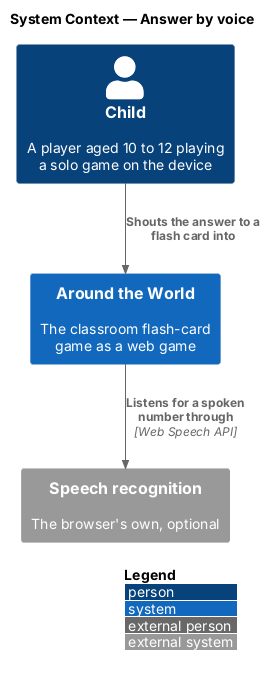
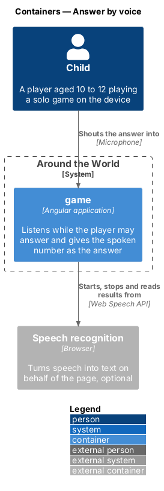
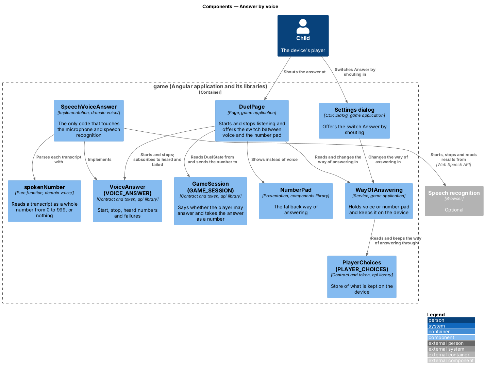
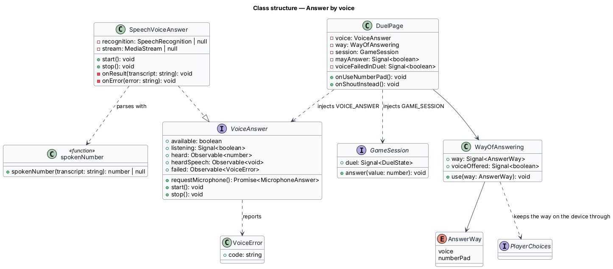
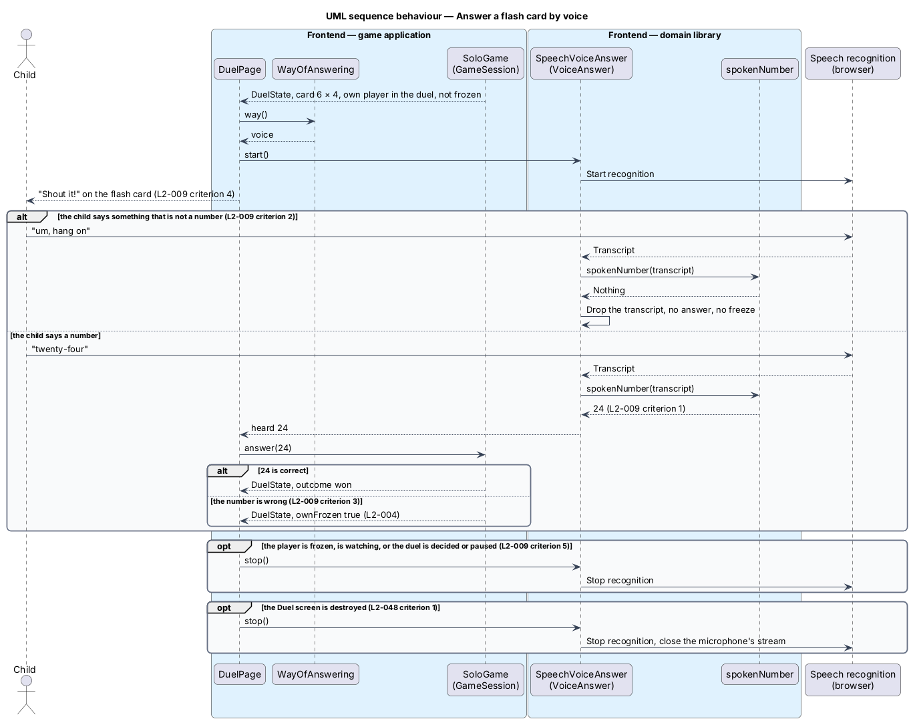
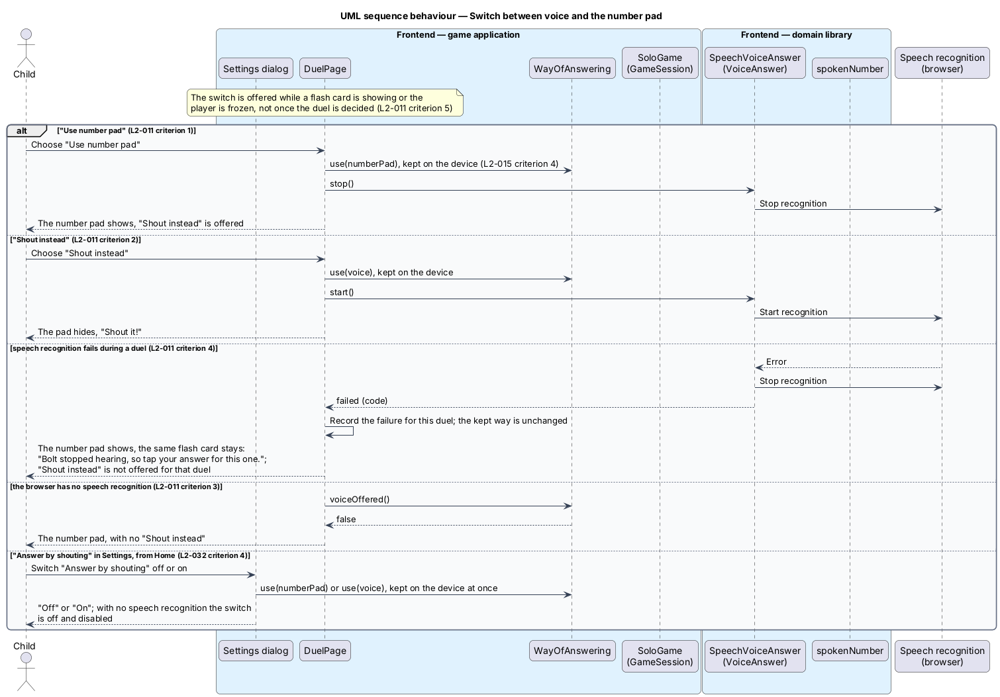

# Answer by voice

## Overview

Around the World is the classroom flash-card game as a web game for children aged 10 to 12. In
the classroom game the answer is shouted, and so it is here: the child shouts the answer to a
flash card into the device. This feature covers how a spoken number becomes an answer, when the
device listens, and how the child moves between voice and the number pad.

**way of answering** — how a player gives answers: by voice or with the number pad

**speech recognition** — browser's own service that turns speech into text; it is optional

**spoken number** — whole number from 0 to 999 read from what speech recognition heard

**number pad** — on-screen digits with Delete and Go; the fallback way of answering

When voice is the way of answering, the Duel screen listens while the player may answer and
shows "Shout it!". A spoken number is given as the answer. Anything that is not a number is
ignored and costs nothing. Speech recognition does not run while the player is watching a duel,
is frozen, or is not on the Duel screen.

While a flash card is showing or the player is frozen, the child may choose "Use number pad",
or "Shout instead" when the microphone works. Where the browser has no speech recognition, or it
fails during a duel, the number pad takes over without losing the flash card. The way of
answering is kept on the device, and the switch "Answer by shouting" in Settings changes it
too.

The slice sits in the `answering` subsystem beside `answering/answer-with-number-pad` and
`answering/check-mic`. What an answer does to a duel is designed in `tour/play-duel`.

## Description

The slice is not built yet; the parts below are those the design introduces. The slice is played
wholly on the device: it has no backend part, and its diagrams show frontend libraries and the
browser's speech recognition only. An answer reaches the `GameSession` contract as a number; in a
game with friends the server applies the same rules to that number
(`rooms/decide-game-on-server`). No audio and no transcript leaves the device (`L2-040`
criterion 2).

- **`VoiceAnswer`** — contract in the `api` library, bound to the `VOICE_ANSWER` token at the
  game route. It exposes `available` (whether the browser has speech recognition), `listening`,
  `requestMicrophone()` and `heardSpeech` (both used by `answering/check-mic`),
  `start()`, `stop()`, `heard` (a stream of whole numbers) and `failed` (a stream of `VoiceError`
  values, each with a `code`). The contract carries numbers only; no transcript crosses it.
- **`SpeechVoiceAnswer`** — implementation in `domain`'s `voice/`, imported dynamically so that
  it stays out of the initial bundle. No code outside `voice/` touches the microphone or speech
  recognition. `start()` begins recognition, and each transcript goes to `spokenNumber`. A
  transcript that gives a number is emitted on `heard`; any other transcript is dropped
  (`L2-009` criterion 2). An error from the browser stops recognition and is emitted on
  `failed`. `stop()` ends recognition and closes the microphone's stream.
- **`spokenNumber`** — pure function in `domain`'s `voice/`. It reads a transcript as a whole
  number from 0 to 999 and returns nothing for any other input. "twenty-four" gives 24 (`L2-009`
  criterion 1). It has a unit test with one case for each row of its table of spoken forms.
- **`WayOfAnswering`** — service in the `game` application, provided in `root` because
  Settings, Mic Check, Duel and a later game share it. It holds the way of answering, an
  `AnswerWay` (`voice` or `numberPad`), as a signal, and `voiceOffered`, which is true when
  `VoiceAnswer.available` is true and the microphone was not refused. `use(way)` changes the
  way. The way is kept on the device with the kid, the nickname, the setup and the sound
  setting (`L2-015` criterion 4): `WayOfAnswering` reads it from, and writes it through, the
  `PlayerChoices` store (`player/pick-kid`), and holds no storage of its own. Where
  `VoiceAnswer.available` is false the way is `numberPad`.
- **`DuelPage`** — page in `game`. It computes `mayAnswer` from `DuelState`: the device's player
  is in the duel, is not frozen, and the duel is open and not paused. One effect calls
  `VoiceAnswer.start()` while the way is `voice` and `mayAnswer` is true, and `stop()` otherwise
  (`L2-009` criterion 5). While listening the flash card shows "Shout it!" with a meter
  (`L2-009` criterion 4), and the live region adds "Shout it!" to the line for a new card. It
  forwards each number from `heard` to `GameSession.answer`.
- **`NumberPad`** — presentation component in `components`, shown when the way is `numberPad`
  (`answering/answer-with-number-pad`).

A spoken wrong number is an answer like any other: `GameSession.answer` receives it and the
player is frozen for 1 second (`L2-009` criterion 3, `L2-004`). Because the freeze makes
`mayAnswer` false, recognition stops for that second and starts again after it.

Switching on Duel. The switch is a quiet pill at the bottom of the Duel screen. It reads "Use
number pad" while voice is the way of answering and "Shout instead" while the number pad is. It
is offered while a flash card is showing or the device's player is frozen. It is not offered
once the duel is decided, while the passport stamp shows, or while the player is watching
(`L2-011` criterion 5).

- "Use number pad" calls `WayOfAnswering.use(numberPad)`; the effect stops recognition and the
  number pad shows (`L2-011` criterion 1).
- "Shout instead" calls `WayOfAnswering.use(voice)`; the pad hides and recognition starts
  (`L2-011` criterion 2). The choice is offered only while `voiceOffered` is true.
- Where the browser has no speech recognition, `voiceOffered` is false, the number pad is the
  way of answering and "Shout instead" is not offered (`L2-011` criterion 3).
- When `failed` emits during a duel, `DuelPage` records the failure for that duel in a signal
  of its own and does not call `use`. The `DuelState` is untouched, so the same flash card
  stays. The number pad shows for that duel, the Duel screen says "Bolt stopped hearing, so tap
  your answer for this one." as a status, and "Shout instead" is not offered for that duel
  (`L2-011` criterion 4).

Switching in Settings. The Settings dialog, opened from Home, has the switch "Answer by
shouting" beside "Sound", each showing "On" or "Off" (`L2-032` criterion 4). Turning it off
calls `WayOfAnswering.use(numberPad)` and turning it on calls `use(voice)`; the way is kept on
the device the moment it is changed. Its help text reads "Off means you tap answers on the
number pad." In a browser with no speech recognition the switch is off and disabled, and the
help text reads "This browser can't listen, so you tap answers." Under the button "Done" the
dialog says "Kept on this device only. No account, ever." Home and the dialog's place on it
are designed in `player/find-way-through-screens`, and the "Sound" switch in
`classroom/play-motion-and-sound`. Whether Settings stays, or the settings button goes, is to
confirm (`L2-032` criterion 1).

`DuelPage` unsubscribes from `heard` and `failed` and calls `stop()` when it is destroyed, so
speech recognition has stopped and the microphone's stream is closed when the child leaves Duel
(`L2-048` criterion 1).

Open points:

- The language or languages speech recognition listens in: `<TO SUPPLY>`.
- The spoken forms `spokenNumber` accepts beyond number words and digits from 0 to 999, and
  whether a number inside other words ("um, twenty-four") is an answer: `<TO SUPPLY>`.
- Whether an interim result gives an answer, or only a final one: `<TO SUPPLY>`.
- Whether, after speech recognition fails during a duel, "Shout instead" is offered again in
  later duels, and which way of answering the next duel starts with: `<TO SUPPLY>`. `L2-011`
  criterion 4 and the mock speak of that duel only.
- Whether "Shout instead" may ask for the microphone again after a refusal: `<TO SUPPLY>`.
  Mic Check itself offers no second request (`L2-012` criterion 7).
- What "Answer by shouting" switched off does to Mic Check on a later visit: `<TO SUPPLY>`
  (`answering/check-mic`).
- Whether speech recognition runs on the device: `<TO SUPPLY>`.
- How a sound the game plays is kept from giving an answer (`L2-039` criterion 4):
  `<TO SUPPLY>`.
- How the level of the child's voice reaches the meter shown beside "Shout it!":
  `<TO SUPPLY>`. The mocks fix that the meter moves with the child's voice and holds still
  under reduced motion; the `VoiceAnswer` contract carries numbers only.

The screen follows the mocks `docs/mocks/pages/duel/` (states `default`, `wrong`, `no-speech`
and `voice-failed`, with `pad`, `pad-typed` and `wrong-pad` for the switch) and
`docs/mocks/dialogs/settings/` (states `default`, `muted` and `no-speech`).

## Requirements

The feature realizes the following level-2 (L2) requirements. Each L2 requirement refines a
level-1 (L1) requirement, cited by identifier.

| L2 ID | Refines (L1) | Requirement |
|-------|--------------|-------------|
| `L2-009` | `L1-003` | With voice as the way of answering, a spoken number shall be given as the answer, something that is not a number shall give no answer and shall not freeze the player, a wrong number shall freeze the player, the Duel screen shall show that the microphone is listening ("Shout it!"), and speech recognition shall not run while the player is watching a duel, frozen, or not on the Duel screen. |
| `L2-011` | `L1-003` | "Use number pad" shall show the number pad and stop speech recognition; "Shout instead" shall hide the pad and start speech recognition when the microphone works; where the browser has no speech recognition the number pad shall be the way of answering and "Shout instead" shall not be offered; when speech recognition fails during a duel the number pad shall show for that duel without losing the flash card, the Duel screen shall say so ("Bolt stopped hearing, so tap your answer for this one.") and "Shout instead" shall not be offered for that duel; the switch ("Use number pad" or "Shout instead") shall otherwise be offered while a flash card is showing or the player is frozen, and not once the duel is decided or while the player is watching. |

## Diagrams

### System context

A child shouts the answer into Around the World, which listens through the browser's speech
recognition. Speech recognition is optional; the game plays without it.

### Containers

The `game` application starts and stops the browser's speech recognition and reads its results.
The diagram shows no backend container, because nothing the child says leaves the device.

### Components

`DuelPage` depends on the `VoiceAnswer` contract, on `WayOfAnswering` and on `GameSession`.
`SpeechVoiceAnswer` implements the contract, parses each transcript with `spokenNumber` and is
the only component that reaches speech recognition. `WayOfAnswering` keeps the way of answering
through `PlayerChoices`, and the Settings dialog changes it.

### Class structure

`SpeechVoiceAnswer` realizes `VoiceAnswer` and depends on `spokenNumber`. `DuelPage` injects
`VOICE_ANSWER` and `GAME_SESSION` and holds `WayOfAnswering`, whose value is an `AnswerWay` kept
through `PlayerChoices`.

### Behaviour — answer a flash card by voice

`DuelPage` starts listening when the player may answer. A transcript that is not a number is
dropped inside `SpeechVoiceAnswer`; a number reaches `GameSession.answer`. Listening stops when
the player may no longer answer and when the Duel screen is destroyed (`L2-009`).

### Behaviour — switch between voice and the number pad

The child's choice on Duel or in Settings sets the way of answering in `WayOfAnswering`, which
keeps it on the device; `DuelPage` starts or stops listening to match, and the flash card stays
(`L2-011`). A failure of speech recognition shows the number pad for that duel only and leaves
the kept way as it was. The switch on Duel is offered only while a flash card is showing or the
player is frozen.

