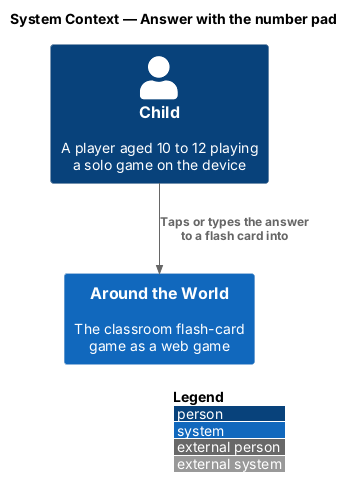
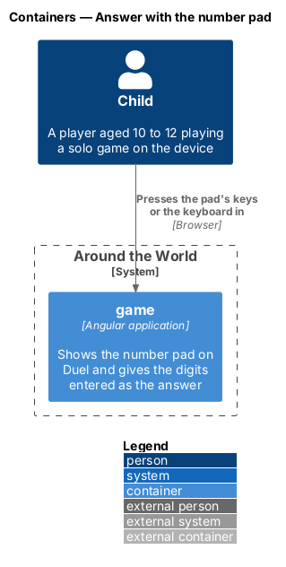
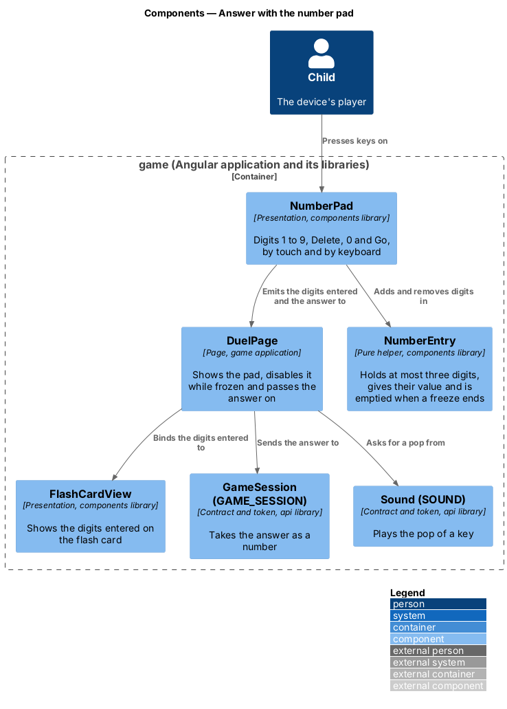
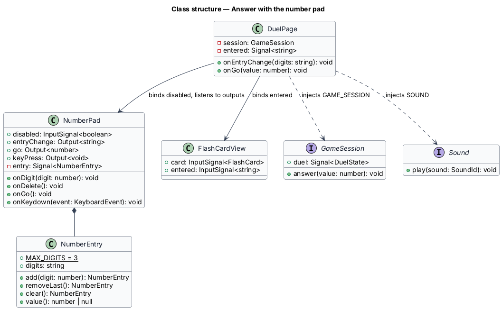
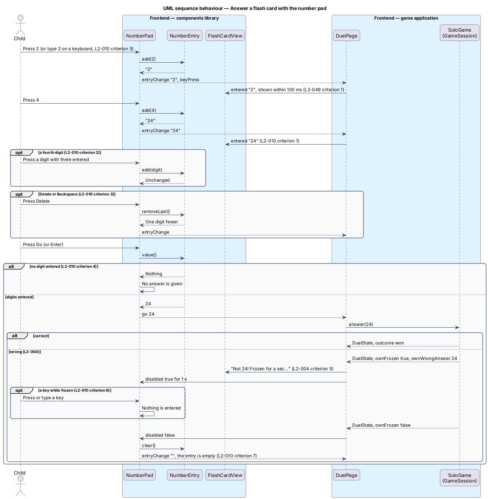

# Answer with the number pad

## Overview

Around the World is the classroom flash-card game as a web game for children aged 10 to 12. The
child normally shouts the answer to a flash card. The number pad is the fallback, used when the
browser has no speech recognition, the microphone is refused, or the child prefers to tap. This
feature covers giving an answer with the number pad or a keyboard.

**number pad** — on-screen keys for the digits 1 to 9, then "Delete", 0 and "Go"

**entry** — digits pressed so far for the current flash card, three at most

**answer box** — place on the flash card where the entry shows

**Go** — key that gives the entry as the answer

**freeze** — one second after a wrong answer during which the player cannot answer

The child presses digits, which show on the flash card as they are pressed, and then Go. An
answer is a whole number from 0 to 999, so the entry takes three digits and ignores a fourth.
Delete removes the last digit. A keyboard does the same: digits, Backspace and Enter. While the
player is frozen, no key enters anything, and the entry is empty when the freeze ends.

The slice sits in the `answering` subsystem beside `answering/answer-by-voice`, which owns the
switch between the two ways of answering. What an answer does to a duel is designed in
`tour/play-duel`.

## Description

The slice is not built yet; the parts below are those the design introduces. The slice is played
wholly on the device: it has no backend part, and its diagrams show frontend libraries only. An
answer reaches the `GameSession` contract as a number; in a game with friends the server applies
the same rules to that number (`rooms/decide-game-on-server`).

- **`NumberPad`** — presentation component in `components` (`atw-number-pad`). It takes one
  input, `disabled`, and emits three outputs: `entryChange` (the digits entered, as text), `go`
  (the answer, as a number) and `keyPress`. It injects no service, token or router. Each key is
  a `<button>` of at least 44 × 44 px. The Delete key shows an icon and its accessible name is
  "Delete"; the Go key's accessible name is "Go", as it reads. A host listener on the document's
  `keydown` event maps the digit keys, Backspace and Enter to the pad's digits, Delete and Go
  (`L2-010` criterion 5); Angular removes the listener when the component is destroyed.
- **`NumberEntry`** — pure helper in `components`, with its own unit tests. It holds the digits
  entered. `add(digit)` appends a digit and ignores it when three are held (`L2-010`
  criterion 2). `removeLast()` removes the last digit (`L2-010` criterion 3). `value()` gives
  the whole number entered, or nothing when no digit is held.
- **`FlashCardView`** — presentation component in `components`. Its `entered` input shows the
  digits in the answer box on the flash card as they are pressed (`L2-010` criterion 1); "?"
  stands in while no digit is entered. The answer box's accessible name is "Your answer:
  {digits}".
- **`DuelPage`** — page in the `game` application. It shows `NumberPad` when the way of answering
  is the number pad, the device's player is in the duel and the duel is not decided. That
  includes a browser with no speech recognition and a duel in which speech recognition failed
  (`answering/answer-by-voice`). The pad is hidden once the duel is decided and while the player
  is watching. It binds `disabled` to the frozen
  state of `DuelState`, keeps the digits from `entryChange` in a signal bound to
  `FlashCardView`, and forwards `go` to `GameSession.answer`. On `keyPress` it asks the `SOUND`
  token for the pop of a key (`L2-039` criterion 1); sound is designed outside this subsystem.
- **`GameSession`** — contract in `api` behind the `GAME_SESSION` token. `answer(value)` takes
  the number.

Go with no digit entered gives no answer: `NumberEntry.value()` returns nothing and `NumberPad`
emits no `go` (`L2-010` criterion 4). An empty Go is therefore never a wrong answer and never
freezes the player.

While `disabled` is true the pad's buttons carry the `disabled` attribute, are greyed through
it, and neither a press nor a keyboard key changes the entry (`L2-010` criterion 6). The digits
of the wrong answer stay in the answer box for the freeze. The pad does not shake; the flash
card does (`L2-004` criterion 5). The freeze
itself is decided by `Duel` (`tour/play-duel`), which also ignores any answer that arrives while
the player is frozen; the pad's disabled state is a convenience on top of that rule.

A digit shows within 100 ms of its key (`L2-049` criterion 1): the entry is a signal inside the
presentation layer, and no digit passes through the game session.

After a wrong answer the flash card names the answer given for the 1 second of the freeze
("Not {answer}! Frozen for a sec…", `L2-004` criterion 5); that number comes from `DuelState`,
not from the entry. `NumberPad` empties its entry and emits an empty `entryChange` when
`disabled` returns to false, so the entry is empty when the freeze ends (`L2-010` criterion 7).
The entry is also cleared when a new flash card appears.

Below 768 px the pad sits under the flash card; from 768 px up it sits beside the card
(`L2-050` criterion 2). Where the window is under 672 px tall the answer box and the keys
shrink, and a key is never smaller than 44 × 44 px, so the flash card and the pad are both
whole on a phone turned on its side (`L2-050` criterion 5).

Open points:

- Whether the keyboard acts while the focus is on a control other than the pad, such as Pause:
  `<TO SUPPLY>`.

The number pad follows the mocks `docs/mocks/pages/duel/` (states `pad`, `pad-typed`,
`wrong-pad`, `no-speech`, `voice-failed` and `long`).

## Requirements

The feature realizes the following level-2 (L2) requirement. It refines a level-1 (L1)
requirement, cited by identifier.

| L2 ID | Refines (L1) | Requirement |
|-------|--------------|-------------|
| `L2-010` | `L1-003` | With the number pad as the way of answering, pressing digits and Go shall give the answer, and the digits pressed shall show on the flash card as they are pressed; a fourth digit shall be ignored once three have been entered, Delete shall remove the last digit, Go with no digit shall give no answer, the keyboard's digits, Backspace and Enter shall act as the pad's digits, Delete and Go, nothing shall be entered while the player is frozen, and the entry shall be empty when the freeze after a wrong answer ends. |

## Diagrams

### System context

A child taps or types the answer to a flash card into Around the World. No other system takes
part.

### Containers

The `game` application shows the number pad on Duel and gives the digits entered as the answer.
The diagram shows no backend container, because the slice is played wholly on the device.

### Components

`NumberPad` keeps its digits in `NumberEntry` and emits to `DuelPage`. `DuelPage` binds the
digits to `FlashCardView`, sends the answer to `GameSession` and asks `Sound` for the pop of a
key.

### Class structure

`NumberPad` owns a `NumberEntry`, whose `MAX_DIGITS` is 3. `DuelPage` binds `NumberPad` and
`FlashCardView` and injects `GAME_SESSION` and `SOUND`.

### Behaviour — answer a flash card with the number pad

Each digit is added to `NumberEntry` and shown on the flash card. Go gives the value to
`GameSession.answer` when a digit is entered and gives no answer when none is. After a wrong
answer the pad is disabled for the 1 second of the freeze, and the entry is empty when the
freeze ends (`L2-010`).

