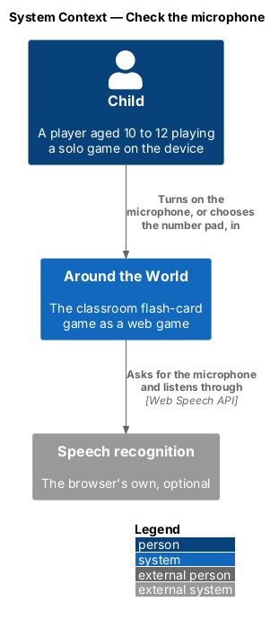
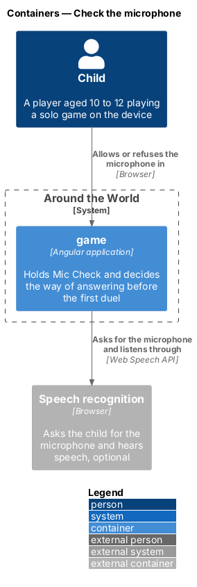
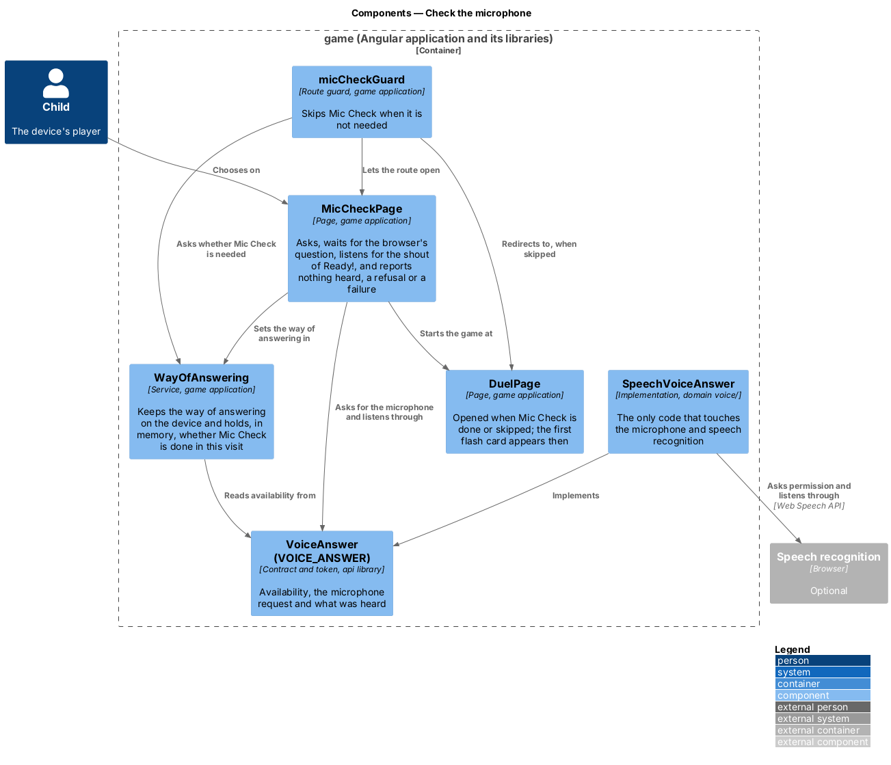
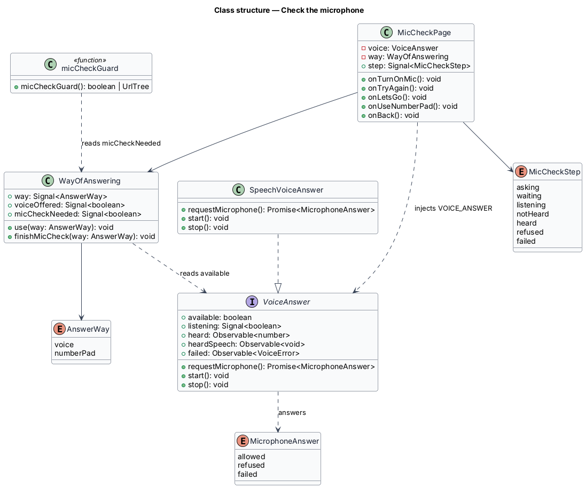
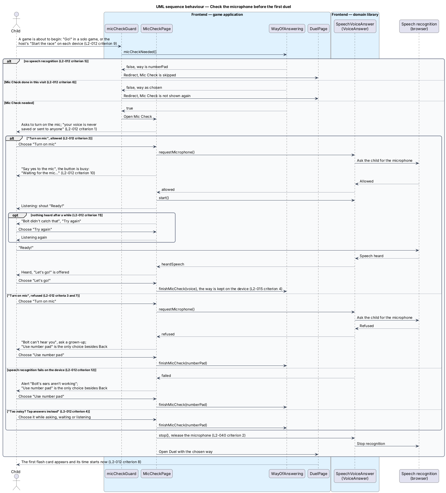

# Check the microphone

## Overview

Around the World is the classroom flash-card game as a web game for children aged 10 to 12. The
child shouts the answer to each flash card, so the game asks for the microphone once before the
first duel. This feature covers that step: the Mic Check screen.

**Mic Check** — screen shown before the first duel of a visit that asks for the microphone and
settles the way of answering

**way of answering** — how a player gives answers: by voice or with the number pad

**speech recognition** — browser's own service that turns speech into text; it is optional

**visit** — time from opening the game in the browser to closing or reloading it

Mic Check asks the child to turn on the microphone and says that their voice is never saved or
sent to anyone. When the child allows the microphone and shouts "Ready!", Mic Check shows that
it heard them, and the game starts with voice. When the child refuses, or finds the room too
noisy, the game starts with the number pad. Where the browser has no speech recognition, Mic
Check is skipped. Mic Check is shown once in a visit. The way of answering it settles is kept
on the device.

The slice sits in the `answering` subsystem. The way of answering it settles is used by
`answering/answer-by-voice` and `answering/answer-with-number-pad`.

## Description

The slice is not built yet; the parts below are those the design introduces. The slice is played
wholly on the device: it has no backend part, and its diagrams show frontend libraries and the
browser's speech recognition only. Mic Check comes before a solo game and before a game with
friends alike. In a solo game it follows "Go!" on Game Setup. In a game with friends it follows
the host's "Start the race": each player who needs Mic Check is shown it on their own device
before Duel (`L2-012` criterion 9). Once the game starts, in a game with friends the server
applies the same rules to each answer (`rooms/decide-game-on-server`).

- **`micCheckGuard`** — route guard function in the `game` application, on the Mic Check route.
  It reads `WayOfAnswering.micCheckNeeded`. When Mic Check is not needed it redirects to Duel,
  so the screen is never created (`L2-012` criteria 5 and 6).
- **`MicCheckPage`** — page in `game`. It holds one signal, `step`, with the values `asking`,
  `waiting`, `listening`, `notHeard`, `heard`, `refused` and `failed`.
  - `asking` — "You answer by shouting!" and "Bolt listens for your answer. Your voice is never
    saved or sent to anyone." (`L2-012` criterion 1). "Turn on mic" calls
    `VoiceAnswer.requestMicrophone()`.
  - `waiting` — entered while the browser's own question about the microphone is open. The page
    shows "Say yes to the mic" and "Your browser is asking if Bolt can listen. Choose "Allow"."
    The button is busy and reads "Waiting for the mic…" (`L2-012` criterion 10).
  - `listening` — entered when the microphone is allowed. The page calls `VoiceAnswer.start()`
    and shows "Shout "Ready!"" and "As loud as you like. Bolt is listening." with rings round
    the picture and a level meter, both of which move with the child's voice. Under reduced
    motion the rings are not shown and the meter holds still.
  - `notHeard` — entered when nothing has been heard after a while. The page shows "Bolt didn't
    catch that" and "Try once more, a bit louder and closer to the screen." It offers "Try
    again", which returns to `listening` (`L2-012` criterion 11).
  - `heard` — entered when `VoiceAnswer.heardSpeech` emits. The page shows "Bolt heard you!",
    "Your mic works. When a card flips, shout the answer." and the word heard, "Ready!". It
    offers "Let's go!", which starts the game with voice (`L2-012` criterion 2).
  - `refused` — entered when the microphone is refused. The page shows, as an alert, "Bolt
    can't hear you" and "The mic is turned off. Ask a grown-up to allow it in the browser, or
    play with the number pad." "Use number pad" is the only choice besides Back, and it starts
    the game with the pad (`L2-012` criteria 3 and 7). The page offers no second request for
    the microphone.
  - `failed` — entered when speech recognition fails on the device: `requestMicrophone()`
    answers `failed`, or `VoiceAnswer.failed` emits. The page shows, as an alert, "Bolt's ears
    aren't working" and "Listening stopped working on this device. You can still play by tapping
    your answers." "Use number pad" is the only choice besides Back (`L2-012` criterion 12).

  In `asking`, `waiting`, `listening` and `notHeard` the page also offers "Too noisy? Tap
  answers instead", which starts the game with the number pad (`L2-012` criteria 4, 10 and 11).
- **`WayOfAnswering`** — service in `game`, provided in `root` because Settings, Mic Check, Duel
  and a later game share it (`answering/answer-by-voice`). `micCheckNeeded` is true when
  `VoiceAnswer.available` is true and Mic Check has not finished in this visit.
  `finishMicCheck(way)` sets the way of answering and records that Mic Check is done for the
  visit. The way of answering is kept on the device (`L2-015` criterion 4); that Mic Check is
  done is held in memory only. When `VoiceAnswer.available` is false the way is `numberPad`.
- **`VoiceAnswer`** — contract in `api` behind the `VOICE_ANSWER` token. This slice uses
  `available`, `requestMicrophone()` (which answers `allowed`, `refused` or `failed`),
  `start()`, `stop()`, `heardSpeech` and `failed`.
- **`SpeechVoiceAnswer`** — implementation in `domain`'s `voice/`, the only code that touches
  the microphone and speech recognition. It is imported dynamically.

"Passed in this visit" is held in memory by `WayOfAnswering` and nowhere else, so a reload or a
new visit shows Mic Check again and a second game in the same visit does not (`L2-012`
criterion 6). The slice itself writes only the way of answering to the device, through
`WayOfAnswering`.

`MicCheckPage` calls `VoiceAnswer.stop()` when the child chooses a way and when the page is
destroyed, so speech recognition has stopped and the microphone's stream is closed when Mic
Check is left (`L2-040` criterion 2, `L2-048` criterion 1). No audio is recorded, stored or
sent.

Whichever choice the child makes, the page then opens Duel (`L2-030` criterion 3). In a solo
game `SoloGame` makes the first flash card when Duel opens: the card appears, and its time
starts, when Mic Check is left and not before (`L2-012` criterion 8).

Back leads to Game Setup in a solo game and to the Lobby in a game with friends (`L2-030`
criterion 8). The mocks draw the solo case.

Mic Check is laid out as follows. Its top bar holds Back and the title "Mic check". Below
768 px the picture is above the words; from 768 px up the picture is on the left and the words
are on the right (`L2-050` criterion 6). The screen shows no classroom (`L2-036` criterion 6).
The picture is Milo and his robot Bolt in a circle with a badge: a microphone, a tick once the
child is heard, and the badge's off form once the microphone is refused or speech recognition
has failed. Each state is therefore carried by words and a mark, and not by colour alone. The
words of `asking`, `waiting`, `listening`, `notHeard` and `heard` are a status region; the
words of `refused` and `failed` are an alert.

Open points:

- What counts as hearing "Ready!": any speech, or that word: `<TO SUPPLY>`.
- How long Mic Check listens before it shows "Bolt didn't catch that": `<TO SUPPLY>`.
- What Mic Check does on a later visit when "Answer by shouting" was switched off in Settings,
  and so the kept way of answering is the number pad: `<TO SUPPLY>`. The switch's help text
  says "Off means you tap answers on the number pad."; `L2-012` criterion 6 speaks of one visit
  only.
- Whether, in a game with friends, the first flash card waits for every player's Mic Check:
  `<TO SUPPLY>`.
- Whether "Shout instead" on Duel may ask for the microphone again after a refusal:
  `<TO SUPPLY>`.
- How the level of the child's voice reaches the rings and the level meter of the `listening`
  step: `<TO SUPPLY>` (`answering/answer-by-voice`).

The screen follows the mocks `docs/mocks/pages/mic-check/` (states `default`, `loading`,
`listening`, `not-heard`, `heard`, `denied` and `error`); its `loading` state is the step
`waiting`, `denied` is `refused` and `error` is `failed`.

## Requirements

The feature realizes the following level-2 (L2) requirement. It refines a level-1 (L1)
requirement, cited by identifier.

| L2 ID | Refines (L1) | Requirement |
|-------|--------------|-------------|
| `L2-012` | `L1-003` | Mic Check shall ask a child who has not passed it to turn on the microphone and say that their voice is never saved or sent to anyone; while the browser's own question about the microphone is open it shall tell the child to choose "Allow" ("Say yes to the mic") with the button busy ("Waiting for the mic…"); it shall start the game with voice once the microphone is allowed, the child shouts "Ready!" and is heard, and chooses "Let's go!"; when nothing has been heard after a while it shall say so ("Bolt didn't catch that") and offer "Try again", which listens again; it shall start the game with the number pad when the microphone is refused or the child chooses "Too noisy? Tap answers instead", which shall be offered while Mic Check is asking, waiting or listening; after a refusal it shall offer only "Use number pad" besides Back and tell the child to ask a grown-up to allow the microphone in the browser; when speech recognition fails on the device it shall say so as an alert ("Bolt's ears aren't working") and offer only "Use number pad" besides Back; it shall be skipped where the browser has no speech recognition and shall not be shown again in the visit once passed or once the number pad is chosen; in a solo game the first flash card shall appear, and its time shall start, when Mic Check is left for Duel; in a game with friends each player who needs Mic Check shall be shown it on their own device after the host starts the game and before Duel. |

## Diagrams

### System context

A child turns on the microphone, or chooses the number pad, in Around the World. The game asks
for the microphone through the browser's speech recognition, which is optional.

### Containers

The `game` application holds Mic Check and settles the way of answering before the first duel.
The diagram shows no backend container, because nothing the child says leaves the device.

### Components

`micCheckGuard` asks `WayOfAnswering` whether Mic Check is needed and either lets the route open
or redirects to Duel. `MicCheckPage` asks for the microphone through the `VoiceAnswer` contract
and sets the way of answering, which `WayOfAnswering` keeps on the device; that Mic Check is
done is held in memory for the visit.

### Class structure

`MicCheckPage` injects `VOICE_ANSWER`, holds `WayOfAnswering` and moves through the
`MicCheckStep` values. `micCheckGuard` reads `micCheckNeeded`. `SpeechVoiceAnswer` realizes
`VoiceAnswer`.

### Behaviour — check the microphone before the first duel

The guard skips Mic Check when the browser has no speech recognition or Mic Check is done in
this visit. Otherwise the child allows the microphone and is heard, perhaps after "Try again",
refuses it, meets a failure of speech recognition, or chooses to tap answers; each branch sets
the way of answering, releases the microphone and opens Duel, where the first flash card of a
solo game then appears (`L2-012`).

