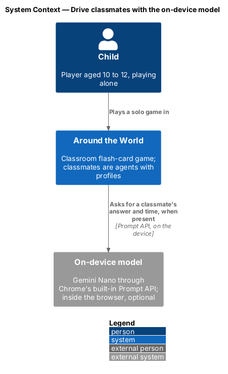
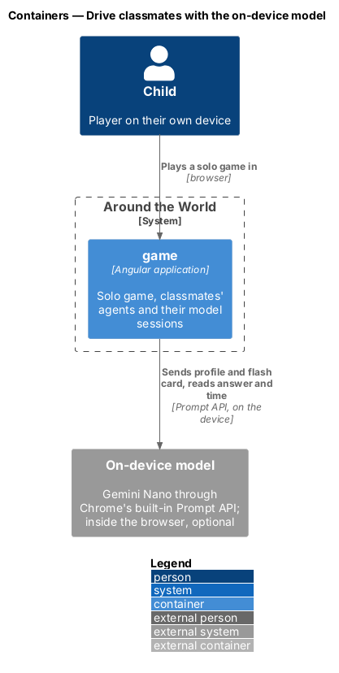
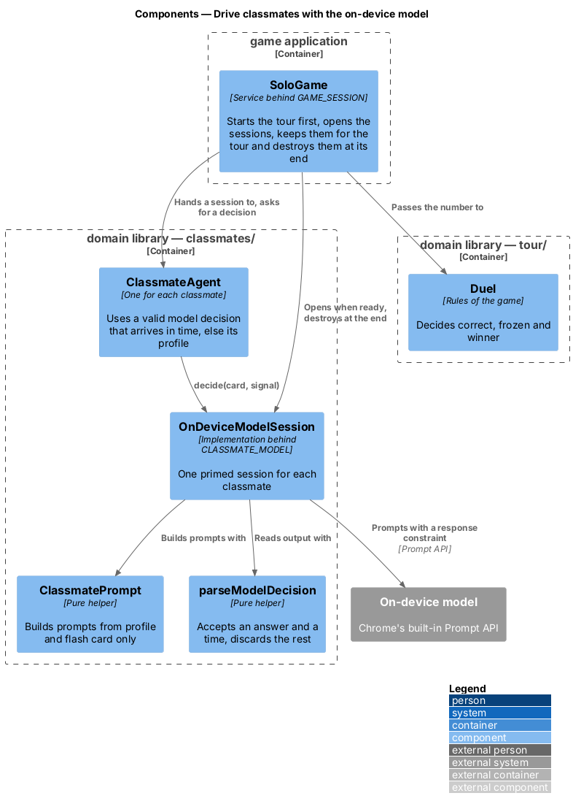
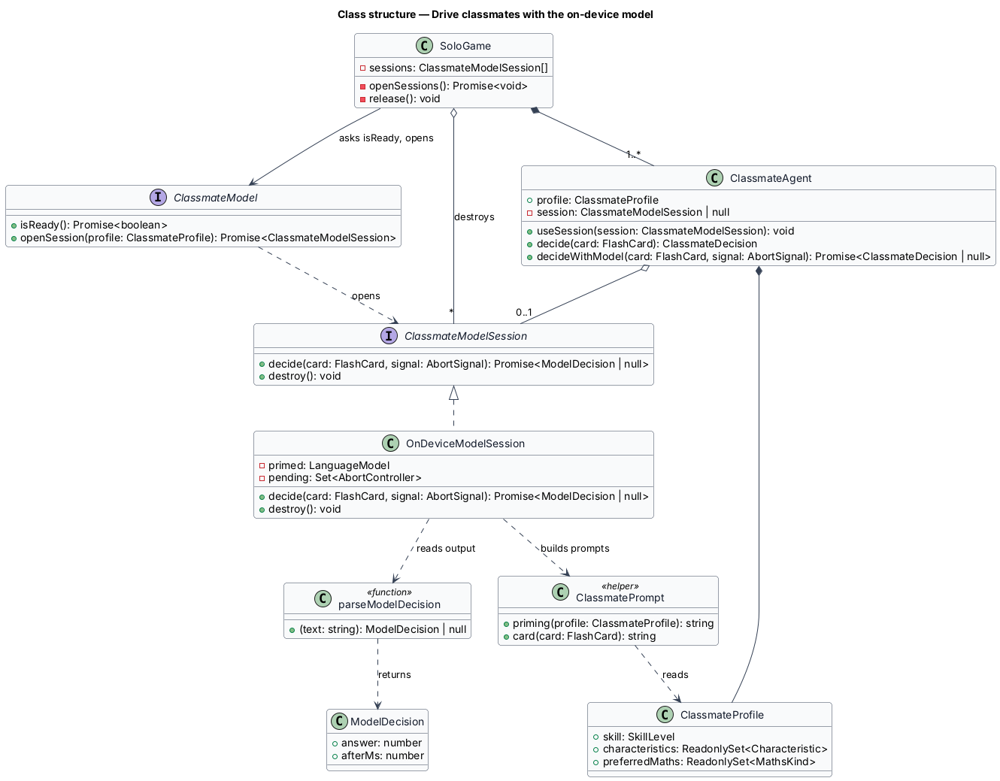
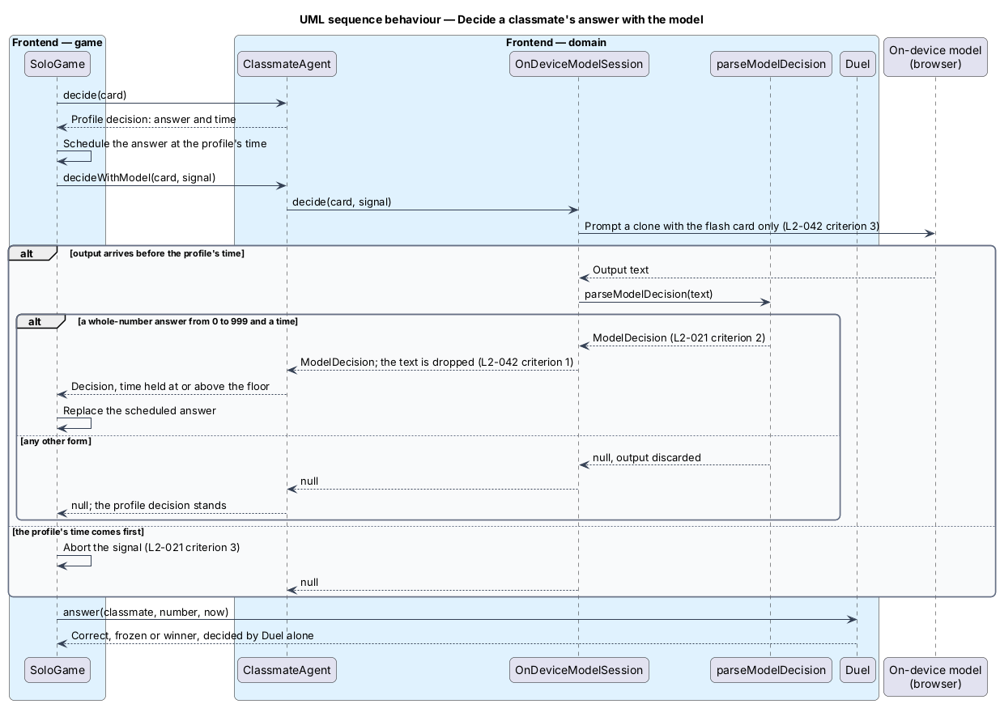
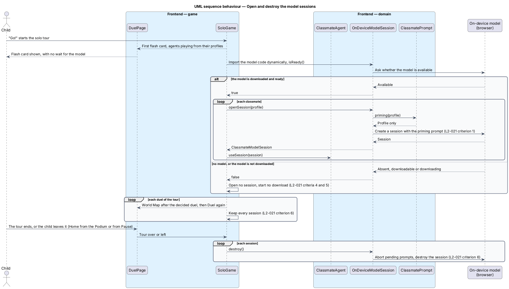

# Drive classmates with the on-device model

## Overview

Around the World is the classroom flash-card game as a web game for children aged 10 to 12. In
a solo game a child plays against classmates, each of which is an agent with a profile
(`classmates/play-solo`). Where the browser provides an on-device language model, this feature
lets that model decide each classmate's answer and the moment it comes. Where the browser
provides none, the classmates play from their profiles alone and the game is the same.

- **classmate** — child in the class who is played by the computer
- **profile** — description of one classmate: a skill level, characteristics and preferred kinds of maths
- **agent** — part of the game that answers flash cards on behalf of one classmate
- **on-device model** — language model built into the browser and run on the device (Gemini Nano through Chrome's built-in Prompt API)
- **model session** — one conversation with the on-device model, primed with one classmate's profile, that lives for one tour
- **decision** — answer that is a whole number from 0 to 999, together with a time to answer

The model has one narrow job. It decides an answer and a time, and both are read as numbers. It
never decides a rule of the duel, the flash card never waits for it, the game never waits for
it to download, and nothing it writes is shown, spoken or stored. Flash cards, profiles and
model output stay on the device.

The feature sits in the `classmates` subsystem and extends `classmates/play-solo`, which owns
the profiles, the class and the decision made from a profile.

## Description

The slice is not built yet; the components below are the ones the design introduces. The slice
runs wholly on the device and has no backend part. The on-device model runs inside the browser;
no flash card, profile or model output is sent to `AroundTheWorld.Api` or to any other origin
(`L2-021` criterion 7).

Contract in the `api` library (`@atw/api`):

- **`ClassmateModel`** (`CLASSMATE_MODEL`) — contract of the on-device model as the game sees
  it. `isReady(): Promise<boolean>` answers whether the model is present and already
  downloaded. `openSession(profile): Promise<ClassmateModelSession>` opens a session primed
  with one profile. A `ClassmateModelSession` has `decide(card, signal): Promise<ModelDecision
  | null>` and `destroy()`.
- **`ModelDecision`** — `answer` (whole number from 0 to 999) and `afterMs` (time to answer).
  It has no text field.

In the `domain` library (`@atw/domain`), folder `classmates/`; nothing outside this folder
touches the browser's on-device model:

- **`OnDeviceModelSession`** — implementation of `ClassmateModelSession` over the Prompt API.
  - *Readiness.* `isReady` returns true only when the Prompt API exists and reports the model
    as available. A model that is absent, downloadable or downloading counts as not ready, and
    the game then opens no session, because opening one starts a download (`L2-021`
    criteria 4 and 5). Whether the game ever fetches the model for a later visit, outside play,
    is `<TO SUPPLY>`.
  - *Priming.* The session is created with an initial prompt built by `ClassmatePrompt` from
    the classmate's profile (`L2-021` criterion 1).
  - *Deciding.* `decide(card, signal)` prompts a clone of the primed session with the flash
    card and a JSON Schema response constraint of two whole-number properties, `answer` and
    `afterMs`. It destroys the clone afterwards, so a session's context does not grow over a
    tour of 24 desks. The `signal` aborts a prompt whose answer is no longer wanted.
  - *Reading.* The output is parsed by `parseModelDecision`. Any failure, rejection or abort
    resolves to `null`; nothing is thrown to the agent.
  - *Destroying.* `destroy()` aborts every pending prompt and destroys the session.
- **`parseModelDecision(text)`** — pure helper. It returns a `ModelDecision` only when the
  text is JSON holding exactly a whole-number `answer` from 0 to 999 and a whole-number
  `afterMs` above 0. Everything else returns `null` and is discarded (`L2-021` criterion 2).
  The text itself is not kept, logged or passed on (`L2-042` criterion 1). The unit of the
  time and its upper bound are `<TO SUPPLY>`.
- **`ClassmatePrompt`** — pure helper that builds the two texts given to the model. The
  priming text holds the classmate's profile only: skill level, characteristics and preferred
  kinds of maths. The card text holds the flash card only. Neither holds the child's nickname,
  the child's voice, anything the child said, or the child's answers (`L2-042` criterion 3).
  The wording of both texts is `<TO SUPPLY>`.
- **`ClassmateAgent`** — designed in `classmates/play-solo`; this slice adds the model to it.
  For each flash card the agent first makes its decision from the profile, which fixes the
  time at which the classmate would answer. When it holds a session, it also asks the session
  to decide.
  - A valid `ModelDecision` that arrives before the profile's time replaces the profile's
    decision. The classmate then answers the model's `answer` at the model's `afterMs`, or at
    once when that time has already passed.
  - When the profile's time comes with no valid model decision, the classmate answers from its
    profile and `SoloGame` aborts the prompt (`L2-021` criterion 3).
  - The floor of 800 ms **(to confirm)** and the rule that keeps a classmate from winning
    every duel (`L2-020` criterion 5) apply to a model decision exactly as to a profile
    decision.
  - Whether the answer is correct, the freeze and the winner of the duel are decided by
    `Duel` (`tour/play-duel`) from the number the agent passes on, never by the model.

In the `game` application:

- **`SoloGame`** — starts the tour without waiting for the model. After the first flash card
  is showing, it asks `CLASSMATE_MODEL.isReady()`. When the model is ready it opens one session
  for each classmate and hands each to that classmate's agent (`L2-021` criterion 1); until a
  session arrives, and whenever none does, the agent plays from its profile. Nothing on any
  screen says whether the model is in use (`L2-021` criterion 4). The sessions live for the
  tour, not for the Duel screen: `SoloGame` keeps them while World Map is shown between the
  duels of one tour. When the tour ends, or the child leaves it for Home from the Podium or
  from Pause, `SoloGame` calls `destroy()` on every session (`L2-021` criterion 6). A new
  tour started with "Play again" on the Podium opens its sessions the same way, after its
  first flash card is showing.
- **Loading.** `OnDeviceModelSession`, `ClassmatePrompt` and `parseModelDecision` are imported
  dynamically by `SoloGame` and are in none of the initial chunks (`L2-047` criterion 2). The
  solo game route binds `CLASSMATE_MODEL`.

Desk 1 of a tour is the traveller's own empty desk, so a tour of 24 desks has 23 classmates
and so 23 sessions (`L2-007` criterion 4). Whether a low-power device holds 23 sessions at
once, and whether a limit on sessions applies, is `<TO SUPPLY>`.

A classmate's reaction in a duel is one of the kid's fixed animations or one of the six
stickers (`L2-042` criterion 2). The reaction is chosen from the outcome of the duel and never
from model output. Whether classmates send stickers in a solo game is `<TO SUPPLY>`.

In end-to-end tests a fixture binds a fake `ClassmateModel` that answers as the spec tells it
to, and every feature also runs with the model reported as not ready.

This slice adds nothing a child can see, so no mock draws it. A solo game is played on the
screens of `docs/mocks/pages/duel/` and `docs/mocks/pages/world-map/`, and each state of both
is the same with the model and without it (`L2-021` criterion 4).

## Requirements

The feature realizes the following level-2 (L2) requirements. Each L2 requirement refines a
level-1 (L1) requirement, cited by identifier.

| L2 ID | Refines (L1) | Requirement |
|-------|--------------|-------------|
| `L2-021` | `L1-006` | Classmates driven by the browser's on-device model: where the browser provides an on-device language model, each classmate's agent shall use it to decide its answer and when to give it, from its profile and the flash card, through its own model session; a decision that is not a whole-number answer from 0 to 999 and a time to answer shall be discarded; the flash card shall never be held back for the model; where the browser has no on-device model, or the model is not downloaded, every classmate shall play from its profile alone and nothing shall tell the child that anything is missing; the game shall never start or wait for a download; every model session shall be destroyed when the solo tour ends or the child leaves it (Home from the Podium or from Pause), and shall be kept while World Map is shown between the duels of one tour; no flash card, profile or model output shall leave the device; the rules of the duel shall never be decided by the model. |
| `L2-042` | `L1-012` | Nothing a language model writes is shown to a child: only a whole-number answer and a time to answer shall be taken from the model's output, and no text from it shall be shown, spoken or stored; a classmate's reaction shall be one of the kid's fixed animations or one of the six stickers; the model's prompt shall hold only the classmate's profile and the flash card, and never the child's nickname, voice or anything they said. |

## Diagrams

### System context

A child plays a solo game in Around the World. The on-device model is part of the child's
browser, is optional, and receives only a classmate's profile and a flash card.

### Containers

The `game` application prompts the on-device model inside the same browser. The diagram shows
no backend container, because the slice makes no request to `AroundTheWorld.Api`.

### Components

`SoloGame` opens one `OnDeviceModelSession` for each classmate and hands it to that
classmate's `ClassmateAgent`. `ClassmatePrompt` builds what goes in, and `parseModelDecision`
is the only way anything comes out.

### Class structure

`OnDeviceModelSession` realizes `ClassmateModelSession` and depends on `ClassmatePrompt` and
`parseModelDecision`. `ClassmateAgent` holds at most one session and returns numbers only.

### Behaviour — decide a classmate's answer with the model

The agent fixes the profile's decision first, then asks the model. A valid decision that
arrives in time is used; anything else is discarded and the classmate answers from its profile
at the profile's time, so the flash card never waits.

### Behaviour — open and destroy the model sessions

The tour starts before the model is asked about. Sessions are opened only when the model is
already downloaded. They are kept while World Map is shown between duels, and every session is
destroyed when the tour ends or the child leaves it.

