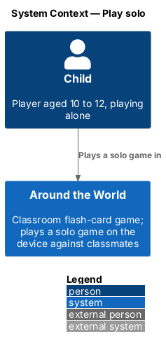
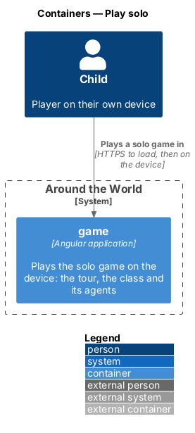
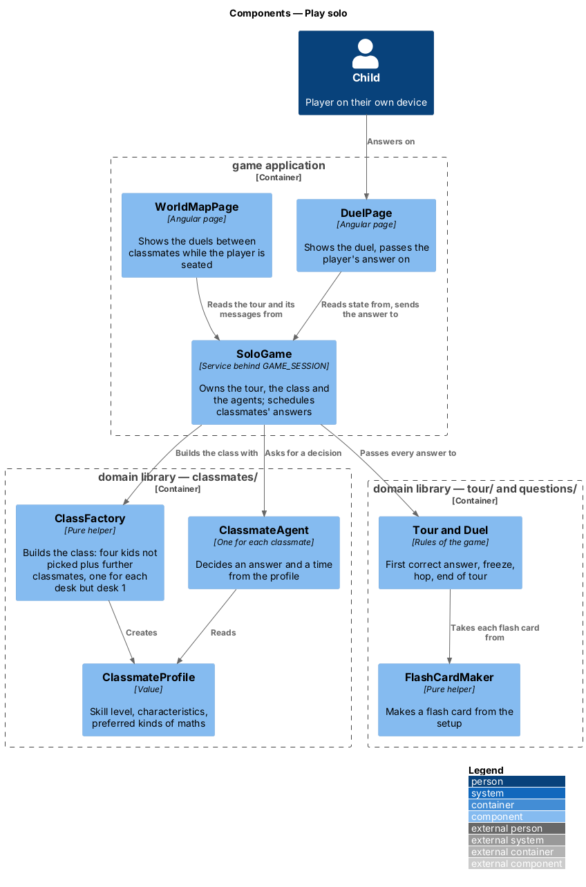
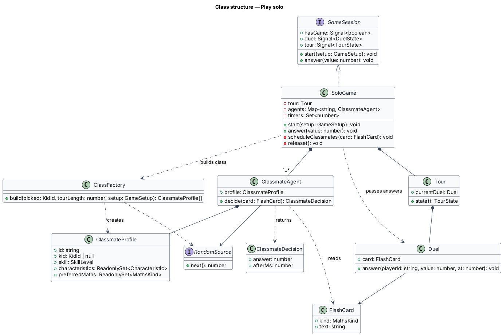
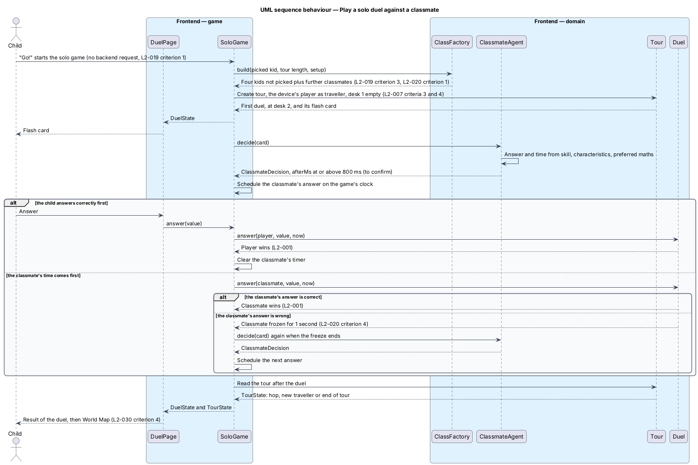
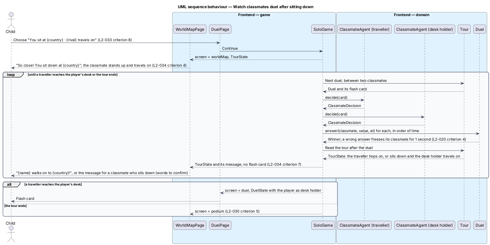

# Play solo

## Overview

Around the World is the classroom flash-card game as a web game for children aged 10 to 12. The
classroom is a ring of desks, and a tour is one game played round it. A child who chooses
"Play solo" plays a tour on the device against classmates, with no backend involved. This
feature builds that class and makes each classmate answer.

- **solo game** — game played on the device by one player against classmates
- **classmate** — child in the class who is played by the computer
- **profile** — description of one classmate: a skill level, characteristics and preferred kinds of maths
- **agent** — part of the game that answers flash cards on behalf of one classmate, from its profile
- **traveller** — player moving round the ring; **desk holder** — player seated at a desk
- **duel** — contest between the traveller and a desk holder over one flash card
- **freeze** — one second after a wrong answer during which a player's answers are ignored
- **further classmate** — classmate who is not one of the five kids

The class is diverse: its profiles differ, so one classmate is fast and careless, another slow
and accurate, and each is better at the kinds of maths it prefers. A classmate plays under
exactly the rules a player does. It answers through the same duel, is frozen by the same wrong
answer, and never answers sooner than a child could.

The feature sits in the `classmates` subsystem. The rules of the duel and of the tour belong
to `tour/play-duel`, `tour/travel-round-ring` and `tour/end-tour`, and flash cards to
`tour/make-flash-card`. `classmates/drive-classmates-with-model` adds the browser's on-device
model to the agents designed here; without it, the game described in this document is complete.

## Description

The slice is not built yet; the components below are the ones the design introduces. The slice
runs wholly on the device: it has no backend part, makes no request to `AroundTheWorld.Api`
(`L2-019` criterion 1) and never loads the SignalR client (`L2-047` criterion 3). A solo game
that has started depends on nothing from the network, so duels, hops and the Podium work when
the device loses its network (`L2-019` criterion 2).

The child starts a solo game on Solo Or Friends. Its card "Just me" reads "Race the class. Your
classmates are played by the computer." and its button "Play solo" opens Game Setup (`L2-030`
criterion 2). "Play solo" works with no network; Solo Or Friends then reads "You're offline.
You can still play solo." (`L2-022` criterion 6, `L2-054` criterion 3). `rooms/make-room`
designs that screen.

In the `game` application:

- **`SoloGame`** — implementation of the `GameSession` contract, provided at the solo game
  route behind `GAME_SESSION`. It owns one `Tour`, the class and one `ClassmateAgent` for each
  classmate. On `start(setup)` it asks `ClassFactory` for the class and creates the `Tour`
  with the device's player as the traveller (`L2-007` criterion 3). Desk 1 is the player's own
  desk and stays empty, the classmates hold desks 2 to the tour length, and the first duel is
  at desk 2 (`L2-007` criterion 4). For each flash card it asks
  the agent of each classmate in the duel for a decision, schedules the answer on the game's
  clock and passes it to `Duel.answer`, the same method the player's own answer reaches.
  `SoloGame` decides nothing about the duel itself. Its timers follow the game's clock, so
  Pause stops them (`L2-033` criterion 4), and it clears every timer when the route is
  destroyed. Leaving the route releases the tour, the class and the agents.

In the `domain` library (`@atw/domain`), folder `classmates/`:

- **`ClassmateProfile`** — `id`, `kid` (a `KidId`, or none for a further classmate), `skill`,
  `characteristics` and `preferredMaths` (a set of `MathsKind`). A classmate has no nickname:
  a classmate who is one of the five kids is named by the kid's name (`L2-033` criterion 6).
  How a further classmate is named on Duel or in a message is `<TO SUPPLY>`; no mock names
  one. The number of skill levels is `<TO SUPPLY>`; the specification fixes only that a class
  holds at least three different levels (`L2-020` criterion 1). The full list of
  characteristics is `<TO SUPPLY>`; the specification names bold, careful and quick to guess
  as examples.
- **`ClassFactory`** — `build(picked: KidId, tourLength, setup)` returns one profile for each
  desk holder. The count is the tour length less 1, because desk 1, the traveller's own desk,
  is the one empty desk (`L2-007` criteria 2, 4 and 6). A tour of 6 has 5 classmates, a tour
  of 12 has 11 and a tour of 24 has 23.
  - The four kids the child did not pick are always in the class, and further classmates hold
    the remaining desks (`L2-019` criterion 3): 1, 7 or 19 further classmates. The four kids
    are spread evenly round the ring and the further classmates fill the desks between them.
  - A kid's profile has characteristics that fit that kid: Zuri bold and first to answer,
    Kenji the planner, Nia the sprinter, Milo quiet and accurate, Pip the dreamer (`L2-020`
    criterion 6). The skill level and the figures of each kid's profile are `<TO SUPPLY>`.
  - The factory gives the class at least three different skill levels and profiles that
    differ (`L2-020` criterion 1).
  - On World Map a further classmate is a plain bean-bodied character in a calmer colour,
    with no accessory and no name tag, and has no entry in the standings (`L2-037`
    criterion 6, `L2-034` criterion 10). `classroom/draw-classroom` draws it.
- **`ClassmateAgent`** — one for each classmate, created with its profile and a
  `RandomSource`. `decide(card: FlashCard)` returns a `ClassmateDecision`: an `answer` that is
  a whole number from 0 to 999 and `afterMs`, the time from the card appearing to the answer.
  - A higher skill level makes a correct answer more likely and `afterMs` shorter (`L2-020`
    criterion 2).
  - A card of a preferred kind of maths makes a correct answer more likely and `afterMs`
    shorter than a card of another kind (`L2-020` criterion 3).
  - The characteristics shape the spread: a classmate who is quick to guess answers sooner and
    is wrong more often, a careful one later and more accurately. The figures that turn skill,
    preference and characteristics into a likelihood and a time are `<TO SUPPLY>`.
  - `afterMs` is never below the floor of 800 ms **(to confirm)**, whatever the profile
    (`L2-020` criterion 5).
- **`RandomSource`** — source of random numbers passed to `ClassFactory` and to each agent, so
  a unit test supplies a fixed sequence and counts outcomes over 100 flash cards.

A classmate's wrong answer reaches `Duel.answer` like any other. `Duel` freezes that classmate
for 1 second and ignores its answers while frozen, exactly as for a player (`L2-020`
criterion 4, `L2-004`). When the freeze ends and the duel is still open, `SoloGame` asks the
agent to decide again for the same flash card.

`L2-020` criterion 5 also requires that a classmate never wins every duel of a tour of 12 or
more desks against a child who answers within 2 seconds. The floor alone does not secure that.
The rule that secures it (for example a limit on a classmate's run of wins, or a bound on the
figures above) is `<TO SUPPLY>`.

After the player loses a duel and sits down, a classmate travels and duels the next desk
holder, who is another classmate. Both agents answer through `Duel` as described. The player
watches on World Map, not on Duel: `SoloGame` keeps `GameSession.screen` at World Map, each
classmates' duel plays out there with its message, and no flash card is shown (`L2-034`
criterion 7). World Map's header reads "You're sitting at {country} · {name} is travelling"
(`L2-034` criterion 2). When the traveller wins, the message is "{name} walks on to
{country}!" (`L2-034` criterion 3). The words of the message when a classmate sits down are
`<TO SUPPLY>` (to confirm, `L2-034` criterion 4). When a traveller reaches the player's desk,
`SoloGame` sets the screen to Duel and the player duels as the desk holder; no mock draws Duel
with the device's player as the desk holder, and `tour/play-duel` designs it. How long a
classmates' duel takes is `<TO SUPPLY>`. What "Back to the card" in World Map's header does
while classmates duel and no flash card is waiting is `<TO SUPPLY>` (`L2-034` criterion 12).
`L2-028` describes watching on Duel only for a game with friends.

"Play again" on the Podium starts a new tour with the same kid and setup (`L2-035`
criterion 3). Duel opens at once and reads "Get ready…" while the first flash card is made.
Whether the new tour keeps the same classmates is `<TO SUPPLY>`.

The classmates' agents are imported dynamically with the solo game route and are in none of the
initial chunks (`L2-047` criterion 2).

A solo game is played on the screens the mocks draw. This slice follows
`docs/mocks/pages/solo-or-friends/` (states `default`, `offline`), `docs/mocks/pages/duel/`
(states `default`, `lost`, `loading`), `docs/mocks/pages/world-map/` (states `sit`,
`desk-holder`) and `docs/mocks/notifications/map-toast/` (state `info`).

## Requirements

The feature realizes the following level-2 (L2) requirements. Each L2 requirement refines a
level-1 (L1) requirement, cited by identifier.

| L2 ID | Refines (L1) | Requirement |
|-------|--------------|-------------|
| `L2-019` | `L1-006` | A solo game is played on the device: a solo game shall be set up and played with no request to the backend; duels, hops and the Podium shall work when the device loses its network; the four kids the child did not pick shall be among the classmates and further classmates shall hold the remaining desks. |
| `L2-020` | `L1-006` | Each classmate is its own agent: each classmate shall be an agent with a profile of a skill level, characteristics and preferred kinds of maths; the class shall be diverse, with at least three different skill levels; a classmate of a higher skill level, or answering a kind of maths it prefers, shall answer correctly more often and sooner; a wrong answer shall freeze a classmate for 1 second exactly as a player; no classmate's answer shall arrive sooner than a child could give one (a floor of 800 ms **(to confirm)**), and a classmate shall never win every duel of a tour of 12 or more desks against a child who answers within 2 seconds; the characteristics of a classmate who is one of the five kids shall fit that kid (Zuri bold and first to answer, Kenji the planner, Nia the sprinter, Milo quiet and accurate, Pip the dreamer). |

## Diagrams

### System context

A child plays a solo game in Around the World. No other system takes part.

### Containers

The `game` application plays the whole solo game. The diagram shows no backend container,
because a solo game makes no request to `AroundTheWorld.Api` (`L2-019` criterion 1).

### Components

`SoloGame` builds the class with `ClassFactory`, asks each `ClassmateAgent` for a decision and
passes every answer to the `Tour` and its `Duel`, which alone apply the rules. `DuelPage` shows
a duel the player is in, and `WorldMapPage` shows the duels between classmates while the player
is seated.

### Class structure

`SoloGame` realizes `GameSession` and owns the `Tour` and the agents. Each `ClassmateAgent`
holds one `ClassmateProfile` and returns a `ClassmateDecision` for a `FlashCard`.

### Behaviour — play a solo duel against a classmate

`ClassFactory` builds the class when the tour starts. In each duel the classmate's answer
arrives no sooner than the floor and reaches `Duel` like the player's; a wrong answer freezes
the classmate for 1 second, and the agent then decides again.

### Behaviour — watch classmates duel after sitting down

After the player loses a duel and sits down, `SoloGame` keeps World Map shown and plays each
duel between two classmates through the same `Duel`. No flash card is shown, and Duel returns
when a traveller reaches the player's desk (`L2-034` criterion 7).

