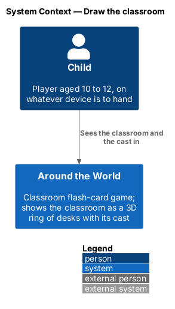
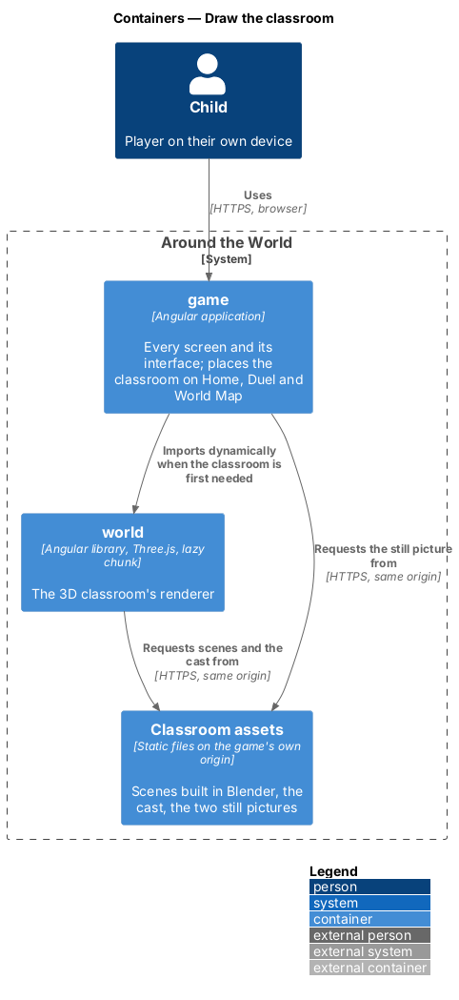
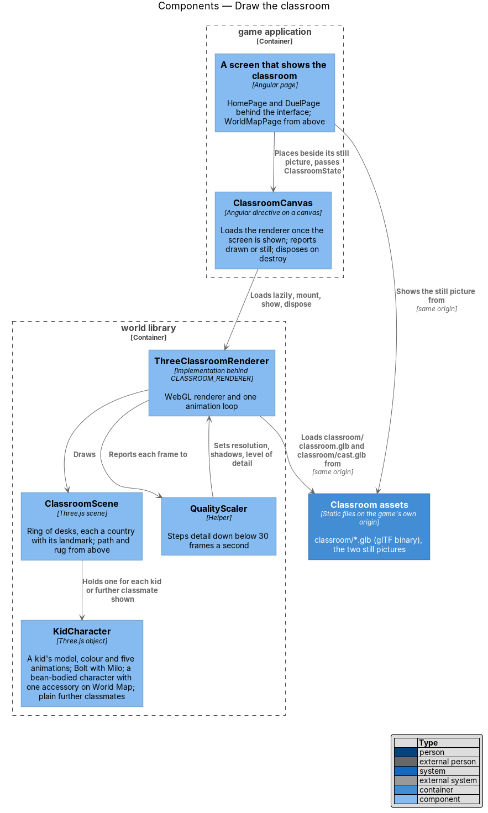
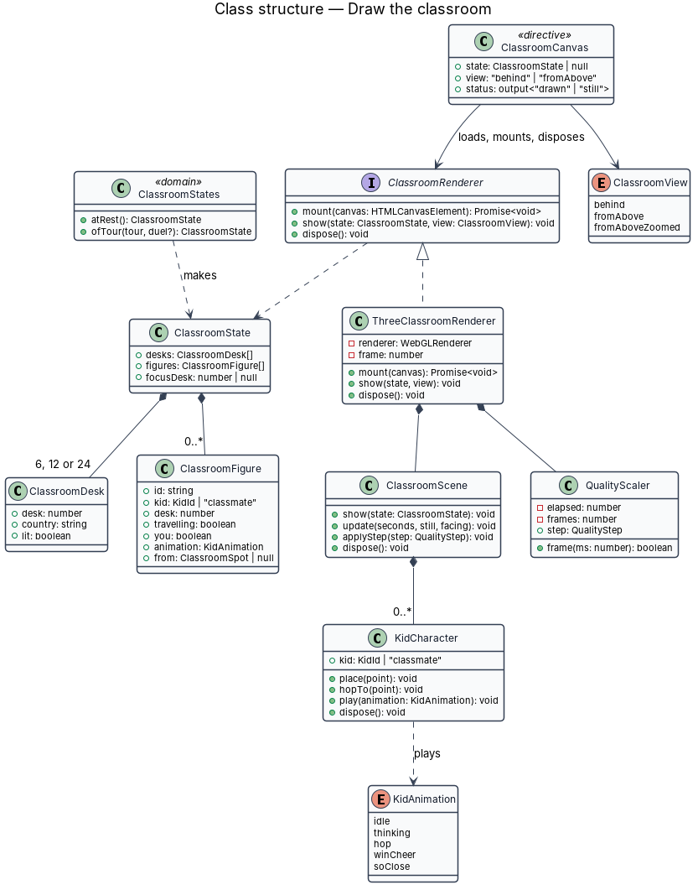
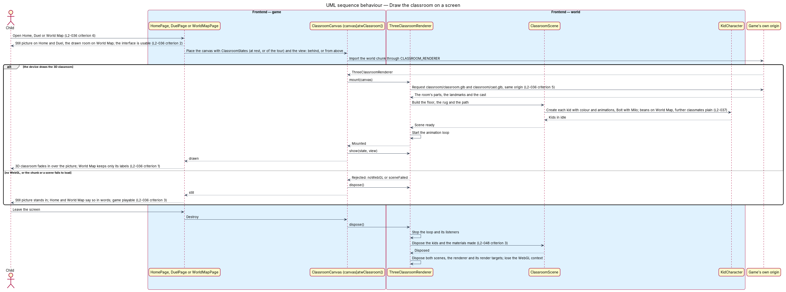
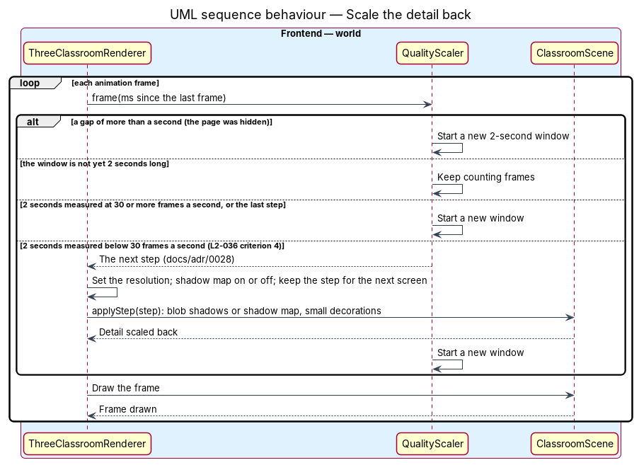

# Draw the classroom

## Overview

Around the World is the classroom flash-card game as a web game for children aged 10 to 12. The
classroom is a ring of desks, and each desk is a country with its landmark. This feature draws
that classroom as a 3D scene and draws the cast in it. Home and Duel show the classroom behind
the interface, World Map shows it from above, and no other screen shows a classroom.

- **classroom** — 3D scene of a ring of desks, built in Blender and drawn with Three.js
- **desk** — one place in the ring; each desk is a different country with its landmark
- **kid** — one of the five children a player picks: Zuri (yellow), Kenji (blue), Nia (red), Milo (green, with his robot Bolt) and Pip (purple)
- **cast** — the five kids as animated 3D characters
- **further classmate** — classmate who is not one of the five kids
- **interface** — panels, buttons and text of a screen, drawn in front of the classroom
- **still picture** — flat image of the classroom shown when the 3D scene is absent
- **renderer** — code that draws the classroom on a canvas

The classroom is decoration with a job: it shows where everyone sits and who is travelling. It
is never something the game waits for. The interface is usable before the classroom arrives, a
still picture stands in on a device that cannot draw it, and its detail is scaled back until
it draws smoothly on a low-power device.

The feature sits in the `classroom` subsystem. `classroom/play-motion-and-sound` owns when a
hop, a cheer or a "so close" plays; this feature owns the scene those animations play in. The
positions it draws come from `tour/travel-round-ring`.

## Description

Journey 09 built the slice, with the decisions of `docs/adr/0028-drawing-the-classroom.md`. The
slice runs wholly on the device and has no backend part. Every asset of the classroom is
requested from the game's own origin (`L2-036` criterion 5, `L2-041` criterion 4).

Contract and types in the `api` library (`@atw/api`):

- **`ClassroomRenderer`** — contract of the renderer.
  - `mount(canvas): Promise<void>` loads the scenes and starts drawing; it rejects with a
    `ClassroomError` (`noWebGL` or `sceneFailed`) when the device has no WebGL or a scene fails
    to load.
  - `show(state: ClassroomState, view: ClassroomView): void` places the kids at their desks in
    the view; a figure that moved since the last state hops there, and each plays the animation
    its state gives it.
  - `dispose(): void` stops the animation loop and disposes every geometry, material, texture,
    render target and the renderer itself, and loses the WebGL context (`L2-048` criterion 3).
- **`CLASSROOM_RENDERER`** — token bound in `game`'s `app.config.ts` to a loader,
  `() => Promise<ClassroomRenderer>`, that imports `@atw/world` dynamically. The binding holds
  no reference to Three.js, so the renderer and its scenes are in none of the initial chunks
  (`L2-036` criterion 2, `L2-047` criterion 2).
- **`ClassroomState`** — the desks in order from desk 1 (`ClassroomDesk`: its number, its
  country and whether it is lit), the figures (`ClassroomFigure`: the player's id, their kid or
  `classmate`, the desk, whether they are travelling, whether it is the device's own player,
  their animation and, for a hop, the spot they hop from), and the desk a view behind the
  interface looks at (`focusDesk`, null on Home). Exactly one desk is empty, apart from the
  desk of each player removed from a game with friends, which stays empty (`L2-007`
  criterion 6). It holds no nickname. A figure is named by its player's id, not its kid, since
  two players of a room may share a kid.
- **`KidAnimation`** — `idle`, `thinking`, `hop`, `winCheer`, `soClose` (`L2-037`
  criterion 2).
- **`ClassroomView`** — which part of the room a screen shows: `behind`, the classroom behind
  the interface of Home and Duel; `fromAbove`, the whole room on World Map from 768 px; or
  `fromAboveZoomed`, World Map zoomed to the player's own kid and filling the screen below
  768 px (`L2-034` criterion 5).

In the `world` library (`@atw/world`), which depends on `api` only:

- **`ThreeClassroomRenderer`** — implementation of `ClassroomRenderer` with Three.js. It
  creates the WebGL renderer on the canvas it is given, runs one `requestAnimationFrame` loop
  and delegates the content to `ClassroomScene`. It pauses the loop while the page is hidden.
  Its cameras: an orthographic camera looking down at 30° for World Map, which frames the same
  rectangle of the plan as World Map's drawn room (`RoomPlan`); and a perspective camera behind
  the interface, at the whole ring from the front on Home and over the desk of the duel on
  Duel.
- **`ClassroomScene`** — lays out the ring from the classroom's scenes: one desk for each
  country of the tour, each with its landmark (`L2-036` criterion 1, `L2-007` criterion 1).
  The scenes are glTF binary files, `classroom/classroom.glb` (the floor, the rug, a dot of the
  path, a desk, a blob shadow and a landmark for each country) and `classroom/cast.glb` (the
  five kids and the further classmate), loaded by `loadScenes` with every material in its
  cheap Lambert form and coloured from the design tokens by its name. Until the Blender
  exports are in the repository, a stand-in built from primitives
  (`frontend/tools/make-classroom-stand-in.mjs`) takes their place in the same format and paths
  (`docs/adr/0028`).
  - *Countries and landmarks.* A tour of n desks holds the first n countries of `domain`'s
    `tour/countries.ts` from desk 1: France, Egypt, Japan, UK, Italy, USA, Brazil, India,
    Kenya, China, Australia and Peru, then Mexico, Norway, Greece, Canada, Spain, Russia,
    Thailand, Turkey, Morocco, Iceland, Korea and Chile for a tour of 24, each with the
    landmark the list gives it (the Statue of Liberty for USA); the landmark's node is
    `landmark-<country>`. Home's classroom is the default tour's 12 desks with the five kids
    (`ClassroomStates.atRest`). The list is the cast, not a rule (`docs/adr/0028`).
  - *From above.* World Map shows a floor, a rug that is a world map, the ring of desks and a
    dotted path. Each desk holder is at their desk, and the traveller stands beside a desk,
    on the path (`L2-034` criterion 1). The desk the traveller is at and the next stop are
    lit. The name tags, the country plaques and the messages over the room are interface and
    belong to `tour/travel-round-ring`.
  - *Behind the interface.* On Duel the classroom sits behind a scrim, which keeps the
    interface over it readable. On Home it fills the area `player/find-way-through-screens`
    gives it.
- **`KidCharacter`** — one kid in the scene: the kid's model, the kid's colour and the five
  animations. Milo's `KidCharacter` always includes his robot Bolt (`L2-037` criterion 3). The
  brief for the 3D characters is the *Character Sheet* that `AGENTS.md` names.
  - *On World Map.* Each kid is a small bean-bodied character in the kid's colour with the
    kid's one accessory (`L2-037` criterion 5). The name tag over it, which gives the kid's
    name, or "You" for the player, is interface and belongs to `tour/travel-round-ring`. The
    `hop` animation moves the traveller along the dotted path to the next desk;
    `classroom/play-motion-and-sound` gives its time (`L2-038` criterion 1). The mocks draw
    the kid before and after the hop and leave the movement between to this design
    (`docs/mocks/README.md`, departure 10). The kid moves in a straight line to the new spot
    while rising and falling once, 0.45 m high, in 1 second: along the path for a hop, down to
    the seat for a sit (`docs/adr/0028`). Under reduced motion the move ends at once until
    `classroom/play-motion-and-sound` gives it its quick fade.
  - *Further classmate.* On World Map a further classmate is a plain bean-bodied character
    in a calmer colour, with no accessory and no name tag (`L2-037` criterion 6).
- **`QualityScaler`** — measures the frame rate of the loop. When the classroom draws below
  30 frames a second for 2 seconds, it steps the detail down, through resolution, shadows and
  level of detail, and measures again until the classroom draws at 30 or more (`L2-036`
  criterion 4). The steps are: resolution 1.5 (never above the device's) with a 512 px shadow
  map; resolution 1; blob shadows in place of the shadow map; small decorations left out and
  resolution 0.75; resolution 0.5, the lowest, which still draws the whole classroom. A gap of
  more than a second is a pause, not a slow frame. The detail is never stepped back up, and the
  step a device reaches is where the next screen with the classroom starts in that visit
  (`docs/adr/0028`). The cheap form of a technique (baked lighting, lower resolution, fewer
  samples, level of detail) is chosen before the technique is dropped.

In the `game` application:

- **`ClassroomCanvas`** — directive on a `<canvas atwClassroom>` that each screen that shows
  the classroom places in its own markup, beside its still picture: `HomePage` and `DuelPage`
  with the view `behind`, and `WorldMapPage` with the view `fromAbove`, which the directive
  turns into `fromAboveZoomed` below 768 px (`L2-036` criterion 6, `L2-034` criterion 5). No
  other page places it, so no other screen loads any part of the `world` library. It injects
  `CLASSROOM_RENDERER`; a presentation component cannot, so it lives in the application. It
  takes a `ClassroomState` (from `domain`'s `ClassroomStates`: `atRest()` on Home, `ofTour(tour,
  duel)` on Duel and World Map) and the view as inputs, and emits `status`: `drawn` or
  `still`. The page keeps its own still picture, so the mocks' classes stay the page's
  (`docs/adr/0028`).
  1. On Home and Duel the page renders the still picture at once, so the screen has a
     background from its first frame. On World Map the drawn room (`WorldMap`) stands in: it
     already gives every position (`docs/adr/0028`). Until the tour is published, World Map's
     header reads "Drawing the classroom…" and the room and the standings are skeletons
     (`L2-031` criterion 4, `docs/adr/0023`).
  2. After the screen is shown, it calls the loader and `mount`. The interface never waits
     for either (`L2-036` criterion 2).
  3. When `mount` resolves, the canvas fades in over the still picture. On World Map, the
     drawn room then shows only its name tags and plaques (`WorldMap` with `labelsOnly`), over
     the 3D room.
  4. When the loader or `mount` rejects, the still picture stands in for as long as the
     screen does, and the game is fully playable (`L2-036` criterion 3). The screen says so
     in words, as a status and not as an alert. Home reads "The 3D classroom is having a
     rest" and "You're seeing a picture of it instead. The game plays just the same." World
     Map reads "The map is having a rest" and "The standings below still show where everyone
     is, and the game carries on.", and its standings still give every position. The mocks
     draw no such words on Duel.
  5. When the component is destroyed, it calls `dispose()` and drops the canvas. A `mount`
     still in progress is abandoned and disposed when it settles.

  The still pictures are `scene-classroom.jpg`, for Home and World Map, and `scene-duel.jpg`,
  for Duel; the mocks hold both in `docs/mocks/assets/img/`. On World Map the still picture
  takes the room's place and the alert sits at the top of the room, as the mock
  `world-map/error` draws. On Home and Duel the canvas and
  the still picture are hidden from assistive technology. On World Map the room is one image
  whose label gives the tour length, where the player is and who is travelling, and the still
  picture is named "A picture of the classroom". Everything the classroom shows is also
  carried by the interface in words.

Colours of the cast. Each kid has one colour: Zuri yellow, Kenji blue, Nia red, Milo green and
Pip purple (`L2-037` criterion 1). The colours are design tokens in
`docs/design-system/tokens/tokens.css` and are read by role, never as a hex value in a
component. Each kid has a bright colour, a deeper shade of it and a tag pair. The bright colour
is for marks: the kid's place on the world ring, the timer bar and the background of the kid's
picture. Button faces and name tags use the deeper shade with white text, and yellow keeps navy
text, because white text on the bright colours has too little contrast (`docs/mocks/README.md`,
departures 1 and 2). A further classmate has a calmer colour of its own. The screens around the
classroom use light sky blue backgrounds, white panels and navy text. The contrast of each pair
is measured in `docs/design-system/tokens/contrast-pairs.json` (`L2-051` criterion 6).

`KidTag` uses the kid's tag pair for the name tag, `WorldRing` the bright colour for the kid's
place on the world ring, `TimerBar` the bright colour for the timer bar, and `KidCharacter` the
kid's colour for the character. Wherever a kid's colour carries a state, a name or a label
carries the same state (`L2-037` criterion 4): the tag shows the kid's name, and beside the
world ring and the timer bar the Duel screen names the traveller and the desk holder in words.

Memory. The classroom is the heaviest thing the game allocates. Entering and leaving a screen
with the classroom 20 times shall leave the heap no more than 10% above its size after the
first time (`L2-048` criterion 4); that heap check runs only when a person asks for it.

The classroom follows the mocks `docs/mocks/pages/home/` (states `default`, `loading`, `error`),
`docs/mocks/pages/duel/` (every state, behind its scrim) and `docs/mocks/pages/world-map/`
(states `default`, `hop`, `sit`, `desk-holder`, `short`, `long`, `loading`, `error`). In the
mocks a picture stands in for the 3D classroom.

## Requirements

The feature realizes the following level-2 (L2) requirements. Each L2 requirement refines a
level-1 (L1) requirement, cited by identifier.

| L2 ID | Refines (L1) | Requirement |
|-------|--------------|-------------|
| `L2-036` | `L1-010` | The 3D classroom: the classroom shall be a 3D scene of a ring of desks, each with its country's landmark, drawn behind the interface; its renderer and scenes shall be loaded when first needed and not in the initial bundle, with the interface usable before they arrive; on a device that cannot draw it, a still picture shall stand in, the screen shall say so in words (Home: "The 3D classroom is having a rest"; World Map: "The map is having a rest", with the standings still giving every position) and the game shall be fully playable; its detail shall be scaled back when it draws below 30 frames a second for 2 seconds; its assets shall come from the game's own origin; Home and Duel shall show the classroom behind the interface, World Map shall show the classroom from above, and the other screens shall show no classroom. |
| `L2-037` | `L1-010` | The cast: each of the five kids shall have one colour (Zuri yellow, Kenji blue, Nia red, Milo green, Pip purple), used for their name tag, their place on the world ring and their timer bar; a kid in the classroom shall have the matching animation for each moment (idle, thinking, hop, win cheer and "so close"); Milo shall be shown with his robot Bolt; a name or a label shall carry any state a kid's colour carries; on World Map a kid shall be a small bean-bodied character in the kid's colour with the kid's one accessory, under a name tag that gives the kid's name, or "You" for the player; on World Map a classmate who is not one of the five kids shall be a plain bean-bodied character in a calmer colour, with no accessory and no name tag. |

## Diagrams

### System context

A child sees the classroom in Around the World. The slice involves no other system: the
classroom's assets come from the game's own origin.

### Containers

The `game` application loads the `world` library and the classroom's assets from its own
origin when the classroom is first needed. The diagram shows no backend container, because the
slice makes no request to `AroundTheWorld.Api`.

### Components

The page shows the still picture and `ClassroomCanvas` loads `ThreeClassroomRenderer` through
`CLASSROOM_RENDERER`. The renderer delegates the ring and the cast to `ClassroomScene` and
`KidCharacter`, and `QualityScaler` adjusts its detail.

### Class structure

`ThreeClassroomRenderer` realizes `ClassroomRenderer` and owns one `ClassroomScene` and one
`QualityScaler`. The scene owns one `KidCharacter` for each kid or further classmate shown, and
the state holds a `ClassroomDesk` for each desk and a `ClassroomFigure` for each player, with
exactly one desk empty.

### Behaviour — draw the classroom on a screen

Home, Duel and World Map place `ClassroomCanvas`; the sequence is the same for each, with
the view the screen asks for. A still picture, or World Map's drawn room, is shown first and
the interface is usable at once. The renderer arrives later. A device that cannot draw the scene keeps the still
picture, Home and World Map say so in words, and leaving the screen disposes everything.

### Behaviour — scale the detail back

`QualityScaler` measures each frame and steps the detail down after 2 seconds below 30 frames
a second, until the classroom draws at 30 or more.

