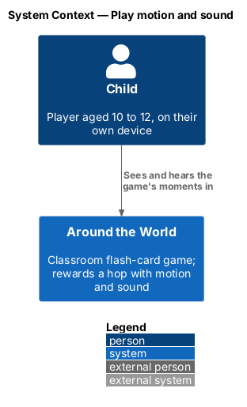
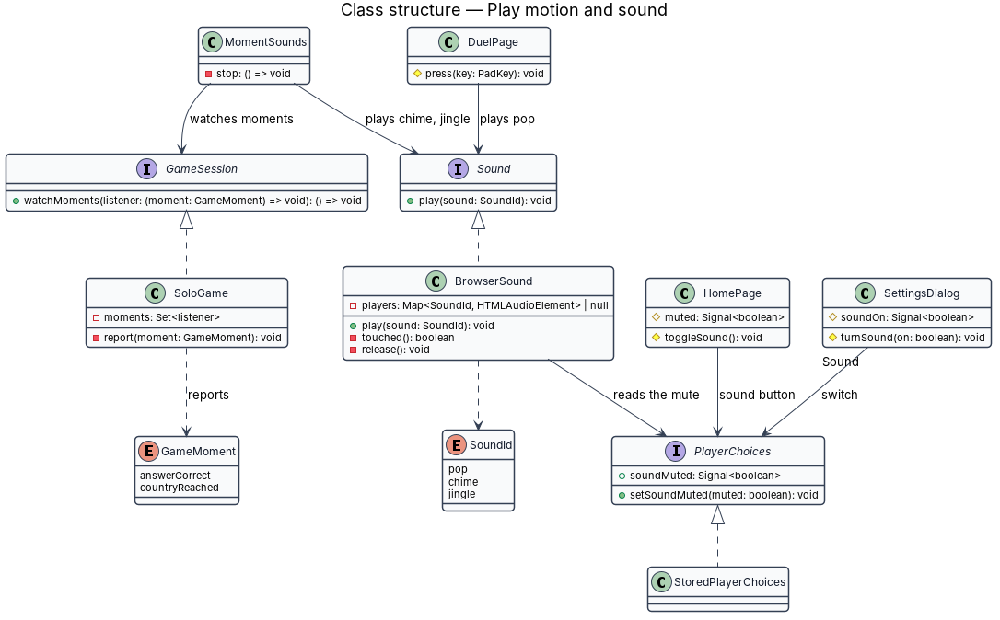

# Play motion and sound

## Overview

Around the World is the classroom flash-card game as a web game for children aged 10 to 12. A
traveller duels a desk holder over one flash card, and the traveller who wins hops to the next
desk. This feature is how the game feels at those moments: the hop is the reward, losing a
desk is gentle, and every sound can be muted.

- **hop** — move of the traveller to the next desk after winning a duel: a passport stamp lands on Duel, and the kid then hops along the path on World Map
- **shake** — one short side-to-side movement of the flash card after a wrong answer, or of the four boxes of the code on Room after a code is refused
- **card flip** — way a new flash card appears
- **"so close"** — reaction of a kid who loses a duel
- **reduced motion** — setting of the device that asks for less movement on screen
- **pop, chime, jingle** — the three sounds of the game: a number-pad key, a correct answer, a new country
- **mute** — sound setting that silences every sound, kept on the device

Motion has fixed limits. The hop lasts about 1 second and no more than 1.5, a flash card flips
in within 300 ms, and a device that asks for reduced motion gets a fade of no more than 200 ms
in place of anything that moves across the screen. Losing a duel plays no red screen, no buzzer
and no other punishing effect.

The feature sits in the `classroom` subsystem. `classroom/draw-classroom` draws the scene and
the kids' animations; `tour/play-duel` and `tour/travel-round-ring` decide the moments; this
feature decides what plays at each moment and for how long.

## Description

The slice runs wholly on the device and has no backend part. In a game with friends the moments
arrive from the server through `GameSession`; what plays for a moment is decided on each device.
Most of the motion is the state the screens already show, played by each presentation
component's own stylesheet and by the classroom's renderer; the sound is played by one service
for the two moments the game reports, and by Duel for a key of the number pad
(`docs/adr/0029-motion-and-sound.md`).

Contracts and types in the `api` library (`@atw/api`):

- **`GameMoment`** — a moment of the game that makes a sound: `answerCorrect`, when the
  device's own player's right answer wins their duel, and `countryReached`, when the device's
  own player hops on and their passport is stamped (`L2-039` criterion 1). A lost duel, a wrong
  answer and a classmate's answer are no moment. `GameSession.watchMoments(listener)` calls the
  listener for each, and returns a function that stops it, as `watchScreen` does
  (`docs/adr/0023-game-screens-follow-the-session.md`).
- **`Sound`** (`SOUND`) — contract with `play(sound: SoundId): void`. `SoundId` is `pop`,
  `chime` or `jingle`.
- **`PlayerChoices`** — keeps the mute as `soundMuted: Signal<boolean>` and
  `setSoundMuted(muted: boolean): void`, with the rest of the record on the device (`L2-015`
  criteria 3 and 4). The record's `soundMuted` field is kept only once the child has changed
  it. The sound button on Home and the "Sound" switch of the Settings dialog both call
  `setSoundMuted` (`L2-032` criteria 3 and 4), so neither loads any sound code.

In the `domain` library (`@atw/domain`), folder `sound/`:

- **`BrowserSound`** — implementation of `Sound`, bound in the solo group.
  - *Mute.* `play` does nothing while `PlayerChoices.soundMuted` is true (`L2-039`
    criterion 2).
  - *First touch.* `play` does nothing until the child has touched the page, as
    `navigator.userActivation.hasBeenActive` records it: the first touch, click or key press
    (`L2-039` criterion 3). Where the browser lacks it, the browser's own autoplay rule refuses
    a sound until a touch, and a refused `play()` is ignored.
  - *Loading.* It makes one `HTMLAudioElement` for each of the three sounds on the first sound
    it plays, so nothing is fetched before a sound is due, and none while muted. A sound that
    plays again starts from its beginning.
  - *Release.* When the solo group is destroyed it pauses each element, removes its source and
    calls `load()`, so the browser lets the audio go (`L2-048` criterion 3).
  - *The sounds.* `sounds/pop.wav` (one 80 ms tone falling from 880 Hz to 660 Hz, at a quarter
    of full loudness), `sounds/chime.wav` (two notes, C6 then E6, over 400 ms, at a third) and
    `sounds/jingle.wav` (four rising notes, C5, E5, G5 and C6, over 750 ms, at a third), on the
    game's own origin: 16-bit mono WAV at 16 kHz, about 39 kB together, made by
    `frontend/tools/make-sounds.mjs` from sine tones with a soft attack and an exponential
    fall. None is harsh and none is a buzzer.

In the `domain` library's `tour/`, **`SoloGame`** reports `answerCorrect` when it decides a duel
the device's own player won, and `countryReached` when World Map opens on that player's hop.

In the `game` application:

- **`MomentSounds`** — service the solo group provides and starts with the group. It watches
  `GameSession`'s moments and plays the chime for `answerCorrect` and the jingle for
  `countryReached`. It stops watching when the group is destroyed.
- **`DuelPage`** plays the pop for each key of the number pad.
- **`HomePage`** shows the sound button in the corner beside Settings: the sound icon, "Mute
  sound" and not pressed while sound is on; the mute icon, "Turn sound on" and pressed while
  muted (`docs/mocks/pages/home/muted.html`).
- **`SettingsDialog`** shows the "Sound" switch first ("Pops, chimes and jingles."), on while
  sound is on (`docs/mocks/dialogs/settings/muted.html`).

What plays at each moment:

| Moment | Screen | Sound | Full motion | Reduced motion |
|--------|--------|-------|-------------|----------------|
| A key of the number pad | Duel | pop | the key sinks onto its base | the key does not move |
| A new flash card | Duel | none | the flash card flips in, in 200 ms (`L2-038` criterion 2) | no flip; a fade of 200 ms |
| A wrong answer | Duel | none | the flash card shakes once, is outlined and reads "Not {answer}! Frozen for a sec…" (`L2-004` criterion 5) | no shake; the card fades back in 200 ms, with the outline and the words |
| The device's player's right answer (`answerCorrect`) | Duel | chime | the flash card reads "= {answer}" and "You got it!", and the kid plays `winCheer`; after 1 second the passport stamp lands tilted in place of the flash card, and after 1.2 seconds World Map opens (`L2-033` criterion 7, `L2-038` criteria 1 and 5) | the same, with the stamp upright, fading in over 200 ms |
| A lost duel | Duel | none | the kid plays `soClose`; the flash card reads "{rival} said {answer} first. So close!" and stays until the child chooses the pill "You sit at {country} · {rival} travels on" (`L2-033` criteria 3 and 8, `L2-038` criterion 3) | the same, with no movement |
| A traveller hops on | World Map | none | the kid hops along the path to the next desk in 1 second (`L2-038` criterion 1) | the kid fades out where it stands and in at the next desk, 200 ms in all, and nothing moves across the screen |
| A traveller sits down | World Map | none | the beaten traveller is drawn at their desk and the desk holder hops on (`L2-034` criterion 4) | the same, with the fade of a hop |
| The device's player reaches a new country (`countryReached`) | World Map | jingle | a message names the country and stays for 1.6 seconds, and Duel then returns (`L2-034` criteria 3 and 9) | the same; the message appears with no movement |
| The Podium opens | Podium | none | the places rise in turn, third, second, first, each in 200 ms (`L2-038` criterion 6) | each place fades in over 200 ms |

A hop past an empty desk is one hop and keeps the same limit (`L2-002` criterion 4). No red
screen plays anywhere: no component has a full-screen effect for losing.

The durations are motion tokens of the design system, in `docs/design-system/tokens/tokens.css`,
and a stylesheet names a token, never a number: `--duration-fast` is 120 ms, `--duration-base`
200 ms, `--duration-slow` 320 ms, `--duration-freeze` 1000 ms, `--duration-hop` 1000 ms,
`--duration-toast` 1600 ms and `--duration-fade` 200 ms. Under reduced motion the duration
tokens drop to nothing, `--duration-hop` becomes 200 ms and `--duration-fade` keeps its 200 ms:
it is the quick fade that stands in for a hop, a card flip, a shake, the stamp landing and the
Podium rising. The timer bar still drains under reduced motion, because it is a clock.

In the `components` library (`@atw/components`), each component plays its motion in its own
stylesheet and reads reduced motion from the `prefers-reduced-motion` media query, so the
reduced form holds before any script runs:

- **`FlashCard`** — flips in on its host in `--duration-base`, and shakes after a wrong answer
  with a second animation on another property (`translate`), so the shake never replays the
  flip. Duel makes a new `FlashCard` for each new flash card (an `@for` over the card, tracked
  by the card), so each card flips in, the one after "Time's up!" included. Under reduced motion
  the flip is a fade of `--duration-fade` and the shake a fade back from half opacity.
- **`StampCard`** — lands tilted in about 250 ms; under reduced motion it is upright and fades
  in over `--duration-fade`.
- **`Podium`** — the places rise in turn; under reduced motion each fades in over
  `--duration-fade`.
- **`IconButton`** and **`Switch`** — the sound button and the "Sound" switch, with the `sound`
  and `mute` icons of **`Icon`**.

Two shakes exist (`L2-038` criterion 4). The flash card shakes after a wrong answer, as the
table gives. The four boxes of the code on Room shake once, for about 300 ms, when a code is
refused (`L2-023`); `CodeBoxes` plays that shake in its own stylesheet, with the same reduced
fade, and `rooms/join-room` designs it. The number pad does not shake: it is disabled while the
player is frozen (`L2-004` criterion 4).

In the `world` library (`@atw/world`), **`KidCharacter`** plays the hop: a one-second arc along
the path, or under reduced motion, read by the renderer from `prefers-reduced-motion` on each
frame, a fade out where the kid stands and in at the next desk, 200 ms in all. Each kid owns a
copy of every material of its model, so its fade touches no other kid. When the 3D classroom is
absent and the still picture stands in, nothing hops, and the sound and the interface's own
motion still play.

Sound and the voice answer (`L2-039` criterion 4). A sound shall never cause an answer to be
given. Each of the three sounds plays at a moment when speech recognition is not running. A
pop plays only while the number pad is the way of answering, when recognition has stopped
(`L2-011` criterion 1). A chime plays once a duel is decided and a jingle on World Map, and
recognition does not run once a duel is decided or away from the Duel screen (`L2-009`
criterion 5). The timing is the guard: no further guard is needed, and the microphone is
already asked for with echo cancellation (`docs/adr/0029-motion-and-sound.md`).

Motion and sound follow the mocks `docs/mocks/pages/duel/` (states `default`, `right`, `wrong`,
`wrong-pad`, `lost`, `hop`), `docs/mocks/pages/world-map/` (states `hop`, `sit`),
`docs/mocks/notifications/map-toast/` (states `info`, `success`, `warning`),
`docs/mocks/pages/home/` (states `default`, `muted`) and `docs/mocks/dialogs/settings/` (states
`default`, `muted`).

## Requirements

The feature realizes the following level-2 (L2) requirements. Each L2 requirement refines a
level-1 (L1) requirement, cited by identifier.

| L2 ID | Refines (L1) | Requirement |
|-------|--------------|-------------|
| `L2-038` | `L1-011` | The hop and losing a desk: when the traveller wins a duel and the hop plays, a passport stamp shall land on Duel with the country's landmark, the kid shall then hop along the path to the next desk on World Map, and the hop shall last about 1 second (no more than 1.5); a new flash card shall flip in within 300 ms; a player who loses a duel shall see their kid do the "so close" reaction and sit down, with no red screen, buzzer or other punishing effect; when the device asks for reduced motion, a fade of no more than 200 ms shall play in place of a hop, a card flip or a shake (the flash card after a wrong answer, and the four boxes of the code on Room after a code is refused), and nothing shall move across the screen; when the Duel screen shows a hop, a passport stamp shall stand in place of the flash card: "Passport stamp!", the country reached, its landmark and "{kid} hops to desk {n} of {tour length}"; when the Podium opens, the places shall rise in turn (third, second, first), each in under 300 ms, and shall fade in with reduced motion. |
| `L2-039` | `L1-011` | Sound: with sound on, a pop, a chime or a short jingle shall play when a key of the number pad is pressed, an answer is correct or a new country is reached; no sound shall play while sound is muted; no sound shall play before the child has touched the page; a sound shall never cause an answer to be given by voice. |

## Diagrams

### System context

A child sees and hears the game's moments in Around the World. The slice involves no other
system.

### Containers

The `game` application plays motion and sound on the device and keeps the sound setting in the
device's storage. The diagram shows no backend container, because the slice makes no request
to `AroundTheWorld.Api`.

### Components

`MomentSounds` plays a sound for each moment `GameSession` reports, through `BrowserSound`,
which reads the mute from `StoredPlayerChoices`. The presentation components and the renderer
play the motion of the state the screens show.

### Class structure

`MomentSounds` depends on the `GameSession` and `Sound` contracts. `BrowserSound` realizes
`Sound` and reads the mute from `PlayerChoices`; `SoloGame` reports the moments.

### Behaviour — play the hop after a duel is won

The chime plays once the duel is decided. "You got it!" shows, and the passport stamp then
lands in place of the flash card. World Map then opens with the message and the jingle, and the
kid hops to the next desk in 1 second. Duel returns when the message has stayed for 1.6
seconds, and the new flash card flips in. Under reduced motion a fade of 200 ms replaces the
hop, and a muted or untouched page plays no sound.

### Behaviour — sit down after a duel is lost

Losing plays the "so close" reaction and no sound. Duel stays until the child chooses to go on.
On World Map the beaten traveller sits at the desk and the desk holder travels on.

### Behaviour — mute and the first touch

`BrowserSound` plays nothing until the browser records the child's first touch, and nothing
while muted. The sound button on Home and the "Sound" switch of the Settings dialog change the
mute in `StoredPlayerChoices`, which keeps it on the device. The button's label reads "Mute sound" while sound is on and "Turn
sound on" while it is muted.

