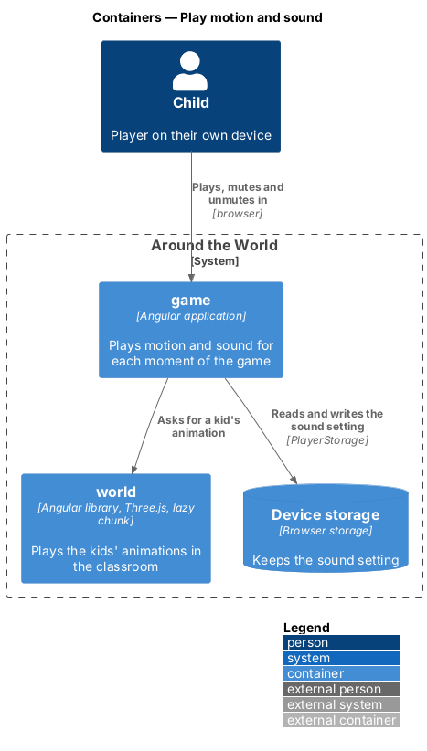
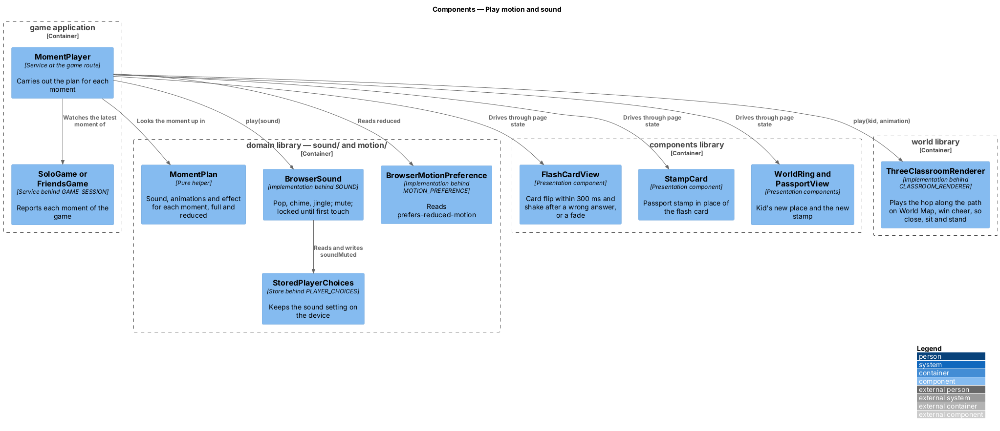
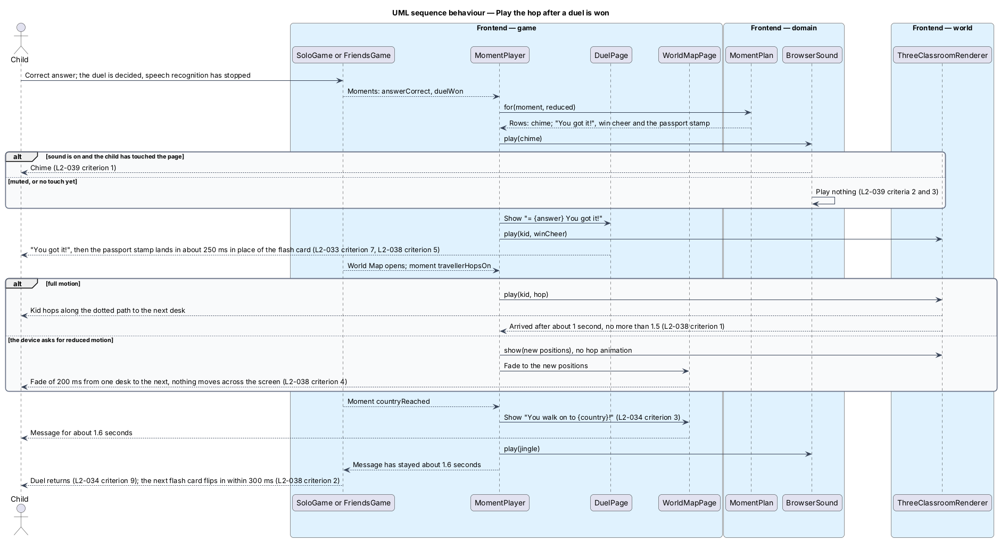
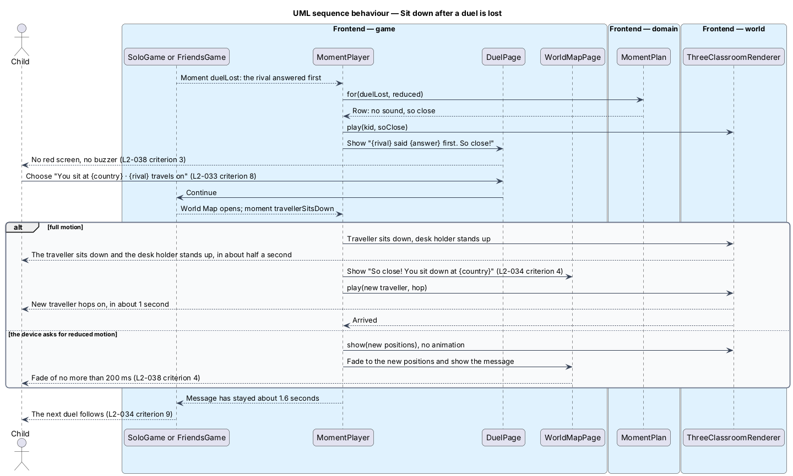
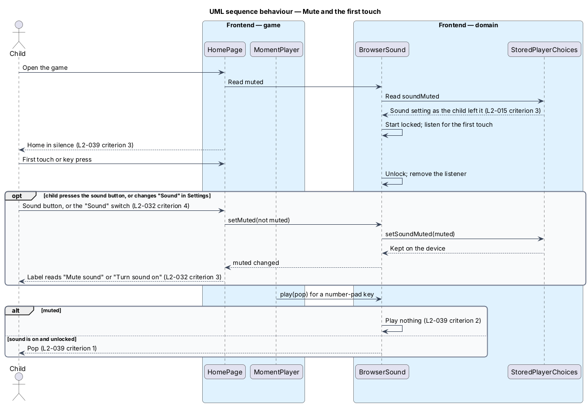

# Play motion and sound

## Overview

Around the World is the classroom flash-card game as a web game for children aged 10 to 12. A
traveller duels a desk holder over one flash card, and the traveller who wins hops to the next
desk. This feature is how the game feels at those moments: the hop is the reward, losing a
desk is gentle, and every sound can be muted.

- **hop** — move of the traveller to the next desk after winning a duel: a passport stamp lands on Duel, and the kid then hops along the path on World Map
- **shake** — one short side-to-side movement of the flash card after a wrong answer, or of the four boxes of the code on Room after a code is refused
- **card flip** — way a new flash card appears
- **"so close"** — reaction of a kid who loses a duel
- **reduced motion** — setting of the device that asks for less movement on screen
- **pop, chime, jingle** — the three sounds of the game: a number-pad key, a correct answer, a new country
- **mute** — sound setting that silences every sound, kept on the device

Motion has fixed limits. The hop lasts about 1 second and no more than 1.5, a flash card flips
in within 300 ms, and a device that asks for reduced motion gets a fade of no more than 200 ms
in place of anything that moves across the screen. Losing a duel plays no red screen, no buzzer
and no other punishing effect.

The feature sits in the `classroom` subsystem. `classroom/draw-classroom` draws the scene and
the kids' animations; `tour/play-duel` and `tour/travel-round-ring` decide the moments; this
feature decides what plays at each moment and for how long.

## Description

The slice is not built yet; the components below are the ones the design introduces. The slice
runs wholly on the device and has no backend part. In a game with friends the moments arrive
from the server through `GameSession`; what plays for a moment is decided on each device.

Contracts and types in the `api` library (`@atw/api`):

- **`GameMoment`** — what just happened, as the game reports it: `cardShown`, `keyPressed`,
  `answerCorrect`, `wrongAnswer`, `duelWon`, `duelLost`, `travellerHopsOn`,
  `travellerSitsDown` and `countryReached`. `duelWon` and `duelLost` are the device's own
  player's duel on Duel. `travellerHopsOn` and `travellerSitsDown` are what World Map shows
  after any decided duel, a duel between two classmates included (`L2-034` criterion 7).
  `GameSession` exposes the latest moment as a signal.
- **`Sound`** (`SOUND`) — contract with `play(sound: SoundId): void`, `muted: Signal<boolean>`
  and `setMuted(muted: boolean): void`. `SoundId` is `pop`, `chime` or `jingle`. The sound
  button on Home and the "Sound" switch of the Settings dialog both call `setMuted`
  (`L2-032` criteria 3 and 4); `player/find-way-through-screens` designs both.
- **`MotionPreference`** (`MOTION_PREFERENCE`) — contract with `reduced: Signal<boolean>`.
- **`ClassroomRenderer`** — described in `classroom/draw-classroom`; this slice calls
  `play(kid, animation)`.

In the `domain` library (`@atw/domain`), folders `sound/` and `motion/`, which the first
change of this slice adds:

- **`BrowserSound`** — implementation of `Sound`, shared by the whole application.
  - *Mute.* It reads `soundMuted` from `PlayerChoices` and writes it back on `setMuted`, so
    the mute is as the child left it on return (`L2-015` criterion 3). `play` does nothing
    while muted (`L2-039` criterion 2).
  - *First touch.* It starts locked. `play` does nothing until the child has touched the
    page: the first pointer or key event unlocks sound, and the listener for it is then
    removed (`L2-039` criterion 3).
  - *Release.* It releases its audio resources and listeners when destroyed.
  - How the three sounds are made (recorded files from the game's own origin, or
    synthesized), and their length and loudness, are `<TO SUPPLY>`.
- **`BrowserMotionPreference`** — implementation of `MotionPreference`. It reads the
  `prefers-reduced-motion` media query, follows changes to it, and removes its listener when
  destroyed.
- **`MomentPlan`** — pure helper with one table: for each `GameMoment`, the sound, the kid
  animations and the screen effect to play, in a full and a reduced form. It holds no timer
  and touches no browser interface, so a unit test covers it one row for each case.

| Moment | Screen | Sound | Full motion | Reduced motion |
|--------|--------|-------|-------------|----------------|
| `keyPressed` | Duel | pop | none | none |
| `cardShown` | Duel | none | flash card flips in within 300 ms (`L2-038` criterion 2) | no flip; a fade of no more than 200 ms |
| `answerCorrect` | Duel | chime | none | none |
| `wrongAnswer` | Duel | none | flash card shakes once, for 300 ms, is outlined and reads "Not {answer}! Frozen for a sec…" (`L2-004` criterion 5) | no shake; the outline and the words alone |
| `duelWon` | Duel | none | flash card reads "= {answer}" and "You got it!", and the kid plays `winCheer`; the passport stamp then lands in about 250 ms in place of the flash card, and World Map opens (`L2-033` criterion 7, `L2-038` criteria 1 and 5) | the same, with no movement and no tilt on the stamp |
| `duelLost` | Duel | none | kid plays `soClose`; the flash card reads "{rival} said {answer} first. So close!" and stays until the child chooses the pill "You sit at {country} · {rival} travels on" (`L2-033` criteria 3 and 8, `L2-038` criterion 3) | the same, with no movement |
| `travellerHopsOn` | World Map | none | the kid plays `hop`: it moves along the dotted path to the next desk in about 1 second, and no more than 1.5 (`L2-038` criterion 1) | the kid fades from one desk to the next in 200 ms, and nothing moves across the screen |
| `travellerSitsDown` | World Map | none | the traveller sits down and the desk holder stands up, in about half a second; the new traveller then travels on as in `travellerHopsOn` (`L2-034` criterion 4) | the new positions are shown after a fade of no more than 200 ms |
| `countryReached` | World Map | jingle | a message names the country and stays for about 1.6 seconds, and Duel then returns (`L2-034` criteria 3 and 9) | the same; the message appears with no movement |

  `duelLost` and `wrongAnswer` play no sound: no buzzer exists in the game (`L2-038`
  criterion 3). A hop past an empty desk is one hop and keeps the same limit (`L2-002`
  criterion 4).

  The durations are motion tokens of the design system, in
  `docs/design-system/tokens/tokens.css`, and a stylesheet names a token, never a number:
  `--duration-fast` is 120 ms, `--duration-base` 200 ms, `--duration-slow` 320 ms,
  `--duration-freeze` 1000 ms, `--duration-hop` 1000 ms and `--duration-toast` 1600 ms. A
  message on World Map and a toast enter in 200 ms, and a dialog in 320 ms. Under reduced
  motion the duration tokens drop to nothing and `--duration-hop` becomes 200 ms. The timer
  bar still drains under reduced motion, because it is a clock.

  Two shakes exist (`L2-038` criterion 4). The flash card shakes after a wrong answer, as the
  table gives. The four boxes of the code on Room shake once, for about 300 ms, when a code is
  refused (`L2-023`); `CodeBoxes` plays that shake in its own stylesheet, and
  `rooms/join-room` designs it. The number pad does not shake: it is disabled while the
  player is frozen (`L2-004` criterion 4). Neither shake plays under reduced motion.

  The passport stamp is a state of Duel, not of World Map. When Duel shows a hop, the stamp
  stands in place of the flash card: "Passport stamp!", the country reached, its landmark and
  "{kid} hops to desk {n} of {tour length}" (`L2-038` criterion 5). `StampCard` draws it. The
  stamp shows after "You got it!" and before World Map opens (`L2-033` criterion 7). How long
  "You got it!" and the stamp each stay is `<TO SUPPLY>`.

  On the Podium the places rise in turn, third, second, first, each in under 300 ms, and fade
  in under reduced motion (`L2-038` criterion 6). The `Podium` component plays that in its own
  stylesheet, and `tour/end-tour` designs the Podium.

In the `game` application:

- **`MomentPlayer`** — service provided at the game route. It watches `GameSession`'s latest
  moment, looks it up in `MomentPlan` with `MotionPreference.reduced`, and carries the row
  out: `Sound.play`, `ClassroomRenderer.play` for each kid animation, and a state the page
  binds for the screen effect. It reports when World Map's message has stayed for about
  1.6 seconds, so Duel returns (`L2-030` criterion 4, `L2-034` criterion 9). Under reduced
  motion it calls no `hop` animation: the renderer receives the new positions through
  `show(state)` and the page fades (`L2-038` criterion 4). When the 3D classroom is absent
  and the still picture stands in, the sound and the interface's own effect still play, and
  the hop counts as finished after its planned time. It cancels pending timers when the route
  is destroyed.

In the `components` library (`@atw/components`):

- **`FlashCardView`** — plays the card flip and the shake in its own stylesheet, the flip
  within 300 ms. Its stylesheet replaces the flip with a fade of no more than 200 ms and
  drops the shake under the `prefers-reduced-motion` media query, so the reduced form holds
  even before any script runs.
- **`StampCard`** — draws the passport stamp that stands in place of the flash card. The
  stamp lands in about 250 ms; under reduced motion it appears with no movement and no tilt.
- **`WorldRing`** and **`PassportView`** — show the kid's new place and the new stamp, with
  the same media query replacing movement by a fade.

No red screen plays anywhere: no component has a full-screen effect for losing.

Sound and the voice answer (`L2-039` criterion 4). A sound shall never cause an answer to be
given. Each of the three sounds plays at a moment when speech recognition is not running. A
pop plays only while the number pad is the way of answering, when recognition has stopped
(`L2-011` criterion 1). A chime plays when a duel is decided and a jingle on World Map, and
recognition does not run once a duel is decided or away from the Duel screen (`L2-009`
criterion 5). `MomentPlayer` therefore plays a chime only after the game reports the duel
decided. Starting and stopping recognition belongs to `answering/answer-by-voice`. Whether a
further guard applies (for example echo cancellation on the microphone) is `<TO SUPPLY>`.

Motion and sound follow the mocks `docs/mocks/pages/duel/` (states `default`, `right`, `wrong`,
`wrong-pad`, `lost`, `hop`), `docs/mocks/pages/world-map/` (states `hop`, `sit`),
`docs/mocks/notifications/map-toast/` (states `info`, `success`, `warning`),
`docs/mocks/pages/home/` (states `default`, `muted`) and `docs/mocks/dialogs/settings/` (states
`default`, `muted`).

## Requirements

The feature realizes the following level-2 (L2) requirements. Each L2 requirement refines a
level-1 (L1) requirement, cited by identifier.

| L2 ID | Refines (L1) | Requirement |
|-------|--------------|-------------|
| `L2-038` | `L1-011` | The hop and losing a desk: when the traveller wins a duel and the hop plays, a passport stamp shall land on Duel with the country's landmark, the kid shall then hop along the path to the next desk on World Map, and the hop shall last about 1 second (no more than 1.5); a new flash card shall flip in within 300 ms; a player who loses a duel shall see their kid do the "so close" reaction and sit down, with no red screen, buzzer or other punishing effect; when the device asks for reduced motion, a fade of no more than 200 ms shall play in place of a hop, a card flip or a shake (the flash card after a wrong answer, and the four boxes of the code on Room after a code is refused), and nothing shall move across the screen; when the Duel screen shows a hop, a passport stamp shall stand in place of the flash card: "Passport stamp!", the country reached, its landmark and "{kid} hops to desk {n} of {tour length}"; when the Podium opens, the places shall rise in turn (third, second, first), each in under 300 ms, and shall fade in with reduced motion. |
| `L2-039` | `L1-011` | Sound: with sound on, a pop, a chime or a short jingle shall play when a key of the number pad is pressed, an answer is correct or a new country is reached; no sound shall play while sound is muted; no sound shall play before the child has touched the page; a sound shall never cause an answer to be given by voice. |

## Diagrams

### System context

A child sees and hears the game's moments in Around the World. The slice involves no other
system.

### Containers

The `game` application plays motion and sound on the device and keeps the sound setting in the
device's storage. The diagram shows no backend container, because the slice makes no request
to `AroundTheWorld.Api`.

### Components

`MomentPlayer` reads each moment from `GameSession`, takes the row for it from `MomentPlan`
and drives `BrowserSound`, the classroom's renderer and the presentation components.

### Class structure

`MomentPlayer` depends on the `Sound`, `MotionPreference` and `ClassroomRenderer` contracts
and on `MomentPlan`. `BrowserSound` and `BrowserMotionPreference` realize two of them.

### Behaviour — play the hop after a duel is won

The chime plays once the duel is decided. "You got it!" shows, and the passport stamp then
lands in place of the flash card. World Map then opens, the kid hops to the next desk in about
1 second, and the message and the jingle follow. Duel returns when the message has stayed for
about 1.6 seconds. Under reduced motion a fade of 200 ms replaces the hop, and a muted or
untouched page plays no sound.

### Behaviour — sit down after a duel is lost

Losing plays the "so close" reaction and no sound. Duel stays until the child chooses to go on.
On World Map the traveller sits down and the desk holder stands up in about half a second, and
the new traveller travels on.

### Behaviour — mute and the first touch

`BrowserSound` stays locked until the child first touches the page, and plays nothing while
muted. The sound button on Home and the "Sound" switch of the Settings dialog change the mute,
which is kept on the device. The button's label reads "Mute sound" while sound is on and "Turn
sound on" while it is muted.

