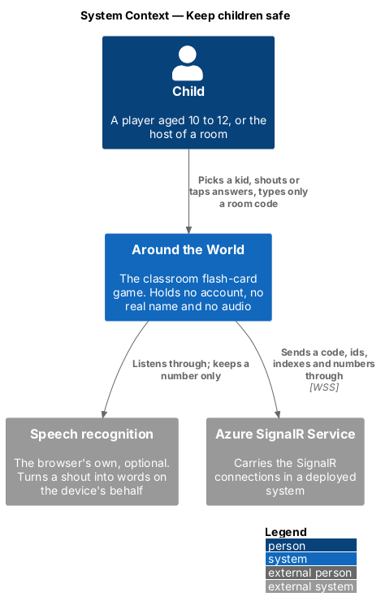
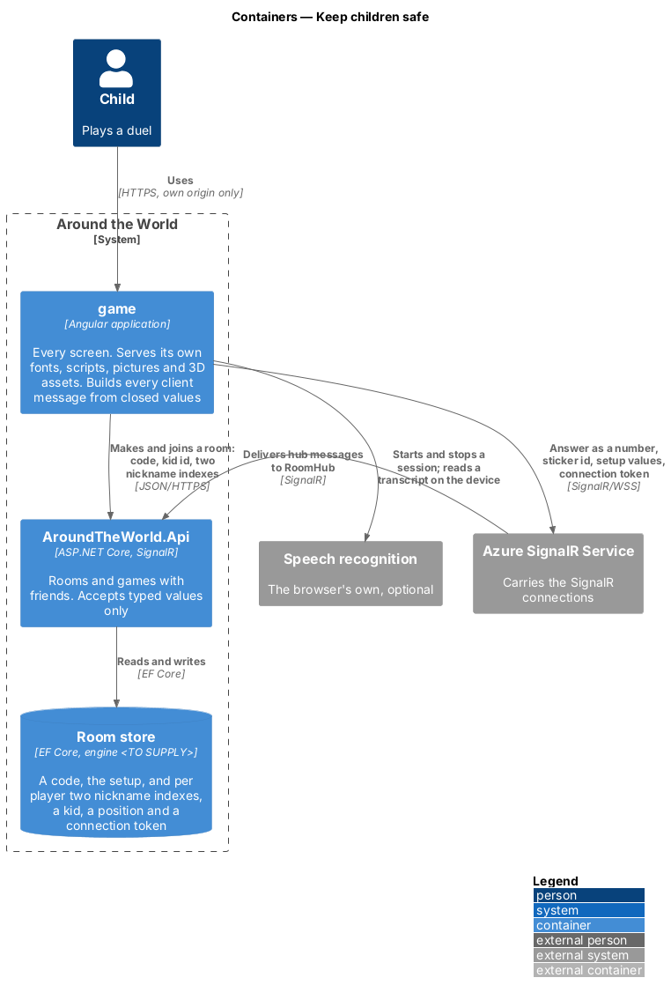
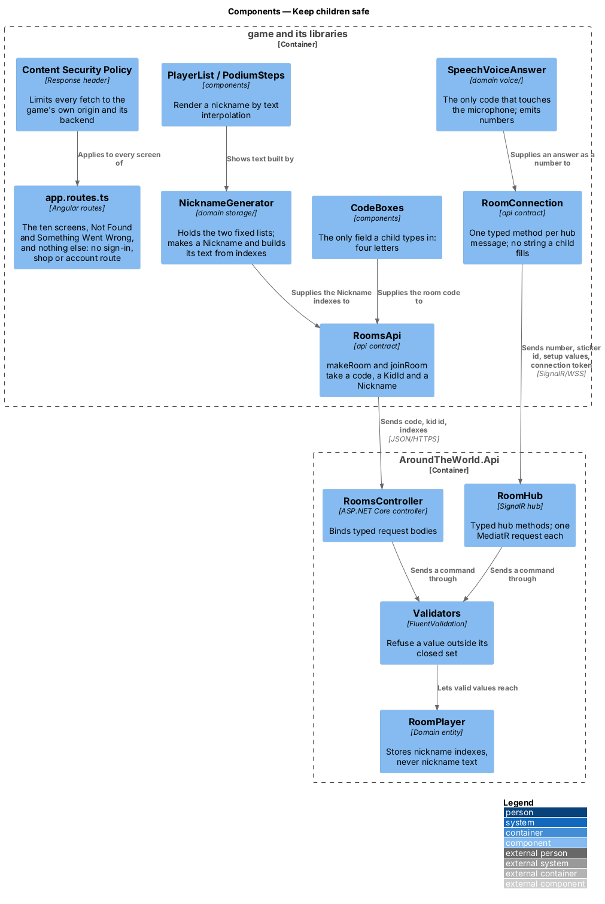
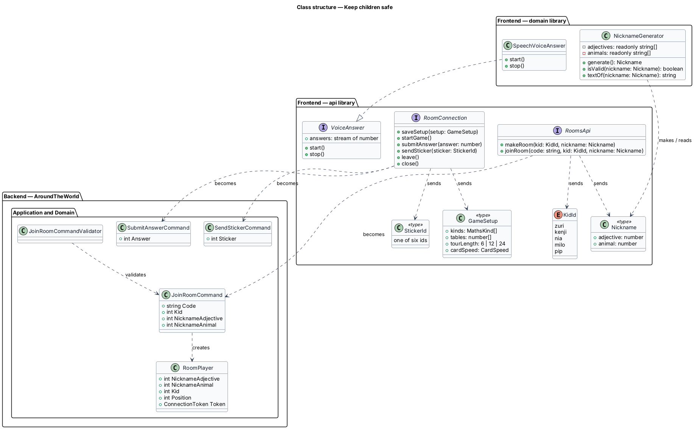
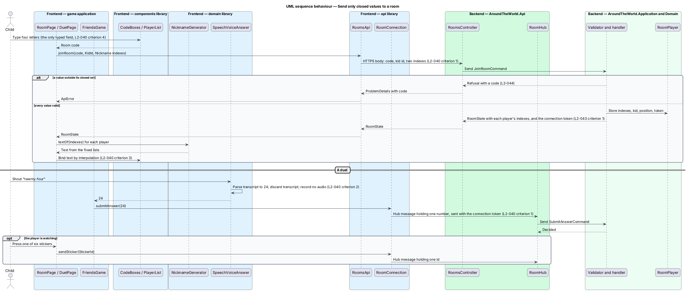
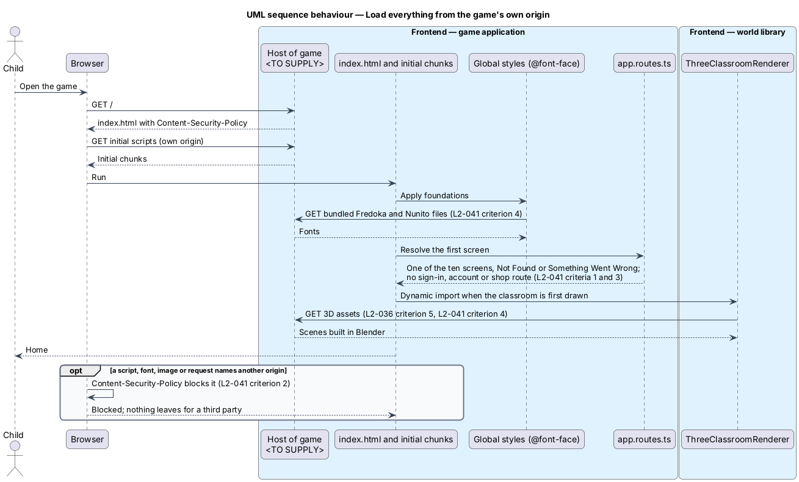

# Keep children safe

## Overview

Around the World is the classroom flash-card game as a web game for children aged 10 to 12. A
child picks a kid, receives a generated nickname, and duels over flash cards, alone against
classmates or with friends in a room. Because the players are children, the game holds no
account and no real name, offers no free-text chat, shows no advert and sells nothing.

This feature is cross-cutting. It adds no screen. It fixes what a client message may hold, what
the browser may fetch and what a screen may ask, so that every other feature is safe by the shape
of its types and not by a rule a later change can forget. It sits in the `platform` subsystem
beside loading, layout and operation.

The terms used below:

- **client message** — HTTP request body or SignalR hub message that the `game` application sends to the backend
- **closed value** — value drawn from a fixed, finite set: a room code of 4 letters, a kid id, a list index, a whole number from 0 to 999, a sticker id or a setup value
- **free text** — string of characters whose content a child chooses
- **connection token** — unguessable value the server gives a player's connection for one room
- **nickname** — made-up name of one adjective and one animal, held everywhere as two list indexes
- **own origin** — scheme, host and port from which the `game` application itself is served
- **third-party origin** — origin that is neither the game's own nor part of the deployed system

The safety of what a language model writes (`L2-042`) belongs to
`docs/detailed-designs/classmates/`. What the backend validates, limits and stores (`L2-043` to
`L2-046`) belongs to `docs/detailed-designs/rooms/guard-room/`. This design fixes the message
shapes those features validate.

## Description

The slice is not built yet. The design introduces the parts below. The members of each contract
are fixed by the design of the subsystem that owns it; this design fixes only the kinds of value
a member may carry.

**Client messages hold closed values and the connection token only (`L2-040` criterion 1).**

- **`RoomsApi`** — contract in the `api` library behind `ROOMS_API`. Making a room sends a
  `KidId` and a `Nickname`. Joining a room sends the room code, a `KidId` and a `Nickname`.
- **`RoomConnection`** — contract in the `api` library behind `ROOM_CONNECTION`. It exposes one
  typed method per hub message: saving a `GameSetup`, starting the game, submitting an answer as
  a `number`, sending a `StickerId`, leaving. The room code is the only `string` a child's choice
  fills in either contract.
- **`Nickname`** — type in the `api` library holding two numbers: the index of the adjective and
  the index of the animal. No type in the `api` library carries a nickname as text.
- **`KidId`**, **`StickerId`**, **`GameSetup`** — closed types in the `api` library: one of five
  kids, one of six stickers, and the values Game Setup offers. The stickers are one for each
  kid and "Beep boop!" (Bolt); which the sixth sticker is, and whose, is (to confirm)
  (`L2-028` criterion 6). `GameSetup` holds the kinds of maths, the times tables, the tour
  length and the card speed. How answers are given is not a value of `GameSetup` and is not
  sent to the backend: each player chooses voice or the number pad on their own device
  (`L2-024` criterion 5, `L2-032` criterion 4).
- **Backend commands** — `MakeRoomCommand`, `JoinRoomCommand`, `SaveSetupCommand`,
  `SubmitAnswerCommand` and `SendStickerCommand` declare integer and enumeration properties, and
  `JoinRoomCommand` declares the one `string`, the code. A hub method of `RoomHub` has no
  `string` parameter that a child's choice fills. Each `…Validator` refuses a value outside its
  closed set with a `code` (`L2-044` criterion 1, designed in
  `docs/detailed-designs/rooms/guard-room/`).
- **`RoomPlayer`** — domain entity. It stores the two nickname indexes, never nickname text
  (`L2-046` criterion 1).

The connection token of `L2-043` criterion 1 is the one value of a client message that is not
closed. `L2-040` criterion 1 lists it among the values a client message may hold. The server
issues it when a player joins, and a child never types or says it. The token travels as SignalR's access token, settled in
`docs/detailed-designs/rooms/guard-room/` (`docs/adr/0031-making-a-room.md`).

**No audio is recorded, stored or sent (`L2-040` criterion 2).**

- **`VoiceAnswer`** — contract in the `api` library behind `VOICE_ANSWER`. Its only output is a
  stream of numbers. It exposes no transcript, no audio buffer and no stream object.
- **`SpeechVoiceAnswer`** — implementation in `domain`'s `voice/`, the only code that touches the
  microphone or speech recognition. It passes each transcript to the `spokenNumber` parser,
  emits the number, and discards the transcript. It creates no recorder and writes nothing to
  storage. `stop()` ends the recognition session and closes the microphone's stream; the pages
  call it when Duel or Mic Check is left (`L2-048` criterion 1, designed in
  `docs/detailed-designs/platform/load-lazily-and-release/`).
- Neither `RoomsApi` nor `RoomConnection` has a member that accepts audio or a transcript, so a
  shout reaches a room only as `submitAnswer(number)`.

`SpeechVoiceAnswer` requires recognition that runs on the device: each session sets
`processLocally`, and a browser that cannot recognise speech on the device plays with the number
pad, so no sound reaches a recognition service (`docs/adr/0025-answering-by-voice.md`,
`docs/detailed-designs/answering/answer-by-voice/`).

**A nickname is rebuilt from its indexes and rendered as text (`L2-040` criterion 3).**

- **`NicknameGenerator`** — class in `domain`'s `storage/`. It holds the two fixed lists.
  `generate()` returns a `Nickname`. `isValid()` reports whether both indexes are inside the
  lists. `textOf()` builds the text from the lists.
- A page that receives a `RoomState` calls `textOf()` for each player and passes the result to
  the component that shows it. A nickname is shown in the Lobby (`PlayerList`, the messages
  "{nickname} joined" and "Waiting for {host's nickname} to start…"), on Duel (the HUD, a
  received sticker, the banner "{nickname} dropped out.") and on the Podium (`PodiumSteps`,
  the headline). Each binds it by text interpolation. The device's own player is shown as
  "You", or with "(you)" after the nickname in the Lobby. A name tag on World Map gives the
  kid's name, never a nickname. No template in the workspace binds `innerHTML`, and no code
  bypasses Angular's sanitizer.
- A nickname whose indexes are outside the lists is not shown: the backend refuses it
  (`L2-044` criterion 1), and the device replaces a stored one (`L2-014` criterion 4).

Each list holds ten words, so each index runs from 0 to 9 and 100 nicknames exist (`L2-014`).
The adjectives are Speedy, Mighty, Clever, Bouncy, Sneaky, Brave, Zippy, Jolly, Cosmic and
Turbo. The animals are Otter, Panda, Falcon, Gecko, Llama, Narwhal, Koala, Fox, Penguin and
Yak. The backend holds no word of either list: its validator checks only that each index is a whole
number from 0 to 9, and only `NicknameGenerator` on the device turns the indexes into words
(`docs/adr/0031-making-a-room.md`).

**No screen has a free-text field other than the room code (`L2-040` criterion 4).**

- **`CodeBoxes`** — presentation component, the only text input in the workspace: the design
  system's Code field. One input labelled "Room code" takes the typing and four boxes show the
  letters. It accepts letters only, shows them as capitals and takes no more than four
  (`L2-023` criterion 1).
- **`NumberPad`** — presentation component made of buttons. Digits typed on a keyboard are read
  by a key handler, not by an input field (`L2-010` criterion 5).
- Pick Your Kid offers "New name" and no field (`L2-014` criterion 3). A watching player is
  offered `StickerTray` with six stickers and nothing else (`L2-028` criterion 2). A sticker is
  an id, never text, and its words are fixed.
- The Settings dialog holds two switches and no field (`L2-032` criterion 4). The Pause and
  Leave Game dialogs hold buttons only (`L2-033` criterion 4).

**No account, advert, purchase or third-party origin (`L2-041`).**

- **`app.routes.ts`** — the route table of `game`. It declares the ten screens, Not Found for a
  web address that leads to no screen (`L2-030` criterion 9) and Something Went Wrong for a
  game that breaks (`L2-054` criterion 4), and no other route: no sign-in, account, profile or
  shop route exists (`L2-041` criteria 1 and 3). No screen and no dialog holds a field for an
  email address, an age or a real name.
- **What the screens say** — Home, for a child who has picked no kid, says "No names, no
  sign-up. You pick a kid and get a game name." (`L2-013` criterion 5). Pick Your Kid says "No
  real names here, so everyone stays safe." Mic Check says "Bolt listens for your answer. Your
  voice is never saved or sent to anyone." (`L2-012` criterion 1). Settings says "Kept on this
  device only. No account, ever."
- **`LocalPlayerStorage`** — implementation of `PlayerStorage` in `domain`'s `storage/`. It
  keeps the kid, the nickname, the setup, the sound setting and the way of answering on the
  device and nothing else (`L2-015` criterion 4, designed in
  `docs/detailed-designs/player/pick-kid/`). The way of answering is the switch "Answer by
  shouting" in Settings; each switch is kept the moment it is changed (`L2-032` criterion 4).
- **Bundled assets** — Fredoka and Nunito are declared with `@font-face` in the global styles
  and their files are built into the application. Nunito for sentences beside Fredoka is
  (to confirm) (`docs/mocks/README.md`, open question 8). Every script is a chunk of the
  build. The kids' portraits, the two still pictures of the classroom and the 3D classroom's
  scenes are static assets of `game` (`L2-041` criterion 4, `L2-036` criterion 5). `index.html`
  and `angular.json` name no external script, stylesheet or font.
- **No measurement code** — the workspace depends on no advertising or analytics package, and
  the frontend emits no telemetry. Backend telemetry holds nothing about a child (`L2-053`,
  designed in `docs/detailed-designs/platform/operate-backend/`).
- **Content Security Policy** — response header on `index.html`. `default-src`, `script-src`,
  `font-src` and `img-src` allow the own origin only. `connect-src` allows the own origin, the
  backend's origin and the Azure SignalR Service endpoint. The browser blocks a request to any
  other origin (`L2-041` criterion 2). The header is set by whatever serves `game`; that host
  and the policy's full text are `<TO SUPPLY>`.
- **E2E fixture** — the shared Playwright fixture fails a spec on any request off localhost, so
  a change that adds a third-party request fails its own acceptance test.

The Azure SignalR Service endpoint, to which a player's connection goes in a deployed system
(`L2-052` criterion 1), is part of the deployed backend and not a third-party origin under
`L2-041` criterion 2 (`docs/adr/0037-running-the-backend-deployed.md`).

The slice changes no screen's layout. What it states about a screen follows the mocks
`docs/mocks/pages/room/` (states `default`, `empty`, `ready`), `docs/mocks/pages/home/` (state
`empty`), `docs/mocks/pages/pick-your-kid/` (state `default`), `docs/mocks/pages/mic-check/`
(state `default`), `docs/mocks/pages/duel/` (state `watching`), `docs/mocks/dialogs/settings/`
(states `default`, `muted`, `no-speech`) and `docs/mocks/notifications/sticker/` (states
`info`, `stacked`).

## Requirements

The feature realizes the following level-2 (L2) requirements. Each L2 requirement refines a
level-1 (L1) requirement, cited by identifier.

| L2 ID | Refines (L1) | Requirement |
|-------|--------------|-------------|
| `L2-040` | `L1-012` | Nothing a child types or says shall leave the device: a client message shall hold only a room code, a kid id, a nickname's two list indexes, an answer as a number, a sticker id, a setup value or the connection token the server gave it, and never free text; no audio shall be recorded, stored or sent to the backend; a nickname shall be built from the fixed lists by its indexes and rendered as text; no screen shall have a field for free text other than the room code. |
| `L2-041` | `L1-012` | The game shall have no accounts, adverts, purchases or tracking of a child: no screen shall ask for an account, a sign-in, an email address, an age or a real name; no network request shall go to an advertising, analytics or other third-party origin; nothing shall be offered for sale; fonts, scripts and 3D assets shall come from the game's own origin. |

## Diagrams

### System context

A child plays Around the World. The game listens through the browser's own speech recognition
and keeps a number only. In a deployed system the game's messages travel through Azure SignalR
Service. No advertising, analytics or identity system appears, because none exists.

### Containers

The `game` application serves its own fonts, scripts and 3D assets. It sends a code, a kid id
and two nickname indexes over HTTPS, and numbers, sticker ids and setup values over SignalR. The
room store holds indexes, never nickname text.

### Components

`CodeBoxes`, `NicknameGenerator` and `SpeechVoiceAnswer` are the three sources of what a child
contributes: a code, two indexes and a number. `RoomsApi` and `RoomConnection` carry those
values to `RoomsController` and `RoomHub`, whose validators refuse anything outside a closed set.
The Content Security Policy applies to every screen.

### Class structure

The `api` library's types hold numbers and closed ids. `NicknameGenerator` is the only type that
turns a `Nickname` into text. The backend's commands and `RoomPlayer` mirror the same shapes
with integer properties.

### Behaviour — send only closed values to a room

A child types four letters and joins a room. The request holds the code, a kid id and two
indexes; a value outside its closed set is refused with a `code`. The server answers with the
connection token, which each later message carries. Each player's nickname is rebuilt on the
device from its indexes and bound as text. In a duel a shout becomes one number, and a watching
player sends one of six sticker ids.

### Behaviour — load everything from the game's own origin

The browser fetches `index.html`, the initial chunks, the font files and the 3D assets from
the game's own origin. The route table resolves to one of the ten screens, to Not Found or to
Something Went Wrong. The Content Security
Policy blocks any request that names another origin. This behaviour has no backend part, so the
diagram shows frontend boxes only.

