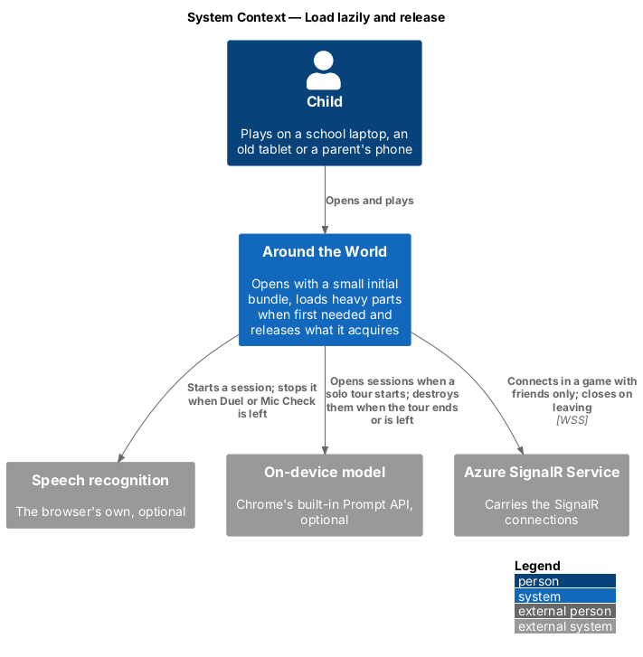
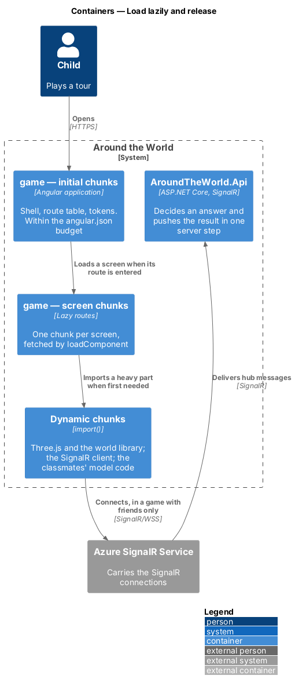
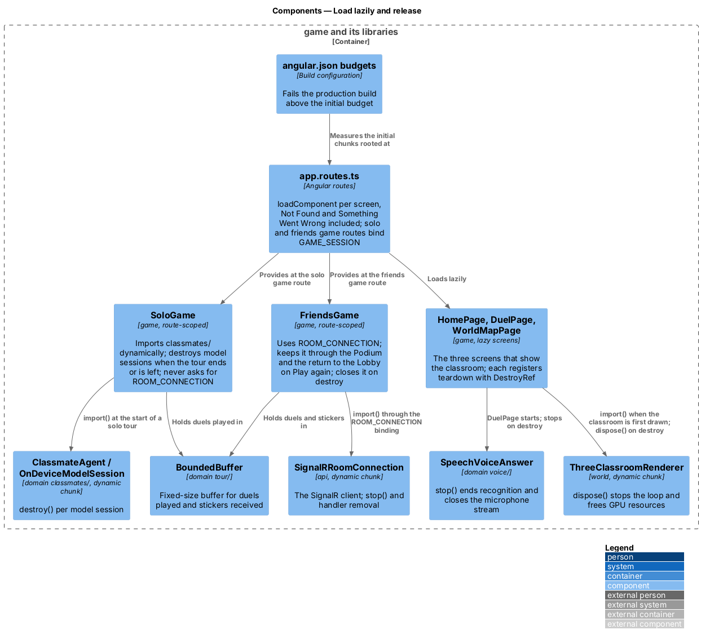
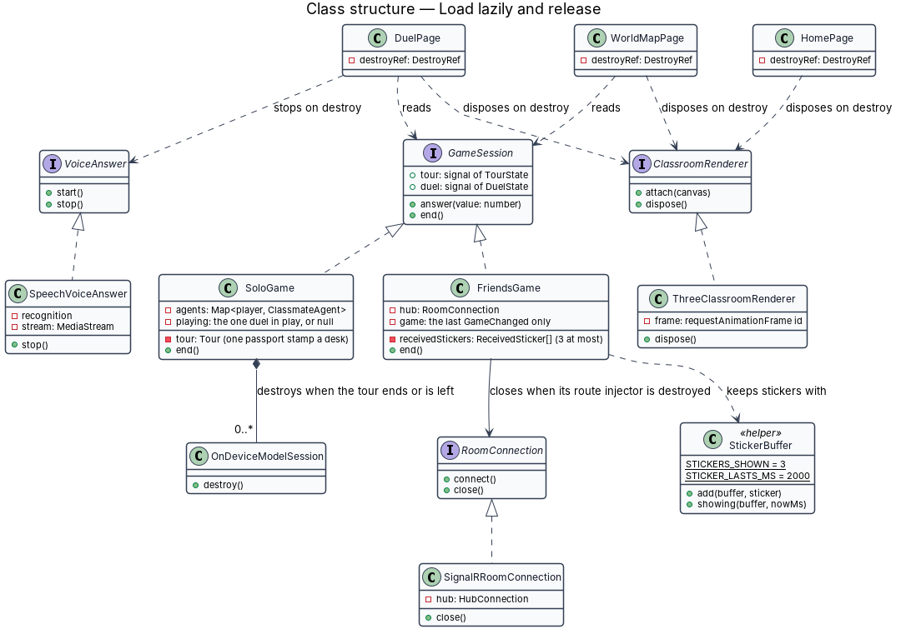
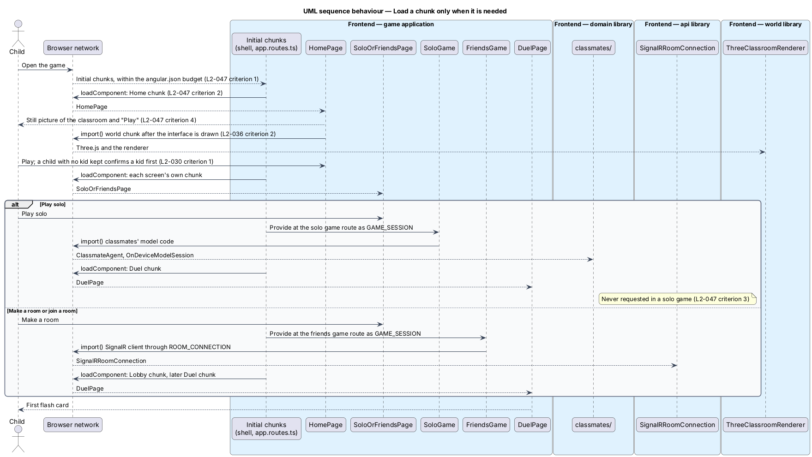
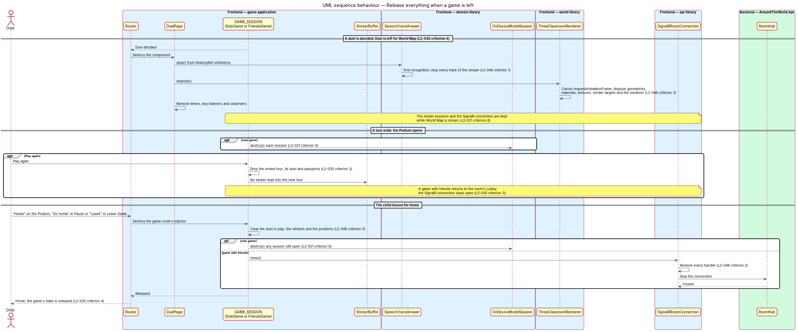

# Load lazily and release

## Overview

Around the World is the classroom flash-card game as a web game for children aged 10 to 12. A
child plays it on whatever is to hand: a school laptop, an old tablet, a parent's phone. The
game opens fast and stays as smooth on the last desk of a 24-desk tour as on the first.
`AGENTS.md` ranks lazy loading and memory management above every other frontend rule.

This feature is cross-cutting. It adds no screen. It fixes four mechanisms that every other
feature uses: the build budget that caps the initial bundle, the route and import structure that
keeps heavy code out of it, the teardown hooks that release what a screen or a game acquires,
and the fixed-size buffers that keep a long tour from growing in memory. It also places the
timing targets of a game on the part that meets each one.

The terms used below:

- **initial bundle** — scripts and styles the browser downloads before the first screen is shown
- **initial chunk** — file of the initial bundle
- **lazy chunk** — file the browser downloads only when a route is entered or a dynamic `import()` runs
- **budget** — size limit in `angular.json` above which the production build fails
- **owner** — component, service or route injector whose destruction ends the life of what it acquired
- **teardown** — work an owner performs when it is destroyed to release what it acquired
- **bounded buffer** — collection with a fixed capacity that drops its oldest item when a new one arrives at capacity

The slice touches the backend in one place only: closing the SignalR connection, and the two
timing targets the server meets (`L2-049` criteria 2 and 3). The renderer's own loading and
fallback belong to `docs/detailed-designs/classroom/`, the voice session to
`docs/detailed-designs/answering/`, and the model sessions to
`docs/detailed-designs/classmates/`.

## Description

The slice is not built yet. The design introduces the parts below.

**The budget (`L2-047` criterion 1).**

- **`angular.json` budgets** — the production configuration of `game` declares a budget of type
  `initial` with a `maximumError`. A build whose initial bundle exceeds it fails. CI runs the
  production build, so a change that grows the initial bundle past the budget does not merge.
  The budgets are 225 kB (warning) and 250 kB (error) for the `initial` bundle, and 4 kB and
  8 kB for `anyComponentStyle`, measured raw (`docs/adr/0008-bundle-budgets.md`). A change that
  raises one shall state its reason.

**A lazy chunk per screen (`L2-047` criterion 2).**

- **`app.routes.ts`** — the route table of `game`. Each of the ten screens, Not Found
  (`L2-030` criterion 9) and Something Went Wrong (`L2-054` criterion 4) is declared with
  `loadComponent`, so each page is its own lazy chunk. The initial chunks hold the shell, the
  route table, the tokens of the `api` library and the global foundations.
- **While a chunk or its content arrives** — placeholders in the shape of the content stand
  in and a status says in words what is arriving, for example "Getting the room…" or "Getting
  the first card ready…". On Home "Play" can be chosen meanwhile (`L2-031` criterion 4).
- **Game routes** — two lazy route groups, one for a solo game and one for a game with friends,
  declared with `loadChildren`. Each group provides `GAME_SESSION` in its route injector: the
  solo group binds `SoloGame`, the friends group binds `FriendsGame`. `DuelPage`,
  `WorldMapPage` and `PodiumPage` are children of both groups and read only `GAME_SESSION`.
  `LobbyPage` is a child of the friends group, so the Lobby a game returns to after "Play
  again" is inside the same route injector (`L2-035` criterion 3).

**Heavy code outside the initial chunks (`L2-047` criteria 2 and 3).**

- **Three.js and the renderer** — the `world` library is reached only through a dynamic
  `import('@atw/world')`. The import runs when the classroom is first drawn, after the screen's
  interface is usable (`L2-036` criterion 2). A still picture stands in until it arrives. On
  Home the picture and "Play" are ready first. Home, Duel and World Map are the only screens
  that show the classroom (`L2-036` criterion 6), so no other screen starts the import.
- **The SignalR client** — `SignalRRoomConnection`, the implementation of `RoomConnection`, and
  the SignalR package it uses are reached only through the `ROOM_CONNECTION` binding of the
  friends route group, whose factory runs a dynamic `import()`. The solo route group does not
  bind `ROOM_CONNECTION` and `SoloGame` does not inject it. A child who plays only a solo game
  never downloads the SignalR client.
- **The classmates' model code** — `SoloGame` imports `domain`'s `classmates/` with a dynamic
  `import()` when a solo tour starts. `ClassmateAgent` and `OnDeviceModelSession` are in no
  initial chunk.
- **The dialogs** — Settings, Pause and Leave Game are each reached through a dynamic
  `import()` that runs when the button that opens the dialog is pressed. The CDK Dialog and
  the three dialogs are therefore in no initial chunk, and Settings is not in Home's chunk.
- **`RoomsApi`** — the HTTP client that makes and joins a room uses Angular's `HttpClient`, has
  no SignalR dependency, and is bound in `app.config.ts`.

How the `api` and `domain` libraries expose `SignalRRoomConnection` and `classmates/` as
separately importable entry points is `<TO SUPPLY>`.

**Teardown (`L2-048` criteria 1 to 3).** Each owner registers its teardown with `DestroyRef`.
A subscription uses `takeUntilDestroyed`. A resource has one of three owners: a page, a tour or
a game. Duel is left for World Map after every decided duel and returns with the next flash
card, or at once when the child chooses "Back to the card" (`L2-030` criterion 4, `L2-034`
criterion 12), so a page's teardown runs once for each duel, while a tour's and a
game's resources stay.

- **`VoiceAnswer.stop()`** — owned by the page. `SpeechVoiceAnswer` ends the recognition
  session and stops every track of the microphone's stream. `DuelPage` and `MicCheckPage` call
  it when destroyed, so the microphone is released while World Map is shown.
- **`ClassroomRenderer.dispose()`** — owned by the page. `ThreeClassroomRenderer` cancels its
  `requestAnimationFrame` loop, then disposes every geometry, material, texture and render
  target, and the renderer, and loses its WebGL context. `HomePage`, `DuelPage` and
  `WorldMapPage` are the three pages that host the classroom (`L2-036` criterion 6), each on a
  `<canvas atwClassroom>` whose directive calls it when the page is destroyed, and when a
  renderer arrives after the page is gone (`docs/adr/0028`). The `world`
  chunk stays loaded, so the next page that hosts the classroom imports nothing again.
- **`OnDeviceModelSession.destroy()`** — owned by the tour. `SoloGame` opens the classmates'
  model sessions when a solo tour starts and keeps them while World Map is shown between the
  duels of that tour. It destroys each session when the tour ends, and when the solo route
  injector is destroyed because the child leaves the tour for Home (`L2-021` criterion 6).
  Destroying `DuelPage` destroys no model session.
- **`RoomConnection.close()`** — owned by the game. `SignalRRoomConnection` removes each
  handler it registered and stops the connection. `FriendsGame` calls it when the friends route
  injector is destroyed. The connection stays open while World Map and the Podium are shown,
  and through "Play again", which returns the players to the same room's Lobby (`L2-035`
  criterion 3, `L2-027` criterion 3). That the room lives until its last player leaves the
  Podium is (to confirm) (`L2-027` criterion 3).
- **Page-level resources** — a page clears its timers, removes its key and resize listeners,
  disconnects its observers and aborts its pending requests in the same hook.
- **Scoped state** — `SoloGame` and `FriendsGame` are provided at their route group, not in
  `root`. Each way out of a game destroys the route injector and with it the game's state
  (`L2-035` criterion 4): "Home" on the Podium, "Go home" in the Pause dialog, "Leave" in the
  Leave Game dialog (`L2-033` criterion 4), "Home" after "We lost the game" (`L2-029`
  criterion 4), "Go home" after "We lost the room" in the Lobby (`L2-029` criterion 6) and
  "Play with friends" on a Podium whose room is lost (`L2-035` criterion 6).

**The stable heap (`L2-048` criterion 4).**

- **Heap check** — a Playwright spec enters and leaves a screen with the classroom 20 times,
  forces garbage collection, and compares the heap with its size after the first time. The
  check fails above 10%. Like the visual and accessibility sweeps, it runs only when a person
  asks.

**Fixed-size buffers (`L2-048` criterion 5).**

- **`BoundedBuffer<T>`** — helper in `domain`'s `tour/` with a fixed capacity. Pushing at
  capacity drops the oldest item.
- **Duels played** — `SoloGame` and `FriendsGame` keep the duels played in a `BoundedBuffer`.
  `Standings` holds no more than one entry for each desk and `Passport` one stamp for each
  desk, so each is bounded by the tour's 24 desks.
- **A new tour** — "Play again" clears the duels played, the stickers received, the positions
  and the passport, so a second tour starts from the same memory as the first. In a solo game
  the new tour starts at once. In a game with friends the players first return to the room's
  Lobby (`L2-035` criterion 3).
- **Stickers received** — `FriendsGame` keeps the stickers received in a `BoundedBuffer`. A
  sticker is removed about 2 seconds after it is shown (`L2-028` criterion 3). Stickers that
  arrive close together stack, newest at the bottom (`L2-028` criterion 7); the mocks stack
  three.
- **Positions** — a map keyed by player. A new position replaces the old one, so the map never
  holds more entries than the tour has desks.

The capacity of the duels buffer and of the stickers buffer is `<TO SUPPLY>`: `L2-048`
criterion 5 requires a fixed limit and states no number.

**The timing targets (`L2-047` criterion 4, `L2-049`).**

| Target | Part that meets it |
|--------|--------------------|
| Home's Largest Contentful Paint within 2.5 s on a mid-range phone on 4G | The initial chunks and the Home chunk draw the still picture and "Play"; the `world` chunk is imported afterwards. |
| "Play" responds within 200 ms | No heavy chunk is parsed before Home is interactive; the press only starts a route change. |
| A pressed digit shows within 100 ms | `DuelPage` holds the entered digits in a signal; the press updates it with no request. |
| Every player sees a result within 500 ms at 100 ms of delay | `SubmitAnswerCommandHandler` decides and `IRoomNotifier` pushes the result in the same server step; no client polls. |
| The server decides an answer within 50 ms at the 95th percentile with 500 rooms of 8 | The handler reads and writes one room. A duration histogram records it (`docs/detailed-designs/platform/operate-backend/`). |
| The last desk of a 24-desk tour draws within 10% of the first desk's frame rate | The bounded buffers, the disposal of each hop's transient objects and `QualityScaler` keep per-frame work constant. |

Whether the 50 ms target holds depends on the room store's engine, Azure SQL Database
(`docs/adr/0009-health-and-migrations.md`), and is measured in journey 17. The
device and network profile that stand for "a mid-range phone on a 4G connection" in a
measurement are `<TO SUPPLY>`.

The slice changes no screen's layout. What it states about a screen follows the mocks: the
`loading` state of each of the ten pages in `docs/mocks/pages/`, `docs/mocks/pages/home/`
(states `default`, `loading`, `error`), `docs/mocks/pages/podium/` (states `friends`, `error`),
`docs/mocks/pages/duel/` (state `error`), `docs/mocks/pages/lobby/` (state `error`),
`docs/mocks/pages/not-found/` and `docs/mocks/pages/something-went-wrong/` (state `default`),
and the dialogs `docs/mocks/dialogs/pause/`, `docs/mocks/dialogs/leave-game/` and
`docs/mocks/dialogs/settings/`.

## Requirements

The feature realizes the following level-2 (L2) requirements. Each L2 requirement refines a
level-1 (L1) requirement, cited by identifier.

| L2 ID | Refines (L1) | Requirement |
|-------|--------------|-------------|
| `L2-047` | `L1-014` | The game shall have a small initial bundle and lazy loading: the initial bundle of a production build shall be within the budget in `angular.json` and the build shall fail above it; every screen shall be its own lazy chunk; Three.js, the classroom's renderer, the SignalR client and the classmates' model code shall be in none of the initial chunks; the SignalR client shall never be downloaded by a child who plays only a solo game; Home's Largest Contentful Paint shall be within 2.5 seconds and its "Play" button shall respond within 200 ms on a mid-range phone on a 4G connection. |
| `L2-048` | `L1-014` | Everything acquired shall be released: leaving Duel or Mic Check shall stop speech recognition and close the microphone's stream; leaving a game with friends shall close the SignalR connection and remove its handlers; leaving a screen with the classroom shall stop its animation loop and dispose every geometry, material, texture and the renderer; the heap after the classroom is entered and left 20 times shall be no more than 10% above its size after the first time; the duels played, the stickers received and the positions held in memory shall each be within a fixed limit. |
| `L2-049` | `L1-014` | The game shall be smooth and prompt during a game: a pressed digit shall show within 100 ms; every player shall see a correct answer's result within 500 ms on a connection with 100 ms of delay; the server shall decide an answer within 50 ms at the 95th percentile when it holds 500 rooms of 8 players each; the Duel screen shall draw at the last desk of a 24-desk tour at the same frame rate as at the first desk, within 10%. |

## Diagrams

### System context

A child opens and plays Around the World. The game uses the browser's speech recognition, the
on-device model and Azure SignalR Service only while the part of the game that needs each is in
use, and releases each when that part is left: the microphone with Duel or Mic Check, the model
sessions with the tour, and the SignalR connection with the game.

### Containers

The `game` application is delivered as three kinds of chunk: the initial chunks under the
budget, one lazy chunk per screen, and the dynamic chunks that hold Three.js with the `world`
library, the SignalR client and the classmates' model code. Only the SignalR chunk reaches the
backend, and only in a game with friends.

### Components

`app.routes.ts` loads each screen lazily and provides `SoloGame` or `FriendsGame` at its game
route. `SoloGame` imports the classmates' code and never asks for `ROOM_CONNECTION`.
`FriendsGame` imports the SignalR client through the `ROOM_CONNECTION` binding. `HomePage`,
`DuelPage` and `WorldMapPage` host the classroom and dispose the renderer when destroyed, and
`DuelPage` also stops the voice session.

### Class structure

`SoloGame` and `FriendsGame` realize `GameSession` and own their `BoundedBuffer` instances.
Each contract that acquires a resource declares the method that releases it: `stop()`,
`close()`, `dispose()` and `destroy()`.

### Behaviour — load a chunk only when it is needed

The browser downloads the initial chunks, then the Home chunk, then the `world` chunk once the
interface is drawn. A child with no kid kept on the device passes Pick Your Kid; "Play" takes
any other child to Solo Or Friends (`L2-030` criterion 1). A solo game imports the classmates'
model code and never requests the SignalR client. A game with friends imports the SignalR client
when its route group is entered. This behaviour has no backend part, so the diagram shows
frontend boxes only.

### Behaviour — release everything when a game is left

After each decided duel `DuelPage` is destroyed for World Map: speech recognition stops, the
microphone's stream closes and the renderer is disposed, while the model sessions and the
SignalR connection are kept. When a solo tour ends, `SoloGame` destroys its model sessions.
"Play again" clears the buffers; in a game with friends it returns the players to the Lobby with
the connection still open. When the child leaves for Home, the game route's injector is
destroyed: the buffers are cleared, any model session still open is destroyed, and the SignalR
connection of a game with friends is closed.

