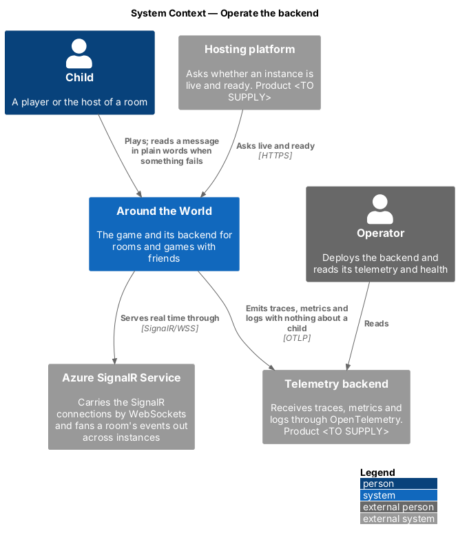
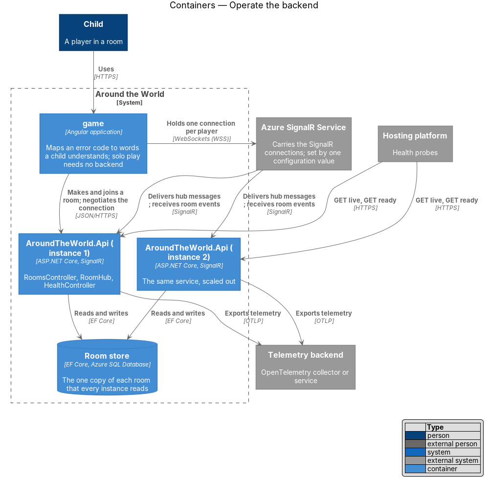
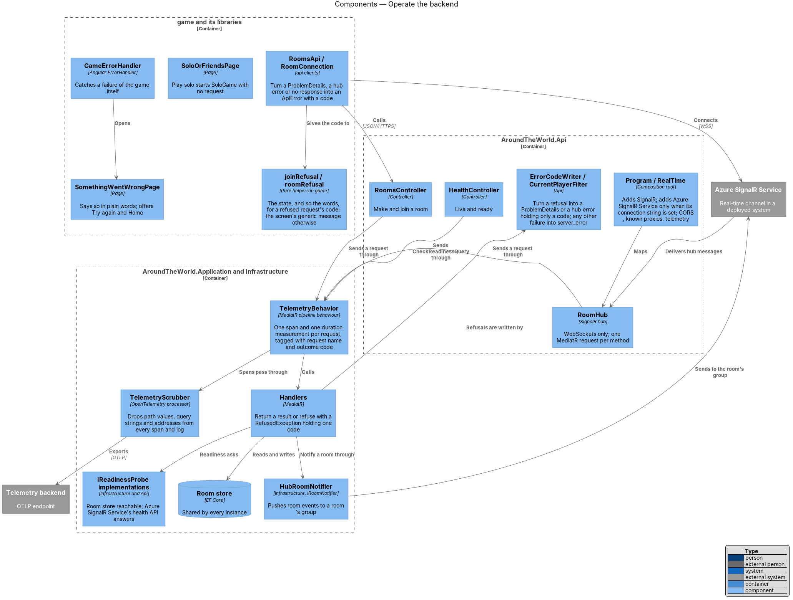
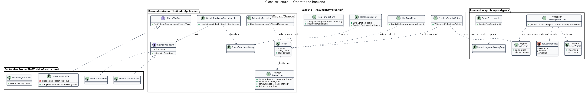
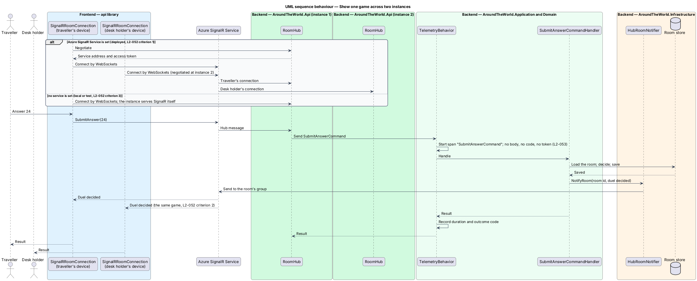
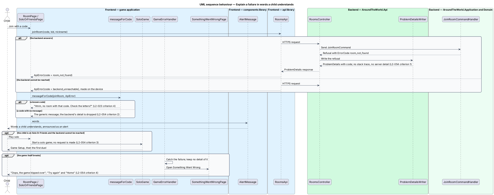
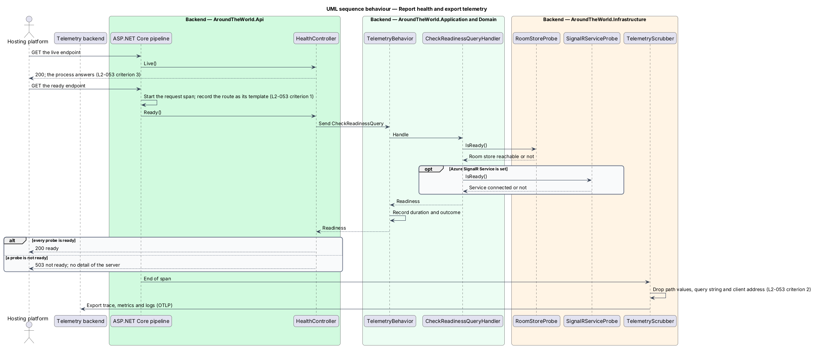

# Operate the backend

## Overview

Around the World is the classroom flash-card game as a web game for children aged 10 to 12. A
solo game is played wholly on the device. A game with friends is a room of up to 8 players who
see the same duel at the same moment; the backend, a .NET service, holds the room and decides
who answered first. SignalR is the backend's one real-time channel.

This feature is cross-cutting. It adds no screen and no rule of the game. It fixes how the
backend runs once deployed: how SignalR connections are carried and scaled out, which settings
a deployment supplies, what the backend reports about itself, how it reports that it is live
and ready, and how a refusal reaches a child as words they understand.

The terms used below:

- **instance** — one running copy of `AroundTheWorld.Api`
- **Azure SignalR Service** — managed service that holds the players' SignalR connections and relays messages between them and the instances
- **self-served SignalR** — arrangement in which an instance holds the players' connections itself, used in a local or test run
- **setting** — configuration value a deployed system supplies from outside the source
- **telemetry** — traces, metrics and logs the backend emits through OpenTelemetry
- **route template** — route as declared, with placeholders in place of values
- **live** — state in which the process answers a request
- **ready** — state in which the instance can serve a room: its room store and its real-time channel are reachable
- **refusal** — outcome in which the backend declines a request and names the reason with a `code`

What the backend accepts, validates, limits and stores (`L2-043` to `L2-046`) belongs to
`docs/detailed-designs/rooms/guard-room/`. The rules of a game with friends belong to
`docs/detailed-designs/tour/` and `docs/detailed-designs/rooms/`.

## Description

The slice is not built yet. The design introduces the parts below.

**Real time through Azure SignalR Service (`L2-052` criteria 1 to 3).**

- **`Program`** — composition root of `AroundTheWorld.Api`. It adds SignalR and maps `RoomHub`.
  When the setting `Azure:SignalR:ConnectionString` holds a value, it also adds Azure SignalR
  Service. When the setting is absent, the instance serves SignalR itself. The same code path
  serves both, so every test runs against the in-memory test server with a real SignalR client
  and no service.
- **WebSockets only** — `RoomHub` is mapped with WebSockets as its only transport, and
  `SignalRRoomConnection` in the `api` library asks for WebSockets only. A player's device
  negotiates with an instance, receives the service's address and an access token, and opens
  one WebSocket to Azure SignalR Service (`L2-027` criterion 2).
- **`IRoomNotifier`** and **`HubRoomNotifier`** — the port in Application and its
  implementation in Infrastructure. `HubRoomNotifier` sends a room event to the SignalR group
  of that room. The group is keyed by the room's identifier, not by its code. Azure SignalR
  Service delivers a group message to every player of the room, whichever instance received
  each player's connection.
- **Room store** — the one copy of each room. Every instance reads and writes a room through
  `IAppDbContext`, and no instance keeps a room's state in its own memory between requests.
  Two instances therefore show one game: either can decide an answer, and both notify the same
  group.

The room store's engine is Azure SQL Database, through EF Core's SQL Server provider
(`docs/adr/0009-health-and-migrations.md`). Two points of the two-instance design are
`<TO SUPPLY>`:

- how two instances order two answers to one duel that arrive at the same moment, so that
  exactly one wins (`L2-026` criterion 1);
- which instance runs a room's clock (a flash card's time, the 30 seconds a spot is saved, the
  deletion of an idle room) when a room's players are connected to different instances.

The service tier that carries 500 rooms of 8 players (`L2-049` criterion 3) is `<TO SUPPLY>`.

A player's WebSocket goes to the service's endpoint, which is not the game's own origin.
Whether that endpoint counts as a third-party origin under `L2-041` criterion 2, which allows
no request to one, is `<TO SUPPLY>`: `L2-052` criterion 1 requires the service, `L2-041`
criterion 2 allows no such request, and no mock decides between them.
`docs/detailed-designs/platform/keep-children-safe/` carries the same mark.

**Documented settings (`L2-052` criterion 4).**

| Setting | Purpose |
|---------|---------|
| `Azure:SignalR:ConnectionString` | Connection to Azure SignalR Service. Absent in a local or test run. |
| `Frontend:Origin` | Origin of the `game` application, the only origin the CORS policy allows (`L2-044` criterion 4). |
| Rate limits | Limits on making a room, trying codes, answers and stickers (`L2-045`). The setting names are fixed in `docs/detailed-designs/rooms/guard-room/`. |
| `ConnectionStrings:RoomStore` | Connection to the room store, an Azure SQL Database. Absent in a local or test run. |
| `OTEL_EXPORTER_OTLP_ENDPOINT` | Address to which telemetry is exported. |

Each setting is read from configuration supplied by the environment. No setting's value is in
the source, and a connection string or an access key is supplied as a secret. The change that
adds a setting documents it in the same change, in `docs/operations/settings.md`.

**Migrations.** The room store's schema changes only through EF Core migrations, which a
command applies: `dotnet run --project src/AroundTheWorld.Api -- migrate`, run from `backend/`
before a new version starts. `Program` runs `RoomStoreMigrator` for that command and exits; the
API's normal start never migrates (`docs/adr/0009-health-and-migrations.md`).

**Telemetry with nothing about a child (`L2-053` criteria 1 and 2).**

- **OpenTelemetry registration** — `Program` registers tracing, metrics and logging through
  OpenTelemetry with the OTLP exporter. The ASP.NET Core instrumentation starts one span per
  HTTP request and names the route by its template.
- **`TelemetryBehavior`** — MediatR pipeline behaviour in Application. Every controller action
  and every hub method sends one MediatR request, so the behaviour sees each of them. It starts
  a span named after the request type, measures the handler's duration into a histogram, and
  counts outcomes. Its only tags are the request's type name and the outcome `code`. It never
  reads a property of the request. The histogram is the measurement behind `L2-049`
  criterion 3. The instrument names are `<TO SUPPLY>`.
- **`TelemetryScrubber`** — OpenTelemetry processor in Infrastructure, applied to every span
  and log record before export. It removes the path with its values, the query string, the
  full address and the client's address. The access token of a WebSocket travels in a query
  string; removing every query string keeps it out of telemetry.
- **Code in the body** — the join request carries the room code in its body, never in the path
  or the query string, so no route value holds a code.
- **Logging rule** — a log message is a fixed template whose arguments are a request type
  name, an outcome `code`, a duration or a room's identifier. No nickname index, room code,
  connection token or message body is passed to a logger. A room's identifier is internal and
  is not the code a child reads aloud.

**Live and ready (`L2-053` criterion 3).**

- **`HealthController`** — exposes `GET /health/live` and `GET /health/ready`, each marked as
  open to anyone. `Live()` answers 200 with `{"status":"live"}` and no check: an answer shows
  the process runs. It is the one endpoint that sends no MediatR request, so that a liveness
  probe depends on nothing but the process (`docs/adr/0009-health-and-migrations.md`).
  `Ready()` sends `CheckReadinessQuery` and answers 200 when ready and 503 when not, with no
  detail of the server.
- **`CheckReadinessQueryHandler`** — asks each registered `IReadinessProbe` and reports ready
  only when each answers ready.
- **`IReadinessProbe`** — port in Application with two implementations in Infrastructure.
  `RoomStoreProbe` checks that the room store is reachable through `IAppDbContext`.
  `SignalRServiceProbe` checks the connection to Azure SignalR Service and is registered only
  when the service is set.

`AGENTS.md` requires a rate limit on anything open to anyone. Whether the two health endpoints
carry one, and what it is, is `<TO SUPPLY>`.

**Failures a screen can explain (`L2-054`).**

- **`ErrorCode`** — the snake_case codes of Application, for example `room_not_found`,
  `room_full`, `game_started` and `not_host`. A handler refuses by returning a `Result` that
  holds one code.
- **`ProblemDetailsWriter`** — turns a refusal from a controller action into a ProblemDetails
  response with a `code` extension. An unhandled exception becomes a ProblemDetails with a
  generic code. No response holds a stack trace or a detail of the server (`L2-044`
  criterion 3).
- **`HubErrorFilter`** — hub filter on `RoomHub`. It turns a refusal from a hub method into a
  hub error whose only content is the `code`.
- **Rate limiter rejection** — a request refused by a rate limit is answered with status 429
  before any handler runs (`L2-022` criterion 4, `L2-045` criterion 2). The `code` its
  ProblemDetails carries is `<TO SUPPLY>`.
- **`ApiError`** — type in the `api` library. `RoomsApi` and `RoomConnection` turn a
  ProblemDetails or a hub error into an `ApiError` holding the `code`. When no response
  arrives, the client makes an `ApiError` with the code `backend_unreachable` on the device.
- **`messageForCode`** — pure helper in `game` with unit tests. It takes the request that
  failed (making a room, joining a room or saving the setup) and the `code`, and returns the
  words for that pair: a title where the mocks draw one, and a sentence. Any other code gives
  one generic message. It reads only the request and the `code`: a title or a detail sent by
  the backend is never shown. A page passes the words to `AlertMessage`, which renders them as
  text.
- **`GameErrorHandler`** — Angular `ErrorHandler` of `game`, bound in `app.config.ts`. It
  catches a failure of the game itself and opens `SomethingWentWrongPage`, passing on no
  detail of the failure (`L2-054` criterion 4).
- **`SomethingWentWrongPage`** — page of `game` that says "Oops, the game tripped over" and
  "That wasn't you. Try again, and if it keeps happening, tell a grown-up.", and offers "Try
  again" and "Home". "Home" opens Home. What "Try again" opens is `<TO SUPPLY>`: the mock
  leads both buttons to Home.

The mocks word each message below. Each is shown as an alert, and the screen stays as the
child left it.

| Request | `code` | Words | What else the screen does |
|---------|--------|-------|---------------------------|
| Joining a room | `room_not_found` | "Hmm, no room with that code. Check the letters?" (`L2-023` criterion 4) | The code can be changed. |
| Joining a room | `room_full` | "That room is full (8 kids max)." (`L2-023` criterion 5) | |
| Joining a room | `game_started` | "That game already started. Ask for the next one!" (`L2-023` criterion 6) | |
| Joining a room | status 429 | "That's a lot of tries! Wait a moment, then try again." (`L2-045` criterion 2) | "Join" is disabled. |
| Joining a room | `backend_unreachable` | "We can't reach the game right now. Check the internet and try again." (`L2-023` criterion 9) | "Join" stays usable, and "Play solo instead" opens Game Setup. |
| Making a room | `backend_unreachable` | "We couldn't make your room" and "Something went wrong on our side. Try again, or play solo while you wait." (`L2-022` criterion 3) | "Try again" is offered. |
| Making a room | status 429 | "Whoa, slow down a moment" and "That's a lot of rooms! Wait a little, then try again." (`L2-022` criterion 4) | "Make a room" is disabled. |
| Saving the setup | a refusal, or no response | "That setup didn't save" and "The room still has the setup from before. Try again." (`L2-018` criterion 7) | "Try again" is offered and Game Setup stays open. |
| Any | any other code | The generic message (`L2-054` criterion 2); words `<TO SUPPLY>` | |

No mock words the generic message. The `code` of a 429 is `<TO SUPPLY>`, so `messageForCode`
reads the status for that row.

A lost connection has no `code` from the backend: the device notices it. With no network,
Solo Or Friends shows the banner "You're offline. You can still play solo." (`L2-022`
criterion 6). During a game with friends Duel shows "Reconnecting…" and "Hang tight! Your spot
at {country} is saved for 30 seconds." (`L2-029` criterion 1). What Duel, the Lobby and the
Podium show when a game or a room is lost for good (`L2-029` criteria 4 and 6, `L2-035`
criterion 6) is designed in `docs/detailed-designs/rooms/return-after-lost-connection/`.

**"Play solo" with no backend (`L2-054` criterion 3).**

- **`SoloOrFriendsPage`** — makes no request when it opens, and the application makes no
  request to the backend at start. "Play solo" opens Game Setup (`L2-030` criterion 2) and
  starts `SoloGame`, which depends on neither `ROOMS_API` nor `ROOM_CONNECTION` (`L2-019`
  criterion 1). A failed "Make a room" shows its
  message and leaves the child on Solo Or Friends with "Play solo" still enabled. With no
  network "Make a room" and "Join a room" are disabled, with "Playing with friends needs the
  internet." under them, and "Play solo" works (`L2-022` criterion 6).

The slice changes no screen's layout. The messages follow the mocks `docs/mocks/pages/room/`
(states `invalid`, `full`, `started`, `rate-limited`, `error`),
`docs/mocks/pages/solo-or-friends/` (states `error`, `rate-limited`, `offline`),
`docs/mocks/pages/game-setup/` (state `error`), `docs/mocks/pages/duel/` (state
`reconnecting`) and `docs/mocks/pages/something-went-wrong/` (state `default`).

## Requirements

The feature realizes the following level-2 (L2) requirements. Each L2 requirement refines a
level-1 (L1) requirement, cited by identifier.

| L2 ID | Refines (L1) | Requirement |
|-------|--------------|-------------|
| `L2-052` | `L1-017` | Real time shall run through Azure SignalR Service: in the deployed backend a player's SignalR connection shall be served through Azure SignalR Service, by WebSockets; players of one room connected to different instances of the backend shall each see the same game; in a local or test run with no Azure SignalR Service set the backend shall serve SignalR itself and every test shall pass; each setting a deployed system needs (the Azure SignalR Service connection, the frontend's origin, the rate limits) shall be documented and none shall be in the source. |
| `L2-053` | `L1-017` | Telemetry shall hold nothing about a child: the backend shall emit a trace and metrics through OpenTelemetry for each request and hub message, with the route recorded as its template; no log, metric or span shall hold a nickname, room code, connection token, message body or query string; the backend shall answer whether it is live and whether it is ready. |
| `L2-054` | `L1-017` | Failures shall be ones a screen can explain: a refusal shall be a ProblemDetails with a `code`, and the screen shall show a message for that code in words a child understands; for an error the screen has no message for, a generic message shall be shown and the detail from the backend shall not; when the backend cannot be reached, "Play solo" on Solo Or Friends shall still work; when the game itself breaks, a screen shall say so in plain words ("Oops, the game tripped over", "That wasn't you. Try again, and if it keeps happening, tell a grown-up.") and shall offer "Try again" and "Home". |

## Diagrams

### System context

A child plays Around the World, which serves real time through Azure SignalR Service and
exports telemetry to a telemetry backend. A hosting platform asks each instance whether it is
live and ready. The telemetry backend's product and the hosting platform are `<TO SUPPLY>`.

### Containers

Each player's device holds one WebSocket to Azure SignalR Service, which relays hub messages to
two instances of `AroundTheWorld.Api`. Both instances read and write the same room store,
export telemetry and answer health probes.

### Components

`Program` adds Azure SignalR Service only when its connection string is set. Every request
passes through `TelemetryBehavior` to its handler. A refusal leaves through
`ProblemDetailsWriter` or `HubErrorFilter`, reaches the device as an `ApiError`, and becomes
words through `messageForCode`. `GameErrorHandler` opens `SomethingWentWrongPage` when the
game itself breaks. Spans pass through `TelemetryScrubber` before export.

### Class structure

A handler returns a `Result` holding one `ErrorCode`. `TelemetryBehavior`,
`ProblemDetailsWriter` and `HubErrorFilter` read only that code. `CheckReadinessQueryHandler`
asks each `IReadinessProbe`. `HubRoomNotifier` realizes `IRoomNotifier`. On the device
`messageForCode` turns a `RefusedRequest` and an `ApiError` into `ErrorWords`.

### Behaviour — show one game across two instances

Two players of one room negotiate at different instances and connect to Azure SignalR Service
by WebSockets. An answer reaches one instance, whose handler decides it against the shared room
store and notifies the room's group; the service delivers the result to both players. With no
service set, the instance serves the connection itself.

### Behaviour — explain a failure in words a child understands

A refusal travels as a ProblemDetails with a `code`, and an unreachable backend becomes a code
made on the device. `messageForCode` returns the words for the request and its code, or the
generic message. On Solo Or Friends, "Play solo" starts a solo game with no request. A failure
of the game itself opens Something Went Wrong.

### Behaviour — report health and export telemetry

The live endpoint answers without a check. The ready endpoint sends `CheckReadinessQuery`,
whose handler asks the room store probe and, when the service is set, the Azure SignalR Service
probe. Each span passes through `TelemetryScrubber`, which drops path values, the query string
and the client's address before export. This behaviour has no frontend part, so the diagram
shows backend boxes only.

