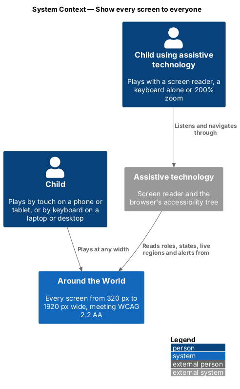
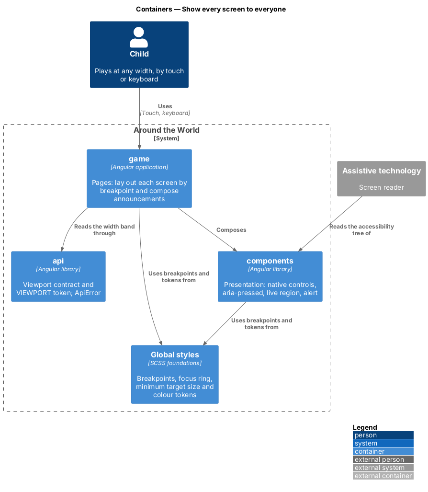
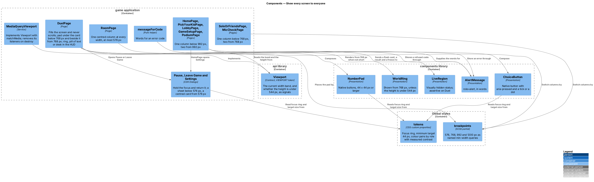
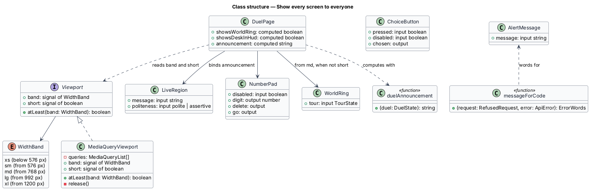
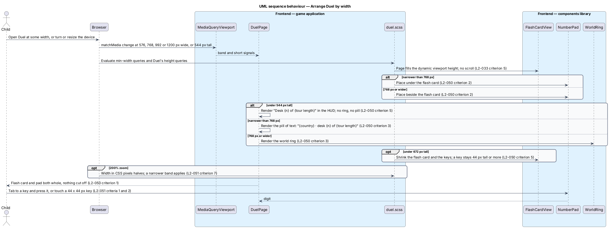
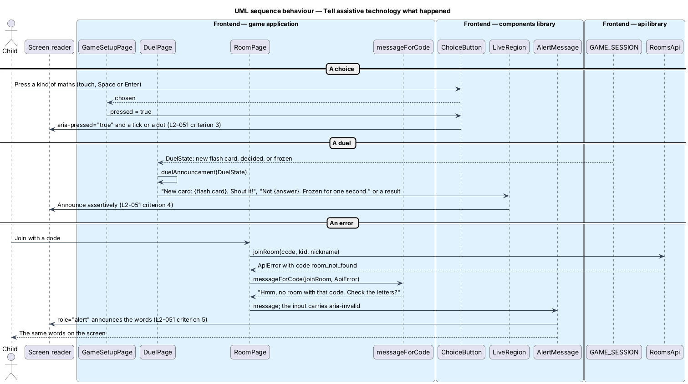

# Show every screen to everyone

## Overview

Around the World is the classroom flash-card game as a web game for children aged 10 to 12. A
child plays it on a phone held upright, a tablet, a laptop or a large desktop, by touch or by
keyboard, and some children play it with a screen reader or with the page zoomed. Every screen
works at every width and meets WCAG 2.2 AA.

This feature is cross-cutting. It adds no screen. It fixes the mechanisms every screen uses:
one set of breakpoints, a layout written from the narrowest width upward, a single source for
the current width where a page renders different parts, native controls with a visible focus
and a minimum target size, pressed state as an attribute, a live region for what happens in a
duel, an alert in words for every error, and colour pairs whose contrast is measured.

The terms used below:

- **breakpoint** — viewport width at which a layout changes: 576, 768, 992 and 1200 px
- **width band** — range of widths between two breakpoints: extra small (below 576 px), small (from 576 px), medium (from 768 px), large (from 992 px), extra large (from 1200 px)
- **touch target** — area of a control that responds to a touch
- **live region** — element whose text changes a screen reader announces without moving the focus
- **alert** — live region with the role `alert`, announced at once
- **status** — live region with the role `status`, announced when the screen reader is free
- **sweep** — Playwright run that visits every mock state at a list of sizes or checks it for accessibility

The slice is played wholly on the device. It has no backend part: its C4 diagrams show no
backend container and its sequence diagrams show frontend boxes only. Reduced motion
(`L2-038`) and the kids' colours (`L2-037`) belong to `docs/detailed-designs/classroom/`. The
number pad's keys and keyboard handling (`L2-010`) belong to
`docs/detailed-designs/answering/`.

## Description

The slice is not built yet. The design introduces the parts below.

**Widths and breakpoints (`L2-050` criterion 1).**

- **`breakpoints`** — SCSS partial among the global foundations. It names the four breakpoints
  576, 768, 992 and 1200 px (`L1-015`) and offers one `min-width` query per breakpoint, written
  in `rem` (36, 48, 62 and 75 rem). The design system names them `--layout-breakpoint-sm`,
  `-md`, `-lg` and `-xl`. A component stylesheet uses a breakpoint by name and states no pixel
  width of its own.
- **Narrowest first** — each stylesheet's base rules lay out the screen for 320 px. Each
  `min-width` query adds to them. A stylesheet of Duel may add a height query, because Duel
  never scrolls.
- **Fluid sizes** — widths are fractions, `minmax()` tracks and `clamp()` values, so a screen
  between two breakpoints and up to 1920 px neither overflows nor leaves controls stranded.
  Text sizes are in `rem`.
- **Page margins** — the page's margin is 16 px below 768 px, 32 px from 768 px and 48 px from
  992 px, and its content is at most 1152 px wide.
- **Responsive sweep** — a Playwright sweep opens every mock state at 320 × 568, 360 × 800,
  at 576, 768, 992 and 1200 px wide, at 844 × 390 and at 1920 × 1080, and fails on a horizontal
  scrollbar, a clipped element or two overlapping controls. It runs only when a person asks.

**Where the page renders different parts.**

- **`Viewport`** — contract in the `api` library behind the `VIEWPORT` token. It exposes the
  current width band as a signal, an `atLeast(band)` test, and a `short` signal that is true
  while the viewport is under 544 px tall.
- **`MediaQueryViewport`** — implementation in `game`, bound in `app.config.ts`. It registers
  one `matchMedia` listener per breakpoint and one for the height, and removes each when
  destroyed. Layout that CSS can express does not use `Viewport`. A page reads it only where
  the rendered parts differ: the world ring on Duel, and the zoom of World Map below 768 px
  (`L2-034` criterion 5, designed in `docs/detailed-designs/classroom/`).

**Duel (`L2-050` criteria 2, 3 and 5; `L2-033` criterion 5).**

- **`DuelPage` layout** — the page is a column of three parts, the HUD, the stage and the
  footer. Its height is the dynamic viewport height and its overflow is hidden, so Duel fills
  the screen and never scrolls. The stage takes the height the HUD and the footer leave, and
  the flash card is the largest thing on the screen at every width. Duel has no minimum height.
- **Number pad** — below 768 px the pad sits under the flash card. From 768 px it sits beside
  the card. The pad keeps the same markup and the same place in the focus order.
- **World ring** — from 768 px `DuelPage` renders `WorldRing` with "Desk {n} of {tour length}".
  Below 768 px it renders, under the HUD, a pill of text: "{country} · desk {n} of {tour
  length}". The choice is an `@if` on `Viewport`, so the ring does no work while it is not
  shown.
- **A phone on its side** — a phone on its side is about 390 px tall and 768 px wide or wider,
  so the pad sits beside the card. Under 672 px tall the flash card and the pad's keys shrink;
  a key is never under 44 px tall. Under 544 px tall the world ring and the pill both give way
  to "Desk {n} of {tour length}" beside the names of the traveller and the desk holder in the
  HUD. The flash card and the pad are both whole.
- **Watching** — the sticker bar in the footer is 2 stickers to a row, 3 from 576 px and one
  row of 6 from 992 px. It wraps and never scrolls sideways.

World Map is the second screen whose height is the viewport's and which never scrolls.

**One or two columns (`L2-050` criteria 4 and 6).** Each page's stylesheet declares one column
in its base rules and two columns in one `min-width` query. The columns are:

| Page | Two columns from | Below that width | From that width |
|------|------------------|------------------|-----------------|
| `HomePage` | 992 px | The classroom fills the top 46% of the height, at least 288 px, and the title panel rises over it. | The title panel is a left column 480 px wide, 544 px from 1200 px. The classroom fills the rest, on the right. |
| `PickYourKidPage` | 992 px | The chosen kid, then the roster, the nickname and the confirm button. | The chosen kid on the left, at 1.1 parts. The roster, the nickname and the confirm button on the right, at 1 part. |
| `LobbyPage` | 992 px | The code, the setup, the start, then the players. | A left column 352 px wide with the code, the setup and the start. The players on the right. |
| `GameSetupPage` | 992 px | The maths, the tour length, the card speed, then the button. | The maths on the left, at 1.25 parts. The tour length, the card speed and the button on the right, at 1 part. |
| `PodiumPage` | 992 px | The headline and the steps, then the passport and the buttons. | The headline and the steps on the left, at 1.25 parts. The passport and the buttons on the right, at 1 part. |
| `SoloOrFriendsPage` | 768 px | The two cards stacked. | The two cards side by side. |
| `MicCheckPage` | 768 px | The picture of Milo and Bolt, then the words. | The picture on the left and the words on the right. |

- **`RoomPage`** — one centred column at every width, at most 576 px wide (`L2-050`
  criterion 6). Not Found and Something Went Wrong are the same centred column.
- **Changes inside a column** — the 576 px and 1200 px queries change no column, only sizes
  and the count of items in a row. The Lobby's players are 2 to a row, 3 from 576 px and 4 from
  1200 px. Game Setup's times tables are 4 to a row and 6 from 576 px. The Podium's passport is
  3 to a row and 4 from 576 px; for a tour of 24 desks it is 4 to a row and 6 from 576 px.
  Home's "Play" button is full width below 576 px. Pick Your Kid's roster is five in one row at
  every width. World Map's standings are five to a row below 576 px and one centred row from
  576 px.
- **Dialogs and messages** — a dialog is a sheet from the bottom edge below 576 px and a
  centred card from 576 px. A Lobby message spans the bottom of the screen below 576 px and
  sits at the bottom right from 576 px. A World Map message is centred under the header. A
  received sticker shows at the right edge above Duel's footer. A connection banner lies across
  the top of Duel. None covers the flash card.

**Keyboard (`L2-051` criterion 1).**

- **Native controls** — every control is a `<button>`, an `<a>` or an `<input>`. No `
`
  carries a click handler. Each control is reachable with Tab and works with Enter or Space.
- **Skip link** — every screen starts with a link, "Skip to the game", that moves the focus to
  the screen's main part.
- **Focus order** — the order of elements in a template is the order on the screen. No
  stylesheet reorders items visually and no template sets a positive `tabindex`.
- **Focus ring** — one ring styles `:focus-visible` on every control: 4 px wide with a 3 px
  offset, read from the tokens `--focus-ring-width`, `--focus-ring-offset` and
  `--color-focus-ring`. No stylesheet removes an outline without replacing it.
- **Dialogs** — Pause, Leave Game and Settings each open a CDK Dialog with the role `dialog`,
  `aria-modal`, its title as its name and its sentence as its description. The dialog holds
  the focus, the screen behind it is inert, and closing it returns the focus to the button
  that opened it. No dialog opens on a dialog.
  - Pause (`L2-033` criterion 4): "Paused", "The clock is stopped. Your desk at {country} is
    waiting.", "Keep playing" and "Go home". The focus starts on "Keep playing". Escape and
    the close button, which is named "Keep playing", do the same as that button.
  - Leave Game (`L2-033` criterion 4): "Leave the game?", "The race carries on without you,
    and you can't come back to this one.", "Stay and play" and "Leave". The close button is
    named "Stay and play". While the room is told, "Leave" is busy and reads "Leaving…",
    "Stay and play" is disabled and the close button is not shown.
  - Settings (`L2-032` criterion 4): "Settings", a close button named "Close", two switches
    and "Done". Each switch is a `<button>` with the role `switch` and `aria-checked`, named
    by its label ("Sound", "Answer by shouting"), described by its help text, and showing "On"
    or "Off" in words. With no speech recognition the second switch is off and disabled.
    Whether Settings stays is (to confirm) (`L2-032` criterion 1).
- **Accessible names** — each control's name is the words it shows. A control that shows only
  an icon is named: "Back" (in the Lobby "Leave the room"), "Mute sound" or "Turn sound on"
  (`L2-032` criterion 3), "Settings", "Pause" or "Leave the game" on Duel, "Back to the card"
  on World Map, "Copy room link" and "Dismiss". Room's input is named "Room code". The number
  pad is a group named "Number pad" whose last two keys are "Delete" and "Go" (`L2-010`
  criterion 1). The timer bar is a `progressbar` named "Time to answer". `WorldRing` is an
  image named "The ring of {tour length} desks: you are at desk {n}".

**Touch targets (`L2-051` criterion 2).**

- **Minimum target token** — the token `--target-min`, 44 px, sets the `min-width` and
  `min-height` of every control in `components`. A control that looks smaller extends its
  target with padding. Icon buttons are 48 px (`--target-comfortable`). Buttons are 44, 48, 56,
  64 or 80 px high; the one large action of a screen is 64 px high below 576 px and 80 px from
  576 px. Nothing depends on hover.

**Pressed state (`L2-051` criterion 3).**

- **`ChoiceButton`** — presentation component in `components`: a native `<button>` with a
  `pressed` input bound to `aria-pressed`. Its stylesheet styles the pressed state through the
  attribute and adds a mark that is not colour: a tick or a dot. Game Setup uses the pattern
  for each kind of maths, each times table, each tour length and each card speed. `KidPicker`
  uses the same pattern for each of the five kids in its roster. The design system draws the
  pattern as four blocks, Toggle chip, Table key, Choice and Segmented choice; whether
  `components` holds one component for each block is settled in
  `docs/detailed-designs/player/set-up-game/`.
- **Disabled choices** — a choice that cannot be changed carries `disabled`: each times table
  while Times is off, and every choice while a setup is being saved.
- **Sound button** — the sound button on Home carries `aria-pressed`, true while sound is
  muted, and its name says what a press does.

**Live regions and alerts (`L2-051` criteria 4 and 5).**

- **`LiveRegion`** — presentation component in `components`: a visually hidden element with
  the role `status`, an `aria-live` politeness and a `message` input. Each live region is in
  the page from the start, also while it is empty. Nothing moves the focus.
- **`duelAnnouncement`** — pure helper in `game` with unit tests. It turns a `DuelState` into
  the words `DuelPage` binds to an assertive `LiveRegion`. The timer bar's draining is not
  announced. The flash card itself shows "= {answer}" and "You got it!", "{rival} said
  {answer} first. So close!" and "Not {answer}! Frozen for a sec…" (`L2-033` criteria 2 and 3,
  `L2-004` criterion 5). The announcements are:

  | Moment | Words |
  |--------|-------|
  | A flash card appears, answered by voice | "New card: {flash card}. Shout it!" |
  | A flash card appears, answered with the number pad | "New card: {flash card}." |
  | The player wins the duel | "{flash card} is {answer}. You got it!" |
  | The player is frozen | "Not {answer}. Frozen for one second." |
  | The player loses the duel | "{rival} said {answer} first. You sit at {country}." |
  | Nobody answers in time | "Time is up. It was {answer}. A new card is coming." |
  | The player is watching | "You are watching. {traveller} against {desk holder}: {flash card}." |

  Whether the answer is given when nobody answers in time is (to confirm) (`L2-005`
  criterion 2). While the passport stamp shows, the stamp card is itself a status and the
  live region is empty.
- **Polite regions** — a joining player and a Lobby message, a received sticker, a World Map
  message and a hint on Game Setup are each announced politely, in a region of their own.
- **Loading** — a screen whose content is still arriving sets `aria-busy` on the part that is
  arriving, hides its placeholders from assistive technology and says in a status what is
  arriving, for example "Getting the room…" (`L2-031` criterion 4).
- **`AlertMessage`** — presentation component in `components`: an element with the role
  `alert` and a `message` input. An error is shown through it, so the error is announced and
  readable in words, with an icon as well as a colour. The focus stays where it was. Room
  shows a refused code as an alert under the field and sets `aria-invalid` on the input; the
  four boxes also change colour and shake once, so colour and motion are not the refusal's
  only carriers (`L2-023` criteria 4 to 6 and 9). Solo Or Friends, Game Setup, the Lobby, Mic
  Check and the Podium show their errors as alerts in the same way. On Duel a lost connection
  shows "Reconnecting…" over everything as an alert, and a game lost for good shows "We lost
  the game" (`L2-029` criteria 1 and 4). A Lobby message that reports a failure, "Couldn't
  copy the link", is an alert and stays until it is dismissed.
- **Statuses that are not errors** — a still picture standing in for the classroom on Home
  and on World Map, drawings standing in for the kids' pictures, the offline banner on Solo
  Or Friends and the connection banners "You're back!", "{nickname} dropped out." and "Your
  internet is wobbly." are statuses. The banner "Everyone else has left." is an alert.
- **`messageForCode`** — pure helper in `game` that maps a refused request and its error
  `code` to words a child understands (`L2-054`, designed in `docs/detailed-designs/platform/operate-backend/`).

**Contrast (`L2-051` criterion 6).**

- **Colour tokens by role** — a stylesheet reads a text token and its surface token as a pair
  and states no hex value. `docs/design-system/tokens/contrast-pairs.json` lists each pair a
  component relies on with its minimum: 4.5 to 1 for text, or 3 to 1 for large text, the edges
  of a control and the focus ring. The design system's contrast check passes every pair in the
  light and the dark theme.
- **The kids' colours** — a button face and a name tag use the deeper shade of a kid's colour
  with white text; yellow keeps navy text. A name tag reads its pair from `--kid-tag-bg` and
  `--kid-tag-fg`, set by `data-kid`. The bright colours are for marks only: the dots of the
  world ring, the timer bar and the backgrounds of pictures (`docs/mocks/README.md`,
  departures 1 and 2). A kid's colour is never the only carrier of a state: the name is always
  written (`L2-037` criterion 4).
- **Themes** — the light theme is the design. The mocks also draw a dark theme from the same
  roles. Whether the game offers the dark theme, following the device, or ships light only is
  (to confirm) (`docs/mocks/README.md`, open question 3). A device that asks for more contrast
  gets stronger edges and secondary text, and forced colours hand the focus ring and the edges
  to the system.

**Zoom (`L2-051` criterion 7).**

- **200% zoom** — zooming halves the viewport's width in CSS pixels, so the `min-width` queries
  select a narrower band and the same layout rules apply. A 1280 px viewport at 200% is laid
  out as 640 px. No stylesheet fixes a height in pixels around text.
- **Accessibility sweep** — a Playwright sweep checks every mock state for roles, names,
  contrast and target size, and opens each at 200% zoom at 1280 px wide. It runs only when a
  person asks. The checking tool is `<TO SUPPLY>`.

The slice follows every mock: each state of each page in `docs/mocks/pages/`, the dialogs
`docs/mocks/dialogs/pause/` (state `default`), `docs/mocks/dialogs/leave-game/` (states
`default`, `busy`) and `docs/mocks/dialogs/settings/` (states `default`, `muted`,
`no-speech`), and the messages in `docs/mocks/notifications/`. The widths, columns, sizes and
colour pairs are those of `docs/design-system/foundations/` (`layout.html`,
`responsive.html`, `accessibility.html`, `theming.html`).

## Requirements

The feature realizes the following level-2 (L2) requirements. Each L2 requirement refines a
level-1 (L1) requirement, cited by identifier.

| L2 ID | Refines (L1) | Requirement |
|-------|--------------|-------------|
| `L2-050` | `L1-015` | Every screen shall work at every width: at 320, 576, 768, 992, 1200 and 1920 px wide nothing shall be cut off, nothing shall overlap and the page shall not scroll sideways; on Duel the number pad shall sit under the flash card below 768 px and beside it from 768 px; on Duel the world ring shall be shown from 768 px and replaced below 768 px by a line of text giving the country and "desk {n} of {tour length}"; Home, Pick Your Kid, the Lobby, Game Setup and the Podium shall be one column below 992 px and two columns from 992 px as the mocks draw it; on a phone turned on its side Duel shall still fill the screen without scrolling with the flash card and the pad both whole, and under 544 px tall the world ring and the line of text shall give way to "Desk {n} of {tour length}" beside the names of the traveller and the desk holder; Solo Or Friends and Mic Check shall be one column below 768 px and two columns from 768 px, and Room shall be one column at every width. |
| `L2-051` | `L1-016` | Every screen shall serve touch, keyboard and assistive technology: every control shall be reachable and workable with a keyboard alone, with a visible focus in the order of the screen; every touch target shall be at least 44 x 44 px; a toggle or a choice that is on shall expose its state with `aria-pressed` and show it by more than colour; a new flash card, a decided duel and a freeze shall be told to a screen reader through a live region; an error shall be announced as an alert in words; text contrast shall be at least 4.5 to 1, or 3 to 1 for large text and for the parts of a control; at 200% zoom nothing shall be lost and the page shall not scroll sideways. |

## Diagrams

### System context

A child plays Around the World at any width, by touch or by keyboard. A child using assistive
technology reaches the same screens through a screen reader, which reads roles, states, live
regions and alerts from the game.

### Containers

The slice lives in the frontend only. The pages of `game` lay out each screen and compose
announcements, the `components` library supplies accessible controls, the `api` library holds
the `Viewport` contract, and the global styles hold the breakpoints and tokens. No backend
container takes part.

### Components

`DuelPage` places the pad through the `breakpoints` partial and reads the width band and the
height from `Viewport` to render `WorldRing`, a pill of text or the desk in the HUD. Five
pages switch to two columns at 992 px and two at 768 px; `RoomPage` stays one column.
`ChoiceButton`, `LiveRegion` and `AlertMessage` carry pressed state, duel events and errors to
assistive technology. Pause, Leave Game and Settings open as CDK Dialogs.

### Class structure

`MediaQueryViewport` realizes `Viewport`, whose `band` is one of five `WidthBand` values and
whose `short` is true under 544 px tall. `DuelPage` computes its announcement with
`duelAnnouncement` and binds it to `LiveRegion`. `AlertMessage` shows the words
`messageForCode` returns.

### Behaviour — arrange Duel by width

When the width changes, the stylesheet's queries place the pad under or beside the flash card
at 768 px, and `DuelPage` renders the world ring or the pill of text at the same width. Under
544 px tall the HUD gives the desk instead. At 200% zoom a narrower band applies. The page
fills the viewport's height at every width.

### Behaviour — tell assistive technology what happened

A pressed choice sets `aria-pressed`. A new flash card, a decided duel or a freeze becomes
words in the assertive live region. An error `code` becomes words in an alert, which is
announced and shown.

