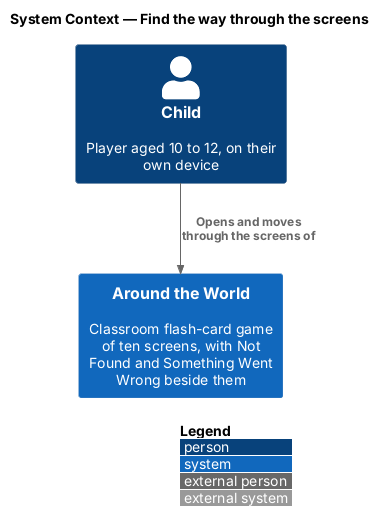
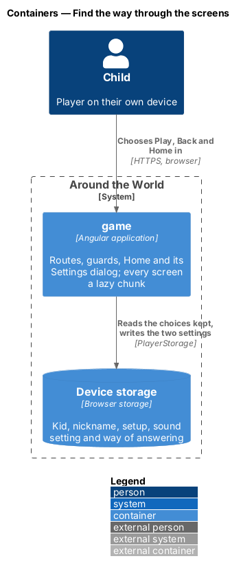
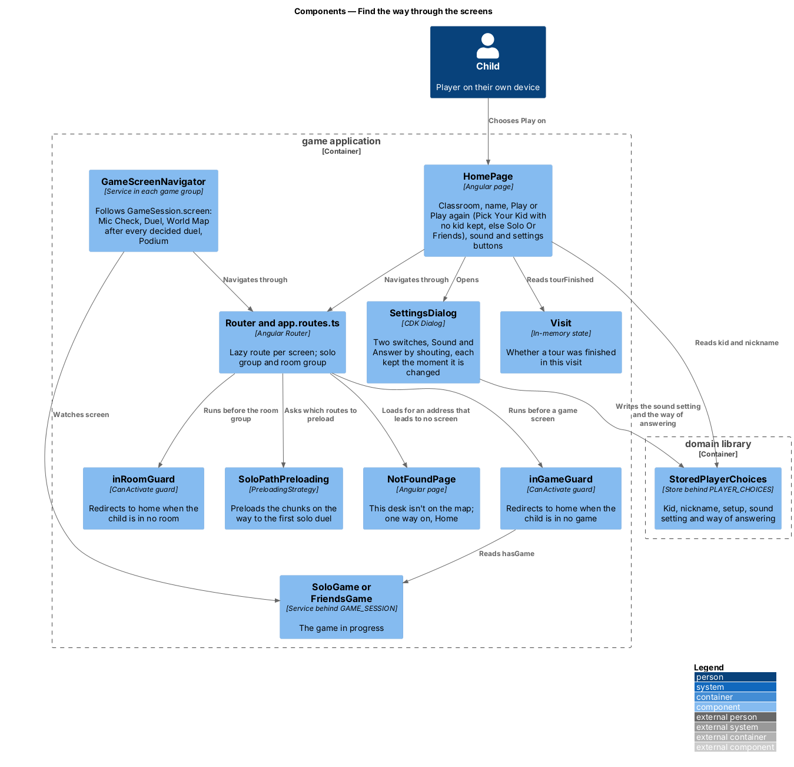
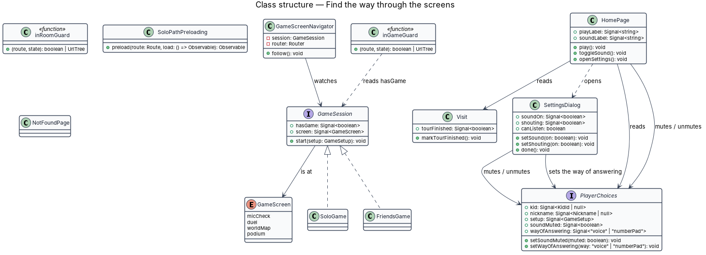
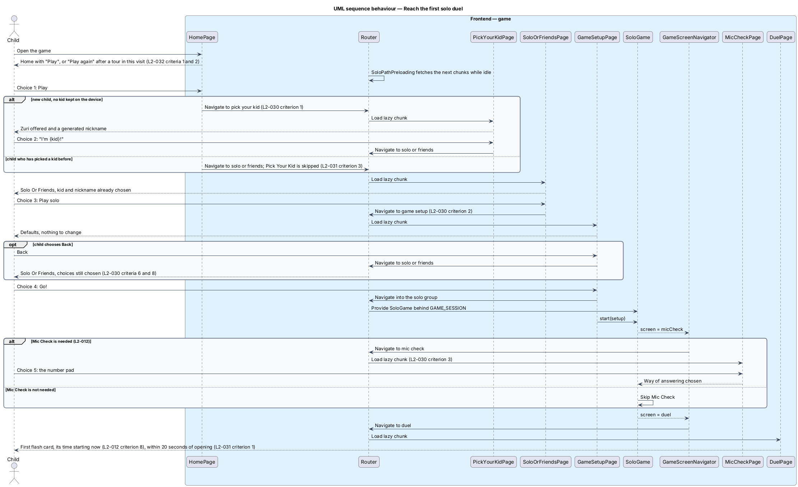
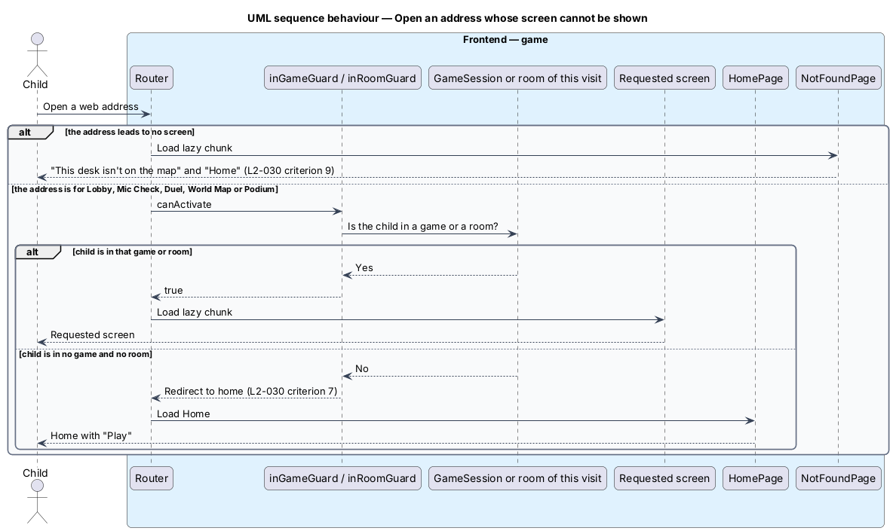
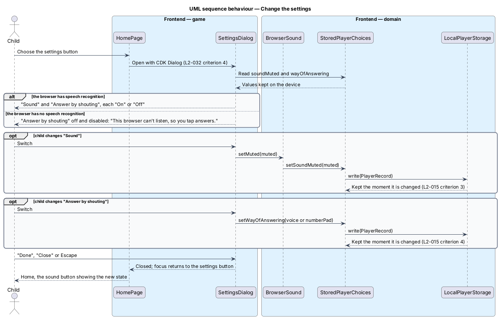

# Find the way through the screens

## Overview

Around the World is the classroom flash-card game as a web game for children aged 10 to 12. The
game has ten screens: Home, Pick Your Kid, Solo Or Friends, Room, Lobby, Game Setup, Mic Check,
Duel, World Map and Podium. This feature is the way between them: which screen follows which
choice, what Back does, what a web address opens when its screen cannot be shown, and what Home
itself shows. Two further pages stand beside the ten: Not Found, for an address that leads to no
screen, and Something Went Wrong, for a failure of the game itself.

- **duel** — contest between the traveller and the desk holder over one flash card
- **tour** — one game, played round a ring of desks
- **solo game** — game played on the device against classmates
- **room** — group of up to 8 players playing together, joined with its code
- **visit** — time from opening the game in the browser to closing or reloading it

The feature also carries the promise that a child is playing within 20 seconds of opening the
game: the way from Home to the first solo duel is five choices long and involves no typing.

The feature sits in the `player` subsystem. Each screen is designed by its own feature:
`player/pick-kid`, `player/set-up-game`, `answering/check-mic`, `tour/play-duel`,
`tour/travel-round-ring`, `tour/end-tour` and the features of `rooms`. This feature owns only
the routes, their guards, Home with its Settings dialog, and Not Found. Something Went Wrong
has its route here and is designed by `platform/operate-backend` (`L2-054` criterion 4).

## Description

Journey 02 built the routes `/`, `/kid` and `/play`, and Home without its corner buttons.
Journey 03 built Solo Or Friends and the solo group with `/setup` and `/duel`, guarded by
`inGameGuard`; Duel shows its loading state until journey 04 deals the first flash card
(`docs/adr/0016-solo-game-route-group.md`). The rest of the slice is not built yet. The sound button arrives with journey 10, the
settings button with journey 07, and Home's error state with the 3D classroom in journey 09
(`docs/adr/0013-pictures-arriving-and-failing.md`). Journey 08 adds Not Found, Something Went
Wrong, and Back during a game (`docs/adr/0027-pausing-leaving-and-recovering.md`). The components below are the ones the
design introduces. The slice
runs wholly on the device and has no backend part. The routes of a game with friends lead into
screens that call `AroundTheWorld.Api`; those calls belong to the `rooms` subsystem.

Routes, declared in the `game` application's `app.routes.ts`. Every route uses `loadComponent`
or `loadChildren`, so each screen is its own lazy chunk (`L2-047` criterion 2). The paths are
those `docs/mocks/manifest.json` gives; no requirement fixes them.

| Path | Screen | Opens from | Back opens | Guard |
|------|--------|------------|------------|-------|
| `/` | `HomePage` | opening the game; "Home" on the Podium, on Not Found and on Something Went Wrong | no Back | none |
| `/kid` | `PickYourKidPage` | "Play" on Home with no kid kept; "Change kid" on Home | Home | none |
| `/play` | `SoloOrFriendsPage` | "I'm {kid}!"; "Play" or "Play again" on Home with a kid kept; "Play with friends" on the Podium | Pick Your Kid | none |
| `/setup` (solo group) | `GameSetupPage` | "Play solo"; "Play solo instead" on Room | Solo Or Friends | none |
| `/room` | `RoomPage` | "Join a room"; a room's link | Solo Or Friends | none |
| `/room/:code` | `LobbyPage` | "Make a room"; "Join" on Room; "Play again" on the Podium in a game with friends | Solo Or Friends | `inRoomGuard` |
| `/setup` (room group) | `GameSetupPage` for the host | "Change" in the Lobby | the Lobby | `inRoomGuard` |
| `/mic` | `MicCheckPage` | "Go!" in a solo game; "Start the race" in a room | Game Setup in a solo game; the Lobby in a game with friends | `inGameGuard` |
| `/duel`, `/map`, `/podium` | `DuelPage`, `WorldMapPage`, `PodiumPage` | a game starting | no Back; the browser's Back pauses a game in progress on Duel and World Map, and opens Game Setup once the tour is over | `inGameGuard`; `pauseOnBackGuard` (deactivate) on Duel and World Map |
| `/error` | `SomethingWentWrongPage` | a failure of the game itself, opened by `GameErrorHandler` without changing the address | no Back | none |
| `/**` | `NotFoundPage` | an address that leads to no screen | no Back | none |

The column "Back opens" is `L2-030` criterion 8. Mic Check, Duel, World Map and the Podium are
the four game screens; the solo group and the room group each load them. `/setup`, `/mic`,
`/duel`, `/map` and `/podium` each serve a solo game and a game with friends; the router
chooses between the two groups with `canMatch`: the room group matches when the visit holds a
room, and the solo group otherwise (`docs/adr/0016-solo-game-route-group.md`). The address of a room's link is
designed in the `rooms` subsystem. The mocks draw Mic Check's Back for a solo game only.

- **Solo group and room group** — two lazy parent routes that load the same four game
  screens. The solo group also holds the solo Game Setup, so "Go!" starts the game on the
  group's own `GAME_SESSION` and then opens the first game screen. `provideRouter` takes
  `withAutoCleanupInjectors()`, so leaving a group destroys its injector. The solo group provides `SoloGame` behind `GAME_SESSION`; the room group provides
  `FriendsGame` behind `GAME_SESSION` and binds `ROOM_CONNECTION`. Duel, World Map and Podium
  read `GAME_SESSION` and do not know which kind of game is played. A child who plays only a
  solo game never loads the room group, so the SignalR client is never downloaded (`L2-047`
  criterion 3). Leaving a group destroys its providers and releases the game's state
  (`L2-035` criterion 4).
- **`inGameGuard`** — functional `CanActivate` guard on the game screens. It reads
  `GameSession.hasGame` and returns a redirect to home when the child is in no game
  (`L2-030` criterion 7).
- **`inRoomGuard`** — functional `CanActivate` guard on the room group. It reads the room
  held for this visit and returns a redirect to home when the child is in no room (`L2-030`
  criterion 7). A room's link opens Room, which carries no guard; that link is designed in the
  `rooms` subsystem. How a player who reloads the page returns to a room is designed in the
  `rooms` subsystem (`L2-029`).
- **`GameSession`** (`GAME_SESSION`, in `api`) — contract of a game in progress. This slice
  reads three members: `hasGame`, `screen` (a signal naming the game screen the game is at:
  Mic Check, Duel, World Map or Podium) and `start(setup)`.
- **`GameScreenNavigator`** — service provided in each game group and created with it. It
  listens to `GameSession.watchScreen` and navigates to the matching route with `replaceUrl`,
  and stops listening when the group is destroyed; it uses no effect, so no framework code joins
  `main` (`docs/adr/0023-game-screens-follow-the-session.md`). The game, not the navigator, decides when `screen` changes:
  - Mic Check when needed and then Duel when the first duel is ready (`L2-030` criterion 3).
    When Mic Check is needed is decided by `answering/check-mic` (`L2-012`). In a game with
    friends each player is shown Mic Check on their own device after the host chooses "Start
    the race" (`L2-012` criterion 9).
  - World Map after every decided duel, whoever won it (`L2-030` criterion 4). After the
    player's win, "You got it!" is shown, the passport stamp then stands in place of the
    flash card, and World Map opens (`L2-033` criterion 7). "You got it!" stays 1 second and the
    passport stamp 1.2 seconds (`docs/adr/0022-moving-round-the-ring.md`); after a win as the
    desk holder World Map opens with no stamp. After the player's loss, Duel stays until the
    child chooses the pill "You sit at {country} · {rival} travels on", the only action on
    the screen (`L2-033` criterion 8). World Map shows the traveller hopping on, or the
    traveller sitting down and the desk holder travelling on.
  - Duel again with the next flash card, when World Map's message has stayed for about
    1.6 seconds (`L2-034` criterion 9), or at once when the child chooses "Back to the card"
    in World Map's header (`L2-034` criterion 12).
  - World Map stays shown in a solo game while the player is seated and two classmates duel.
    Duel returns when a traveller reaches the player's desk (`L2-034` criterion 7).
  - Podium when the tour ends (`L2-030` criterion 5). In a solo game "Play again" on the
    Podium starts a new tour at once and Duel opens, without a return to Game Setup. In a
    game with friends "Play again" returns the players to the same room's Lobby (`L2-035`
    criterion 3). When the room is lost while the Podium is shown, "Play with friends" opens
    Solo Or Friends (`L2-035` criterion 6). "Home" opens Home, whose button then reads "Play
    again".
- **`PlayerChoices`** (`PLAYER_CHOICES`) — store of the kid, the nickname, the setup, the sound
  setting and the way of answering, described in `player/pick-kid`. The whole application
  shares it, so every screen before Duel reads its choices from it. Back from Solo Or Friends
  opens Pick Your Kid with the kid still selected, and Back from Game Setup in a solo game
  opens Solo Or Friends with the setup unchanged (`L2-030` criterion 6). The code typed on
  Room is kept for the visit by the `rooms` subsystem.
- **`Visit`** — in-memory state provided in root: `tourFinished`, set when a Podium is shown.
  It is never written to the device (`L2-015` criterion 4). Its contract and token (`Visit`, `VISIT`) are in
  `api`; `game` binds the in-memory `VisitState`.
- **Back** — each screen from Pick Your Kid to Mic Check has a top bar: an icon button
  labelled "Back", a centred title and an empty right slot. The titles are "Pick your kid",
  "Who's playing?" (Solo Or Friends), "Join a room" (Room), "Room" (the Lobby), "Set up your
  game" or "Set up the race" (Game Setup) and "Mic check". Back is a link to the screen the
  table names (`L2-030` criterion 8), and the browser's own Back does the same. In the Lobby
  the button is labelled "Leave the room"; `rooms/wait-in-lobby` designs it. Home, Duel,
  World Map, the Podium, Not Found and Something Went Wrong have no top bar. World Map's
  header holds "Back to the card", which belongs to `tour/travel-round-ring`. Leaving Duel is
  handled by Pause and Leave, which belong to `tour/play-duel` (`L2-033` criterion 4).
- **`pauseOnBackGuard`** — functional `CanDeactivate` guard on Duel and World Map. While a
  solo game is in progress it refuses a navigation the browser started (`popstate`), pauses the
  game and opens the Pause dialog of `tour/play-duel`, exactly as Pause does (`L2-030`
  criterion 10). A navigation the game or a button starts is never held, nor is any once the
  tour is over. `provideRouter` takes `withRouterConfig({ canceledNavigationResolution:
  'computed' })`, so a refused Back leaves the browser's history as it was
  (`docs/adr/0027-pausing-leaving-and-recovering.md`). Back from the Podium opens Game Setup,
  where "Go!" starts a new game with the setup shown.
- **`NotFoundPage`** — page behind the path `/**`. It reads "This desk isn't on the map" and
  "That page doesn't exist. Let's get you back to the classroom.", and offers one way on, the
  link "Home" (`L2-030` criterion 9). It shows no classroom and has no loading, empty or
  error state. It composes `Notice` from `components` (the globe, the title, the text and the
  action) and is the last route, so an unknown address loads only its chunk and, to find no
  match, the solo group's route table.
- **`SoloPathPreloading`** — router `PreloadingStrategy`. Once Home is shown and the browser
  is idle, it preloads the chunks of the routes marked as on the way to the first solo duel:
  pick your kid, solo or friends, game setup and the solo group. It never preloads the room
  group, Three.js or the classmates' model code.

Home:

- **`HomePage`** — shows the classroom (drawn by `classroom/draw-classroom`), the game's name,
  one large "Play" button and, in a corner, the sound and settings buttons (`L2-032`
  criterion 1).
  - *Title panel.* It reads "The flash-card race", then the game's name "Around the World",
    then "Shout the answer first. Hop to the next desk. Make it all the way round.", then
    the button. The button reads "Play", or "Play again" when `Visit.tourFinished` is true
    (`L2-032` criterion 2). It is as wide as the panel below 576 px.
  - *Play.* For a child with no kid kept on the device, "Play" opens Pick Your Kid. For a
    child who has picked a kid before, "Play" and "Play again" open Solo Or Friends, with the
    kid and the nickname already chosen (`L2-030` criterion 1, `L2-031` criterion 3).
  - *Chip.* Under the button Home shows the kept kid and nickname with "Change kid", which
    opens Pick Your Kid. With no kid kept, Home reads "No names, no sign-up. You pick a kid
    and get a game name." in its place. The chip and that line belong to `player/pick-kid`
    (`L2-013` criteria 4 and 5).
  - *Corner buttons.* The sound button and the settings button sit over the classroom at the
    top right. The sound button calls `Sound.setMuted` through the `SOUND` token. It exposes
    the mute with `aria-pressed`, and its label says which it will do: "Mute sound" while
    sound is on and "Turn sound on" while it is muted (`L2-032` criterion 3). Sound itself
    belongs to `classroom/play-motion-and-sound`. The settings button is labelled "Settings"
    and opens `SettingsDialog`.
  - *Loading.* While the kept kid's picture and the classroom's picture
    (`img/scene-classroom.jpg`, until journey 09 draws the classroom) are arriving through
    `PICTURE_LOADER`, skeletons in their shape stand in and a status reads "Getting your kid…". "Play" can be chosen
    meanwhile (`L2-031` criterion 4).
  - *No 3D classroom.* When the classroom cannot be drawn, its still picture stays and a
    status under the button reads "The 3D classroom is having a rest" and "You're seeing a
    picture of it instead. The game plays just the same." (`L2-036` criterion 3).
  - *Widths.* Below 992 px the classroom fills the top 46% of the height, and at least
    288 px, and the title panel rises over it with rounded top corners. From 992 px the
    title panel is a left column 480 px wide, 544 px from 1200 px, and the classroom fills
    the rest on the right (`L2-050` criterion 4).
- **`SettingsDialog`** — dialog in the `game` application, opened over Home with CDK Dialog
  (`L2-032` criterion 4). Its code is loaded when the settings button is first chosen.
  - *Content.* The title "Settings", a close button labelled "Close", two switches, the
    button "Done" and the line "Kept on this device only. No account, ever." Each switch is a
    `Switch` from `components` with the role `switch`, and shows "On" or "Off" in words.
  - *"Sound".* It reads "Pops, chimes and jingles." and calls `Sound.setMuted`, as the sound
    button does.
  - *"Answer by shouting".* It reads "Off means you tap answers on the number pad." and sets
    `PlayerChoices.wayOfAnswering` to `voice` or `numberPad`. When `VoiceAnswer.available` is
    false (`answering/answer-by-voice`), the switch is off and `disabled` and reads "This
    browser can't listen, so you tap answers."
  - *Keeping.* Each switch is kept on the device the moment it is changed (`L2-015`
    criteria 3 and 4); "Done" saves nothing more. "Done", "Close" and Escape close the dialog
    and return the focus to the settings button.
  - *Widths.* The dialog is a sheet from the bottom below 576 px and a centred card from
    576 px.
  - Whether Settings stays, or the button goes and sound is the one corner button, is to
    confirm (`L2-032` criterion 1). "Answer by shouting" set to off keeps the number pad, so a
    later visit skips Mic Check until it is switched on (`L2-012` criterion 13, ADR 0025).
  - Until journey 10 builds sound, the dialog shows "Answer by shouting" alone; "Sound" joins
    it with that journey.

The five choices of a new child to the first solo duel (`L2-031` criteria 1 and 2) are: "Play"
on Home, the confirm button for the kid offered on Pick Your Kid, "Play solo" on Solo Or
Friends, "Go!" on Game Setup, and the number pad on Mic Check. None involves typing. A child
who has played before skips Pick Your Kid and makes four (`L2-031` criterion 3). The first
flash card appears, and its time starts, when Mic Check is left (`L2-012` criterion 8). The
20 seconds are spent on loading and on those choices. Home's own budget is `L2-047`
criterion 4, and the chunks of the four screens after it are preloaded while the child reads
Home. The 3D classroom and the classmates' model never hold a screen back (`L2-036`
criterion 2, `L2-021` criterion 4). The network profile that stands for "a typical school
connection" in the acceptance test is Chrome's network emulation at 10 Mbit/s down, 5 Mbit/s
up and 40 ms latency, applied through the DevTools protocol; journey 18 writes that test.

The screens follow the mocks `docs/mocks/pages/home/` (states `default`, `empty`, `loading`,
`error`, `played`, `muted`), `docs/mocks/dialogs/settings/` (states `default`, `muted`,
`no-speech`) and `docs/mocks/pages/not-found/` (state `default`). The top bar and its Back
follow the `default` state of each screen from `docs/mocks/pages/pick-your-kid/` to
`docs/mocks/pages/mic-check/`.

## Requirements

The feature realizes the following level-2 (L2) requirements. Each L2 requirement refines a
level-1 (L1) requirement, cited by identifier.

| L2 ID | Refines (L1) | Requirement |
|-------|--------------|-------------|
| `L2-030` | `L1-009` | The way through the screens: for a child with no kid kept on the device, "Play" shall open Pick Your Kid, and confirming a kid shall open Solo Or Friends; for a child who has picked a kid before, "Play" shall open Solo Or Friends; "Play solo" shall open Game Setup, "Make a room" the Lobby and "Join a room" Room; a starting game shall show Mic Check (when needed) and then Duel; after a decided duel World Map shall show what follows (the traveller hopping on, or the traveller sitting down and the desk holder travelling on) and Duel shall return with the next flash card; the Podium shall open when a tour ends; Back on any screen before Duel shall open the screen before it with what the child had chosen still chosen; a web address for a screen that needs a game or a room the child is not in shall open Home. Back shall lead from Pick Your Kid to Home, from Solo Or Friends to Pick Your Kid, from Room and the Lobby to Solo Or Friends, from Game Setup to Solo Or Friends in a solo game and to the Lobby in a game with friends, and from Mic Check to Game Setup in a solo game and to the Lobby in a game with friends. A web address that leads to no screen shall open a screen that says so ("This desk isn't on the map") and offers one way on, "Home". |
| `L2-031` | `L1-009` | Playing within 20 seconds: a new child shall see the first flash card within 20 seconds of opening the game; the way from Home to the first solo duel shall take no more than five choices and no typing; for a child who has played before, one choice ("Play") shall lead on to Solo Or Friends with their kid and nickname already chosen; a screen whose content is still arriving shall show placeholders in the shape of that content and a status that says in words what is arriving, and on Home "Play" shall be choosable meanwhile. |
| `L2-032` | `L1-009` | Home: Home shall show the classroom, the game's name, one large "Play" button and, in a corner, the sound and settings buttons; the button shall read "Play again" for a child who has finished a tour in this visit; the sound button shall mute or unmute every sound and its label shall say which it will do ("Mute sound" or "Turn sound on"); the settings button shall open a Settings dialog with two switches, "Sound" and "Answer by shouting" ("Off means you tap answers on the number pad."), each kept on the device the moment it is changed, and "Done"; in a browser with no speech recognition, "Answer by shouting" shall be off and shall not be turned on ("This browser can't listen, so you tap answers."). Whether Settings stays, or the button goes and sound is the one corner button, is to confirm. |

## Diagrams

### System context

A child moves through the screens of Around the World. The slice involves no other system.

### Containers

The `game` application holds every route and reads the child's choices from the device's
storage. The diagram shows no backend container, because the slice itself makes no request to
`AroundTheWorld.Api`.

### Components

The router loads each screen lazily. The two guards redirect to `HomePage`,
`GameScreenNavigator` follows `GameSession.screen`, and `SoloPathPreloading` fetches the chunks
of the solo path while Home is shown. `HomePage` opens `SettingsDialog`, and `NotFoundPage`
answers an address that leads to no screen.

### Class structure

`GameScreenNavigator` and `inGameGuard` depend on the `GameSession` contract, which `SoloGame`
and `FriendsGame` realize. `HomePage` reads `PlayerChoices`, `Visit` and `Sound`, and
`SettingsDialog` changes `Sound` and `PlayerChoices`.

### Behaviour — reach the first solo duel

A new child makes five choices and types nothing. Each choice opens the next lazy route, and
`GameScreenNavigator` shows Mic Check and then Duel when the game starts. For a child who has
picked a kid before, "Play" opens Solo Or Friends and Pick Your Kid is skipped.

### Behaviour — open an address whose screen cannot be shown

An address that leads to no screen opens `NotFoundPage`. For an address that needs a game or a
room, a guard checks whether the child is in one before the screen's chunk is loaded, and
redirects to Home when the child is in neither.

### Behaviour — change the settings

The settings button on Home opens `SettingsDialog`. Each switch is kept on the device the
moment it is changed, and "Answer by shouting" is off and disabled in a browser with no speech
recognition.

