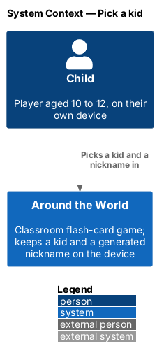
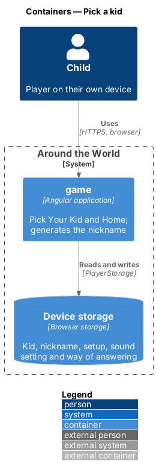
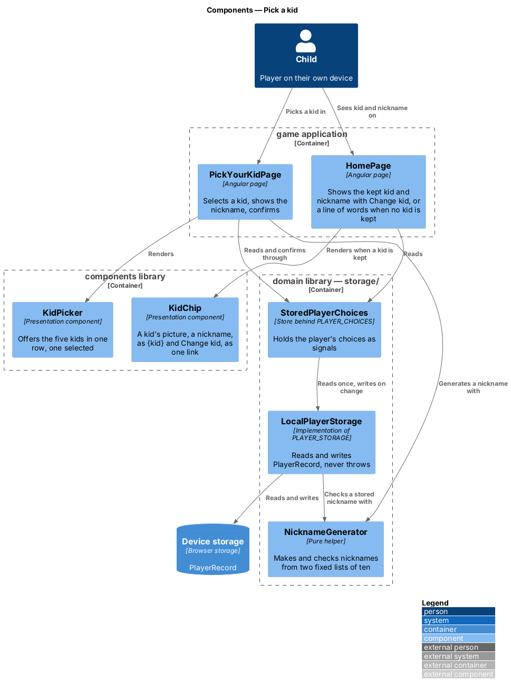
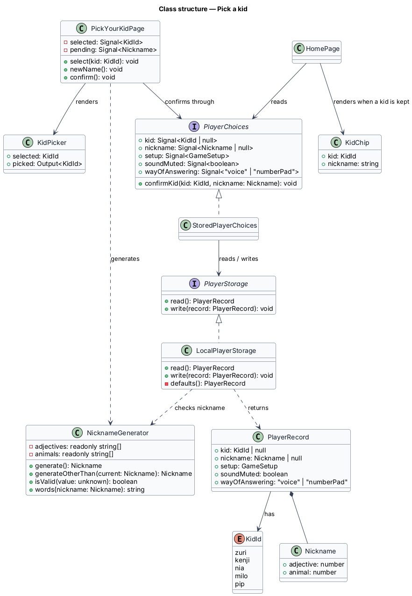
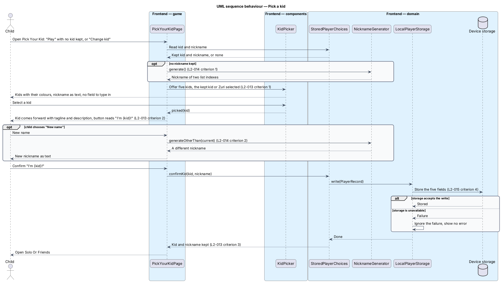
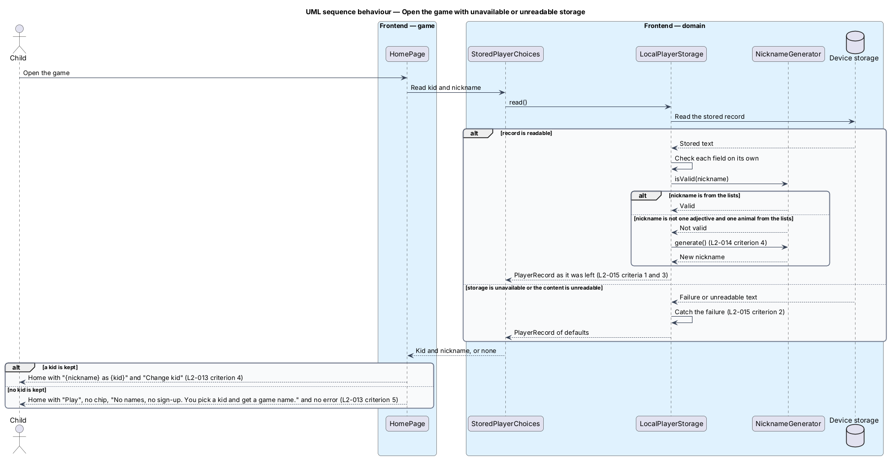

# Pick a kid

## Overview

Around the World is the classroom flash-card game as a web game for children aged 10 to 12. A
child plays without an account, a sign-in or a real name. This feature gives the child the two
things that stand in for an identity: a kid and a nickname. Both are kept on the device and
nowhere else.

- **kid** — one of the five children a player picks to play as: Zuri (yellow), Kenji (blue), Nia (red), Milo (green, with his robot Bolt) and Pip (purple)
- **nickname** — made-up name of one adjective and one animal taken from two fixed lists of ten, such as "Speedy Otter"
- **player** — child playing on a device

The feature covers the Pick Your Kid screen, the part of Home that shows the kid and the
nickname already picked, the generation of the nickname, and everything the game keeps on the
device between visits. It sits in the `player` subsystem beside
`player/set-up-game` and `player/find-way-through-screens`.

A nickname is never typed. No screen of this feature holds a field in which a name can be
entered, so nothing a child writes about themselves exists to be stored or sent.

## Description

The slice is built (journey 02); the components below are the ones it introduced. The slice
runs wholly on the device: it has no backend part and makes no request to `AroundTheWorld.Api`.
A game with friends later sends the kid's id and the nickname's two list indexes to a room;
that exchange belongs to the `rooms` subsystem.

The stage offers the selected kid’s 384- and 1024-pixel portraits to the browser. The roster uses thumbnails.

Types and contracts in the `api` library (`@atw/api`):

- **`KidId`** — identifier of one of the five kids: `zuri`, `kenji`, `nia`, `milo`, `pip`.
- **`Nickname`** — two list indexes, `adjective` and `animal`. A nickname is held and stored as
  indexes and is turned into words only for display.
- **`PlayerRecord`** — everything kept on the device: `kid`, `nickname`, `setup` (`GameSetup`),
  `soundMuted` and `wayOfAnswering` (`voice` or `numberPad`). The record holds no other field
  (`L2-015` criterion 4). `soundMuted` and `wayOfAnswering` are the two switches of the
  Settings dialog, "Sound" and "Answer by shouting" (`L2-032` criterion 4);
  `player/find-way-through-screens` designs the dialog. What `wayOfAnswering` set to
  `numberPad` does to Mic Check on a later visit is `<TO SUPPLY>`; `answering/check-mic` owns
  Mic Check (`L2-012` criterion 6). Journey 02 keeps `kid` and `nickname`; `setup`
  (journey 03), `wayOfAnswering` (journey 07) and `soundMuted` (journey 10) join the record as
  their journeys keep them, and a missing field reads as its default (ADR 0011).
- **`DEVICE_STORAGE`** — injection token for the browser's `Storage`. Its factory returns
  `localStorage`, or `null` when reaching it throws.
- **`PlayerStorage`** (`PLAYER_STORAGE`) — contract with `read(): PlayerRecord` and
  `write(record: PlayerRecord): void`. Neither method throws.
- **`PlayerChoices`** (`PLAYER_CHOICES`) — contract for the store of the player's current
  choices, exposed as signals: `kid`, `nickname`, `setup`, `soundMuted` and `wayOfAnswering`.

Rules in the `domain` library (`@atw/domain`), folder `storage/`:

- **`NicknameGenerator`** — holds the adjective list and the animal list. `generate()` returns
  a `Nickname` chosen at random. `generateOtherThan(current)` returns a nickname that differs
  from the current one (`L2-014` criterion 2). `isValid(value)` answers whether a value is two
  whole-number indexes inside the lists. `words(nickname)` returns the adjective and the animal
  as text. Each list holds ten words, in the order `L2-014` gives, so 100 nicknames exist and
  an index runs from 0 to 9. The adjectives are Speedy, Mighty, Clever, Bouncy, Sneaky, Brave,
  Zippy, Jolly, Cosmic and Turbo. The animals are Otter, Panda, Falcon, Gecko, Llama, Narwhal,
  Koala, Fox, Penguin and Yak.
- **`LocalPlayerStorage`** — implementation of `PlayerStorage`. `read()` catches every failure
  of the browser's storage and every parse failure, and returns the defaults for whatever it
  cannot read (`L2-015` criterion 2). It checks each field on its own: a `kid` that is not one
  of the five ids is dropped, and a nickname that fails `NicknameGenerator.isValid` is replaced
  with a newly generated one (`L2-014` criterion 4). `write()` stores the five fields and
  ignores a failure of the storage. The record is one JSON entry in `localStorage` under the
  key `atw.player`, with a `version` of 1 and the nickname as its two indexes
  (`docs/adr/0011-player-record-on-the-device.md`).
- **`StoredPlayerChoices`** — implementation of `PlayerChoices`. It reads `PLAYER_STORAGE` once
  when the game opens and writes the whole `PlayerRecord` each time a choice changes. The whole
  application shares it, so `game`'s `app.config.ts` binds it.
- **`KIDS`** — the cast in `domain`'s `cast/`: each kid's id, name, tagline, description and
  picture (`img/kid-{id}.jpg`), in the order they are offered. `kidById(id)` finds one.

Pictures:

- **`PictureLoader`** (`PICTURE_LOADER`, in `api`) — contract with `preload(urls, signal)`,
  which resolves `loaded` when every picture has arrived and `failed` when one could not. Its
  implementation `BrowserPictureLoader` lives in `game` and decodes each picture with an
  `Image`, dropping the source when the signal aborts. Pick Your Kid's loading and error
  states, and Home's loading state, follow it
  (`docs/adr/0013-pictures-arriving-and-failing.md`). A storage that cannot be read shows no
  error state (`L2-015` criterion 2).

Presentation in the `components` library (`@atw/components`):

- **`KidPicker`** — offers the five kids in the order Zuri, Kenji, Nia, Milo, Pip, each with
  their colour, with exactly one selected. It takes the selected `KidId` as an input and emits
  a selection. The five kids are five buttons in one row at every width, each a picture and a
  name, in a group labelled "Choose a kid". The selected state of a button is exposed with
  `aria-pressed` and shown by an outline in the deeper shade of the kid's colour and a tick
  beside the name, so by more than colour alone (`L2-051` criterion 3).
- **`KidChip`** — shows a kid's picture, a nickname, "as {kid}" and "Change kid" as one link.
  Home uses it for the kid and the nickname already picked. While the picture arrives it
  shows skeletons in its shape.
- **`Portrait`** — a kid's picture on their colour; a skeleton while it loads, and the drawn
  kid (`Bean`) when it cannot load.
- **`Nickname`** — "Your game name", the nickname as text, the "New name" button and "No real
  names here, so everyone stays safe."; a skeleton while the page loads.
- **`ToyButton`**, **`IconButton`**, **`TextButton`**, **`TopBar`**, **`Screen`**, **`Stack`**,
  **`Panel`**, **`Alert`**, **`Skeleton`** and **`Icon`** — the design-system blocks the two
  screens compose. A component that is a link or a button sits on the native element
  (`a[atw-toy-button]`), so the page keeps the router
  (`docs/adr/0012-interactive-components-on-native-elements.md`).

Each kid has a tagline and a description, fixed by `L2-013`:

| Kid | Tagline | Description |
|-----|---------|-------------|
| Zuri | "First to shout it!" | "Bold and loud. Zuri holds her pencil like a sword and never waits to be asked." |
| Kenji | "Collects every country" | "The planner. Kenji pins a badge on his backpack for every desk he reaches." |
| Nia | "Fastest feet in class" | "The sprinter. Nia is always mid-jump and already halfway to the next desk." |
| Milo | "Quiet. Then BOOM." | "Shy but brilliant. His robot pal Bolt beeps when Milo nails a tricky one." |
| Pip | "Flies to every desk" | "The dreamer. Pip throws a paper plane ahead to every new country." |

Pages in the `game` application:

- **`PickYourKidPage`** — orchestrates the screen, whose top bar reads "Pick your kid". The
  page opens from "Play" on Home when no kid is kept, from "Change kid" on Home, and from Back
  on Solo Or Friends. On opening it selects the kid from `PlayerChoices`, or Zuri when none is
  kept (`L2-013` criterion 1). With no nickname kept, it asks `NicknameGenerator` for one
  (`L2-014` criterion 1). A child who has picked a kid before does not pass through the page
  on the way to a game: "Play" on Home opens Solo Or Friends (`L2-030` criterion 1).
  - *Chosen kid.* The selected kid comes forward with a short fade: the kid's picture, the
    name, the tagline and the description (`L2-013` criterion 2). The region is a polite live
    region, so a screen reader is told which kid is chosen.
  - *Name panel.* It reads "Your game name", shows the nickname as text from `words()`, and
    holds a dice button labelled "New name", which calls `generateOtherThan`. The words of the
    label are hidden below 576 px and stay the button's accessible name. Under it the panel
    reads "No real names here, so everyone stays safe." The page declares no input element
    (`L2-014` criterion 3).
  - *Confirm.* The button reads "I'm {kid}!" (`L2-013` criterion 2). It calls
    `PlayerChoices.confirmKid(kid, nickname)`, which keeps both on the device, and navigates
    to Solo Or Friends (`L2-013` criterion 3).
  - *Loading.* While the kids' pictures are arriving, skeletons in the shape of the chosen
    kid, the roster and the nickname stand in, and a status reads "Getting the kids…". The
    confirm button is disabled and reads "I'm ready!" (`L2-031` criterion 4).
  - *Pictures that do not load.* Drawn kids stand in for the pictures. A status reads "The
    kids' pictures didn't load" and "These little drawings stand in. You can still pick and
    play.", and offers "Try the pictures again". A kid can still be picked and confirmed.
  - *Widths.* Below 992 px the screen is one column: the chosen kid, the roster, the name
    panel and the confirm button. From 992 px the chosen kid is on the left, and the roster,
    the name panel and the confirm button are on the right, in the proportion 1.1 to 1
    (`L2-050` criterion 4).
- **`HomePage`** — shows a `KidChip` under its button when a kid is kept: the kid's picture,
  "{nickname}", "as {kid}" and "Change kid". The chip opens Pick Your Kid with that kid
  selected (`L2-013` criterion 4, `L2-015` criterion 1). To a child who has picked no kid,
  Home shows no kid, no nickname and no "Change kid", and reads "No names, no sign-up. You
  pick a kid and get a game name." in the chip's place (`L2-013` criterion 5). While the kept
  kid is being read, a skeleton in the shape of the chip stands in and a status reads "Getting
  your kid…" (`L2-031` criterion 4). The rest of Home belongs to
  `player/find-way-through-screens`.

The kid and the nickname are kept only when the child confirms. A kid selected or a nickname
generated on Pick Your Kid and then abandoned leaves the device's record unchanged.

The screens follow the mocks `docs/mocks/pages/pick-your-kid/` (states `default`, `milo`,
`renamed`, `loading`, `error`) and, for the chip, `docs/mocks/pages/home/` (states `default`,
`empty`, `loading`).

## Requirements

The feature realizes the following level-2 (L2) requirements. Each L2 requirement refines a
level-1 (L1) requirement, cited by identifier.

| L2 ID | Refines (L1) | Requirement |
|-------|--------------|-------------|
| `L2-013` | `L1-004` | Picking a kid: Pick Your Kid shall offer the five kids (Zuri, Kenji, Nia, Milo and Pip), each with their colour, with one selected: the kid kept on the device, or Zuri when none is kept. The selected kid shall come forward with their name, tagline and description, and the confirm button shall read "I'm {kid}!". Confirming shall keep the kid and the nickname on the device and open Solo Or Friends. Home shall show the nickname and kid of a child who has picked before, and "Change kid" shall open Pick Your Kid with that kid selected. To a child who has picked no kid, Home shall show no kid, no nickname and no "Change kid", and shall say "No names, no sign-up. You pick a kid and get a game name." |
| `L2-014` | `L1-004` | A generated nickname: the game shall generate a nickname of one adjective and one animal from two fixed lists of ten, shall generate a different one on "New name", shall offer no field in which a name can be typed, and shall replace a stored nickname that is not from the lists with a newly generated one. |
| `L2-015` | `L1-004` | What is kept on the device: the device shall hold only the kid, the nickname, the setup, the sound setting and the way of answering ("Answer by shouting" in Settings, `L2-032` criterion 4). Home shall show the same kid and nickname on a later visit, and the mute and the setup shall be as the child left them. The game shall start with the defaults and show no error when the storage is unavailable or unreadable. |

## Diagrams

### System context

The child picks a kid and a nickname in Around the World. No other system takes part: the
choice stays on the child's device.

### Containers

The `game` application reads and writes the browser's storage on the device. The diagram shows
no backend container, because the slice makes no request to `AroundTheWorld.Api`.

### Components

`PickYourKidPage` and `HomePage` read the choices through `PlayerChoices`. `StoredPlayerChoices`
keeps them through `LocalPlayerStorage`, and `NicknameGenerator` makes and checks nicknames.

### Class structure

`PlayerRecord` composes the five kept fields. `LocalPlayerStorage` realizes `PlayerStorage` and
depends on `NicknameGenerator` to check a stored nickname; `StoredPlayerChoices` realizes
`PlayerChoices`.

### Behaviour — pick a kid and keep it on the device

The page opens from "Play" for a child with no kid kept, or from "Change kid". It takes the
kept choices, selects Zuri and generates a nickname when none is kept, and keeps the kid and
the nickname only on confirmation. A failure to write to the storage is ignored and the child

### Behaviour — open the game with unavailable or unreadable storage

`LocalPlayerStorage` returns defaults for whatever it cannot read and replaces a nickname that
is not from the lists, so the game opens with no error (`L2-015` criterion 2, `L2-014`
criterion 4). With no kid kept, Home shows no chip and reads "No names, no sign-up. You pick a
kid and get a game name." (`L2-013` criterion 5).

