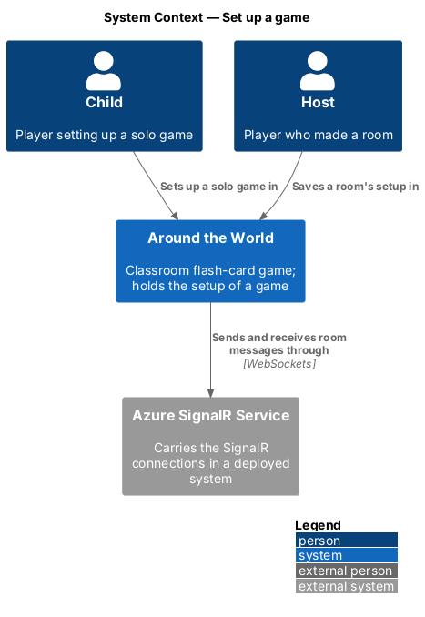
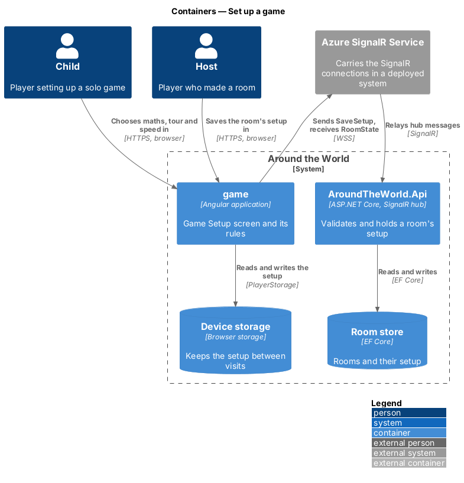
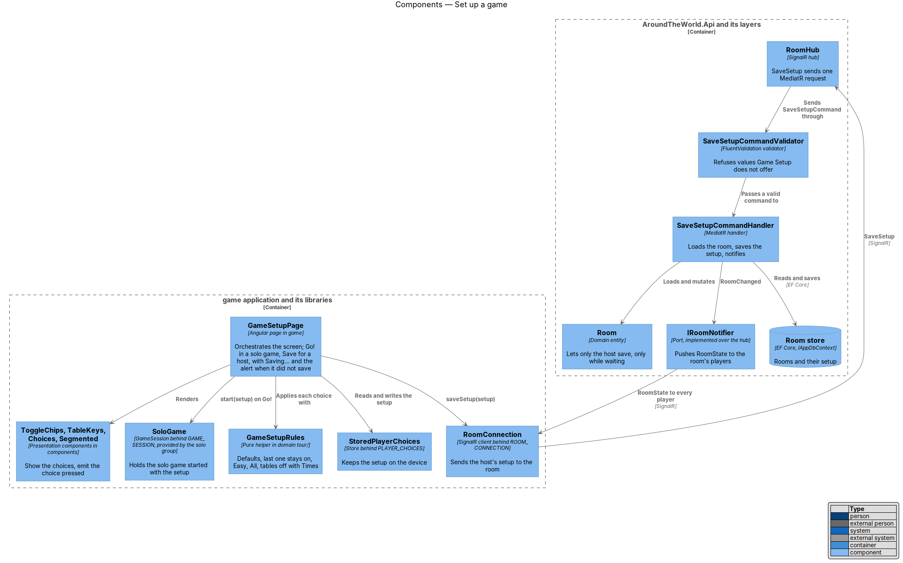
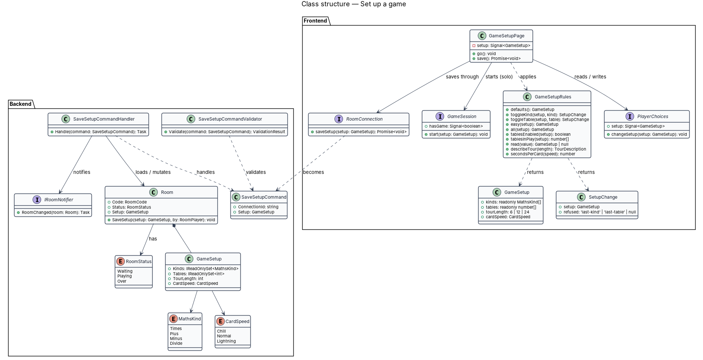
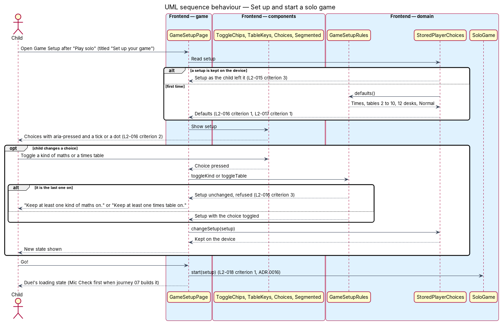
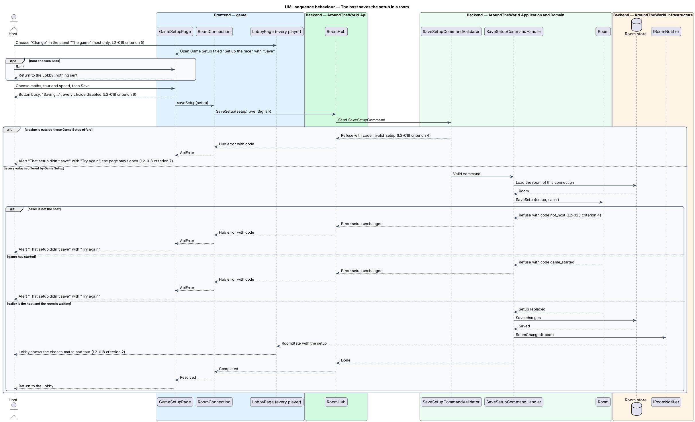

# Set up a game

## Overview

Around the World is the classroom flash-card game as a web game for children aged 10 to 12. A
game is set up once, on the Game Setup screen, and the defaults start a game with no changes.
This feature covers that screen, the rules its choices obey, and the two ways a setup is put to
use: "Go!" starts a solo game on the device, and the host's "Save" gives the setup to a room.
The way of answering is not part of a setup: each player chooses voice or the number pad on
their own device (`L2-024` criterion 5, `L2-032` criterion 4).

- **setup** — choices that shape a game: the kinds of maths, the times tables, the tour length and the card speed
- **kind of maths** — one of Times, Plus, Minus and Divide
- **times table** — whole number from 2 to 12 that is one factor of a Times flash card
- **tour length** — number of desks in the ring: 6, 12 or 24
- **card speed** — time allowed to answer a flash card: Chill (10 seconds), Normal (6 seconds) or Lightning (3 seconds)
- **room** — group of up to 8 players playing together, joined with its code
- **host** — player who made the room

The feature sits in the `player` subsystem. Flash cards are made from the setup by
`tour/make-flash-card`, and the Lobby that shows a room's setup belongs to the `rooms`
subsystem. In a room only the host changes the setup, and the backend, not the screen, decides
that.

## Description

Journey 03 builds the solo game's part: the rules, the screen, the setup kept on the device and
"Go!". The host's part, "Save" and its states, comes with journey 14 (`docs/adr/0017-game-setup-rules-and-states.md`). A solo
game uses the frontend only. A game with friends adds the backend part: the host's setup
travels over the room's SignalR connection to `AroundTheWorld.Api`.

Types and contracts in the `api` library (`@atw/api`):

- **`GameSetup`** — `kinds` (the `MathsKind`s that are on, in the order `times`, `plus`,
  `minus`, `divide`), `tables` (the times tables that are on, whole numbers from 2 to 12 in
  ascending order), `tourLength` (`6`, `12` or `24`) and `cardSpeed` (`chill`, `normal` or
  `lightning`). Lists rather than sets, so a setup is kept on the device as JSON unchanged.
- **`PlayerChoices`** (`PLAYER_CHOICES`) — store of the player's choices, described in
  `player/pick-kid`. Its `setup` signal holds the setup, the defaults until the child changes
  it, and `changeSetup(setup)` writes each change to the device as the field `setup` of the
  player's record (`L2-015` criterion 3, `docs/adr/0017-game-setup-rules-and-states.md`).
- **`GameSession`** (`GAME_SESSION`) — contract of a game in progress, described in
  `player/find-way-through-screens`. The solo group provides `SoloGame` behind it, and "Go!"
  calls its `start(setup)` (`docs/adr/0016-solo-game-route-group.md`).
- **`RoomConnection`** (`ROOM_CONNECTION`) — SignalR client of a room. This slice uses
  `saveSetup(setup: GameSetup): Promise<void>`, which rejects with an `ApiError` holding a
  `code`.

Rules in the `domain` library (`@atw/domain`), folder `tour/`:

- **`GameSetupRules`** — pure helper that holds every rule of the screen.
  - `defaults()` returns Times on, tables 2 to 10 on, Plus, Minus and Divide off, a tour of 12
    desks and card speed Normal (`L2-016` criterion 1, `L2-017` criterion 1).
  - `toggleKind(setup, kind)` and `toggleTable(setup, table)` turn a choice on or off and
    return a `SetupChange`: the setup and `refused`, which is `last-kind` or `last-table` when
    the choice is the last one on and the setup is unchanged (`L2-016` criterion 3), and null
    otherwise.
  - `easy(setup)` turns on tables 2, 3, 4, 5 and 10 only; `all(setup)` turns on tables 2 to 12
    (`L2-016` criterion 4).
  - `tablesEnabled(setup)` is false when Times is off. The tables then cannot be changed and
    are not used (`L2-016` criterion 5): `tablesInPlay(setup)` gives the tables flash cards
    may use, none while Times is off. Turning Times off leaves the chosen tables in the setup,
    so they are on again when Times is turned on again (`L2-016` criterion 6).
  - `read(value)` returns a setup read back from the device when every value is one Game Setup
    offers, and null otherwise, so the defaults stand in (`L2-015` criterion 2).
  - `describeTour(length)` returns the tour's name and about how long it takes: Quick hop,
    about 2 minutes; Round the world, about 5; Grand tour, about 10 (`L2-017` criterion 2).
    `secondsPerCard(speed)` returns 10, 6 or 3 (`L2-017` criterion 3).

Presentation in the `components` library (`@atw/components`), one component per page of
`docs/design-system/components/` (`docs/adr/0010-design-system-components.md`), each on the
native element that holds its group (`docs/adr/0012-interactive-components-on-native-elements.md`):

- **`ToggleChips`** (`div[atw-toggle-chips]`, block `toggle-row`) — the four kinds of maths as
  toggle buttons: "× Times", "+ Plus", "− Minus" and "÷ Divide", in the group "Kinds of
  maths".
- **`TableKeys`** (`div[atw-table-keys]`, block `table-grid`) — the eleven tables, ×2 to ×12,
  in 4 columns, or 6 from 576 px. A table's accessible name is "{n} times table".
- **`Choices`** (`div[atw-choices]`, block `choice-grid`) — "How far round?": 6, 12 or 24
  "desks", one chosen.
- **`Segmented`** (`div[atw-segmented]`, block `segmented`) — "Card speed": Chill, Normal or
  Lightning, one chosen.
- **`Panel`** with its `heading`, and **`PanelHead`** (`div[atw-panel-head]`) for "Times
  tables" with "Easy" and "All" as text buttons in a **`Cluster`**.

Each takes its options and which are on as inputs and emits the option pressed; none holds a
rule. Every option exposes its state with `aria-pressed` (`L2-016` criterion 2) and shows it
with a tick or a dot as well as its colour (`L2-051` criterion 3). Each takes a `disabled`
input, which disables every option.

The page composes them in two panels for the maths and two for the tour:

- *"Which maths?"* holds the kinds; *"Times tables"* holds "Easy", "All" and the keys.
- *Last one on.* When the child presses the last kind of maths that is on, it stays on and a
  status under the kinds reads "Keep at least one kind of maths on. Turn another on first.";
  the last times table stays on and a status under the tables reads "Keep at least one times
  table on. Turn another on first." (`L2-016` criterion 3, mocks `last-one` and
  `last-table`). The status goes at the next choice that changes the setup.
- *Times off.* Every table key is `disabled` and shown not pressed, "Easy" and "All" are not
  offered, and the panel reads "Turn on Times to pick tables." (`L2-016` criterion 5).
- *"How far round?"* reads "{tour name} · about {n} minutes" under the choices with the text
  `GameSetupRules` gives, and *"Card speed"* reads "10 seconds per card", "6 seconds per card"
  or "3 seconds per card. Good luck!". Both lines are polite live regions.

Page in the `game` application:

- **`GameSetupPage`** — reads the setup from `PlayerChoices`, passes each emitted choice
  through `GameSetupRules` and writes the result back. In a game with friends, while the
  room's setup is arriving, skeletons in the shape of the panels stand in and a status reads
  "Getting your setup…" (`L2-031` criterion 4); a solo game reads its setup at once from the
  device and never shows it (`docs/adr/0017-game-setup-rules-and-states.md`).
  - *Solo game.* The page is the first route of the solo group (`/setup`,
    `docs/adr/0016-solo-game-route-group.md`) and opens after "Play solo", or after "Play solo
    instead" on Room (`L2-023` criterion 9). Its top bar reads "Set up your game" and its
    button reads "Go!". "Go!" calls `GameSession.start` with the setup as it stands (`L2-018`
    criterion 1) and opens Duel, which shows its loading state until journey 04 deals the
    first flash card; Mic Check comes first when journey 07 builds it. Back leads to Solo Or
    Friends (`L2-030` criterion 8).
  - *Game with friends.* "Make a room" opens the Lobby directly, before any Game Setup. The
    host reaches Game Setup by choosing "Change" in the Lobby's panel "The game". The
    page then reads "Set up the race" in its top bar and "Save" in place of "Go!" (`L2-018`
    criterion 5). "Save" calls `RoomConnection.saveSetup` and returns to the Lobby when the
    call resolves. Back returns to the Lobby without saving. A player who is not the host is
    shown the setup in the Lobby, is not offered "Change" and has no way to Game Setup
    (`L2-018` criteria 3 and 5).
  - *Saving.* While the call is pending, the button is busy and reads "Saving…", and every
    choice is disabled (`L2-018` criterion 6).
  - *Not saved.* When the room refuses the setup, or the call fails, the page stays open and
    shows an alert above the button: "That setup didn't save" and "The room still has the
    setup from before. Try again.", with "Try again", which sends the setup again. "Save"
    stays, and the choices are as the host left them (`L2-018` criterion 7). The alert is the
    same for every `code`.
  - *Widths.* Below 992 px the screen is one column: the maths, the tour length, the card
    speed and the button. From 992 px the two maths panels are on the left, and the tour
    length, the card speed and the button are on the right, in the proportion 1.25 to 1
    (`L2-050` criterion 4).

Backend, in `AroundTheWorld.Api`, `AroundTheWorld.Application` and `AroundTheWorld.Domain`:

- **`RoomHub.SaveSetup`** — hub method. It checks nothing itself and sends one
  `SaveSetupCommand` with the caller's connection and the setup received.
- **`SaveSetupCommandValidator`** — refuses a setup holding a value Game Setup does not offer:
  a kind of maths outside the four, no kind at all, a table outside 2 to 12, Times on with no
  table, a tour length other than 6, 12 or 24, or a card speed outside the three. The refusal
  is a hub error with the `code` `invalid_setup` (`L2-018` criterion 4).
- **`SaveSetupCommandHandler`** — loads the room of the caller's connection through
  `IAppDbContext`, calls `Room.SaveSetup`, saves, and tells every player through
  `IRoomNotifier`.
- **`Room.SaveSetup(setup, by)`** — replaces the room's `GameSetup`. It refuses with
  `not_host` when the caller is not the host (`L2-025` criterion 4) and with `game_started`
  when the room's status is not `Waiting`. A refusal leaves the room's setup unchanged.
- **`GameSetup`** (domain) — value holding `MathsKind` flags, the tables, the tour length and
  `CardSpeed`.
- **`IRoomNotifier.RoomChanged`** — pushes the room's `RoomState`, which holds the setup, to
  every player in the room, so each Lobby shows the chosen maths and tour (`L2-018`
  criterion 2). The Lobby shows the maths and the tour length; it does not show the card
  speed. How answers are given, the Lobby's row "Answer by", is not a value of `GameSetup`
  and is not sent to the backend: each player chooses voice or the number pad on their own
  device (`L2-024` criterion 5). What the row reads for a player who answers with the number
  pad is to confirm and belongs to `rooms/wait-in-lobby`.

The message that carries a setup holds setup values only and no free text (`L2-040`
criterion 1). The check that the caller's connection belongs to the room is designed in the
`rooms` subsystem (`L2-043`). The engine of the room store is Azure SQL Database (`docs/adr/0009-health-and-migrations.md`). Whether a new room
starts from the default setup or from the setup kept on the host's device is `<TO SUPPLY>`.
Whether a host who saves a setup in a room also changes the setup kept on the host's own device
is `<TO SUPPLY>`.

The screen follows the mocks `docs/mocks/pages/game-setup/` (states `default`, `friends`,
`all-maths`, `easy`, `times-off`, `last-one`, `last-table`, `loading`, `submitting`, `error`).

## Requirements

The feature realizes the following level-2 (L2) requirements. Each L2 requirement refines a
level-1 (L1) requirement, cited by identifier.

| L2 ID | Refines (L1) | Requirement |
|-------|--------------|-------------|
| `L2-016` | `L1-005` | Choosing the maths: Game Setup shall open with Times on, tables 2 to 10 on, and Plus, Minus and Divide off; each kind of maths and times table shall toggle with its state exposed as pressed or not pressed; the last kind of maths shall stay on and Game Setup shall say why ("Keep at least one kind of maths on. Turn another on first."), and the last times table shall stay on and Game Setup shall say why ("Keep at least one times table on. Turn another on first."); "Easy" shall turn on tables 2, 3, 4, 5 and 10 and "All" tables 2 to 12; with Times off the times tables shall not be changeable and shall not be used, "Easy" and "All" shall not be offered, and Game Setup shall say why ("Turn on Times to pick tables."); the tables that were on shall be on again when Times is turned on again. |
| `L2-017` | `L1-005` | Tour length and card speed: Game Setup shall open with a tour of 12 desks and card speed Normal, shall show the tour's name and about how long it takes for 6, 12 or 24 desks (Quick hop, about 2 minutes; Round the world, about 5; Grand tour, about 10), and shall show the time per card for Chill, Normal or Lightning (10, 6 or 3 seconds). |
| `L2-018` | `L1-005` | Starting from the setup: "Go!" shall start a solo game with the defaults when nothing is changed; the host's "Save" shall show the chosen maths and tour to every player in the room; a player who is not the host shall see the setup and shall not change it; the backend shall refuse a setup holding a value outside those Game Setup offers with an error `code` and leave the room's setup unchanged. The host's "Change" in the Lobby shall open Game Setup titled "Set up the race" with "Save" in place of "Go!"; "Save" and Back shall both return to the Lobby; a player who is not the host shall not be offered "Change". While the setup is being saved, the button shall be busy ("Saving…") and no choice shall be changeable. When the room refuses the setup or it cannot be saved, Game Setup shall say so as an alert ("That setup didn't save", "The room still has the setup from before. Try again."), shall offer "Try again" and shall stay open. |

## Diagrams

### System context

A child sets up a solo game, and a host sets up a room's game, in Around the World. Azure
SignalR Service carries the host's setup to the backend in a deployed system.

### Containers

The `game` application keeps the setup on the device and, in a room, sends it to
`AroundTheWorld.Api`, which holds it in the room store and pushes it to every player.

### Components

`GameSetupPage` applies `GameSetupRules` to each choice and keeps the result through
`PlayerChoices`. In a room, `RoomConnection` carries the setup to `RoomHub`, and the validator,
the handler and `Room` decide whether it is accepted.

### Class structure

`GameSetupRules` operates on the frontend's `GameSetup`. On the backend,
`SaveSetupCommandHandler` handles `SaveSetupCommand`, mutates `Room` and notifies through
`IRoomNotifier`; `Room` owns its `GameSetup`.

### Behaviour — set up and start a solo game

Each choice passes through `GameSetupRules` and is kept on the device. The last kind of maths
stays on and the page says why. "Go!" starts the game with the setup as it stands, and no
request reaches the backend.

### Behaviour — the host saves the setup in a room

The host opens Game Setup with "Change" in the Lobby, and "Save" or Back returns there. While
the setup is being saved the button reads "Saving…" and no choice can be changed. The hub
method sends one `SaveSetupCommand`. A value Game Setup does not offer, a caller who is
not the host and a game that has started are each refused with a `code`, the room's setup
is unchanged, and the page shows the alert "That setup didn't save" with "Try again". An
accepted setup reaches every Lobby in the room.

