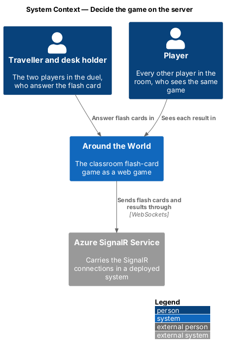
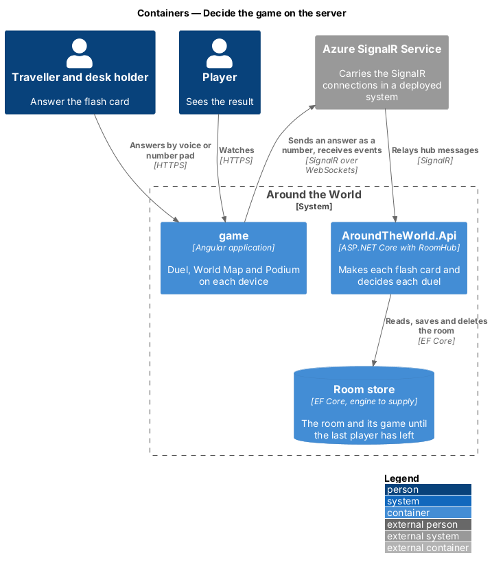
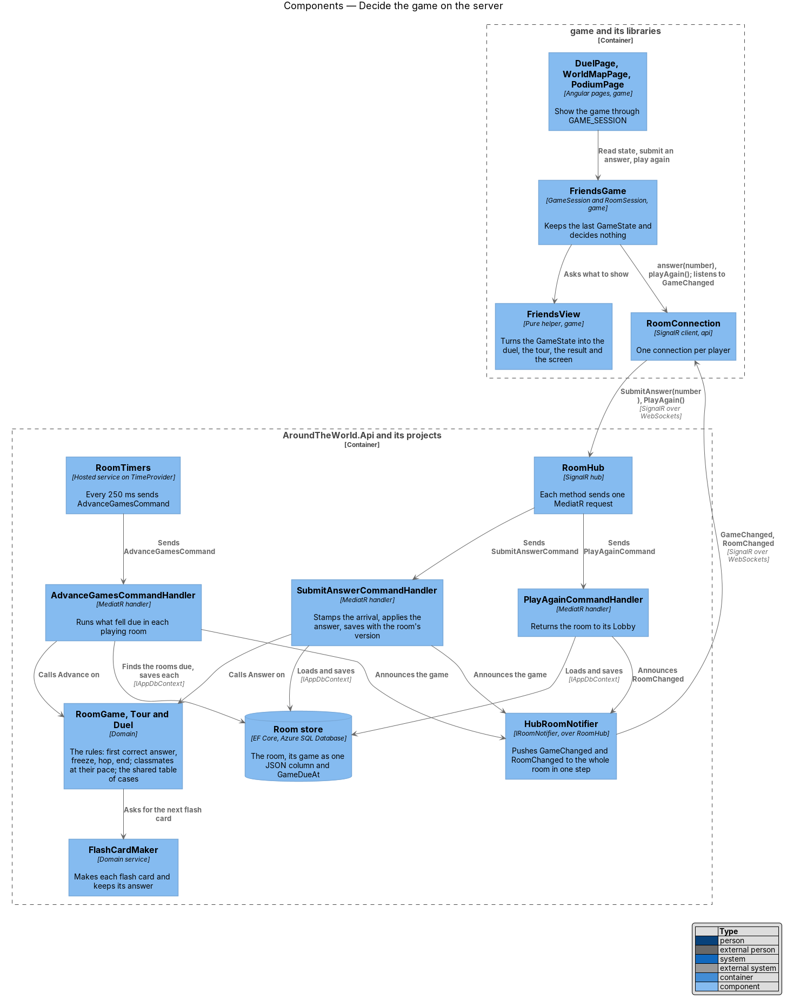
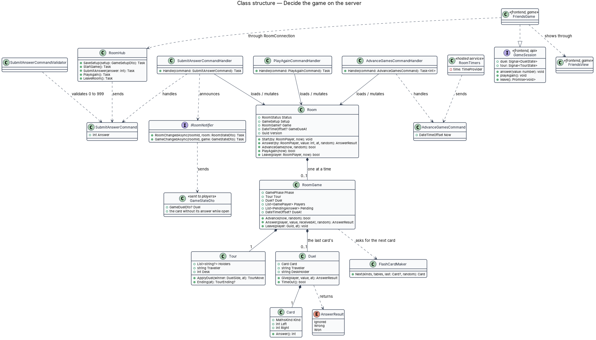
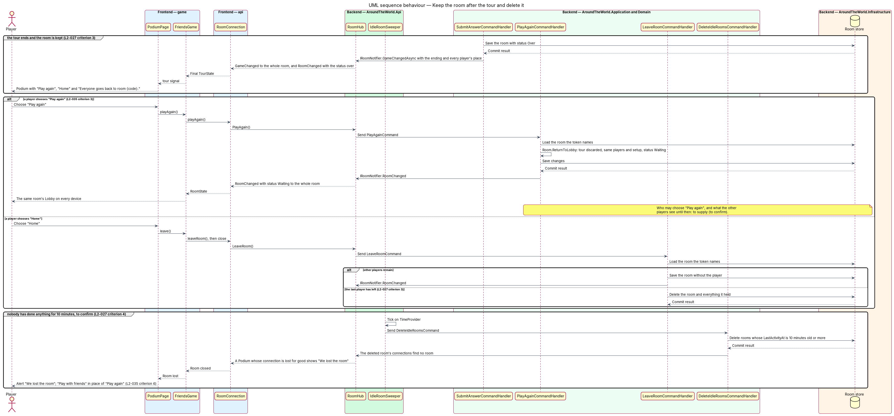

# Decide the game on the server

## Overview

Around the World is the classroom flash-card game as a web game for children aged 10 to 12. The
game is a tour of desks. One player, the traveller, stands beside a desk and duels its desk
holder over one flash card; whoever answers first wins.

- **room** — group of up to 8 players who play one game together, held by the backend
- **tour** — one game: a ring of 6, 12 or 24 desks that the players try to go all the way round
- **duel** — contest between the traveller and one desk holder over one flash card
- **flash card** — one maths problem with one whole-number answer
- **hop** — move of a winning traveller to the next desk
- **freeze** — 1 second after a wrong answer during which a player's answers are ignored
- **classmate** — child the computer plays

A solo game is decided on the device. A game with friends cannot be: each device would claim
that its own player answered first. This feature makes the server the only judge of a game with
friends. The server makes each flash card and keeps its answer. It sends the card, without the
answer, to the whole room in one step. It decides the duel from the order in which answers reach
it, and it applies the freeze, the hop and the end of the tour itself. A device only sends a
number and shows what the server sends back.

The feature also covers how every player sees the same game within 1 second, and how long the
room lives. The room outlives the Podium, so that its players can return to its Lobby and play
again (ADR 0033). It is deleted when its last player has left, or after 10 minutes in which
nobody has done anything **(to confirm)**.

In a game with friends with fewer players than desks, classmates hold the desks no player holds,
so that exactly one desk is empty (`L2-007` criterion 5).

The rules themselves (`L2-001` to `L2-007`) and the making of flash cards (`L2-008`) are designed
in the `tour` subsystem; this design states where the server applies them. The screens that show
the game belong to the features of Duel, World Map and Podium.

## Description

Journey 14 builds the slice (`docs/adr/0033-deciding-a-game-on-the-server.md`,
`docs/adr/0034-playing-with-friends-on-the-device.md`). The slice runs
from the Duel screen in the `game` application, over one SignalR connection per player, to the
room store.

Frontend:

- **`FriendsGame`** — game service in `game`, provided by the room group behind `GAME_SESSION`
  and `ROOM_SESSION`. It implements the `GameSession` contract, so `DuelPage`, `WorldMapPage` and
  `PodiumPage` do not know that the game is played with friends. It decides nothing.
  `answer(value)` passes the number to `RoomConnection`; it keeps the last `GameState` the server
  sent, and the pure helper **`FriendsView`** turns it into the `duel`, `tour` and `result` the
  screens read, counting durations left down on the game's clock (ADR 0034). `playAgain()` asks the server to return the room to its Lobby, and `leave()` sends
  `LeaveRoom` and closes the connection (`L2-048` criterion 2). It keeps the duels played and the
  positions within fixed limits (`L2-048` criterion 5).
- **`RoomConnection`** — SignalR client contract in `api`. It carries an answer as a number and
  delivers two events: `RoomChanged` (the room) and `GameChanged` (the game as it stands, ADR
  0033). One connection serves one player for the whole game (`L2-027` criterion 2).
- **`GameState`** — type in `api`, the game as the server sends it. Its open duel's card has no
  answer; the answer arrives only once the duel is decided.

Backend:

- **`RoomHub`** — `SaveSetup(setup)` and `StartGame()` are the Lobby's
  ([`rooms/wait-in-lobby`](../wait-in-lobby/README.md)). `SubmitAnswer(int answer)` sends one
  `SubmitAnswerCommand`. The message holds
  the number and nothing else: no time, no player id and no room. The connection presents the
  connection token the server gave it ([`rooms/guard-room`](../guard-room/README.md), `L2-040`
  criterion 1). The hub has no method through which a client can claim a win, a hop or the end
  of a tour, so such a message is not a hub method, changes nothing and reaches no handler
  (`L2-026` criterion 2). `PlayAgain()` sends one `PlayAgainCommand`.
  `LeaveRoom()` sends one `LeaveRoomCommand`, from the Lobby, from the Podium and from "Leave"
  in the Leave Game dialog during a game.
- **`SubmitAnswerCommandValidator`** — refuses an answer that is not a whole number from 0 to 999
  with `invalid_answer` (`L2-044` criterion 1).
- **`SubmitAnswerCommandHandler`** — MediatR handler. It reads the arrival time from
  `TimeProvider`, loads the room the connection's token names and calls `Room.Answer`, which
  brings the game up to that time and applies the answer. It saves the room in one unit of work
  and announces the game through `IRoomNotifier`; a save that meets a change made first is
  applied again to the room as it now stands (ADR 0033). The arrival time is the only time used
  (`L2-026` criterion 1).
- **`Tour`**, **`Duel`** and **`RoomGame`** — domain types in `AroundTheWorld.Domain.Tours` that
  apply the rules of the game on the server; `Tour` and `Duel` play the same table of cases as
  the device's (`docs/specs/tour-cases.json`, ADR 0033). `RoomGame.Answer(player, answer,
  receivedAt)` returns one of three outcomes:
  - `Ignored` — the sender is not in the duel (`L2-001` criterion 3), the duel is already won
    (`L2-001` criterion 4), or the sender is frozen, whatever the device showed (`L2-026`
    criterion 4);
  - `Frozen` — the answer differs from the answer of the server's own `FlashCard`; the sender is
    frozen for 1 second from `receivedAt` (`L2-004`);
  - `Won` — the answer is correct and the first to arrive. The tour applies the hop (`L2-002`)
    or the change of traveller (`L2-003`), and either ends (`L2-006`) or takes the next flash
    card from `FlashCardMaker` (`L2-026` criterion 3).

  The tour numbers its desks from 1 to the tour length. Desk 1 is the first traveller's own desk
  and the one empty desk, and the first duel is at desk 2 (`L2-007` criterion 4). A hop adds 1 to
  the distance travelled, and a traveller whose next desk is an empty desk passes it and stops
  at the desk after it (`L2-002` criteria 3 and 4). A desk holder who wins and walks on has a
  distance of 1 if it was 0 and otherwise keeps it (`L2-003` criterion 3). A player has gone all
  the way round when their distance equals the tour length (`L2-006` criterion 5). Exactly one
  player travels and exactly one desk is empty at every moment, apart from the desk of each
  player removed from the game, which stays empty (`L2-007` criterion 6, `L2-029` criterion 4).
- **`Room`** — domain entity. `Start` makes the tour: the host travels from desk 1, the other
  players hold desks 2, 3 and on in the order they joined, and classmates hold the desks no
  player holds (`L2-007` criteria 5 and 8). `ReturnToLobby` applies when
  the status is `Over`: it discards the finished tour, keeps the players, the host and the
  `GameSetup`, and sets the status to `Waiting`. It starts no tour; the host starts the next
  game from the Lobby with `Room.Start` ([`rooms/wait-in-lobby`](../wait-in-lobby/README.md)).
- **`PlayAgainCommandHandler`** — MediatR handler. It loads the room the connection's token
  names, calls `Room.ReturnToLobby`, saves, and announces `RoomChanged` through `IRoomNotifier`.
  On that event each device that shows the Podium opens the same room's Lobby (`L2-035`
  criterion 3). The Podium says so beforehand: "Everyone goes back to room {code}.".
- **`FlashCardMaker`** — domain service that makes a flash card from the room's `GameSetup`
  (`L2-008`), with the device's ranges (ADR 0018). The `Card` it returns holds the answer and
  stays on the server.
- **`IRoomNotifier`** — port in Application, implemented over `RoomHub`. Each method sends one
  message to the whole room's group. `GameChangedAsync` sends a `GameStateDto`, whose open duel's
  card has no answer, so both players in the duel and every watching player are sent the card in
  the same server step (`L2-026` criterion 5), and a decision with the result, the new traveller
  and each player's position (`L2-027` criterion 1). The end of the tour comes in the same
  message, and does not close the room.
- **`RoomTimers`** — hosted service in `AroundTheWorld.Api` driven by `TimeProvider`. Every
  250 ms it sends `AdvanceGamesCommand`, whose handler calls `Room.AdvanceGame(now)` on each
  playing room whose `GameDueAt` has come: the first card, a classmate's answer, a card's time
  running out (`L2-005` criterion 2, a new card for the same two players 2 seconds later) and the
  next card after a decision, each at its own time (ADR 0033). `IdleRoomSweeper` sends
  `DeleteIdleRoomsCommand`. The freeze uses no timer: `Duel` compares `receivedAt` with the time
  the freeze ends.
- **`DeleteIdleRoomsCommandHandler`** — deletes each room whose `LastActivityAt` is 10 minutes
  old or more **(to confirm)** (`L2-027` criterion 4); a device still connected to it finds its
  connection closed and shows the room as lost. Each handler that acts for a player sets
  `Room.LastActivityAt`; time passing in a game is not activity (ADR 0033).
- **Room store** — reached through `IAppDbContext` with EF Core; its engine is Azure SQL Database (`docs/adr/0009-health-and-migrations.md`).
  The room and its tour live there, so that two instances of the backend decide the same game
  (`L2-052` criterion 2, `platform/operate-backend`).

When the tour ends, the handler sets the room's status to `Over`, saves it and announces the
game, with its result, as `GameChanged`. The room is kept while the Podium is shown. "Play again" returns the players to the
same room's Lobby. A player who chooses "Home" leaves:
`LeaveRoomCommandHandler` ([`rooms/wait-in-lobby`](../wait-in-lobby/README.md)) removes the
player, and deletes the room and everything it held once the last player has left (`L2-027`
criterion 3). The room lives until its last player leaves the Podium (ADR 0033). The
backend then keeps nothing about the deleted room (`L2-046` criterion 2).

When the room is lost while the Podium is shown, on a connection that cannot
be got back, the Podium says so as an alert: "We lost the room" and "Your passport is safe here.
To play with your friends again, make or join a new room.". It keeps the passport and offers
"Play with friends", which opens Solo Or Friends, in place of "Play again" (`L2-035`
criterion 6); "Everyone goes back to room {code}." is not shown then.

A player who chooses "Leave" in the Leave Game dialog during a game ("Leave the game?", "The race
carries on without you, and you can't come back to this one.") tells the room and opens Home
(`L2-033` criterion 4). While `LeaveRoom` is under way the dialog's button is busy and reads
"Leaving…", "Stay and play" is disabled and the dialog has no close button. The game continues
without that player.

The result reaches every player in the step that decides it; no device polls. That push, with
the server's time to decide an answer (`L2-049` criterion 3), is what meets the 1 second of
`L2-027` criterion 1.

Decided by journey 14:

- The answers of one room are taken one at a time in the order the room store saves them, each
  applied to the room as the one before left it (ADR 0033).
- The server's `Tour` and `Duel` and the device's are two implementations kept equal by one table
  of cases, `docs/specs/tour-cases.json`, which each side's tests play (ADR 0033).
- Any player may choose "Play again"; the first returns everyone to the Lobby, and until then
  the others see the Podium. A child may join a room that has returned to its Lobby (ADR 0033).
- The first flash card is dealt 3 seconds after the start and does not wait for Mic Check
  **(to confirm)** (ADR 0033).
- A classmate answers from a pace the server keeps: always right, after 50%, 65% or 80% of the
  card's time by its desk, never sooner than 800 ms. The host is the first traveller, the other
  players hold desks 2, 3 and on in the order they joined, and a tour of 6 desks with 7 or 8
  players is played round 12 desks **(to confirm)** (ADR 0033).
- A lost duel does not wait for the child: the next card is dealt 3.8 seconds after the
  decision, and the loser's World Map opens by itself 2.2 seconds after it (ADR 0033, ADR 0034).
- The time limit of a tour is the solo game's, counted from the start (ADR 0024).
- Every instance runs `RoomTimers`; the room's concurrency token lets one save of a room stand.
  A device whose connection is lost for good shows "We lost the room" on the Podium; on Duel and
  in the Lobby it is journey 16's (ADR 0034).
- A player who chooses "Leave" during a game is replaced by a classmate at their place and in
  their side of the duel; the race carries on (ADR 0033).

The slice follows the mocks `docs/mocks/pages/duel/` (state `friends`), `docs/mocks/pages/podium/`
(states `friends`, `two-players`, `error`) and `docs/mocks/dialogs/leave-game/` (states `default`,
`busy`). The layouts of Duel, World Map and Podium belong to the designs of those screens.

## Requirements

The feature realizes the following level-2 (L2) requirements. Each refines the level-1 (L1)
requirement cited by identifier.

| L2 ID | Refines (L1) | Requirement |
|-------|--------------|-------------|
| `L2-026` | `L1-008` | The server decides a game with friends: when the correct answers of the traveller and the desk holder both reach the server, the one the server received first shall win, whatever time either client claims. The server shall ignore a client's claim that it won, hopped or ended the tour. The server shall check each answer against the flash card it made and shall apply the freeze, the hop and the end of the tour itself, and shall ignore an answer that arrives within 1 second of a wrong one even if the client did not show the freeze. A flash card shall be sent to both players in the duel in the same server step, in a message that does not hold the answer. |
| `L2-027` | `L1-008` | Every player sees the same game: when the server decides a duel, every player in the room shall be shown the result, the new traveller and each player's position within 1 second. Answers shall travel as numbers and stickers as ids, over one SignalR connection per player. When a room's game is over, the room and everything it held shall be deleted from the backend once the last player has left the room, and the room shall be kept while the Podium is shown, so that its players can return to its Lobby and play again; the room lives until its last player leaves the Podium (ADR 0033). A room in which nobody has done anything for 10 minutes **(to confirm)** shall be deleted. |

## Diagrams

### System context

The two players in the duel answer, and every player in the room sees the result. In a deployed
system Azure SignalR Service carries the connections.

### Containers

An answer travels as a number from the `game` application over SignalR to `AroundTheWorld.Api`,
which keeps the room and its game in the room store until the last player has left.

### Components

The pages read the game through `FriendsGame`, which only relays. `RoomHub` and `RoomTimers` send
requests; the handlers call `Tour` and `Duel`, which hold the rules, and `HubRoomNotifier` pushes
each outcome to the whole room. `PlayAgainCommandHandler` returns the room to its Lobby.

### Class structure

`Room` owns the `Tour`, whose current `Duel` owns the `FlashCard` with its answer. `Room.Start`
makes a tour and `Room.ReturnToLobby` discards a finished one.
`SubmitAnswerCommandHandler` mutates the room and announces through `IRoomNotifier`, which sends
a `FlashCardDto` without the answer. `FriendsGame` realizes `GameSession`.

### Behaviour — decide a duel

The flash card reaches the room in one step without its answer. Each answer is a bare number; the
handler stamps its arrival time and `Tour` returns `Ignored`, `Frozen` or `Won`. On `Won` the
game, with the result and then the next flash card or the end of the tour, reaches every player
as `GameChanged`.

### Behaviour — keep the room after the tour and delete it

`GameChanged` with the ending carries what the Podium shows and the room is kept. "Play again" sets the room
waiting again and `RoomChanged` opens its Lobby on every device. The room is deleted in two
cases: when its last player has left, and when nobody has done anything for 10 minutes
**(to confirm)**, after which `IdleRoomSweeper` sends `DeleteIdleRoomsCommand`; a Podium whose
connection is then lost for good shows "We lost the room".

