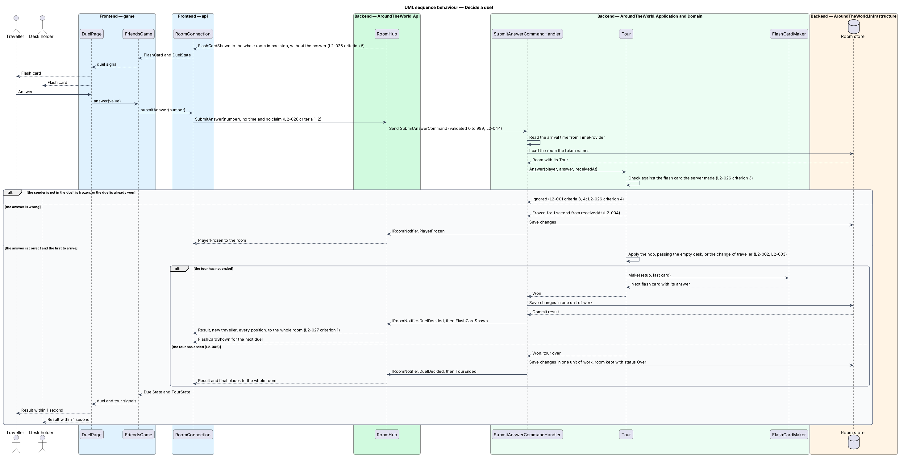

# Decide the game on the server

## Overview

Around the World is the classroom flash-card game as a web game for children aged 10 to 12. The
game is a tour of desks. One player, the traveller, stands beside a desk and duels its desk
holder over one flash card; whoever answers first wins.

- **room** — group of up to 8 players who play one game together, held by the backend
- **tour** — one game: a ring of 6, 12 or 24 desks that the players try to go all the way round
- **duel** — contest between the traveller and one desk holder over one flash card
- **flash card** — one maths problem with one whole-number answer
- **hop** — move of a winning traveller to the next desk
- **freeze** — 1 second after a wrong answer during which a player's answers are ignored
- **classmate** — child the computer plays

A solo game is decided on the device. A game with friends cannot be: each device would claim
that its own player answered first. This feature makes the server the only judge of a game with
friends. The server makes each flash card and keeps its answer. It sends the card, without the
answer, to the whole room in one step. It decides the duel from the order in which answers reach
it, and it applies the freeze, the hop and the end of the tour itself. A device only sends a
number and shows what the server sends back.

The feature also covers how every player sees the same game within 1 second, and how long the
room lives. The room outlives the Podium, so that its players can return to its Lobby and play
again **(to confirm)**. It is deleted when its last player has left, or after 10 minutes in which
nobody has done anything **(to confirm)**.

In a game with friends with fewer players than desks, classmates hold the desks no player holds,
so that exactly one desk is empty (`L2-007` criterion 5).

The rules themselves (`L2-001` to `L2-007`) and the making of flash cards (`L2-008`) are designed
in the `tour` subsystem; this design states where the server applies them. The screens that show
the game belong to the features of Duel, World Map and Podium.

## Description

The slice is not built yet; the parts below are the ones the design introduces. The slice runs
from the Duel screen in the `game` application, over one SignalR connection per player, to the
room store.

Frontend:

- **`FriendsGame`** — game service in `game`, provided at the game route behind `GAME_SESSION`.
  It implements the `GameSession` contract, so `DuelPage`, `WorldMapPage` and `PodiumPage` do not
  know that the game is played with friends. It decides nothing. `answer(value)` passes
  the number to `RoomConnection`, and the `duel` and `tour` signals hold what the server last
  sent. `playAgain()` asks the server to return the room to its Lobby, and `leave()` sends
  `LeaveRoom` and closes the connection (`L2-048` criterion 2). It keeps the duels played and the
  positions within fixed limits (`L2-048` criterion 5).
- **`RoomConnection`** — SignalR client contract in `api`. It carries an answer as a number and
  delivers the events `GameStarted`, `FlashCardShown`, `PlayerFrozen`, `DuelDecided`, `TourEnded`,
  `RoomChanged` and `RoomClosed`. One connection serves one player for the whole game (`L2-027` criterion 2).
- **`FlashCard`**, **`DuelState`**, **`TourState`** — types in `api`. In a game with friends a
  `FlashCard` arrives without its answer; the answer arrives only inside the decided `DuelState`.

Backend:

- **`RoomHub`** — `SubmitAnswer(int answer)` sends one `SubmitAnswerCommand`. The message holds
  the number and nothing else: no time, no player id and no room. The connection presents the
  connection token the server gave it ([`rooms/guard-room`](../guard-room/README.md), `L2-040`
  criterion 1). The hub has no method through which a client can claim a win, a hop or the end
  of a tour, so such a message is not a hub method, changes nothing and reaches no handler
  (`L2-026` criterion 2). `PlayAgain()` sends one `PlayAgainCommand`.
  `LeaveRoom()` sends one `LeaveRoomCommand`, from the Lobby, from the Podium and from "Leave"
  in the Leave Game dialog during a game.
- **`SubmitAnswerCommandValidator`** — refuses an answer that is not a whole number from 0 to 999
  (`L2-044` criterion 1).
- **`SubmitAnswerCommandHandler`** — MediatR handler. It reads the arrival time from
  `TimeProvider`, loads the room the connection's token names and calls `Tour.Answer`. It saves
  the room in one unit of work and announces the outcome through `IRoomNotifier`. The arrival
  time is the only time used (`L2-026` criterion 1).
- **`Tour`** and **`Duel`** — domain types in `AroundTheWorld.Domain` that apply the rules of the
  game on the server. `Tour.Answer(player, answer, receivedAt)` returns one of three outcomes:
  - `Ignored` — the sender is not in the duel (`L2-001` criterion 3), the duel is already won
    (`L2-001` criterion 4), or the sender is frozen, whatever the device showed (`L2-026`
    criterion 4);
  - `Frozen` — the answer differs from the answer of the server's own `FlashCard`; the sender is
    frozen for 1 second from `receivedAt` (`L2-004`);
  - `Won` — the answer is correct and the first to arrive. The tour applies the hop (`L2-002`)
    or the change of traveller (`L2-003`), and either ends (`L2-006`) or takes the next flash
    card from `FlashCardMaker` (`L2-026` criterion 3).

  The tour numbers its desks from 1 to the tour length. Desk 1 is the first traveller's own desk
  and the one empty desk, and the first duel is at desk 2 (`L2-007` criterion 4). A hop adds 1 to
  the distance travelled, and a traveller whose next desk is an empty desk passes it and stops
  at the desk after it (`L2-002` criteria 3 and 4). A desk holder who wins and walks on has a
  distance of 1 if it was 0 and otherwise keeps it (`L2-003` criterion 3). A player has gone all
  the way round when their distance equals the tour length (`L2-006` criterion 5). Exactly one
  player travels and exactly one desk is empty at every moment, apart from the desk of each
  player removed from the game, which stays empty (`L2-007` criterion 6, `L2-029` criterion 4).
- **`Room`** — domain entity. `Start` makes the tour: each player takes a place on the ring, and
  classmates hold the desks no player holds (`L2-007` criterion 5). `ReturnToLobby` applies when
  the status is `Over`: it discards the finished tour, keeps the players, the host and the
  `GameSetup`, and sets the status to `Waiting`. It starts no tour; the host starts the next
  game from the Lobby with `Room.Start` ([`rooms/wait-in-lobby`](../wait-in-lobby/README.md)).
- **`PlayAgainCommandHandler`** — MediatR handler. It loads the room the connection's token
  names, calls `Room.ReturnToLobby`, saves, and announces `RoomChanged` through `IRoomNotifier`.
  On that event each device that shows the Podium opens the same room's Lobby (`L2-035`
  criterion 3). The Podium says so beforehand: "Everyone goes back to room {code}.".
- **`FlashCardMaker`** — domain service that makes a flash card from the room's `GameSetup`
  (`L2-008`). The `FlashCard` it returns holds the answer and stays on the server.
- **`IRoomNotifier`** — port in Application, implemented over `RoomHub`. Each method sends one
  message to the whole room's group. `FlashCardShown` sends a `FlashCardDto`, which has no answer
  field, so both players in the duel and every watching player are sent the card in the same
  server step (`L2-026` criterion 5). `DuelDecided` sends the result, the new traveller and each
  player's position (`L2-027` criterion 1). `TourEnded` sends every player's place and does not
  close the room.
- **`RoomTimers`** — hosted service in `AroundTheWorld.Api` driven by `TimeProvider`. It sends
  the requests that time, not a player, causes: `EndCardTimeCommand` when a flash card's time
  runs out (`L2-005`), and `DeleteIdleRoomsCommand`. The freeze uses no timer: `Tour` compares
  `receivedAt` with the time the freeze ends.
- **`EndCardTimeCommandHandler`** — calls `Tour.EndCardTime`, which applies `L2-005`
  criterion 2 **(to confirm)** and takes a new flash card for the same two players.
- **`DeleteIdleRoomsCommandHandler`** — deletes each room whose `LastActivityAt` is 10 minutes
  old or more **(to confirm)** and announces `RoomClosed` to it (`L2-027` criterion 4). Each
  handler that acts for a player sets `Room.LastActivityAt`.
- **Room store** — reached through `IAppDbContext` with EF Core; its engine is `<TO SUPPLY>`.
  The room and its tour live there, so that two instances of the backend decide the same game
  (`L2-052` criterion 2, `platform/operate-backend`).

When the tour ends, the handler sets the room's status to `Over`, saves it and announces
`TourEnded`. The room is kept while the Podium is shown. "Play again" returns the players to the
same room's Lobby. A player who chooses "Home" leaves:
`LeaveRoomCommandHandler` ([`rooms/wait-in-lobby`](../wait-in-lobby/README.md)) removes the
player, and deletes the room and everything it held once the last player has left (`L2-027`
criterion 3). That the room lives until its last player leaves the Podium is to confirm. The
backend then keeps nothing about the deleted room (`L2-046` criterion 2).

When the room is lost while the Podium is shown, on `RoomClosed` or on a connection that cannot
be got back, the Podium says so as an alert: "We lost the room" and "Your passport is safe here.
To play with your friends again, make or join a new room.". It keeps the passport and offers
"Play with friends", which opens Solo Or Friends, in place of "Play again" (`L2-035`
criterion 6); "Everyone goes back to room {code}." is not shown then.

A player who chooses "Leave" in the Leave Game dialog during a game ("Leave the game?", "The race
carries on without you, and you can't come back to this one.") tells the room and opens Home
(`L2-033` criterion 4). While `LeaveRoom` is under way the dialog's button is busy and reads
"Leaving…", "Stay and play" is disabled and the dialog has no close button. The game continues
without that player.

The result reaches every player in the step that decides it; no device polls. That push, with
the server's time to decide an answer (`L2-049` criterion 3), is what meets the 1 second of
`L2-027` criterion 1.

Nine points are undecided:

- How the answers of one room are decided one at a time when they reach two instances of the
  backend is `<TO SUPPLY>` with the room store's engine. `L2-026` criterion 1 depends on it.
- Whether the server's `Tour` and `Duel` and the device's share one written rule set, or are two
  implementations kept equal by tests, is `<TO SUPPLY>`.
- Who may choose "Play again" in a room, and what the other players see until it is chosen, are
  `<TO SUPPLY>` (to confirm); `Room.ReturnToLobby` refuses nobody until that is decided. Whether
  a child may join a room that has returned to its Lobby is `<TO SUPPLY>` with it
  ([`rooms/join-room`](../join-room/README.md)).
- Each player is shown Mic Check on their own device after the host starts the game, when they
  need it (`L2-012` criterion 9). Whether the first flash card waits for each player's Mic Check
  is `<TO SUPPLY>`.
- How a classmate's answer is produced in a game with friends is `<TO SUPPLY>`. Who the first
  traveller is, and how a tour of 6 desks seats 7 or 8 players, are `<TO SUPPLY>`.
- Whether a lost duel waits for the child's choice in a game with friends is `<TO SUPPLY>`, and
  with it how long the server waits after `DuelDecided`, while each device shows the result and
  then World Map (`L2-030` criterion 4), before it sends the next `FlashCardShown`.
- The time limit of a tour for each tour length is to confirm (`L2-006` criterion 2).
- Which instance of the backend runs `RoomTimers` for a room is `<TO SUPPLY>`. What a device
  shows on `RoomClosed` during a duel or in the Lobby is `<TO SUPPLY>`: the mocks draw a lost
  room on the Podium (`L2-035` criterion 6) and a connection that cannot be got back in the
  Lobby (`L2-029` criterion 6).
- What the tour does with the desk of a player who chooses "Leave" during a game, and when that
  player was the traveller or the desk holder of the current duel, is `<TO SUPPLY>`
  ([`rooms/return-after-lost-connection`](../return-after-lost-connection/README.md)).

The slice follows the mocks `docs/mocks/pages/duel/` (state `friends`), `docs/mocks/pages/podium/`
(states `friends`, `two-players`, `error`) and `docs/mocks/dialogs/leave-game/` (states `default`,
`busy`). The layouts of Duel, World Map and Podium belong to the designs of those screens.

## Requirements

The feature realizes the following level-2 (L2) requirements. Each refines the level-1 (L1)
requirement cited by identifier.

| L2 ID | Refines (L1) | Requirement |
|-------|--------------|-------------|
| `L2-026` | `L1-008` | The server decides a game with friends: when the correct answers of the traveller and the desk holder both reach the server, the one the server received first shall win, whatever time either client claims. The server shall ignore a client's claim that it won, hopped or ended the tour. The server shall check each answer against the flash card it made and shall apply the freeze, the hop and the end of the tour itself, and shall ignore an answer that arrives within 1 second of a wrong one even if the client did not show the freeze. A flash card shall be sent to both players in the duel in the same server step, in a message that does not hold the answer. |
| `L2-027` | `L1-008` | Every player sees the same game: when the server decides a duel, every player in the room shall be shown the result, the new traveller and each player's position within 1 second. Answers shall travel as numbers and stickers as ids, over one SignalR connection per player. When a room's game is over, the room and everything it held shall be deleted from the backend once the last player has left the room, and the room shall be kept while the Podium is shown, so that its players can return to its Lobby and play again; that the room lives until its last player leaves the Podium is **to confirm**. A room in which nobody has done anything for 10 minutes **(to confirm)** shall be deleted. |

## Diagrams

### System context

The two players in the duel answer, and every player in the room sees the result. In a deployed
system Azure SignalR Service carries the connections.

### Containers

An answer travels as a number from the `game` application over SignalR to `AroundTheWorld.Api`,
which keeps the room and its game in the room store until the last player has left.

### Components

The pages read the game through `FriendsGame`, which only relays. `RoomHub` and `RoomTimers` send
requests; the handlers call `Tour` and `Duel`, which hold the rules, and `HubRoomNotifier` pushes
each outcome to the whole room. `PlayAgainCommandHandler` returns the room to its Lobby.

### Class structure

`Room` owns the `Tour`, whose current `Duel` owns the `FlashCard` with its answer. `Room.Start`
makes a tour and `Room.ReturnToLobby` discards a finished one.
`SubmitAnswerCommandHandler` mutates the room and announces through `IRoomNotifier`, which sends
a `FlashCardDto` without the answer. `FriendsGame` realizes `GameSession`.

### Behaviour — decide a duel

The flash card reaches the room in one step without its answer. Each answer is a bare number; the
handler stamps its arrival time and `Tour` returns `Ignored`, `Frozen` or `Won`. On `Won` the
result and the next flash card, or the end of the tour, reach every player.

### Behaviour — keep the room after the tour and delete it

`TourEnded` carries what the Podium shows and the room is kept. "Play again" sets the room
waiting again and `RoomChanged` opens its Lobby on every device. The room is deleted in two
cases: when its last player has left, and when nobody has done anything for 10 minutes
**(to confirm)**, after which `RoomTimers` sends `DeleteIdleRoomsCommand` and the room's players
are told the room is closed; a Podium then shows "We lost the room".

