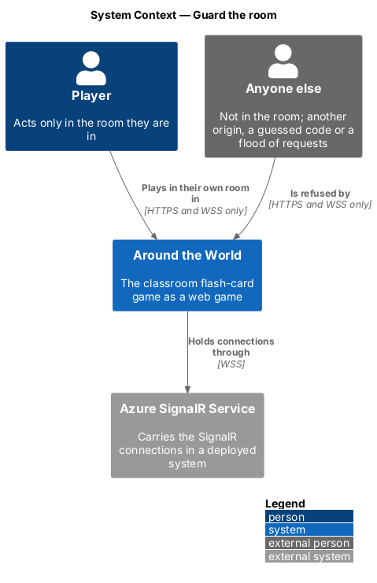
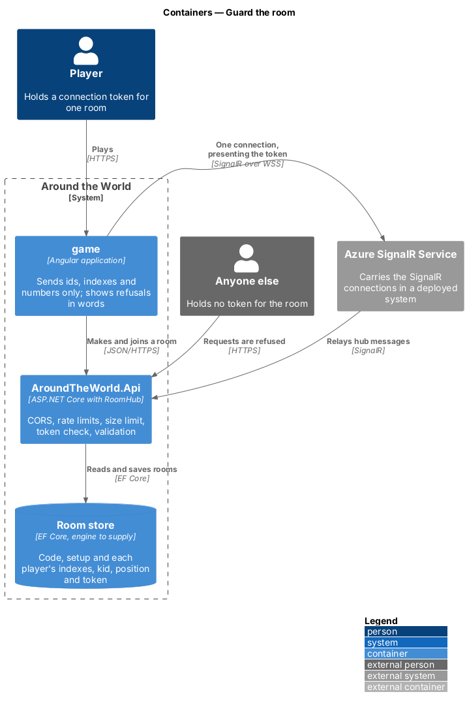
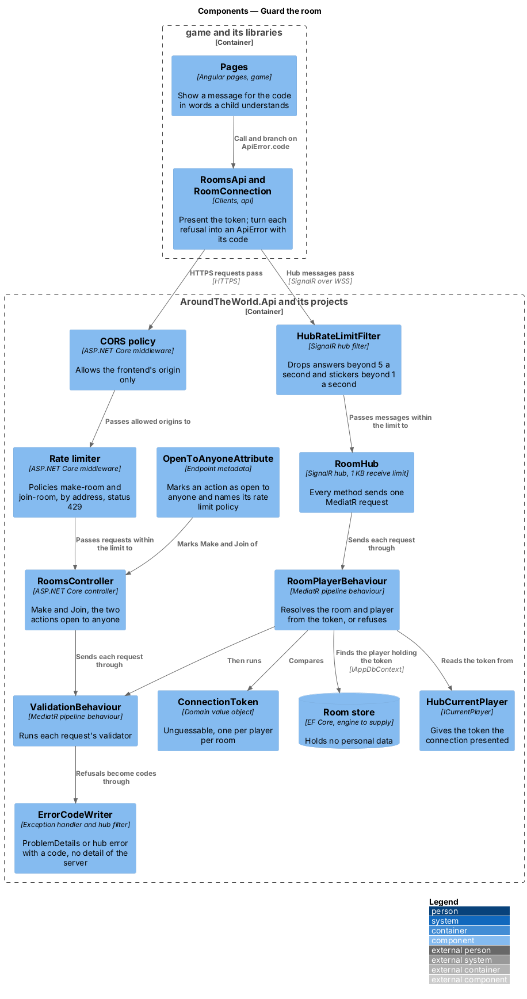
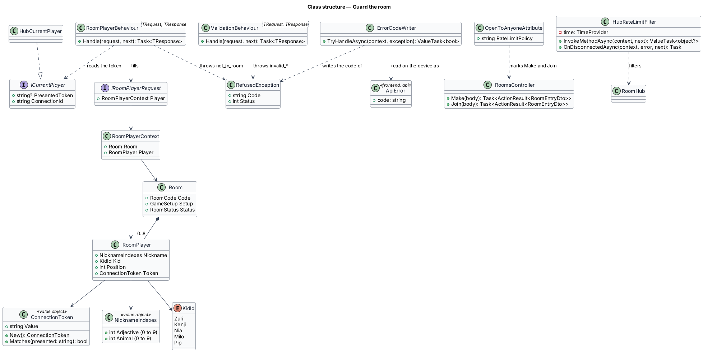
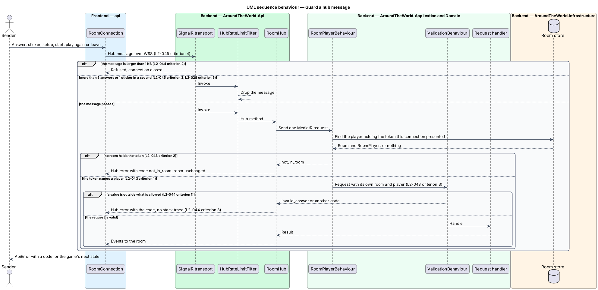
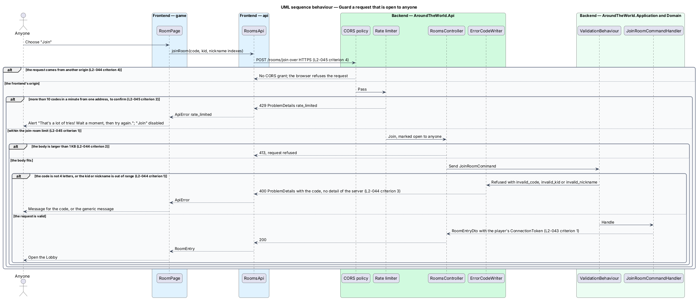

# Guard the room

## Overview

Around the World is the classroom flash-card game as a web game for children aged 10 to 12. It
has no accounts and no sign-in, so the backend cannot ask who a caller is. It still keeps
each room for its own players and keeps nothing about a child.

- **room** — group of up to 8 players who play one game together, held by the backend
- **code** — 4 capital letters that name one room and are read aloud across the room
- **connection token** — unguessable value the server gives one player for one room, presented
  by that player's connection
- **open to anyone** — said of a request the backend accepts without a connection token: making
  a room and joining with a code

This feature is the guard around every other feature of the `rooms` subsystem. It has four
parts. First, only a room's own player may act in it: a player receives a connection token on
entering a room, and every later message is accepted only from a connection that presented it.
Second, everything the backend receives is validated, limited to 1 KB and answered, when refused,
with an error `code` and no detail of the server. Third, the two requests open to anyone are
rate limited, answers are limited for each connection, and all traffic travels over HTTPS and
WSS. Fourth, the backend holds no personal data: for a room it holds a code, the setup and, for
each player, the nickname's indexes, a kid, a position and a connection token.

A code is short so that a child can read it aloud. It is therefore not a secret, and the token,
not the code, is what lets a player act. The features this guard surrounds are
[`rooms/make-room`](../make-room/README.md), [`rooms/join-room`](../join-room/README.md),
[`rooms/wait-in-lobby`](../wait-in-lobby/README.md),
[`rooms/decide-game-on-server`](../decide-game-on-server/README.md),
[`rooms/watch-duel-and-send-sticker`](../watch-duel-and-send-sticker/README.md) and
[`rooms/return-after-lost-connection`](../return-after-lost-connection/README.md).

## Description

Journey 12 built the parts that making a room needs (the token, `ValidationBehaviour`,
`RefusedException`, the error writer, `OpenToAnyoneAttribute` and the `make-room` limit).
Journey 13 built the `join-room` limit, `invalid_code`, the room hub with `ICurrentPlayer`
(read by `CurrentPlayerFilter`, a hub filter), `RoomPlayerBehaviour` for every request marked
`IRoomPlayerRequest`, the hub's 1 KB limit and its refusals as hub errors
([`docs/adr/0032-joining-a-room-and-the-lobby.md`](../../../adr/0032-joining-a-room-and-the-lobby.md)).
The rest arrive with journeys 14 to 17. Its decisions are in
[`docs/adr/0031-making-a-room.md`](../../../adr/0031-making-a-room.md). Most of the slice
lives in the backend. The frontend's part is to present the token, to send nothing but ids,
indexes and numbers, and to show each refusal in words.

Only a room's own player may act (`L2-043`):

- **`ConnectionToken`** — domain value object in `AroundTheWorld.Domain`. `Room.Make` and
  `Room.Join` make one for each `RoomPlayer` from a cryptographic random number generator. It is 32 random bytes written in base64url without padding (43 characters, ADR 0031). The server issues it; it is never typed or said. The token is returned once, in the `RoomEntryDto` of
  the make or join response, and appears in no `RoomState`, hub event, log, metric or span
  (`L2-043` criterion 1, `L2-053` criterion 2).
- **`RoomConnection`** — SignalR client in `api`. It presents the token when it connects and on
  each reconnect, so every later message of that connection is accepted only with it. The token
  is among the values a client message may hold (`L2-040` criterion 1). The token travels as SignalR's access token (`accessTokenFactory`), which the WebSockets
  transport sends as the query parameter `access_token`; no telemetry records a query string
  (ADR 0031). `FriendsGame` keeps the token in memory only.
- **`ICurrentPlayer`** and **`HubCurrentPlayer`** — port in Application and its implementation in
  `AroundTheWorld.Api`. It gives the token the calling connection presented.
- **`RoomPlayerBehaviour`** — MediatR pipeline behaviour for each request a hub method sends. It
  finds, through `IAppDbContext`, the `RoomPlayer` that holds the presented token and hands the
  request that player and that player's room. With no such player it refuses with `not_in_room`
  and the room is unchanged (`L2-043` criterion 2). `RoomHub` itself checks nothing.
- No hub request carries a room's code or id. The room acted on or read is always the one the
  token names, so a player in one room cannot ask for or change another (`L2-043` criterion 3).
- A reconnect is the same check: the place returned is the one the token names
  ([`rooms/return-after-lost-connection`](../return-after-lost-connection/README.md), `L2-043`
  criterion 4).

Everything received is validated (`L2-044`):

- **`ValidationBehaviour`** — MediatR pipeline behaviour that runs the request's FluentValidation
  validator before its handler. `MakeRoomCommandValidator`, `JoinRoomCommandValidator` and
  `SubmitAnswerCommandValidator` refuse an answer that is not a whole number from 0 to 999, a
  kid id that is not one of the five, nickname indexes outside the lists and a code that is not
  4 letters. Each list holds ten words (`L2-014`), so each index is a whole number from 0 to 9. The codes are `invalid_answer`, `invalid_kid`, `invalid_nickname` and `invalid_code`
  (`L2-044` criterion 1). `SaveSetupCommandValidator` belongs to `player/set-up-game` (`L2-018`
  criterion 4).
- **Typed messages** — each request body and hub argument is a number, an id or a list index,
  and a connection carries the token the server gave it. No contract has a field of free text
  other than the code (`L2-040` criterion 1). A sticker id that is not one of the six is
  ignored without an error, as `L2-028` criterion 4 asks
  ([`rooms/watch-duel-and-send-sticker`](../watch-duel-and-send-sticker/README.md)).
- **1 KB limit** — `RoomHub` is configured to receive messages of at most 1 KB, and
  `RoomsController` to accept bodies of at most 1 KB; a larger one is refused before any handler
  runs (`L2-044` criterion 2). Where the limit is applied when Azure SignalR Service relays the
  message is decided by journey 17 (`platform/operate-backend`); `RoomsController` limits each body to
  1 KB with `[RequestSizeLimit(1024)]` (ADR 0031).
- **`RefusedException`** and **`ErrorCodeWriter`** — a refusal carries a `code` and a status.
  `ErrorCodeWriter` writes it as ProblemDetails with a `code` extension for an HTTP request and
  as a hub error with the `code` for a hub message. Any other exception becomes a generic error.
  No response holds a stack trace or a detail of the server, and the hub's detailed errors stay
  off (`L2-044` criterion 3). On the device, `RoomsApi` and `RoomConnection` turn each into an
  `ApiError`, and the page shows a message for its `code` (`L2-054` criteria 1 and 2).
- **CORS policy** — allows the frontend's origin and no other, for the controller and the hub
  (`L2-044` criterion 4). The origin is a deployment setting documented by
  `platform/operate-backend` (`L2-052` criterion 4).

What is open to anyone is rate limited (`L2-045`):

- **`OpenToAnyoneAttribute`** — endpoint metadata that marks an action as open to anyone and
  names its rate limit policy in one declaration. `RoomsController.Make` and
  `RoomsController.Join` carry it; no other endpoint does (`L2-045` criterion 1).
- **Rate limiter** — ASP.NET Core rate limiting middleware with two policies counted for each
  address. `join-room` allows 10 attempts in a minute **(to confirm)**, from the settings
  `RateLimits:JoinRoom:PermitLimit` and `RateLimits:JoinRoom:WindowSeconds` (ADR 0032); a further attempt is
  refused with status 429 and the code `rate_limited`, and Room tells the child to wait a
  moment and disables "Join" (`L2-045` criterion 2). A 429 carries a `Retry-After` header and the code `rate_limited`. `make-room` allows 10 rooms
  in a minute **(to confirm)**, from the settings `RateLimits:MakeRoom:PermitLimit` and
  `RateLimits:MakeRoom:WindowSeconds` (ADR 0031); over it, Solo Or Friends tells the child to wait and disables "Make a room"
  (`L2-022` criterion 4). The limits are deployment settings (`L2-052` criterion 4). The address is the connection's remote address; behind a deployed system's proxy it is read
  from the forwarded headers of the known proxy, which journey 17 configures (ADR 0031).
- **`HubRateLimitFilter`** — SignalR hub filter in `AroundTheWorld.Api`. It counts messages for
  each connection on `TimeProvider`. It drops `SubmitAnswer` messages beyond 5 a second
  (`L2-045` criterion 3) and `SendSticker` messages beyond 1 a second (`L2-028` criterion 5),
  without an error. It forgets a connection's counts when the connection ends.
- **HTTPS and WSS only** — the API serves no plain HTTP endpoint, and `RoomConnection` uses the
  WebSockets transport over WSS (`L2-045` criterion 4). Where TLS ends in a deployed system is
  decided by journey 17 (`platform/operate-backend`).

The backend holds no personal data (`L2-046`):

- **`Room`** — holds the `RoomCode`, the `GameSetup` and the status.
- **`RoomPlayer`** — holds the nickname's two list indexes, the `KidId`, the position and the
  `ConnectionToken`. A nickname is never held or sent as text (`L2-046` criterion 1).
- The room store holds no account, no real name, no audio and no address of a device. The rate
  limiter counts by address in memory, for the length of its window only, and writes no address
  to the store. A room is deleted when its last player has left, or when nobody has done anything in it for
  10 minutes **(to confirm)**: `IdleRoomSweeper`, a hosted service, sends `DeleteIdleRoomsCommand`
  once a minute on `TimeProvider` (ADR 0031). The store then holds nothing about it
  (`L2-046` criterion 2, `L2-027` criteria 3 and 4,
  [`rooms/decide-game-on-server`](../decide-game-on-server/README.md)). A room whose game is
  over is kept while its players are at the Podium, so that they can return to its Lobby and
  play again **(to confirm)**, and holds only what this list names.
- The other features of the subsystem add working state to a room: the host mark, the time of
  joining, the id of the current SignalR connection, the time a player went away, the time of
  the room's last activity, and the tour with its current flash card. None of it describes a
  child. `L2-046` criterion 1 lists fewer fields than these: its list names what describes a player,
  and the working state describes no child, so it is allowed (ADR 0031).

The screens word each refusal as an alert, and the words are those of the mocks:

| Screen | `code` | Words |
|--------|--------|-------|
| Room | `room_not_found` | "Hmm, no room with that code. Check the letters?" (`L2-023` criterion 4) |
| Room | `room_full` | "That room is full (8 kids max)." (`L2-023` criterion 5) |
| Room | `game_started` | "That game already started. Ask for the next one!" (`L2-023` criterion 6) |
| Room | `rate_limited` | "That's a lot of tries! Wait a moment, then try again." (`L2-045` criterion 2) |
| Room | `backend_unreachable` | "We can't reach the game right now. Check the internet and try again." (`L2-023` criterion 9) |
| Solo Or Friends | `rate_limited` | "Whoa, slow down a moment" and "That's a lot of rooms! Wait a little, then try again." (`L2-022` criterion 4) |
| Solo Or Friends | `backend_unreachable` | "We couldn't make your room" and "Something went wrong on our side. Try again, or play solo while you wait." (`L2-022` criterion 3) |

[`rooms/join-room`](../join-room/README.md) and [`rooms/make-room`](../make-room/README.md)
describe the states that show them. No mock words a generic message for any other `code`. On Solo Or Friends the generic message
is the error state's, "We couldn't make your room" with "Something went wrong on our side. Try
again, or play solo while you wait." (ADR 0031); on Room it is "Something went wrong on our
side. Try again in a moment." (ADR 0032, `L2-054` criterion 2). The messages follow the
mocks `docs/mocks/pages/room/` (states `invalid`, `full`, `started`, `rate-limited`, `error`) and
`docs/mocks/pages/solo-or-friends/` (states `error`, `rate-limited`).

## Requirements

The feature realizes the following level-2 (L2) requirements. Each refines the level-1 (L1)
requirement cited by identifier.

| L2 ID | Refines (L1) | Requirement |
|-------|--------------|-------------|
| `L2-043` | `L1-013` | Only a room's own player may act in it: when a player joins a room, the server shall give their connection an unguessable token for that room, and every later message shall be accepted only with it. The server shall refuse with an error `code`, leaving the room unchanged, an answer, a sticker, a setup or a start from a connection that is not in the room. Nothing about another room's players, positions or setup shall be returned to a player. A reconnecting player shall get their own place back with their token and shall be refused with any other. |
| `L2-044` | `L1-013` | Everything the backend receives is validated: a message whose answer is not a whole number from 0 to 999, whose kid id is not one of the five, whose nickname indexes are outside the lists or whose code is not 4 letters shall be refused with a ProblemDetails or hub error holding a `code`, and nothing shall change. The connection shall refuse a message larger than 1 KB. An error shall hold no stack trace and no detail of the server. The CORS policy shall refuse a browser's request from any origin other than the frontend's. |
| `L2-045` | `L1-013` | Rate limits on what is open to anyone: making a room and joining with a code shall each be marked as open to anyone and shall each have a rate limit. When one address tries more than 10 codes in a minute **(to confirm)**, the next attempt shall be refused with status 429 and the screen shall tell the child to wait a moment (on Room: "That's a lot of tries! Wait a moment, then try again."). Answers beyond 5 a second from one connection shall be dropped. All traffic shall reach the backend over HTTPS and WSS only. |
| `L2-046` | `L1-013` | The backend holds no personal data: what the backend holds for a room shall be a code, the setup, and for each player the nickname's indexes, a kid, a position and a connection token. The backend's store shall hold no account, no real name, no audio, no address of a device and nothing about a room that has been deleted. |

## Diagrams

### System context

A player acts in their own room; anyone else is refused. All traffic is HTTPS and WSS, and Azure
SignalR Service carries the connections in a deployed system.

### Containers

The `game` application makes and joins a room over HTTPS and then holds one SignalR connection
that presented the token. `AroundTheWorld.Api` applies every check, and the room store holds only
what `L2-046` allows.

### Components

An HTTP request passes the CORS policy and the rate limiter before `RoomsController`. A hub
message passes `HubRateLimitFilter` before `RoomHub`. Each request then passes
`RoomPlayerBehaviour`, for hub requests, and `ValidationBehaviour`; `ErrorCodeWriter` turns each
refusal into a `code`.

### Class structure

`RoomPlayerBehaviour` reads the presented token through `ICurrentPlayer` and fills the request's
`RoomPlayerContext`. Both behaviours refuse through `RefusedException`, which `ErrorCodeWriter`
writes as a `code`. `RoomPlayer` shows the fields the backend holds for a player.

### Behaviour — guard a hub message

A hub message passes four checks in order: the 1 KB limit, the rate for its connection, the
token, and the validator. A message over the size limit closes the connection, one over the rate
is dropped, and the other two refusals return a hub error with a `code`.

### Behaviour — guard a request that is open to anyone

A join passes the CORS policy, the `join-room` rate limit, the 1 KB limit and the validator
before its handler. The address over the limit receives status 429, and Room says "That's a lot
of tries! Wait a moment, then try again." and disables "Join"; a valid join returns the player's
`ConnectionToken`.

