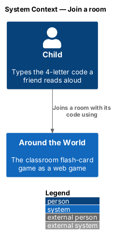
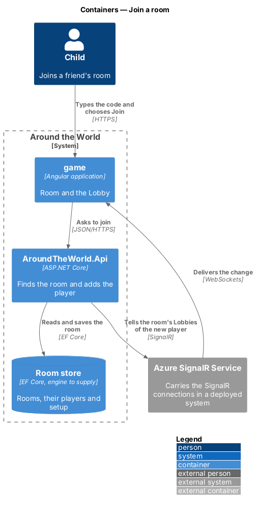
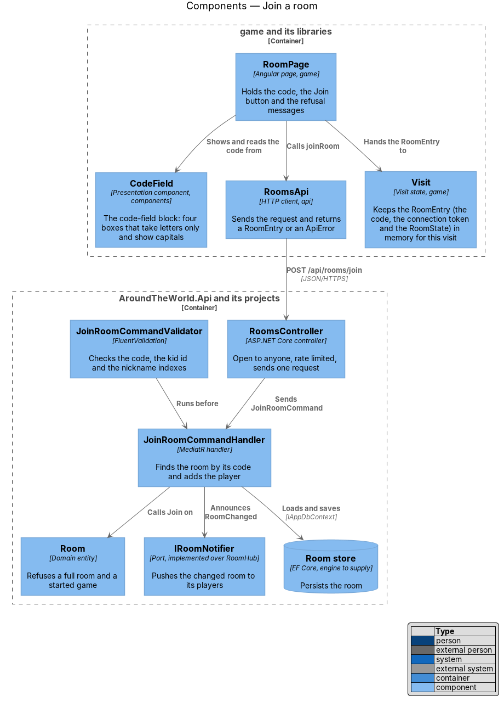
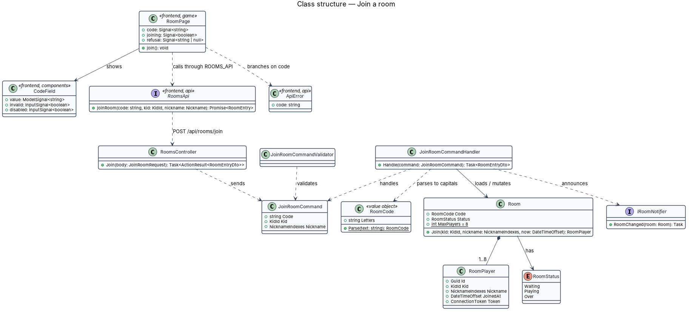
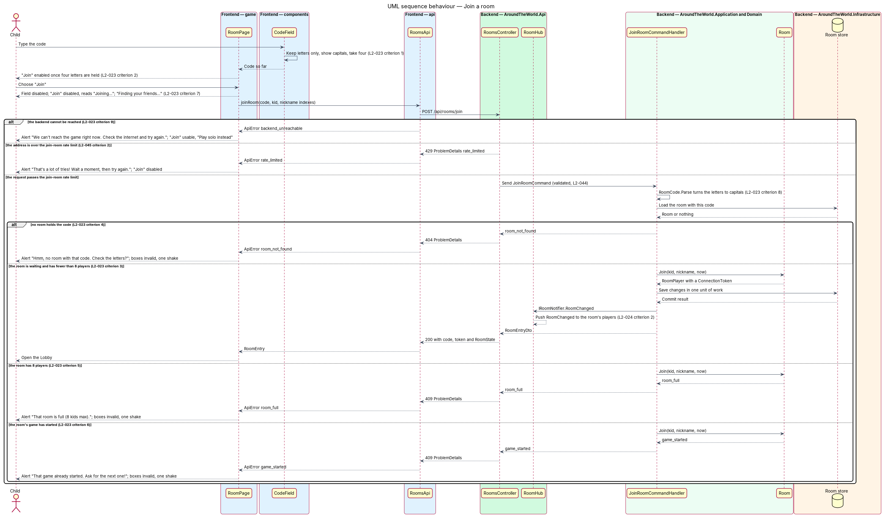

# Join a room

## Overview

Around the World is the classroom flash-card game as a web game for children aged 10 to 12. A
game with friends is played in a room, which a host makes and friends join.

- **room** — group of up to 8 players who play one game together, held by the backend
- **code** — 4 capital letters that name one room and are read aloud across the room
- **host** — player who made the room
- **Room** — screen on which a child types a code to join a room

This feature covers joining. The host reads the code aloud; a friend opens Room, types the four
letters and chooses "Join". The backend finds the room, adds the child to it and the Lobby opens.
The feature also covers the three refusals a child can meet: no room holds the code, the room
already has 8 players, or its game has already started. Room says each in its own words as an
alert and marks the four boxes as invalid. It covers two further states: too many tries from one
address, and a backend that cannot be reached.

The room code is the only text a child types anywhere in the game (`L2-040` criterion 4), and it
is limited to four letters. Joining is open to anyone and is therefore rate limited, so that
codes cannot be tried at speed; [`rooms/guard-room`](../guard-room/README.md) describes the
limit. Making the room belongs to [`rooms/make-room`](../make-room/README.md) and the Lobby to
[`rooms/wait-in-lobby`](../wait-in-lobby/README.md).

## Description

Journey 13 built the slice; its decisions are in
[`docs/adr/0032-joining-a-room-and-the-lobby.md`](../../../adr/0032-joining-a-room-and-the-lobby.md).
The slice runs from Room in the `game` application to the room store.

Frontend:

- **`RoomPage`** — page in `game`, under the top bar titled "Join a room". It holds the code as a
  signal and shows, in one centred column of at most 576 px at every width (`L2-050`
  criterion 6): "What's the code?", "Ask the friend who made the room. It's 4 letters.",
  `CodeField`, one message line and the "Join" button. It calls `RoomsApi.joinRoom` through
  `ROOMS_API`. "Join" is disabled while the code holds fewer than four letters (`L2-023`
  criterion 2). While a join is in progress the field is disabled, "Join" is disabled, busy and
  reads "Joining…", and the message line reads "Finding your friends…" as a status (`L2-023`
  criterion 7). On success the page hands the `RoomEntry` to the visit (`Visit.enterRoom`) and
  opens the Lobby at `/room/{CODE}`, where `FriendsGame` takes it. Room is at `/room`; the room's
  link is the Lobby's own address, which opens Room with the code filled in for anyone not in
  that room (`L2-024` criterion 4, ADR 0032). The code is read from the address as the page
  opens, so the `loading` state (placeholder boxes, busy, "Getting the room…", `L2-031`
  criterion 4) is never shown. Back opens Solo Or Friends (`L2-030` criterion 8). Changing the
  code clears a refusal. A child who has never picked a kid joins as Zuri with a new nickname, as
  "Make a room" does.
- **`CodeField`** (`label[atw-code-field]`) — presentation component in `components`; it
  renders the mocks' `code-field` block. One input labelled "Room code", not itself drawn, takes the typing; four boxes show the
  letters, and the box being filled is outlined in the accent colour. The component accepts
  letters only, shows each as a capital and takes no more than four (`L2-023` criterion 1). The
  filtering is a pure helper, `roomCodeLetters`, kept beside the component with its unit tests.
  The component takes an `invalid` input, exposed as `aria-invalid` on the input, and the boxes
  and their letters take the danger colour through that attribute. It takes a `disabled` input
  for a join in progress. Enter joins at four letters (its `entered` output). When a code is
  refused the four boxes shake once, for about 300 ms, as the input becomes `aria-invalid`.
  Where the device asks for reduced motion the boxes do not shake and only change colour
  (`L2-038` criterion 4).
- **`FieldMessage`** (`p[atw-field-message]`) — presentation component in `components`: the
  message line under the boxes, a status, or an alert with its icon for a refusal.
- **`RoomsApi`** — HTTP client contract in `api`. `joinRoom(code, kid, nickname)` sends
  `POST /api/rooms/join` with the code, the kid id and the nickname's two list indexes. The code
  travels in the body, so that no address or query string holds it (`L2-053` criterion 2).
- **`ApiError`** — error type in `api`. `RoomPage` branches on its `code` and shows each refusal
  in the message line as an alert in words, with the field marked `aria-invalid` (`L2-051`
  criterion 5), leaving the code editable:
  - `room_not_found` — "Hmm, no room with that code. Check the letters?" (`L2-023` criterion 4);
  - `room_full` — "That room is full (8 kids max)." (`L2-023` criterion 5);
  - `game_started` — "That game already started. Ask for the next one!" (`L2-023` criterion 6);
  - `rate_limited` — "That's a lot of tries! Wait a moment, then try again.", with "Join"
    disabled until the child opens Room again (`L2-045` criterion 2, ADR 0032);
  - `backend_unreachable` — "We can't reach the game right now. Check the internet and try
    again."; "Join" stays usable, so the code can be sent again, and "Play solo instead" under
    it opens Game Setup (`L2-023` criterion 9);
  - any other code — the generic message "Something went wrong on our side. Try again in a
    moment." (`L2-054` criterion 2, ADR 0032), with "Join" usable.
- **`Visit`** — keeps the `RoomEntry` in memory only, for this visit (ADR 0031).

Backend:

- **`RoomsController`** — its `Join` action answers `POST /api/rooms/join`, is marked as open
  to anyone, carries the rate limit policy `join-room` (10 codes a minute for one address, to
  confirm) and sends one `JoinRoomCommand`.
- **`JoinRoomCommand`** — request carrying the code as typed, the `KidId` and the nickname's two
  list indexes.
- **`JoinRoomCommandValidator`** — refuses a code that is not 4 letters, a kid id that is not
  one of the five and nickname indexes outside the lists (`L2-044` criterion 1). Letters in
  lower case pass.
- **`JoinRoomCommandHandler`** — MediatR handler. It turns the code to capitals with
  `RoomCode.Parse` (`L2-023` criterion 8) and loads the room that holds it. With no such room it
  refuses with `room_not_found`. Otherwise it calls `Room.Join`, saves through `IAppDbContext` in
  one unit of work, announces the change through `IRoomNotifier` and returns a `RoomEntryDto`.
  When the store refuses the save because another change reached the room first, it forgets
  what it read and tries again on the room as it now stands, at most 5 times.
- **`Room`** — domain entity. `Join(kid, nickname, now)` refuses with `game_started` unless the
  status is `Waiting`, and with `room_full` when the room holds 8 players. A room whose tour has
  ended and whose players are at the Podium is not `Waiting`, so it also refuses with
  `game_started`. Once "Play again" has returned the room to its Lobby
  ([`rooms/decide-game-on-server`](../decide-game-on-server/README.md)) the room is `Waiting`
  again **(to confirm)**. Otherwise it adds a
  `RoomPlayer` with the time of joining and a new `ConnectionToken`, one place after the last.
  Two players may hold the same kid (`L2-024` criterion 3). Every change to the players renews
  the room's `Version`.
- **`IRoomNotifier`** — port in Application, implemented over `RoomHub`. `RoomChanged` pushes the
  room's new state to every player already in it
  ([`rooms/wait-in-lobby`](../wait-in-lobby/README.md)).
- **Room store** — reached through `IAppDbContext` with EF Core; its engine is Azure SQL Database (`docs/adr/0009-health-and-migrations.md`). How
  the store refuses the second of two joins that reach a room with 7 players at the same moment
  is the room's `Version`, a concurrency token: the store refuses the later save as a whole, and
  the handler's next try meets 8 players and `room_full` (ADR 0032).

Errors are ProblemDetails with a `code`: `room_not_found` with status 404, `room_full` and
`game_started` with status 409, `rate_limited` with status 429 and a `Retry-After` header, and
`invalid_code`, `invalid_kid` and `invalid_nickname` with status 400. The screen follows
the mocks `docs/mocks/pages/room/` (states `default`, `empty`, `ready`, `loading`, `submitting`,
`invalid`, `full`, `started`, `rate-limited`, `error`).

## Requirements

The feature realizes the following level-2 (L2) requirements. Each refines the level-1 (L1)
requirement cited by identifier.

| L2 ID | Refines (L1) | Requirement |
|-------|--------------|-------------|
| `L2-023` | `L1-007` | Joining a room with its code: Room shall accept letters only, show them as capitals in four boxes and take no more than four, and "Join" shall be disabled with fewer than four letters. While a join is in progress "Join" shall be disabled and read "Joining…", and Room shall say "Finding your friends…". A code for a waiting room with fewer than 8 players shall join the child to that room and open the Lobby, whether typed in capitals or in lower case. For a code for no room, Room shall say "Hmm, no room with that code. Check the letters?" as an alert and the code shall stay changeable; for a room with 8 players, "That room is full (8 kids max)."; for a room whose game has started, "That game already started. Ask for the next one!". When the backend cannot be reached, Room shall say so as an alert ("We can't reach the game right now. Check the internet and try again."), the code shall be able to be sent again, and "Play solo instead" shall open Game Setup. |
| `L2-045` | `L1-013` | Rate limits on what is open to anyone: when one address tries more than 10 codes in a minute **(to confirm)**, the next attempt shall be refused with status 429 and the screen shall tell the child to wait a moment (on Room: "That's a lot of tries! Wait a moment, then try again.") (criterion 2; the other criteria are realized by `rooms/guard-room`). |

## Diagrams

### System context

A child joins a room through Around the World. The context holds no other system; the push to
the players already in the room is shown at container level.

### Containers

The join travels from the `game` application to `AroundTheWorld.Api` over HTTPS. The API saves
the room and tells the Lobbies already open of the new player over SignalR, through Azure SignalR
Service in a deployed system.

### Components

`RoomPage` reads the code from `CodeField` and calls `RoomsApi`. In the backend the controller
sends `JoinRoomCommand`; the handler loads the `Room`, calls `Join`, saves and announces the
change through `IRoomNotifier`.

### Class structure

`RoomPage` depends on `RoomsApi` and branches on `ApiError.code`. `JoinRoomCommandHandler` parses
the code into a `RoomCode`, mutates the `Room` and announces through `IRoomNotifier`. `Room` owns
at most 8 `RoomPlayer` entries.

### Behaviour — join a room

`CodeField` filters the typing and `RoomPage` enables "Join" at four letters. The handler turns
the code to capitals and loads the room. A request that gets no response and an address over the
rate limit each end in an alert before any handler runs. The four later branches show the join
and the three refusals, each returned as a ProblemDetails `code` that `RoomPage` shows as an
alert in the words of `L2-023`, with the boxes marked invalid and shaken once.

