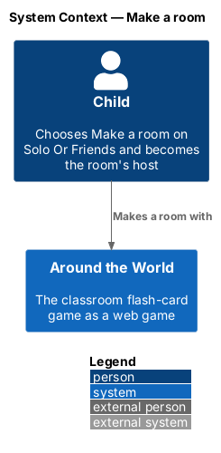
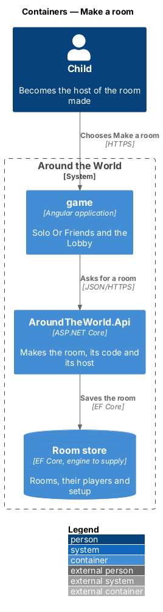
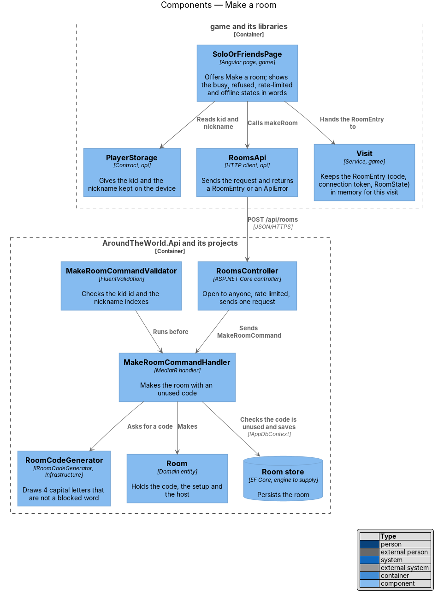
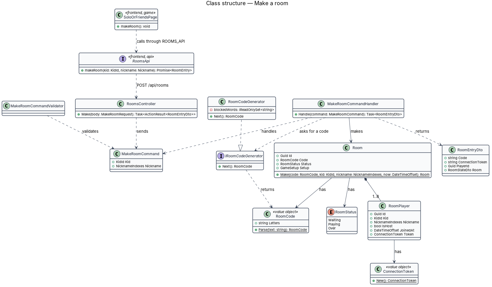
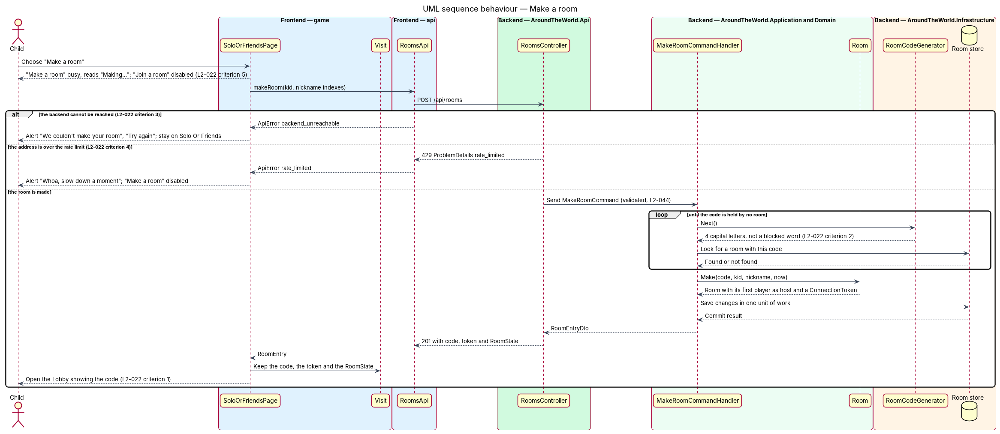

# Make a room

## Overview

Around the World is the classroom flash-card game as a web game for children aged 10 to 12. A
child plays alone on the device or with friends in real time. A game with friends is played in a
room.

- **room** — group of up to 8 players who play one game together, held by the backend
- **code** — 4 capital letters that name one room and are read aloud across the room
- **host** — player who made the room and who alone sets the game up and starts it
- **connection token** — unguessable value the server gives one player for one room

This feature covers the first step of a game with friends. A child on Solo Or Friends chooses
"Make a room". The backend makes a room with a unique code, the child becomes its host, and the
Lobby opens showing the code, directly and before any Game Setup. The feature also covers the
states of Solo Or Friends around that step: a room being made, a room that could not be made, an
address that has made more rooms than the rate limit allows, and a device with no network.

Making a room is open to anyone, because the game has no accounts. The feature therefore sits
behind a rate limit, which
[`rooms/guard-room`](../guard-room/README.md) describes for the whole backend. The Lobby that
opens afterwards belongs to [`rooms/wait-in-lobby`](../wait-in-lobby/README.md).

## Description

Journey 12 built the slice; the decisions that filled this design's gaps are in
[`docs/adr/0031-making-a-room.md`](../../../adr/0031-making-a-room.md). The slice runs from Solo Or
Friends in the `game` application to the room store.

Frontend:

- **`SoloOrFriendsPage`** — page in `game`, under the top bar titled "Who's playing?". Its card
  "With friends" reads "Play live with up to 8 friends. Share a 4-letter code to get them in."
  and holds "Make a room" above "Join a room". The page offers "Make a room", reads the kid and the nickname through `PLAYER_CHOICES`, and
  calls `RoomsApi.makeRoom` through `ROOMS_API`. On success it hands the result to the visit
  (`Visit.enterRoom`) and opens the Lobby (`L2-022` criterion 1). On an
  `ApiError` it stays on Solo Or Friends and shows a message chosen by the error's `code`.
  "Play solo" stays usable in every state (`L2-054` criterion 3). The page has five states
  besides the default:
  - `loading` — two placeholder cards stand in, the page is marked busy and a hidden status
    reads "Getting ready…" (`L2-031` criterion 4);
  - `submitting` — while the request is under way "Make a room" is busy and reads "Making…", and
    "Join a room" is disabled (`L2-022` criterion 5);
  - `error` — on `backend_unreachable` an alert under the cards reads "We couldn't make your
    room" and "Something went wrong on our side. Try again, or play solo while you wait.", and
    offers "Try again", which sends the request again (`L2-022` criterion 3);
  - `rate-limited` — on status 429 an alert reads "Whoa, slow down a moment" and "That's a lot
    of rooms! Wait a little, then try again.", and "Make a room" is disabled; "Join a room"
    stays usable (`L2-022` criterion 4). "Make a room" stays disabled until the child opens Solo Or Friends again
    (ADR 0031);
  - `offline` — while the device has no network a banner across the top of the screen reads
    "You're offline." and "You can still play solo.", "Make a room" and "Join a room" are
    disabled, and the card says "Playing with friends needs the internet." (`L2-022`
    criterion 6). The banner is a status, not an alert. The page learns that the device has no network from
    `NETWORK`: `BrowserNetwork` reads `navigator.onLine` and listens for the browser's `online`
    and `offline` events, and stops listening when the page goes (ADR 0031).
- **`RoomsApi`** — HTTP client contract in `api`, bound to `ROOMS_API`. `makeRoom(kid, nickname)`
  sends `POST /api/rooms`, on the game's own origin, with the kid id and the nickname's two list
  indexes, and nothing else (`L2-040` criterion 1). `HttpRoomsApi` implements it over Angular's
  `HttpClient`; the route of Solo Or Friends provides both, so neither is in an initial chunk
  (ADR 0031). A request that gets no response becomes an `ApiError` with the code
  `backend_unreachable`. A ProblemDetails response becomes an `ApiError` with that response's
  `code`; any other answer an `ApiError` with the code `unknown`.
- **`RoomEntry`** — type in `api` returned by `makeRoom`: the room's code, the player's
  connection token, the player's id in the room and the first `RoomState`.
- **`Visit`** — holds the `RoomEntry` in memory only, for this visit (`room`, `enterRoom`,
  `leaveRoom`); the connection token is never written to the device's storage (`L2-015`
  criterion 4). The room group (`games/friends-game.routes.ts`) matches with `canMatch` while the
  visit holds a room and holds the Lobby at `/room/:code`; `FriendsGame`, behind `GAME_SESSION`,
  joins the group with the connection of [`rooms/wait-in-lobby`](../wait-in-lobby/README.md)
  (journey 13) and reads the entry from the visit (ADR 0031).

Backend:

- **`RoomsController`** — controller in `AroundTheWorld.Api`. Its `Make` action answers
  `POST /api/rooms`, is marked as open to anyone, carries the rate limit policy `make-room` and sends
  one `MakeRoomCommand`. An address over the limit receives status 429 with the code
  `rate_limited` (`L2-022` criterion 4). One address may make 10 rooms in a fixed window of a
  minute **(to confirm)**, read from the settings `RateLimits:MakeRoom:PermitLimit` and
  `RateLimits:MakeRoom:WindowSeconds`; the 429 carries a `Retry-After` header and ProblemDetails
  with the code `rate_limited` (ADR 0031).
- **`MakeRoomCommand`** — request carrying the `KidId` and the nickname's two list indexes.
- **`MakeRoomCommandValidator`** — refuses a kid id that is not one of the five and nickname
  indexes outside the two lists of ten, which is outside 0 to 9 (`L2-014`, `L2-044`
  criterion 1).
- **`MakeRoomCommandHandler`** — MediatR handler in `AroundTheWorld.Application`. It asks
  `IRoomCodeGenerator` for a code, looks in the room store for a room that holds it, and asks
  again until the code is unused. It then calls `Room.Make`, saves through `IAppDbContext` in one
  unit of work and returns a `RoomEntryDto`. After 10 codes that are all in use it refuses
  with status 503 and the code `no_free_code`, which Solo Or Friends shows as its generic message
  (ADR 0031).
- **`IRoomCodeGenerator`** and **`RoomCodeGenerator`** — port in Application and its
  implementation in `AroundTheWorld.Infrastructure`. `Next()` draws 4 capital letters from A to Z
  at random and draws again while the letters spell a blocked word (`L2-022` criterion 2). Each letter is drawn with .NET's
  cryptographic `RandomNumberGenerator`. The list of blocked words is a fixed set of rude or
  unkind 4-letter words in `AroundTheWorld.Infrastructure` (`Rooms/BlockedWords.cs`), compared
  with the whole code (ADR 0031).
- **`RoomCode`** — domain value object holding exactly 4 capital letters from A to Z.
- **`Room`** — domain entity. `Room.Make(code, kid, nickname, now)` creates the room with status
  `Waiting`, a `GameSetup` and its first `RoomPlayer`, marked as the host. A new room starts from the default setup (`L2-016` criterion 1,
  `L2-017` criterion 1), never from the setup kept on the host's device (ADR 0031); the host's later "Save" belongs to `player/set-up-game`.
- **`RoomPlayer`** — domain entity for one player in a room: nickname indexes, kid, the time of
  joining, the host mark and a `ConnectionToken`.
- **`ConnectionToken`** — domain value object made for each `RoomPlayer`
  ([`rooms/guard-room`](../guard-room/README.md), `L2-043` criterion 1).
- **Room store** — reached through `IAppDbContext` with EF Core; its engine is Azure SQL Database (`docs/adr/0009-health-and-migrations.md`).

Solo Or Friends shows its two cards stacked below 768 px and side by side from 768 px (`L2-050`
criterion 6). No mock words a message for any other `code` on Solo Or Friends; the generic message
(`L2-054` criterion 2) is the error state's: "We couldn't make your room", "Something went
wrong on our side. Try again, or play solo while you wait." and "Try again" (ADR 0031). The screen follows the mocks
`docs/mocks/pages/solo-or-friends/` (states `default`, `loading`, `submitting`, `error`,
`rate-limited`, `offline`).

## Requirements

The feature realizes the following level-2 (L2) requirement, which refines the level-1 (L1)
requirement cited by identifier.

| L2 ID | Refines (L1) | Requirement |
|-------|--------------|-------------|
| `L2-022` | `L1-007` | Making a room: when the child chooses "Make a room" on Solo Or Friends, the backend shall make a room with a unique code of 4 capital letters from A to Z that is never a blocked word, the child shall be its host, and the Lobby shall open showing the code. While a room is being made, "Make a room" shall be busy and read "Making…", and "Join a room" shall be disabled. When the backend cannot be reached, a message shall say the room could not be made ("We couldn't make your room", "Something went wrong on our side. Try again, or play solo while you wait.") and offer "Try again", and the child shall stay on Solo Or Friends. A request from an address over the rate limit shall be refused with status 429; Solo Or Friends shall tell the child to wait ("Whoa, slow down a moment", "That's a lot of rooms! Wait a little, then try again.") and "Make a room" shall be disabled until Solo Or Friends is opened again. When the device has no network, a banner shall say so ("You're offline. You can still play solo."), "Make a room" and "Join a room" shall be disabled ("Playing with friends needs the internet.") and "Play solo" shall work. |

## Diagrams

### System context

A child makes a room through Around the World. No external system takes part in this slice.

### Containers

The request travels from the `game` application to `AroundTheWorld.Api`, which saves the new
room in the room store.

### Components

`SoloOrFriendsPage` calls `RoomsApi` and hands the result to `Visit`. In the backend,
`RoomsController` sends `MakeRoomCommand`; the handler obtains a code from `RoomCodeGenerator`,
makes the `Room` and saves it.

### Class structure

`MakeRoomCommandHandler` depends on `IRoomCodeGenerator` and makes a `Room`. The room owns its
`RoomPlayer` entries, and each holds a `ConnectionToken`. `RoomEntryDto` carries the code, the
token and the first room state back to `RoomsApi`.

### Behaviour — make a room

"Make a room" is busy and reads "Making…" while the request is under way. The sequence then
shows the three outcomes. An unreachable backend leaves the child on Solo Or Friends with the
alert "We couldn't make your room" and "Try again". A rate-limited address leaves the child there
with the alert "Whoa, slow down a moment" and "Make a room" disabled. Otherwise the handler draws
codes until one is unused, makes the room with the child as host, and the Lobby opens with the
code.

