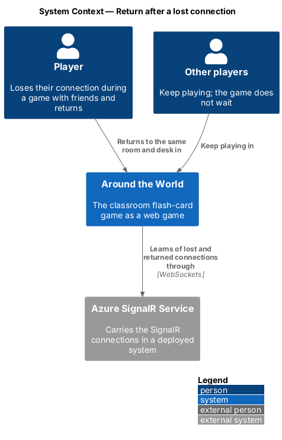
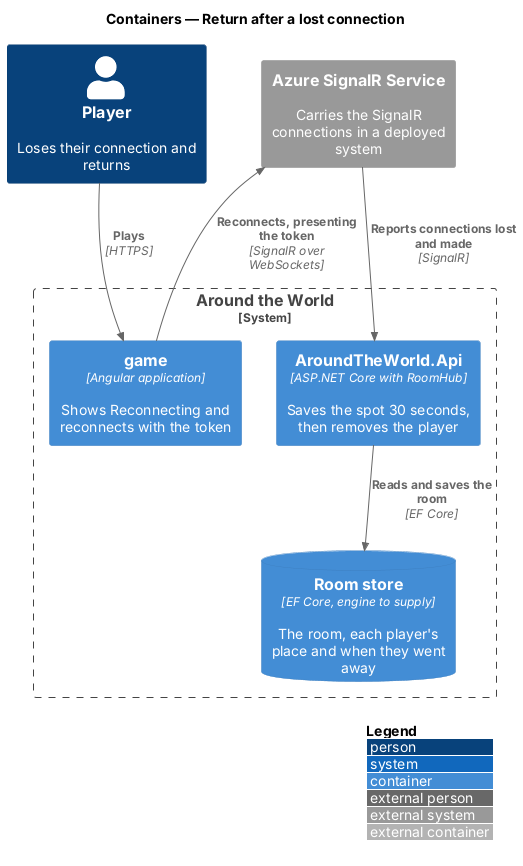
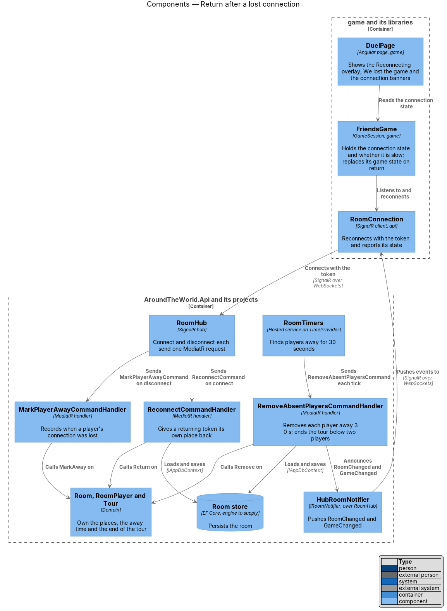
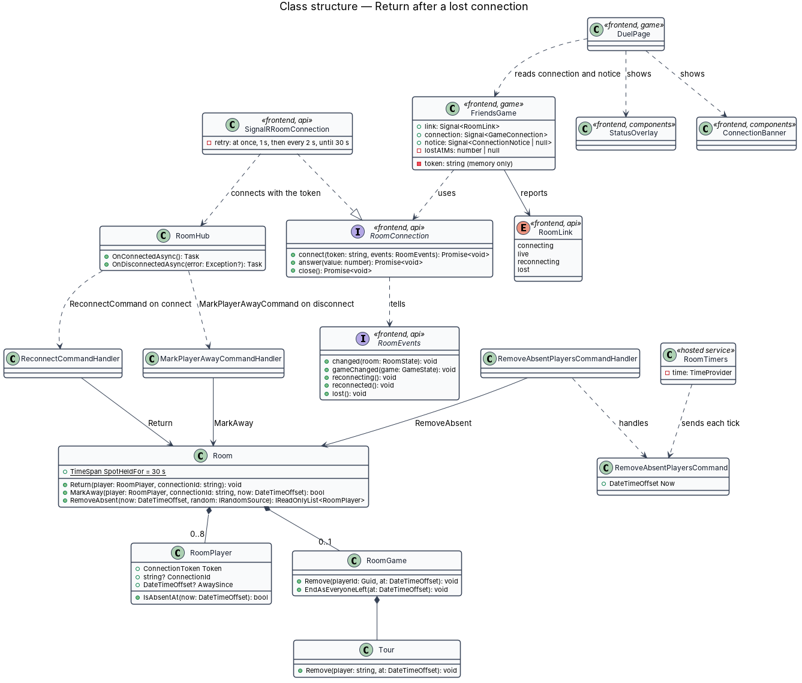
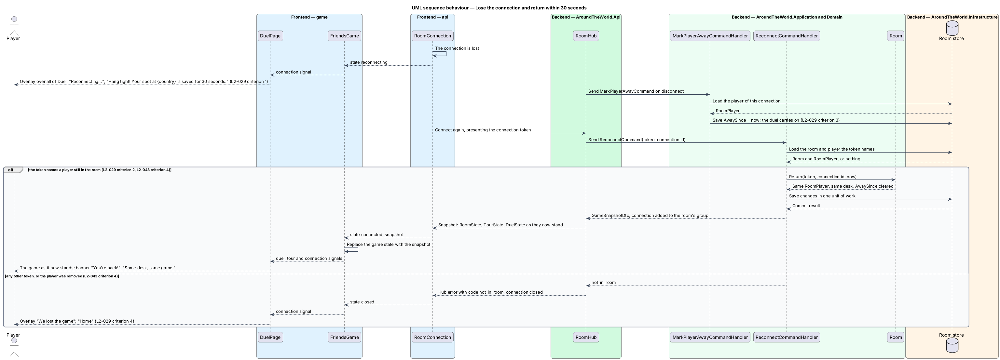
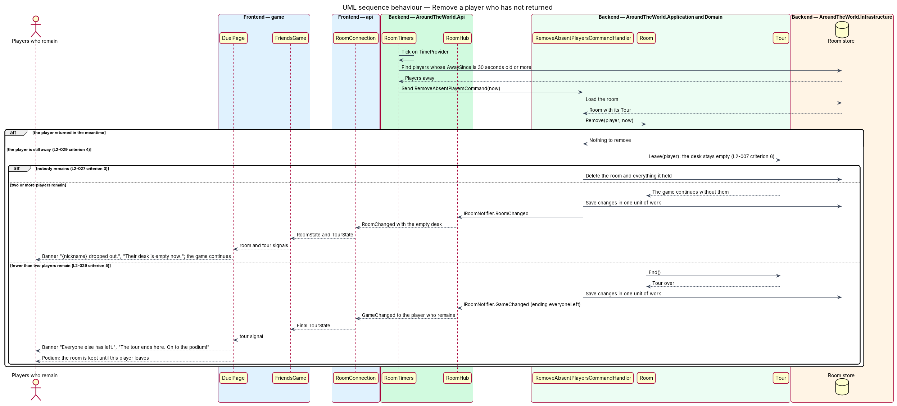

# Return after a lost connection

## Overview

Around the World is the classroom flash-card game as a web game for children aged 10 to 12. A
game with friends is played in real time by a room of up to 8 players, each on their own device
and each holding one SignalR connection to the backend. School networks and old tablets drop
connections.

- **room** — group of up to 8 players who play one game together, held by the backend
- **connection token** — unguessable value the server gives one player for one room
- **spot** — player's place in the room: their desk, their role and their distance travelled
- **away** — state of a player whose connection is lost and whose spot is still saved

This feature covers a lost connection during a game with friends. The Duel screen of the player
who lost it shows "Reconnecting…" over everything and says the spot is saved for 30 seconds
("Hang tight! Your spot at {country} is saved for 30 seconds."). A player who returns within 30
seconds, presenting the same connection token, is in the same room at the same desk, with the
game as it now stands, and a banner says so. The game does not wait: a duel carries on and the
other player can still win it by answering.

A player who has not returned after 30 seconds is removed. Their desk stays empty and the game
continues without them. A banner tells the other players, and the removed player's own Duel
screen says the game is lost and offers "Home". When fewer than two players then remain, the tour
ends, a banner tells the player who remains, and the Podium is shown to them. A further banner
tells a player whose connection is slow.

The token itself, and the refusal of any other token, belong to
[`rooms/guard-room`](../guard-room/README.md). Deciding the duel that carries on belongs to
[`rooms/decide-game-on-server`](../decide-game-on-server/README.md).

## Description

The slice is not built yet; the parts below are the ones the design introduces. The slice runs
from the Duel screen in the `game` application, over the player's SignalR connection, to the room
store.

Frontend:

- **`RoomConnection`** — SignalR client contract in `api`. It reports its state as `connected`,
  `reconnecting` or `closed`, and reports separately whether the connection is slow. What counts
  as a slow connection is `<TO SUPPLY>`. When the connection is lost it reconnects by itself and presents
  the same connection token, the one value it holds that the server gave it (`L2-040`
  criterion 1). It stops trying 30 seconds after the loss and reports `closed`. Its
  retry timers are cleared when it is closed (`L2-048` criterion 2).
- **`FriendsGame`** — game service in `game`. It exposes the connection's state, and whether it
  is slow, as signals. It
  keeps the connection token in memory only, because the device's storage holds no token
  (`L2-015` criterion 4); a page that is reloaded therefore has no token and cannot return. On
  the `GameSnapshot` that follows a return, it replaces its room, tour and duel state whole
  (`L2-029` criterion 2).
- **`DuelPage`** — page in `game`. While the state is `reconnecting` it shows an overlay over
  the whole Duel screen: "Reconnecting…" and "Hang tight! Your spot at {country} is saved for 30
  seconds.", where the country is that of the player's desk. The overlay is announced as an
  alert in words (`L2-029` criterion 1, `L2-051` criterion 5). The number pad and the voice
  answer send nothing while the connection is away. When the state is `closed` during a game,
  because the 30 seconds have passed or the token was refused, the overlay reads "We lost the
  game" and "The connection was away for too long, so your desk was given up. Nothing was your
  fault.", and offers "Home", which opens Home (`L2-029` criterion 4).

  The page shows one banner across the top of the Duel screen for each of four events. A banner
  does not cover the flash card and stays until it is no longer true
  (`docs/design-system/patterns/notifications.html`):
  - "You're back!" and "Same desk, same game.", a status, after a return within 30 seconds
    (`L2-029` criterion 2). When this banner leaves is `<TO SUPPLY>`;
  - "{nickname} dropped out." and "Their desk is empty now.", a status, on the devices of the
    other players when a player is removed (`L2-029` criterion 4). The nickname is that of the
    removed player, read from the `RoomState` held before the removal;
  - "Everyone else has left." and "The tour ends here. On to the podium!", an alert, on the
    device of the one player who remains, before the Podium opens (`L2-029` criterion 5). How
    long it shows before the Podium opens is `<TO SUPPLY>`;
  - "Your internet is wobbly." and "Answers might take a moment.", a status, while the
    connection is slow (`L2-029` criterion 7).
- **`GameSnapshot`** — type in `api`: the `RoomState`, the `TourState` and the `DuelState` with
  the current flash card, without its answer.

Backend:

- **`RoomHub`** — `OnDisconnectedAsync` sends `MarkPlayerAwayCommand` and `OnConnectedAsync`
  sends `ReconnectCommand`. Each sends one MediatR request and checks nothing itself.
- **`MarkPlayerAwayCommandHandler`** — finds the `RoomPlayer` the lost connection belonged to
  and calls `MarkAway(now)`, which records `AwaySince`. It changes nothing else: the current
  `Duel` is untouched, its flash card's time keeps running and the other player's answer is
  decided as usual (`L2-029` criterion 3).
- **`ReconnectCommandHandler`** — loads the room and the player the token names. With no such
  player it refuses with `not_in_room` and the hub closes the connection (`L2-043` criterion 4).
  Otherwise it calls `Room.Return`, saves, adds the connection to the room's group and returns a
  `GameSnapshotDto`.
- **`Room`** — `Return(token, connectionId, now)` clears `AwaySince` and binds the new
  connection to the same `RoomPlayer`, whose desk and distance are unchanged. `Remove(player,
  now)` does nothing when the player has returned. Otherwise it removes the player, tells the
  `Tour` that the desk is empty and ends the tour when fewer than two players remain (`L2-029`
  criteria 4 and 5). The desk stays empty for the rest of the tour and no classmate takes it, so
  the ring then holds that empty desk besides the traveller's own (`L2-007` criterion 6).
- **`RoomPlayer`** — holds the `ConnectionToken`, the id of the current SignalR connection and
  `AwaySince`.
- **`RoomTimers`** — hosted service in `AroundTheWorld.Api` driven by `TimeProvider`. It finds
  each player whose `AwaySince` is 30 seconds old or more and sends one
  `RemoveAbsentPlayerCommand` for each.
- **`RemoveAbsentPlayerCommandHandler`** — loads the room, calls `Room.Remove`, saves, and
  announces `RoomChanged` to the players who remain, or `TourEnded` to the one who remains. After
  `TourEnded` the room is kept while the Podium is shown, as
  [`rooms/decide-game-on-server`](../decide-game-on-server/README.md) describes. When the
  removal leaves no player in the room, the handler deletes the room and everything it held
  (`L2-027` criterion 3).
- **Room store** — reached through `IAppDbContext` with EF Core; its engine is Azure SQL Database (`docs/adr/0009-health-and-migrations.md`).

Tests advance `FakeTimeProvider` past 30 seconds; none sleeps.

Four points are undecided:

- What the tour does when the removed player is the traveller or the desk holder of the current
  duel is `<TO SUPPLY>`: `L2-029` criterion 4 fixes only that the desk is empty and the game
  continues.
- Whether the other players are shown that a player is away during the 30 seconds is
  `<TO SUPPLY>`. No mock draws it: the other players are told when the player is removed.
- A player who chooses "Leave" during a game (`L2-033` criterion 4) tells the room and cannot
  come back: `FriendsGame.leave()` sends `LeaveRoom` and closes the connection, and no spot is
  saved ([`rooms/decide-game-on-server`](../decide-game-on-server/README.md)). Whether that
  player's desk is then treated as a removed player's desk, and whether the other players are
  shown "{nickname} dropped out.", are `<TO SUPPLY>`.
- A connection lost in the Lobby, before the game starts, belongs to
  [`rooms/wait-in-lobby`](../wait-in-lobby/README.md) (`L2-029` criterion 6). Whether the 30
  seconds apply there is `<TO SUPPLY>`.

The screen follows the mocks `docs/mocks/pages/duel/` (states `reconnecting`, `error`) and
`docs/mocks/notifications/connection-banner/` (states `info`, `success`, `warning`, `danger`).

## Requirements

The feature realizes the following level-2 (L2) requirements. Each refines the level-1 (L1)
requirement cited by identifier.

| L2 ID | Refines (L1) | Requirement |
|-------|--------------|-------------|
| `L2-029` | `L1-008` | Losing the connection and coming back: when a player in a game with friends loses their connection, the Duel screen shall show "Reconnecting…" over everything and shall say their spot is saved for 30 seconds ("Hang tight! Your spot at {country} is saved for 30 seconds."). A player who reconnects within 30 seconds shall be in the same room at the same desk with the game as it now stands, and a banner shall say so ("You're back!", "Same desk, same game."). The game shall not wait: the other player in a duel shall still be able to win it by answering. A player who has not returned after 30 seconds shall be removed from the room, their desk shall be empty and the game shall continue without them; a banner shall tell the other players ("{nickname} dropped out.", "Their desk is empty now."), and the removed player's own Duel screen shall say the game is lost ("We lost the game") and offer "Home". When fewer than two players remain, the tour shall end, a banner shall tell the player who remains ("Everyone else has left.", "The tour ends here. On to the podium!") and the Podium shall be shown to them. When a player's connection is slow, a banner across the top of the Duel screen shall say so ("Your internet is wobbly.", "Answers might take a moment.") and shall not cover the flash card. (Criterion 6, a connection lost in the Lobby, is realized by `rooms/wait-in-lobby`.) |
| `L2-043` | `L1-013` | Only a room's own player may act in it: a player who reconnects and presents their token within 30 seconds shall get their own place back, and shall be refused with any other token (criterion 4; the other criteria are realized by `rooms/guard-room`). |
| `L2-007` | `L1-001` | The class at the start of a tour: at any moment of a tour exactly one player shall be the traveller and exactly one desk shall be empty, apart from the desk of each player removed from a game with friends, which shall stay empty (criterion 6; the other criteria are realized by the `tour` subsystem). |

## Diagrams

### System context

A player loses their connection and returns to Around the World while the other players keep
playing. Azure SignalR Service carries the connections in a deployed system.

### Containers

The `game` application reconnects over SignalR and presents its token. `AroundTheWorld.Api`
keeps each player's place, and the time they went away, in the room store.

### Components

`DuelPage` reads the connection's state from `FriendsGame` and shows the overlay and the
banners. `RoomHub` sends a command when a
connection is lost and when one is made; `RoomTimers` sends the removal after 30 seconds. The
three handlers act on `Room`, `RoomPlayer` and `Tour`.

### Class structure

`RoomPlayer` holds the token, the current connection and `AwaySince`. `Room.Return` and
`Room.Remove` are the two ends of the 30 seconds. `FriendsGame` replaces its state with a
`GameSnapshot` on return.

### Behaviour — lose the connection and return within 30 seconds

The device shows "Reconnecting…" over the whole Duel screen while the server marks the player
away and the duel carries on. A connection that presents the player's token gets the same desk
and a snapshot of the game as it stands, and the banner "You're back!" shows. Any other token is
refused with `not_in_room`, and the Duel screen says "We lost the game" and offers "Home".

### Behaviour — remove a player who has not returned

`RoomTimers` finds a player away for 30 seconds and sends the removal. The desk stays empty, the
game continues and the other players see the banner "{nickname} dropped out.". With fewer than two
players the tour ends, the remaining player sees the banner "Everyone else has left." and then
the Podium, and the room is kept until that player leaves. A removal that leaves nobody deletes
the room. The removed player's own device, once its 30 seconds of retries have passed, shows "We
lost the game".

