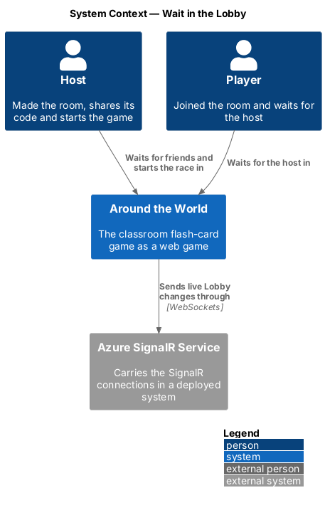
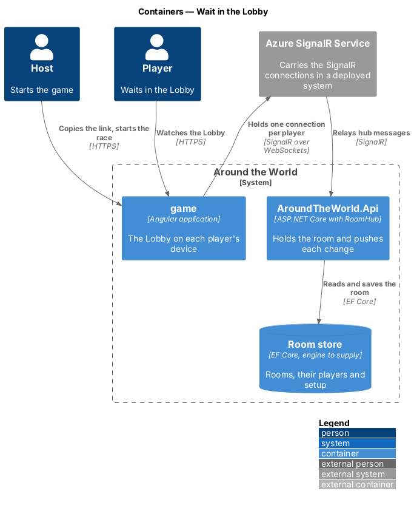
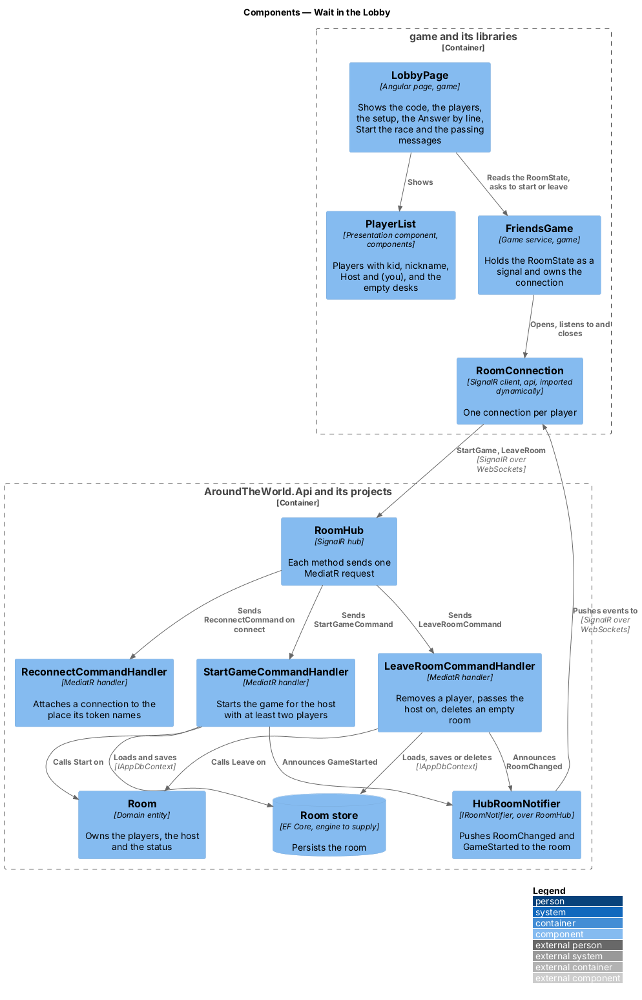
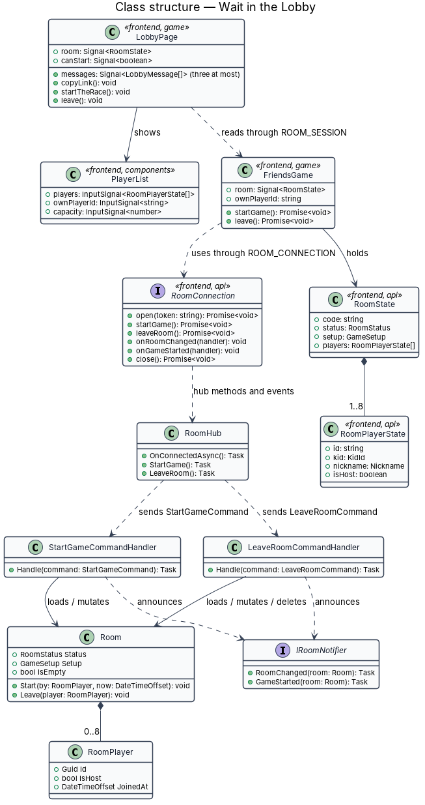
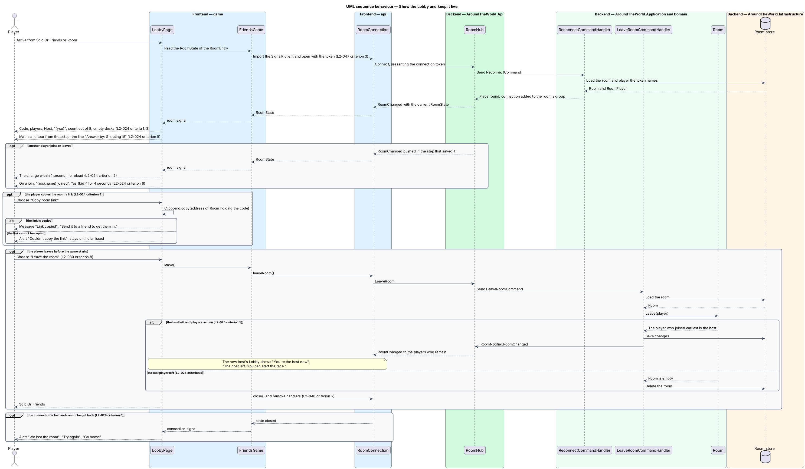
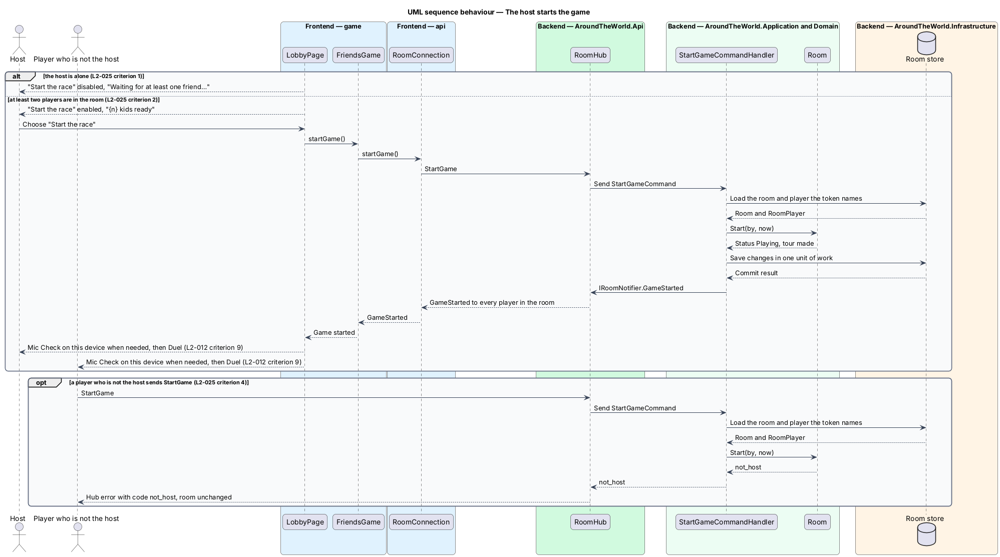

# Wait in the Lobby

## Overview

Around the World is the classroom flash-card game as a web game for children aged 10 to 12. A
game with friends is played in a room that a host makes and up to 7 friends join.

- **room** — group of up to 8 players who play one game together, held by the backend
- **code** — 4 capital letters that name one room and are read aloud across the room
- **host** — player who made the room and who alone sets the game up and starts it
- **Lobby** — screen on which the players of a room wait until the host starts the game
- **setup** — kinds of maths, times tables, tour length and card speed chosen for the game

This feature covers the wait. The Lobby shows the code in the largest type on the screen, so
that it can be read aloud, and lists the players as they arrive. Each player sees a join or a
leave within 1 second without reloading. Any player can copy a link that opens Room with the code
filled in. The Lobby also shows the setup the host chose: the maths and the tour length. Beside
them it shows the line "Answer by: Shouting it!", which is not part of the room's setup: each
player chooses voice or the number pad on their own device. A passing message tells the players
already in the room of each friend who joins.

A host reaches the Lobby directly from "Make a room" on Solo Or Friends, before any Game Setup; a
friend reaches it from Room.

The feature ends with the start. The host chooses "Start the race" once at least two players are
in the room, and the game starts for every player. A player who is not the host has no such
button, and the backend refuses a start that such a player sends. When the host leaves before the
start, the player who joined earliest becomes the host; when the last player leaves, the room is
gone.

The host's change to the setup belongs to `player/set-up-game` (`L2-018`). The game that starts
belongs to [`rooms/decide-game-on-server`](../decide-game-on-server/README.md). The Lobby is
shown again after a game: "Play again" on the Podium returns the players to the same room's
Lobby, where the host starts the next game (`L2-035` criterion 3).

## Description

The slice is not built yet; the parts below are the ones the design introduces. The slice runs
from the Lobby in the `game` application, over one SignalR connection per player, to the room
store.

Frontend:

- **`LobbyPage`** — page in `game`, under the top bar titled "Room", whose Back button is named
  "Leave the room". It reads the room from `FriendsGame` through `GAME_SESSION` and shows four
  parts (`L2-024` criteria 1 and 5):
  - the code panel: "Room code", the code in the largest type on the screen, the button "Copy
    room link" and "Say it out loud so friends can type it in.". The button copies the room's
    link with the CDK `Clipboard` service. A copied link shows the message "Link copied" with
    "Send it to a friend to get them in."; a link that cannot be copied shows "Couldn't copy
    the link" with "Say the code out loud instead: {the code's letters}." as an alert, which
    stays until it is dismissed (`L2-024` criterion 4);
  - the panel "The game": "Maths" (for example "×2 to ×10"), "Tour" ("{n} desks") and "Answer by"
    ("Shouting it!"). The first two are read from the room's `GameSetup`, and every Lobby in the
    room shows the new values once the host has saved a change (for example "× + −, ×2 to ×12"
    and "24 desks"; `L2-018` criterion 2). "Answer by" is not a value of `GameSetup` and is not
    sent to the backend: each player chooses voice or the number pad on their own device
    (`L2-024` criterion 5). Every mock of the Lobby reads "Shouting it!"; what the line reads
    for a player who answers with the number pad is `<TO SUPPLY>` (to confirm). The card speed
    is not shown. The host alone is offered "Change", which opens Game Setup (`L2-018`
    criterion 5, `player/set-up-game`);
  - the start control. For the host it is "Start the race", disabled while the host is alone,
    with the status "Waiting for at least one friend…" under it, or "{n} kids ready" once a
    friend is in (`L2-025` criteria 1 and 2). Any other player has no "Start the race" and no
    "Change", and sees a panel "You're in!" with "Waiting for {host's nickname} to start…"
    (`L2-025` criterion 3);
  - `PlayerList` under the heading "In the classroom".

  "Leave the room" leaves the room for Solo Or Friends without asking (`L2-030` criterion 8):
  the page calls `FriendsGame.leave()`. Whether the host is asked first is to confirm.

  The page shows passing messages in a region at the bottom of the screen, across it on a phone
  and at the bottom right from 576 px. A message is a status, shows a dismiss button, leaves by
  itself after 4 seconds and pauses while it is pointed at or focused. Messages stack with the
  newest at the bottom, three at most (`docs/design-system/patterns/notifications.html`). When
  a player joins, every other Lobby in the room shows "{nickname} joined" with "as {kid}" once
  (`L2-024` criterion 6); the page derives it from the player added between two `RoomState`
  values. The player who becomes the host is shown "You're the host now" with "The host left.
  You can start the race." (`L2-025` criterion 5). The page holds the messages as a list of
  `LobbyMessage` values bounded at three.

  The page has two further states. While the room is arriving, placeholders stand in for the
  code, the setup and the players, the page is marked busy and a hidden status reads "Getting
  the room…" (`L2-031` criterion 4). When the connection to the room is lost and cannot be got
  back, an alert takes the place of the start control: "We lost the room" and "The connection
  dropped and we couldn't get back in.", with "Try again" and "Go home", which opens Home
  (`L2-029` criterion 6); the code, the setup and the players last received stay shown.
- **`PlayerList`** — presentation component in `components`; it renders the mocks' `player-grid`
  block. It takes the players, the device's own player id and the capacity of 8. It shows each
  player's kid on the kid's colour, the nickname and "as {kid}", marks the host with a crown
  and "Host" and the device's own player "(you)" after the nickname, shows the count as "{n}/8"
  and draws each remaining place as "Empty desk" in a dashed outline. The grid has 2 columns, 3
  from 576 px and 4 from 1200 px. The list is a polite live region. Two players with the same
  kid are both shown as that kid and are told apart by their nicknames (`L2-024` criterion 3).
- **`FriendsGame`** — game service in `game`, provided at the game route. It holds the
  `RoomState` as a signal, opens `RoomConnection` with the connection token, and replaces the
  signal's value on each `RoomChanged` event. A `RoomChanged` whose status is `Waiting`, received
  while the Podium is shown, opens the Lobby again
  ([`rooms/decide-game-on-server`](../decide-game-on-server/README.md)). It closes the
  connection and removes its handlers when the player leaves the game with friends (`L2-048`
  criterion 2).
- **`RoomConnection`** — SignalR client contract in `api`, bound to `ROOM_CONNECTION`. Its
  implementation and the SignalR client library are imported dynamically when the Lobby is first
  entered, so a child who plays only solo never downloads them (`L2-047` criteria 2 and 3).
- **`RoomState`** — type in `api`: the code, the status, the `GameSetup` and the players, each
  with an id, a `KidId`, the nickname's two list indexes and the host mark. It holds no
  connection token and no way of answering. Each nickname is built on the device from the fixed lists by its indexes and
  rendered as text (`L2-040` criterion 3).

Backend:

- **`RoomHub`** — SignalR hub in `AroundTheWorld.Api`. Each method sends one MediatR request and
  checks nothing itself. `OnConnectedAsync` sends `ReconnectCommand`, which attaches the
  connection to the place its token names and adds it to the room's group; the caller then
  receives the current `RoomState`. `StartGame` sends `StartGameCommand` and `LeaveRoom` sends
  `LeaveRoomCommand`. No hub request carries a room's code or id: the room is the one the
  connection's token names ([`rooms/guard-room`](../guard-room/README.md)).
- **`StartGameCommandHandler`** — loads the caller's room and calls `Room.Start`. It saves the
  room and announces `GameStarted` through `IRoomNotifier` to every player (`L2-025`
  criterion 2).
- **`LeaveRoomCommandHandler`** — loads the caller's room and calls `Room.Leave`. When the room
  is then empty the handler deletes it; otherwise it saves and announces `RoomChanged` (`L2-025`
  criterion 5). The same handler serves a player who leaves from the Podium, so a room whose
  game is over is deleted when its last player has left (`L2-027` criterion 3).
- **`Room`** — domain entity. `Start(by, now)` refuses with `not_host` when the caller is not
  the host (`L2-025` criterion 4) and with `not_enough_players` when fewer than two players are
  in the room. Otherwise it sets the status to `Playing` and makes the tour, in which classmates
  hold the desks no player holds (`L2-007` criterion 5). `Leave(player)`
  removes the player and, when that player was the host, marks the remaining player with the
  earliest `JoinedAt` as the host.
- **`IRoomNotifier`** and **`HubRoomNotifier`** — port in Application and its implementation over
  the hub. `RoomChanged` and `GameStarted` are sent to the room's group in the same step that
  saves the change. No Lobby polls; this push is what meets the 1 second of `L2-024`
  criterion 2.
- **Room store** — reached through `IAppDbContext` with EF Core; its engine is Azure SQL Database (`docs/adr/0009-health-and-migrations.md`).

On `GameStarted` each device shows Mic Check to a player who needs it, on that player's own
device, and then Duel (`L2-012` criterion 9, `L2-030` criterion 3). The host's device does the
same.

Below 992 px the Lobby is one column: the code, the setup, the start control, then the players.
From 992 px a left column 352 px wide holds the code, the setup and the start control, and the
players stand on the right (`L2-050` criterion 4).

Three points are undecided:

- The address of the room's link is `<TO SUPPLY>`: the specs fix only that opening it opens Room
  with the code filled in.
- `L2-029` criterion 6 fixes what the Lobby shows once the connection cannot be got back. How
  long the Lobby tries before it says so, what "Try again" does when the room no longer holds
  the player, and whether the backend removes from a waiting room a player whose connection is
  lost are `<TO SUPPLY>`: `L2-029` criteria 1 to 5 cover a game that has started.
- Whether the first flash card waits for each player's Mic Check is `<TO SUPPLY>`
  ([`rooms/decide-game-on-server`](../decide-game-on-server/README.md)).

The screen follows the mocks `docs/mocks/pages/lobby/` (states `default`, `empty`, `guest`,
`full`, `edited`, `loading`, `error`) and `docs/mocks/notifications/lobby-toast/` (states `info`,
`success`, `warning`, `danger`, `stacked`).

## Requirements

The feature realizes the following level-2 (L2) requirements. Each refines the level-1 (L1)
requirement cited by identifier.

| L2 ID | Refines (L1) | Requirement |
|-------|--------------|-------------|
| `L2-024` | `L1-007` | The Lobby: the Lobby shall show the code in the largest type on the screen, the players in the room each with their nickname and kid, the host marked "Host", the device's own player marked "(you)", the count out of 8 and the empty desks. Every Lobby in the room shall show a join or a leave within 1 second without being reloaded. Two players with the same kid shall be told apart by their nicknames. A player shall be able to copy the room's link, which opens Room with the code filled in; a message shall say the link is copied ("Link copied", "Send it to a friend to get them in."), and when it cannot be copied a message shall say to say the code out loud instead ("Couldn't copy the link") and shall stay until it is dismissed. The Lobby shall show the game's setup: the maths, the tour length ("{n} desks") and how answers are given ("Answer by: Shouting it!"), which shall not be a value of the room's setup; what the line reads for a player who answers with the number pad is **to confirm**. When a player joins, every other Lobby in the room shall say so once in a passing message ("{nickname} joined", "as {kid}") that leaves by itself after 4 seconds; messages shall stack with the newest at the bottom and each shall be dismissible. |
| `L2-025` | `L1-007` | The host starts the game: "Start the race" shall be disabled while the host is alone, when the Lobby shall say it is waiting for at least one friend ("Waiting for at least one friend…"), and shall start the game for every player once at least two players are in the room; until then the host's Lobby shall say how many are in ("{n} kids ready"). A player who is not the host shall have no "Start the race" and shall be told who they are waiting for ("You're in!", "Waiting for {host's nickname} to start…"), and the backend shall refuse with an error `code` a request from such a player to start the game or change its setup. When the host leaves before the game starts, the player who joined earliest shall become the host and shall be told so ("You're the host now", "The host left. You can start the race."); when the last player leaves, the room shall be gone. |
| `L2-029` | `L1-008` | Losing the connection and coming back: when the connection of a player in the Lobby to the room is lost and cannot be got back, the Lobby shall say so as an alert ("We lost the room") and shall offer "Try again" and "Go home" (criterion 6; the other criteria are realized by `rooms/return-after-lost-connection`). |

## Diagrams

### System context

The host and the other players wait in Around the World. In a deployed system Azure SignalR
Service carries the connections over which Lobby changes arrive.

### Containers

Each device's `game` application holds one SignalR connection, relayed by Azure SignalR Service
to `AroundTheWorld.Api`, which keeps the room in the room store.

### Components

`LobbyPage` shows `PlayerList` and its passing messages, and reads the room from `FriendsGame`,
which owns the `RoomConnection`. `RoomHub` sends one command per method; the start and leave handlers mutate the
`Room` and announce through `HubRoomNotifier`.

### Class structure

`FriendsGame` holds a `RoomState` made of `RoomPlayerState` entries and uses `RoomConnection`.
`RoomHub` sends `StartGameCommand` and `LeaveRoomCommand`; their handlers mutate `Room`, which
owns the `RoomPlayer` entries and decides who the host is.

### Behaviour — show the Lobby and keep it live

The Lobby opens its connection with the token, receives the current `RoomState` and then each
change as it is saved; a join also shows "{nickname} joined" to the players already in the room.
The optional parts show copying the link, with its two messages, and leaving, including the host
passing to the earliest joiner, who is told "You're the host now", and the deletion of an empty
room. The last part shows the alert "We lost the room" when the connection cannot be got back.

### Behaviour — the host starts the game

"Start the race" is disabled while the host is alone. With two players, `Room.Start` sets the
room playing and `GameStarted` reaches every player. A start sent by a player who is not the host
is refused with `not_host` and changes nothing. After the start each device shows Mic Check when
its player needs it, then Duel. Until the start the host's Lobby reads "{n} kids ready".

