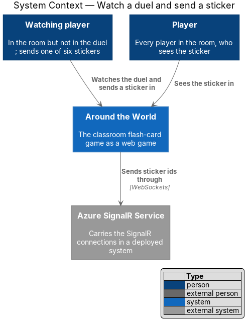
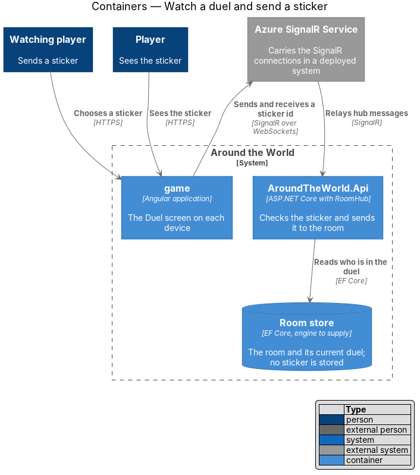
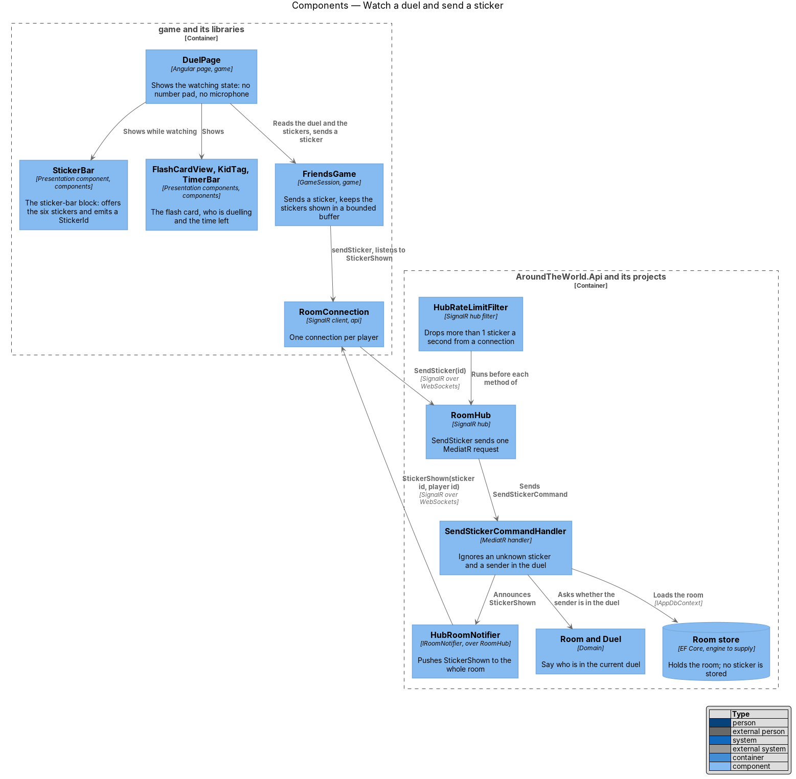
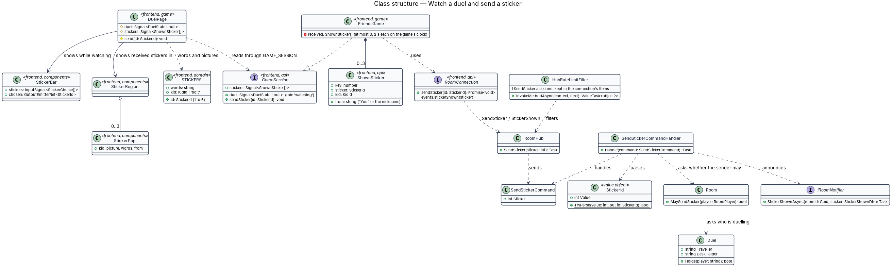
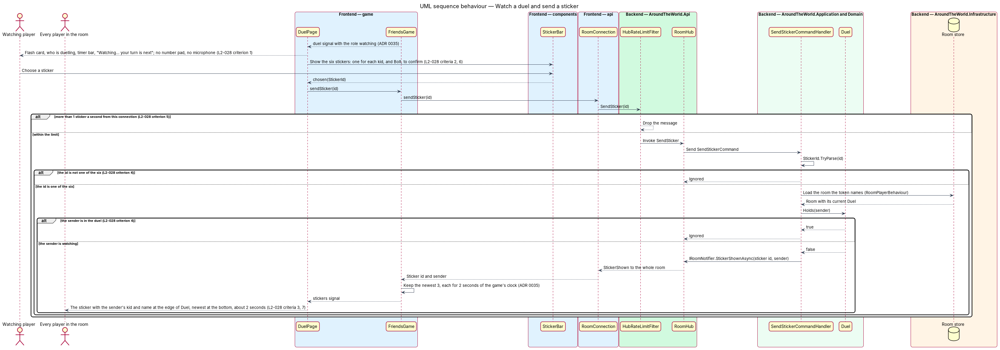

# Watch a duel and send a sticker

## Overview

Around the World is the classroom flash-card game as a web game for children aged 10 to 12. In a
game with friends, a room of up to 8 players goes round a ring of desks. Only two of them are in
a duel at any moment: the traveller and the desk holder of the desk the traveller stands beside.
Every other player in the room watches.

- **duel** — contest between the traveller and one desk holder over one flash card
- **watching player** — player in the room who is neither the traveller nor the desk holder of
  the current duel
- **sticker** — one of six fixed pictures with fixed words that a watching player can send to the
  room

This feature covers what a watching player sees and the one thing a watching player can send.
The Duel screen shows the flash card, who is duelling and the timer bar, and says in words that
the player is watching: "Watching… your turn is next". It shows no number pad and does not use
the microphone. It offers the six stickers and nothing else. A sticker sent is shown to every
player in the room, with the sender's kid and the sender's name, for about 2 seconds.

Each sticker shows a picture and its words. In the order offered they are one for each kid,
"Go!" (Zuri), "Wow!" (Nia), "Nice one" (Kenji), "So close" (Milo) and "Whoosh!" (Pip), and
"Beep boop!" (Bolt, Milo's robot), with the ids 1 to 6 (ADR 0035). Which the sixth sticker is, and
whose, is to confirm (`L2-028` criterion 6).

The game has no free-text chat (`L1-012`). A sticker travels as its id only, so nothing a child
writes or says can reach another child. The server ignores an id that is not one of the six,
ignores a sticker from a player in the duel, and drops stickers sent faster than 1 a second.

Deciding the duel being watched belongs to
[`rooms/decide-game-on-server`](../decide-game-on-server/README.md). The Duel screen for a player
in the duel, and the voice answer and number pad, belong to the `tour` and `answering`
subsystems. This watching state of Duel belongs to a game with friends only: a solo player who
has sat down watches the classmates' duels on World Map (`L2-034` criterion 7).

## Description

The slice runs from the Duel screen in the `game` application, over the player's one SignalR
connection, to `RoomHub`. It stores nothing. The decisions behind it are in
[ADR 0035](../../../adr/0035-watching-a-duel-and-stickers.md).

Frontend:

- **`DuelPage`** — page in `game`. It reads the device's role in the current duel from
  `GameSession.duel`, whose `role` is `watching` for a player not in the duel. In a game with
  friends every device shows Duel while a card is open or its time has run out; when the duel is
  decided a watching player's World Map opens at once with the move, and Duel returns with the
  next card (`L2-028` criterion 8, `L2-030` criterion 4). When the role is watching, it shows `FlashCardView`, the two `KidTag`s of the
  players in the duel, each with its role ("Travelling", "Holds {country}"), and `TimerBar` in
  the traveller's colour. The flash card reads "Watching… your turn is next" in the place where
  the answer stands for a player in the duel. A live region says "You are watching. {traveller}
  against {desk holder}: {flash card}." (`L2-051` criterion 4). The page does not create
  `NumberPad`, and it does not start `VoiceAnswer`, so no microphone is opened (`L2-028`
  criterion 1). It shows `StickerBar` in the footer of the screen, where a player in the duel
  has the switch between voice and the number pad; that switch is not offered while watching
  (`L2-011` criterion 5). No other control sends anything (`L2-028` criterion 2); the corner
  button "Leave the game" stays. Each of the two players in the duel is named by nickname, or by
  the kid's name when a classmate who is one of the five kids holds the desk (`L2-033`
  criterion 6).

  The page shows each received sticker in `StickerRegion` at the right edge of the screen, above
  the footer, as a `StickerPop`. Each shows the picture and colours of the sender's kid, the
  sticker's words and the sender's name: "You" on the sender's own device and the nickname
  elsewhere (`L2-028` criterion 3, ADR 0035). A sticker pops in over 200 ms, stays 2 seconds and
  goes; with reduced motion it fades in and is not tilted. Stickers that arrive close together
  stack with the newest at the bottom, at most three at once, and none covers the flash card
  (`L2-028` criterion 7). The region is a polite live region and takes no pointer input. A player
  in the duel sees received stickers in the same region.
- **`StickerBar`** — presentation component in `components` (`div[atw-sticker-bar]`); it renders
  the mocks' `sticker-bar` block, a group named "Send a sticker". It shows the stickers it is
  given as buttons, in the order Zuri, Nia, Kenji, Milo, Pip, Bolt. The bar wraps: 2 across,
  3 across from 576 px and one row of six from 992 px. Each of the first five buttons shows the
  kid's picture on the kid's tag colours; the sixth shows Bolt drawn as a robot. Each shows the
  sticker's words, which are also its accessible name, and emits the chosen `StickerId`
  (`L2-028` criterion 6).
- **`StickerPop`** and **`StickerRegion`** — presentation components in `components`
  (`p[atw-sticker-pop]`, `div[atw-sticker-region]`): one received sticker, and the polite live
  region at the screen's edge they stack in.
- **`STICKERS`** — the six stickers in `domain`'s `cast/`: each one's id, words and kid (or
  Bolt). Only the id ever leaves the device.
- **`GameSession`** — contract in `api` behind `GAME_SESSION`. This slice reads the device's
  role in the duel and `stickers`, the stickers being shown, and calls `sendSticker(id)`. A solo
  game shows none and sends none.
- **`FriendsGame`** — game service in `game`. `sendSticker` passes the id to `RoomConnection`.
  On `StickerShown` it keeps the sticker, its sender and the game's clock's time in a buffer of
  three, dropping the oldest for a fourth, and shows each for 2 seconds of the game's clock,
  which already ticks while a game is held, so no timer is made for a sticker (`L2-028`
  criterion 3, `L2-048` criterion 5, ADR 0035). The sender's kid and nickname are read from the
  `RoomState` by the sender's player id, and the device's own player is named "You". A sticker
  from a player no longer in the room is not shown.
- **`RoomConnection`** — SignalR client contract in `api`. It sends `SendSticker` with the id and
  delivers `StickerShown` (`L2-027` criterion 2).

Backend:

- **`RoomHub`** — `SendSticker(int stickerId)` sends one `SendStickerCommand`. The message holds
  the id and nothing else.
- **`HubRateLimitFilter`** — SignalR hub filter in `AroundTheWorld.Api`, described in
  [`rooms/guard-room`](../guard-room/README.md). It lets one `SendSticker` a second through for
  each connection, counted on `TimeProvider`, and drops the others without an error (`L2-028`
  criterion 5). The time of the last one let through is kept in the connection's own `Items`, so
  it goes with the connection and nothing grows with the stickers sent.
- **`SendStickerCommandHandler`** — MediatR handler for a room player's request; the room is the
  one the connection's token names (`RoomPlayerBehaviour`). It parses the id with
  `StickerId.TryParse`. It ends without effect and without an error when the id is not one of the
  six, when the room has no game being played, or when the current `Duel` holds the sender
  (`Room.MaySendSticker`, `L2-028` criterion 4). Otherwise it announces `StickerShown` through
  `IRoomNotifier`. It saves nothing: a sticker is never written to the room store (`L2-046`
  criterion 1).
- **`StickerId`** — domain value object that accepts only the six ids, 1 to 6.
- **`Duel`** — domain type; `Holds(player)` says whether a player is its traveller or its desk
  holder.
- **`IRoomNotifier`** — `StickerShownAsync(roomId, sticker)` sends `StickerShown`, the sticker's
  id and the sender's player id, to the whole room's group, the sender included.

A sticker with an unknown id is ignored, not refused: `SendStickerCommand` has no validator that
answers with an error, because `L2-028` criterion 4 asks for silence. `L2-044` criterion 1 lists
no sticker id among the values it refuses with a `code`.

Three points are decided by [ADR 0035](../../../adr/0035-watching-a-duel-and-stickers.md):

- The six ids are 1 to 6 in the order offered: 1 "Go!", 2 "Wow!", 3 "Nice one", 4 "So close",
  5 "Whoosh!", 6 "Beep boop!". The sixth sticker itself stays to confirm.
- At most three stickers show at once, as the mock `stacked` draws, and the buffer holds three; a
  fourth makes the oldest leave.
- A received sticker shows the picture and colours of the sender's kid, whichever sticker it is,
  "Beep boop!" included (`L2-028` criterion 3).

The screen follows the mocks `docs/mocks/pages/duel/` (state `watching`) and
`docs/mocks/notifications/sticker/` (states `info`, `stacked`).

## Requirements

The feature realizes the following level-2 (L2) requirement, which refines the level-1 (L1)
requirement cited by identifier.

| L2 ID | Refines (L1) | Requirement |
|-------|--------------|-------------|
| `L2-028` | `L1-008` | Watching a duel and sending a sticker: in a game with friends, a player who is not in the duel shall see the flash card, who is duelling and the timer bar, shall have no number pad and no microphone, and shall be told they are watching ("Watching… your turn is next"). The Duel screen shall offer a watching player the six stickers and nothing else to send. The stickers shall be six, each showing a picture and its words: one for each kid, "Go!" (Zuri), "Wow!" (Nia), "Nice one" (Kenji), "So close" (Milo) and "Whoosh!" (Pip), and "Beep boop!" (Bolt); which the sixth sticker is, and whose, is **to confirm**. Every player in the room shall see a sent sticker with the sender's kid and the sender's name ("You" on the sender's own device) for about 2 seconds. Stickers that arrive close together shall stack at the edge of the Duel screen with the newest at the bottom, and none shall cover the flash card. The server shall ignore a sticker whose id is not one of the six or whose sender is in the duel, and shall drop stickers sent faster than 1 a second. |

## Diagrams

### System context

A watching player sends a sticker through Around the World and every player in the room sees it.
In a deployed system Azure SignalR Service carries the connections.

### Containers

A sticker id travels from one `game` application over SignalR to `AroundTheWorld.Api` and back to
every device in the room. The API reads the room store to learn who is in the duel and stores no
sticker.

### Components

`DuelPage` shows the flash card, the duelling kids, the timer bar and `StickerBar` with its six
stickers, and the stickers received in `StickerRegion`.
`FriendsGame` sends the id through `RoomConnection`. `HubRateLimitFilter` runs before `RoomHub`;
`SendStickerCommandHandler` checks the id and the sender and announces through `HubRoomNotifier`.

### Class structure

`FriendsGame` realizes `GameSession` and owns a bounded set of `ShownSticker` entries.
`SendStickerCommandHandler` depends on `StickerId`, `Duel` and `IRoomNotifier`;
`HubRateLimitFilter` filters `RoomHub`.

### Behaviour — watch a duel and send a sticker

The watching state reads "Watching… your turn is next", shows no number pad and opens no
microphone. A chosen sticker passes the rate
filter, the check of its id and the check that its sender is not in the duel; each failed check
ends in silence. A sticker that passes reaches the whole room and is shown at the edge of the
Duel screen, with the sender's kid and name, for about 2 seconds.

