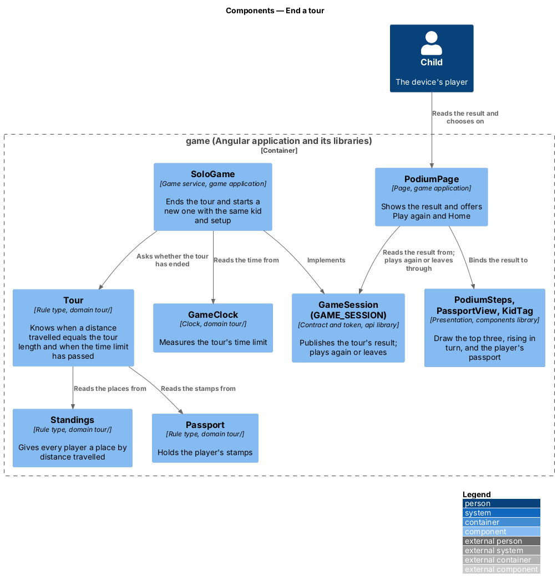
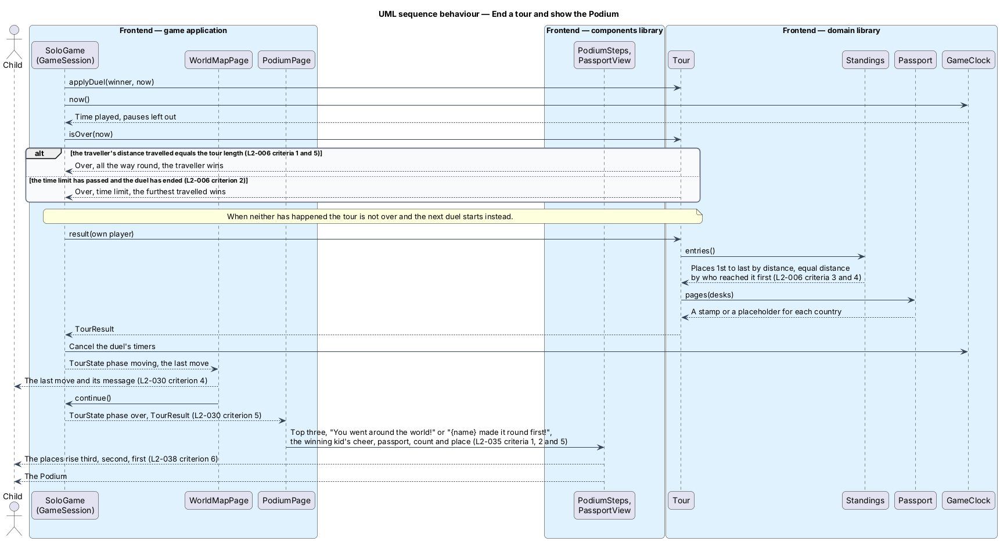
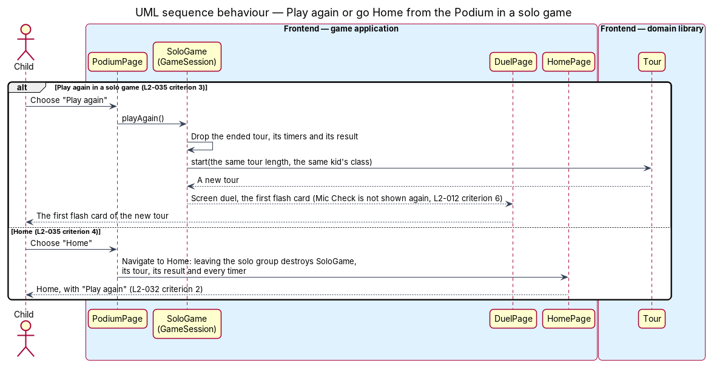

# End a tour

## Overview

Around the World is the classroom flash-card game as a web game for children aged 10 to 12. A
tour is one trip round a ring of 6, 12 or 24 desks, each desk a country. This feature covers how
a tour ends, how every player is placed, and the screen that shows the result.

**tour** — one game: a trip round the ring of desks

**distance travelled** — count of the hops a player has made

**all the way round** — state of a player whose distance travelled equals the tour length

**time limit** — length of play after which a tour ends even when nobody is all the way round

**place** — position of a player in the result, from 1st to last

**passport** — record of the countries a player reached, one stamp for each

**Podium** — screen that shows the top three players, the headline and the player's passport

**cheer** — one sentence under the headline that says what the winning kid does to celebrate

A tour ends in one of two ways. A player whose distance travelled reaches the tour length has
gone all the way round and wins; for the first traveller of a tour that is the hop past the last
desk. When the time limit passes first, the tour ends after the current duel and the player who
travelled furthest wins. Every player then has a place by distance travelled.

The Podium shows the result and offers two choices: "Play again" and "Home". The slice sits in
the `tour` subsystem and follows `tour/travel-round-ring`, which moves the players and records
their distances and stamps.

## Description

The slice covers a solo game, which is decided on the device: it has no backend part, and its
diagrams show frontend libraries only. In a game with friends the server applies the same rules
(`rooms/decide-game-on-server`). The decisions this design needed are in
[ADR 0024](../../../adr/0024-ending-a-tour.md).

- **`Tour`** — rule type in `domain`'s `tour/`. `Tour.start` takes the time at which the time
  limit passes, read from `timeLimitMs(tourLength)`: 3 minutes for a tour of 6 desks, 6 for 12
  and 12 for 24, in game time (`L2-006` criterion 2). `ending(atMs)` is asked after each decided
  duel has been applied, the child's or two classmates'. It answers `allTheWayRound` when a
  player's distance travelled equals the tour length (`L2-006` criteria 1 and 5), `timeLimit`
  when the time limit has passed (`L2-006` criterion 2), and null otherwise. The first traveller
  of a tour of 12 desks has a distance of 11 at desk 12, so reaching the last desk does not end
  the tour; the hop past it does. A duel in progress is never cut short, and a card nobody
  answers decides no duel. `result(ending, own, shown)` builds the `TourResult`.
- **`Standings`** — rule type in `domain`'s `tour/`. It holds each player's distance travelled
  and the time at which that distance was reached, and orders every player from 1st to last:
  further first; of two with the same distance the one who reached it first; players level since
  the start in the order of their desks (`L2-006` criteria 3, 4 and 6). No place is shared.
- **`Passport`** — rule type in `domain`'s `tour/`. The first traveller's passport holds the
  stamp of desk 1 from the start (`L2-007` criterion 7); every other stamp is a desk reached by
  a hop. `pages(countries)` gives one `PassportPage` for each desk of the tour, stamped or not.
- **`TourResult`** — type in `api`, published by `GameSession.result`. It holds how the tour
  ended (`allTheWayRound` or `timeLimit`), the winner and their distance travelled, the places
  of the players the screens name (the five kids, `L2-035` criterion 7), the device's player's
  place, their passport pages, the count of countries reached and the tour length.
- **`GameClock`** — clock in `domain`'s `tour/` (ADR 0020). It gives the game time against
  which the time limit is measured; Pause holds it (ADR 0027).
- **`SoloGame`** — game service in `domain`'s `tour/`, provided behind `GAME_SESSION` by the
  solo group (ADR 0016). When `Tour` reports the tour over it starts no further duel, and World
  Map shows the last move with its message as every other (`tour/travel-round-ring`). When the
  message has stayed 1.6 seconds, or on `continue()` ("Back to the card"), it publishes the
  `TourResult` and moves the screen to the Podium. `playAgain()` drops the ended tour, its
  timers and its result, and starts a new one with the same kid and the same setup, so with the
  same class, and Duel opens with the first flash card.
- **`PodiumPage`** — page in `game` at `/podium`, in the solo group behind the in-game guard,
  opened by `GameScreenNavigator` when the session's screen is `podium` (`L2-030` criterion 5).
  It tells `VISIT` that a tour was finished (`L2-032` criterion 2). `PodiumWords`, a helper
  beside it with its unit tests, gives the headline, the line under it and the steps.
- **`Podium`**, **`Passport`** — presentation components in `components` (`atw-podium`,
  `atw-passport`), one per page of the design system. `Podium` draws the headline, the cheer and
  up to three places. `Passport` draws the portrait, the count and place, and a stamp or a
  placeholder for each country. Both read places through the `ordinal` helper ("1st", "2nd",
  "3rd", "4th", "11th", "21st"). The page composes them with `Screen`, `ScreenBody`, `Stack`,
  `ToyButton` and `Skeleton`.

The headline reads "You went around the world!" when the device's player went all the way
round, and otherwise "{name} made it round first!" (`L2-035` criterion 1). Under it the cheer
names the winning kid in one sentence: "Zuri raises her pencil like a knight.", "Kenji adds a pin
and pushes up his glasses.", "Nia does a star jump.", "Bolt does a happy spin." and "Pip launches
the paper plane.". When the tour ended on its time limit the headline reads "Time's up! You
travelled furthest!" or "Time's up! {name} travelled furthest!", and the line under it reads
"{n} desks out of {tour length}. {cheer}", n being the winner's distance travelled. A classmate
who is not one of the five kids is "A classmate" and has no cheer.

The Podium is laid out as follows:

- It has no top bar. Below 992 px the Podium is one column: the headline, the steps, the
  passport and the buttons. From 992 px up the headline and the steps are on the left, and the
  passport and the buttons are on the right (`L2-050` criterion 4).
- `Podium` places 2nd, 1st and 3rd from left to right on steps of three heights in the kids'
  colours. Each step carries the place, read as "{place} place", and the name, "You" for the
  device's player, so the place is not carried by colour alone. The list is named "The top 3".
  The places rise in turn, third, second, first, each in under 300 ms, or fade in under reduced
  motion (`L2-038` criterion 6).
- A game with two players shows two steps, 2nd and 1st, and the list is named "The top 2"
  (`L2-035` criterion 5).
- A player who is not in the top three is on no step; their place shows in the passport only,
  as in "5 of 12 countries · 4th place" (`L2-035` criterion 2).
- `Passport` is titled "Your passport" and reads "{n} of {tour length} countries · {place}
  place". Under it is one tile for each desk of the tour: a stamp with the country's name when
  the player reached it, and "?", named "Not reached", when not. The tiles are in 3 columns, and
  in 4 from 576 px up; a tour of 24 desks uses 4 columns, and 6 from 576 px up.
- The two buttons read "Play again" and "Home".

While the places are being worked out the headline reads "Counting the desks…", placeholders
stand in for the steps, the passport and the button, and a status says "Working out the places…"
(`L2-031` criterion 4). A solo game publishes its result before the Podium opens, so this state
is proved by a unit test of the page (ADR 0024).

"Play again" in a solo game starts a new tour at once with the same kid and setup and opens Duel
(`L2-035` criterion 3); Mic Check is not shown again in the visit (`L2-012` criterion 6). In a
game with friends "Play again" returns the players to the same room's Lobby, and the Podium says
so beforehand, under the buttons: "Everyone goes back to room {code}." (`L2-035` criterion 3).
The room is kept while the Podium is shown, until its last player leaves it (`L2-027`
criterion 3, ADR 0033); `FriendsGame`
and the server's part are designed in `rooms/decide-game-on-server`, and the Lobby in
`rooms/wait-in-lobby`.

When the room of a game with friends is lost while the Podium is shown, an alert reads "We lost
the room" and "Your passport is safe here. To play with your friends again, make or join a new
room." The passport stays, and "Play with friends", which opens Solo Or Friends, stands in
place of "Play again" (`L2-035` criterion 6). Journey 14 builds it.

"Home" is a link to Home, whose button then reads "Play again" (`L2-032` criterion 2). Leaving
the solo group destroys `SoloGame`, which is provided there, and with it the tour, the result
and every timer (`L2-035` criterion 4, ADR 0016). The classmates' model sessions are released by
the `classmates` subsystem (`L2-021` criterion 6).

The result is bounded: `TourResult` holds at most five places and one passport page for each desk
of the tour (`L2-048` criterion 5).

Decided in ADR 0024:

- The time limit is 3, 6 or 12 minutes of game time for a tour of 6, 12 or 24 desks; no clock
  for it shows during a duel.
- The headline when another player travelled furthest on the time limit is "Time's up! {name}
  travelled furthest!".
- "Play again" keeps the class: `ClassFactory` gives the same class for the same kid and tour
  length.
- No place is shared; the tie-break of `L2-006` criterion 3 orders equal distances whichever way
  the tour ends, and players level since the start keep the order of their desks.
- A classmate who is not one of the five kids has no place on the Podium, as in the standings;
  the places shown count the five kids only. As a winner such a classmate is "A classmate" and
  has no cheer.
- The first traveller's passport counts desk 1, where the tour starts; every other stamp is a
  desk reached by a hop. A child who has not sat down so has France and every desk from Japan to
  the one they stand beside; Egypt is reached by the hop past the last desk. The mocks were
  redrawn so.
- World Map shows the hop or the sit that ends the tour with its message, as every other move,
  and the Podium opens after it.
- In a room any player may choose "Play again"; the first returns everyone to the Lobby, and
  until then the others see the Podium. In a game with friends the steps show the players by
  nickname and a classmate has no step (`docs/adr/0033-deciding-a-game-on-the-server.md`,
  `docs/adr/0034-playing-with-friends-on-the-device.md`).

The screen follows the mocks `docs/mocks/pages/podium/` (states `default`, `second`, `unplaced`,
`time-up`, `long` and `loading` in a solo game; `friends`, `two-players` and `error` with a
room).

## Requirements

The feature realizes the following level-2 (L2) requirements. Each L2 requirement refines a
level-1 (L1) requirement, cited by identifier.

| L2 ID | Refines (L1) | Requirement |
|-------|--------------|-------------|
| `L2-006` | `L1-001` | A tour shall end when a traveller hops past the last desk and so has gone all the way round, and that player shall win; any player shall have gone all the way round when their distance travelled equals the tour length; when the time limit has passed with nobody all the way round, the tour shall end when the current duel ends and the player who travelled furthest shall win, the one who reached an equal distance first being placed higher; every player shall have a place from 1st to last by distance travelled. The time limit shall be 3, 6 or 12 minutes of game time for a tour of 6, 12 or 24 desks, with no clock for it shown during a duel; no place shall be shared. |
| `L2-035` | `L1-009` | The Podium shall show the top three with their kids and places, and a headline that says whether the player went round the world ("You went around the world!") or who did first ("{name} made it round first!"), with the winning kid's cheer under it; when the tour ended on its time limit the headline shall say so ("Time's up! You travelled furthest!", "Time's up! {name} travelled furthest!") with "{n} desks out of {tour length}. {cheer}" under it; in a solo game the places shall count the five kids only, as the standings do; the player's passport shall show a stamp for each country reached, a placeholder for each not reached ("?", named "Not reached"), the count out of the tour length and their place ("{n} of {tour length} countries · {place} place"), whether or not they are in the top three; "Play again" shall start a new tour with the same kid and setup in a solo game, and in a game with friends shall return the players to the same room's Lobby, which the Podium shall say beforehand ("Everyone goes back to room {code}."); "Home" shall open Home and release the game's state; with fewer than three players only the places that exist shall be shown; when the room of a game with friends is lost while the Podium is shown, the Podium shall say so ("We lost the room"), keep the passport and offer "Play with friends", which opens Solo Or Friends, in place of "Play again". |

## Diagrams

### System context

A child finishes a tour and reads their place and passport in Around the World. A solo game
involves no other system.

### Containers

The `game` application ends a solo tour on the device and holds the Podium. The diagram shows no
backend container, because a solo game sends no request to the backend.

### Components

`SoloGame` asks `Tour` whether the tour has ended, with the time read from `GameClock`. `Tour`
reads the places from `Standings` and the stamps from `Passport`. `PodiumPage` reads the result
through `GameSession` and binds it to `Podium` and `Passport`.

### Class structure

`Tour` builds a `TourResult` from its `Standings` and the player's `Passport`. A `TourResult`
holds the `TourEnding`, the places as `StandingsEntry` values and the passport as `PassportPage`
values. `PodiumPage` depends on `GameSession` and `Visit` only.

### Behaviour — end a tour and show the Podium

After each decided duel `SoloGame` asks `Tour` whether the tour is over. The tour ends when the
traveller's distance travelled equals the tour length or when the time limit has passed
(`L2-006`). `Tour` builds the result, World Map shows the last move, and the Podium then shows
the result (`L2-035`).

### Behaviour — play again or go Home from the Podium

In a solo game "Play again" starts a new tour at once with the same kid and setup, without
leaving the game route and without Mic Check. "Home" leaves the route, which destroys `SoloGame`
and releases the game's state. In a game with friends "Play again" returns the players to the
room's Lobby (`rooms/decide-game-on-server`).

On desktop, the standings fill their column. The steps sit at its foot, level with the solo passport actions, as in the Podium frame (L2-035 criterion 9).
