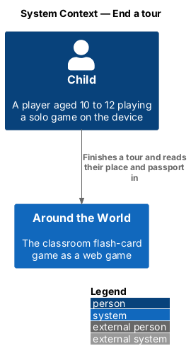
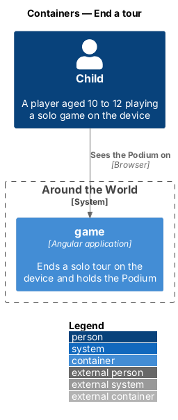
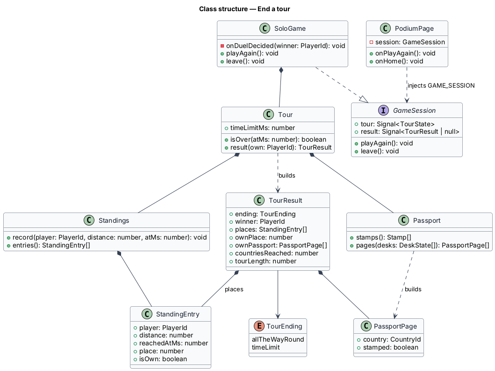

# End a tour

## Overview

Around the World is the classroom flash-card game as a web game for children aged 10 to 12. A
tour is one trip round a ring of 6, 12 or 24 desks, each desk a country. This feature covers how
a tour ends, how every player is placed, and the screen that shows the result.

**tour** — one game: a trip round the ring of desks

**distance travelled** — count of the hops a player has made

**all the way round** — state of a player whose distance travelled equals the tour length

**time limit** — length of play after which a tour ends even when nobody is all the way round

**place** — position of a player in the result, from 1st to last

**passport** — record of the countries a player reached, one stamp for each

**Podium** — screen that shows the top three players, the headline and the player's passport

**cheer** — one sentence under the headline that says what the winning kid does to celebrate

A tour ends in one of two ways. A player whose distance travelled reaches the tour length has
gone all the way round and wins; for the first traveller of a tour that is the hop past the last
desk. When the time limit passes first, the tour ends after the current duel and the player who
travelled furthest wins. Every player then has a place by distance travelled.

The Podium shows the result and offers two choices: "Play again" and "Home". The slice sits in
the `tour` subsystem and follows `tour/travel-round-ring`, which moves the players and records
their distances and stamps.

## Description

The slice is not built yet; the parts below are those the design introduces. The design covers a
solo game, which is decided on the device: the slice has no backend part, and its diagrams show
frontend libraries only. In a game with friends the server applies the same rules
(`rooms/decide-game-on-server`).

- **`Tour`** — rule type in `domain`'s `tour/`. `isOver(atMs)` is asked after each decided duel
  has been applied. It answers that the tour is over when the traveller's distance travelled
  equals the tour length (`L2-006` criteria 1 and 5), or when the time limit has passed
  (`L2-006` criterion 2). The rule is the same for every player, whichever desk they held when
  they first became the traveller. The first traveller of a tour of 12 desks has a distance of
  11 at desk 12, so reaching the last desk does not end the tour; the hop past it does. The time
  limit is checked only when a duel ends, so a duel in progress is never cut short. `result(own)`
  builds the `TourResult`.
- **`Standings`** — rule type in `domain`'s `tour/`. It holds each player's distance travelled
  and the time at which that distance was reached. `entries()` gives every player a place from
  1st to last by distance (`L2-006` criterion 4). Of two players with the same distance, the one
  who reached it first is placed higher (`L2-006` criterion 3).
- **`Passport`** — rule type in `domain`'s `tour/`. `pages(desks)` gives one `PassportPage` for
  each country of the tour, stamped when the player reached it and a placeholder when not.
- **`TourResult`** — type in `api`, published by `GameSession.result`. It holds how the tour
  ended (`allTheWayRound` or `timeLimit`), the winner, the places, the device's player's place,
  their passport pages, the count of countries reached and the tour length.
- **`GameClock`** — clock in `domain`'s `tour/`. It gives the time played, with pauses left out,
  against which the time limit is measured.
- **`SoloGame`** — game service in the `game` application behind `GAME_SESSION`. When `Tour`
  reports the tour over it cancels the duel's timers and builds the `TourResult`. World Map
  shows the last move as it shows every other (`tour/travel-round-ring`); on `continue()`
  `SoloGame` publishes `TourState` in phase `over` and the `TourResult`, and the Podium opens in
  place of Duel. `playAgain()` drops the ended tour and starts a new one with the same kid and
  the same setup. `leave()` cancels every timer and drops the tour.
- **`PodiumPage`** — page in `game`, opened when the tour is over (`L2-030` criterion 5). It
  shows the top three with their kids and places, and a headline with the winning kid's cheer
  under it (`L2-035` criterion 1). It shows the player's passport, the count of countries out of
  the tour length and the player's place, whether or not the player is in the top three
  (`L2-035` criterion 2). With fewer than three players it shows only the places that exist
  (`L2-035` criterion 5).
- **`PodiumSteps`**, **`PassportView`**, **`KidTag`** — presentation components in `components`.
  `PodiumSteps` draws up to three places. `PassportView` draws a stamp or a placeholder for each
  country.

The headline reads "You went around the world!" when the device's player went all the way
round, and otherwise "{name} made it round first!" (`L2-035` criterion 1). Under it the cheer
names the winning kid in one sentence: the mocks draw "Zuri raises her pencil like a knight."
and "Nia does a star jump." The cheers of Kenji, Milo and Pip are not drawn; the cast list in
`docs/mocks/README.md` gives them as adding a pin and pushing up his glasses, Bolt doing a
happy spin and launching the paper plane. When the tour ended on its time limit and the
device's player travelled furthest, the headline reads "Time's up! You travelled furthest!" and
the line under it reads "{n} desks out of {tour length}. {cheer}" (`L2-035` criterion 1, to
confirm).

The Podium is laid out as follows:

- It has no top bar. Below 992 px the Podium is one column: the headline, the steps, the
  passport and the buttons. From 992 px up the headline and the steps are on the left, and the
  passport and the buttons are on the right (`L2-050` criterion 4).
- `PodiumSteps` places 2nd, 1st and 3rd from left to right on steps of three heights in the
  kids' colours. Each step carries the place, read as "{place} place", and the name, "You" for
  the device's player, so the place is not carried by colour alone. The list is named "The top
  3". The places rise in turn, third, second, first, each in under 300 ms, or fade in under
  reduced motion (`L2-038` criterion 6).
- A game with two players shows two steps, 2nd and 1st, and the list is named "The top 2"
  (`L2-035` criterion 5).
- A player who is not in the top three is on no step; their place shows in the passport only,
  as in "5 of 12 countries · 4th place" (`L2-035` criterion 2).
- `PassportView` is titled "Your passport" and reads "{n} of {tour length} countries · {place}
  place", with the place as 1st, 2nd, 3rd and so on. Under it is one tile for each desk of the
  tour: a stamp with the country's name when the player reached it, and "?", named "Not
  reached", when not. The tiles are in 3 columns, and in 4 from 576 px up; a tour of 24 desks
  uses 4 columns, and 6 from 576 px up.
- The two buttons read "Play again" and "Home".

While the places are being worked out the headline reads "Counting the desks…", placeholders
stand in for the steps and the passport, and a status says "Working out the places…" (`L2-031`
criterion 4).

"Play again" in a solo game starts a new tour at once with the same kid and setup and opens Duel
(`L2-035` criterion 3); Mic Check is not shown again in the visit (`L2-012` criterion 6). In a
game with friends "Play again" returns the players to the same room's Lobby, and the Podium says
so beforehand, under the buttons: "Everyone goes back to room {code}." (`L2-035` criterion 3).
The room is kept while the Podium is shown (`L2-027` criterion 3, to confirm); `FriendsGame`
and the server's part are designed in `rooms/decide-game-on-server`, and the Lobby in
`rooms/wait-in-lobby`.

When the room of a game with friends is lost while the Podium is shown, an alert reads "We lost
the room" and "Your passport is safe here. To play with your friends again, make or join a new
room." The passport stays, and "Play with friends", which opens Solo Or Friends, stands in
place of "Play again" (`L2-035` criterion 6).

"Home" opens Home, whose button then reads "Play again" (`L2-032` criterion 2). Leaving the game
route destroys `SoloGame`, which is provided at that route, and with it the tour, the result and
every timer (`L2-035` criterion 4). The classmates' model sessions are released by the
`classmates` subsystem (`L2-021` criterion 6).

The result is bounded: `TourResult` holds one place for each player and one passport page for
each desk of the tour (`L2-048` criterion 5).

Open points:

- The length of the time limit for each tour length, and whether a clock for it shows during a
  duel: `<TO SUPPLY>`. `L2-006` criterion 2 marks both to confirm; the mocks show no such clock.
- The headline of a tour that ends on the time limit when another player travelled furthest:
  `<TO SUPPLY>`. The mocks draw only "Time's up! You travelled furthest!", which `L2-035`
  criterion 1 marks to confirm.
- Whether a new solo tour started by "Play again" keeps the same classmates or makes a new
  class: `<TO SUPPLY>`. `L2-035` criterion 3 fixes only the kid and the setup.
- Whether the Podium shows a place shared by two players, and whether the tie-break of `L2-006`
  criterion 3 orders equal distances in a tour that does not end on the time limit:
  `<TO SUPPLY>`.
- Whether a classmate who is not one of the five kids has a place on the Podium, and how one is
  named there and in the headline: `<TO SUPPLY>`. Such a classmate has no nickname and no entry
  in the World Map standings (`L2-034` criterion 10). The mock
  `docs/mocks/pages/podium/two-players.html` draws a game with friends of two players with two
  places, so the classmates who held its other desks have no place there.
- Which countries count as reached in the passport for a player who never hopped, or who
  travelled on after winning as a desk holder: `<TO SUPPLY>` (`tour/travel-round-ring`). The
  mocks stamp the first n countries from desk 1 for a count of n.
- What World Map draws for the hop that ends the tour: `<TO SUPPLY>`.
- Who may choose "Play again" in a room, and what the other players see until then:
  `<TO SUPPLY>`. That the room lives until its last player leaves the Podium is to confirm
  (`L2-027` criterion 3).

The screen follows the mocks `docs/mocks/pages/podium/` (states `default`, `second`, `unplaced`,
`time-up`, `friends`, `two-players`, `long`, `loading` and `error`).

## Requirements

The feature realizes the following level-2 (L2) requirements. Each L2 requirement refines a
level-1 (L1) requirement, cited by identifier.

| L2 ID | Refines (L1) | Requirement |
|-------|--------------|-------------|
| `L2-006` | `L1-001` | A tour shall end when a traveller hops past the last desk and so has gone all the way round, and that player shall win; any player shall have gone all the way round when their distance travelled equals the tour length; when the time limit has passed with nobody all the way round, the tour shall end when the current duel ends and the player who travelled furthest shall win, the one who reached an equal distance first being placed higher; every player shall have a place from 1st to last by distance travelled. The length of the time limit for each tour length, and whether a clock for it is shown during a duel, are to confirm. |
| `L2-035` | `L1-009` | The Podium shall show the top three with their kids and places, and a headline that says whether the player went round the world ("You went around the world!") or who did first ("{name} made it round first!"), with the winning kid's cheer under it; when the tour ended on its time limit the headline shall say so ("Time's up! You travelled furthest!") (to confirm); the player's passport shall show a stamp for each country reached, a placeholder for each not reached ("?", named "Not reached"), the count out of the tour length and their place ("{n} of {tour length} countries · {place} place"), whether or not they are in the top three; "Play again" shall start a new tour with the same kid and setup in a solo game, and in a game with friends shall return the players to the same room's Lobby, which the Podium shall say beforehand ("Everyone goes back to room {code}."); "Home" shall open Home and release the game's state; with fewer than three players only the places that exist shall be shown; when the room of a game with friends is lost while the Podium is shown, the Podium shall say so ("We lost the room"), keep the passport and offer "Play with friends", which opens Solo Or Friends, in place of "Play again". |

## Diagrams

### System context

A child finishes a tour and reads their place and passport in Around the World. A solo game
involves no other system.

### Containers

The `game` application ends a solo tour on the device and holds the Podium. The diagram shows no
backend container, because a solo game sends no request to the backend.

### Components

`SoloGame` asks `Tour` whether the tour has ended, with the time read from `GameClock`. `Tour`
reads the places from `Standings` and the stamps from `Passport`. `PodiumPage` reads the result
through `GameSession` and binds it to the presentation components.

### Class structure

`Tour` builds a `TourResult` from its `Standings` and the player's `Passport`. A `TourResult`
holds the `TourEnding`, the places as `StandingEntry` values and the passport as `PassportPage`
values. `PodiumPage` depends on `GameSession` only.

### Behaviour — end a tour and show the Podium

After each decided duel `SoloGame` asks `Tour` whether the tour is over. The tour ends when the
traveller's distance travelled equals the tour length or when the time limit has passed
(`L2-006`). `Tour` builds the result, World Map shows the last move, and the Podium then shows
the result (`L2-035`).

### Behaviour — play again or go Home from the Podium

In a solo game "Play again" starts a new tour at once with the same kid and setup, without
leaving the game route and without Mic Check. "Home" leaves the route, which destroys `SoloGame`
and releases the game's state. In a game with friends "Play again" returns the players to the
room's Lobby (`rooms/decide-game-on-server`).

