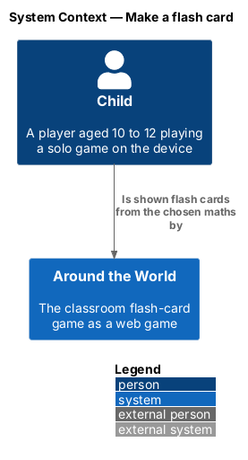
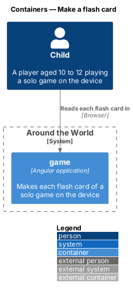
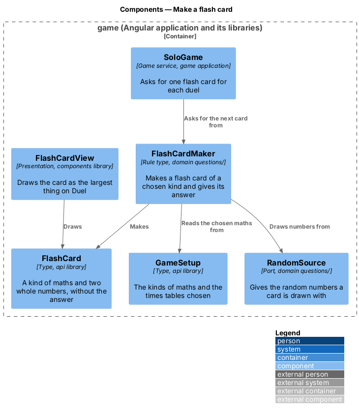
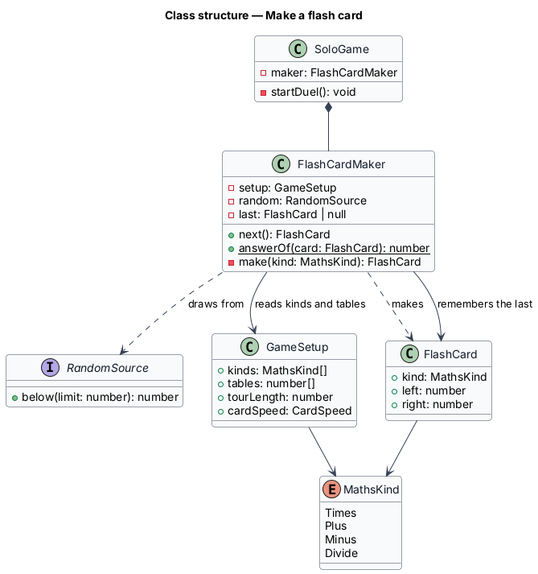
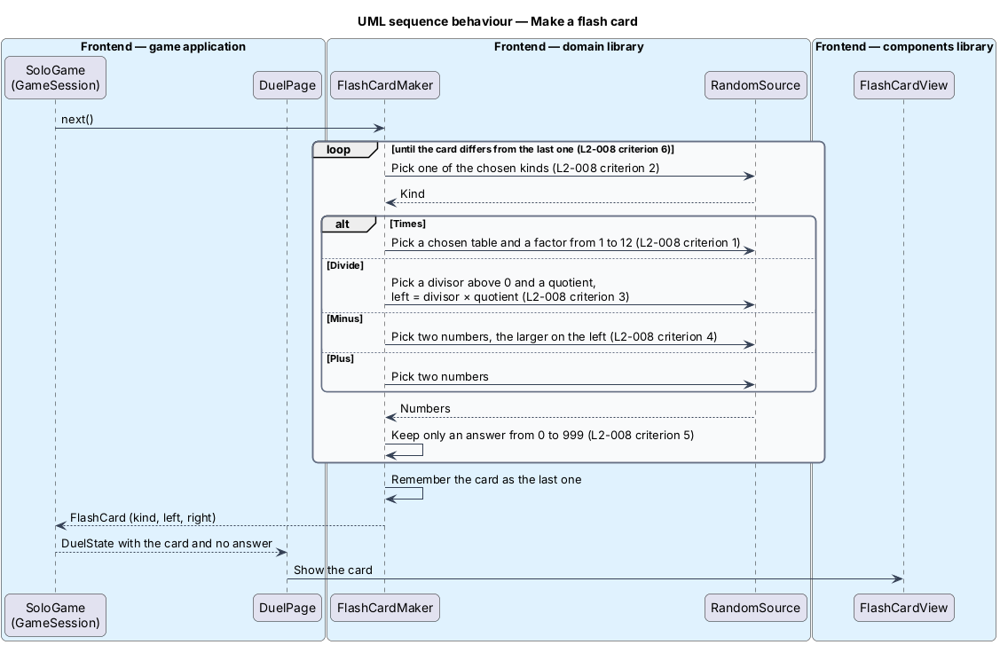

# Make a flash card

## Overview

Around the World is the classroom flash-card game as a web game for children aged 10 to 12. Two
players duel over one flash card, and the first correct answer wins. This feature covers how each
flash card is made.

**flash card** — one sum shown to both players of a duel, with one whole-number answer

**kind of maths** — one of Times, Plus, Minus and Divide

**times table** — whole number from 2 to 12 whose multiples a Times card asks for

**game setup** — choices made once for a game: the kinds of maths, the times tables, the tour
length and the card speed

A game is set up with one or more kinds of maths and, for Times, a set of times tables. Every
flash card is of a chosen kind. Its answer is a whole number from 0 to 999, so that it can be
shouted or entered in three digits. A card is never a fraction or a word problem, and the same
card never appears twice running.

The slice sits in the `tour` subsystem and supplies the card that `tour/play-duel` decides a duel
over. Choosing the maths on Game Setup is designed outside this subsystem.

## Description

The slice is built (journey 04); the parts below are those the design introduces. The design covers a
solo game, in which the cards are made on the device: the slice has no backend part, and its
diagrams show frontend libraries only. In a game with friends the server applies the same rules
(`rooms/decide-game-on-server`).

- **`FlashCardMaker`** — rule type in `domain`'s `questions/`, and the only place on the device
  where a flash card is made. It is created with the `GameSetup` of the game and a
  `RandomSource`. `next()` returns the next `FlashCard`. `FlashCardMaker.answerOf(card)` gives
  the answer of a card.
- **`RandomSource`** — port in `domain`'s `questions/` that gives a random whole number below a
  limit. A fixed sequence replaces it in unit tests, so each rule is tested on chosen numbers.
- **`GameSetup`** — type in `api`. `FlashCardMaker` reads its kinds of maths and its times
  tables. The times tables are used only while Times is on.
- **`FlashCard`** — type in `api`: a `MathsKind` and two whole numbers, `left` and `right`. It
  does not hold the answer, so a state that carries a card does not reveal it.
- **`FlashCardView`** — the `FlashCard` presentation component in `components`
  (`atw-flash-card`), which draws a card on the Duel screen as `left`, the sign of the kind and
  `right`, as in "6 × 4" and "144 ÷ 12"; `DuelPage` writes the sum with its `DuelWords` helper.
  The sum is `role="img"`, and its accessible name gives the sign in words, as in "6 times 4"
  and "144 divided by 12". A sum
  with a three-digit number fits the card without being cut off. The states of the card during
  a duel are designed in `tour/play-duel`.

`next()` picks one of the chosen kinds, then makes a card of that kind:

- **Times** — `a × b`, where one factor is a chosen times table and the other is from 1 to 12
  (`L2-008` criterion 1).
- **Divide** — a divisor that is never 0 and a whole quotient are picked, and `left` is their
  product, so the card divides exactly (`L2-008` criterion 3).
- **Minus** — `left` is not less than `right`, so the answer is never negative (`L2-008`
  criterion 4).
- **Plus** — two whole numbers.

Each kind is made from whole numbers by construction, so no card is a fraction, and a card is
two numbers and a sign, so no card is a word problem. A card whose answer falls outside 0 to 999
is not returned (`L2-008` criterion 5). A card equal to the last card returned is not returned
either (`L2-008` criterion 6); `FlashCardMaker` remembers one card for that purpose and no more.

Over 100 cards every card is of a chosen kind and each chosen kind appears (`L2-008`
criterion 2).

`SoloGame` holds one `FlashCardMaker` for a tour and calls `next()` when a duel starts, including
the new duel that follows a card nobody answered in time (`tour/play-duel`).

Decisions (`docs/adr/0018-flash-card-ranges.md`):

- Each chosen kind is picked as often as the others.
- Times: a chosen table and a number from 1 to 12, the table on either side half of the time.
  Plus: two numbers from 2 to 50. Minus: a left from 10 to 99 and a right from 1 to the left.
  Divide: a divisor and a quotient from 1 to 12, `left` their product; the divisor is a chosen
  times table while Times is on, and from 2 to 12 otherwise.
- `4 × 6` and `6 × 4` are the same card, and so are two Plus cards with the same two numbers in
  either order; Minus and Divide cards are the same only in the same order. The maker draws
  again up to 10 times when it drew the last card, then moves the card's second number on by
  one, so `next()` always ends.
- `RandomSource.below(limit)` gives a whole number below the limit; the game binds it to
  `Math.random` (`mathRandom`) and a unit test to a fixed sequence (`fixedRandom`).

The mocks' sums (`6 × 4`, `7 × 8`, `144 ÷ 12`) are the cast, and no mock settles these points.

A flash card's appearance on the Duel screen follows the mocks `docs/mocks/pages/duel/` (states
`default` and `long`).

## Requirements

The feature realizes the following level-2 (L2) requirement. It refines a level-1 (L1)
requirement, cited by identifier.

| L2 ID | Refines (L1) | Requirement |
|-------|--------------|-------------|
| `L2-008` | `L1-002` | Each flash card shall be made from the chosen kinds of maths and times tables: a Times card shall be `a × b` where one factor is a chosen table and the other is from 1 to 12, and over 100 cards every card shall be of a chosen kind and each chosen kind shall appear; a Divide card shall divide exactly with a divisor that is never 0, a Minus card shall never have a negative answer, every answer shall be a whole number from 0 to 999, no card shall be a fraction or a word problem, and the card made after a duel has just ended shall not be the same card as the last one. |

## Diagrams

### System context

A child is shown flash cards from the chosen maths by Around the World. A solo game involves no
other system.

### Containers

The `game` application makes each flash card of a solo game on the device. The diagram shows no
backend container, because a solo game sends no request to the backend.

### Components

`SoloGame` asks `FlashCardMaker` for the next card. `FlashCardMaker` reads the chosen maths from
`GameSetup`, draws numbers from `RandomSource` and makes a `FlashCard`, which `FlashCardView`
draws.

### Class structure

`FlashCardMaker` reads a `GameSetup`, depends on the `RandomSource` port, makes `FlashCard`
values and remembers the last one. `GameSetup` and `FlashCard` both refer to `MathsKind`.

### Behaviour — make a flash card

`FlashCardMaker` picks a chosen kind, makes a card by that kind's rule, keeps only an answer from
0 to 999 and repeats while the card equals the last one (`L2-008`). `SoloGame` publishes the card
without its answer.

