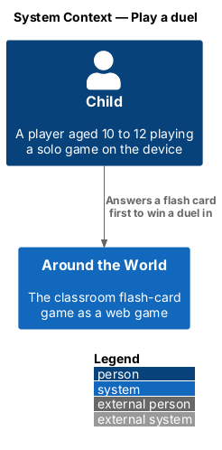
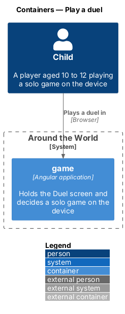
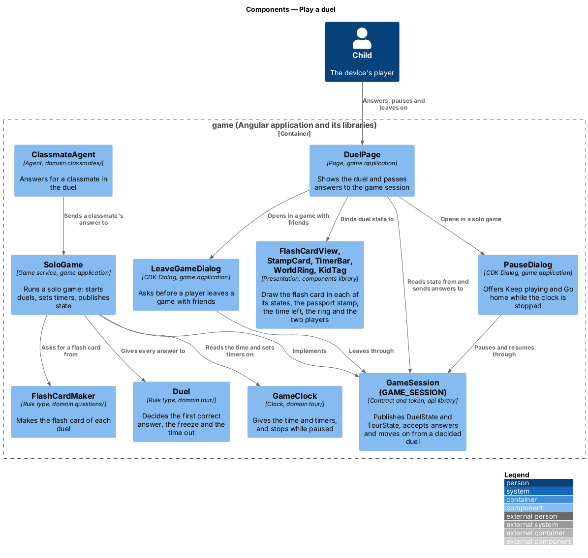
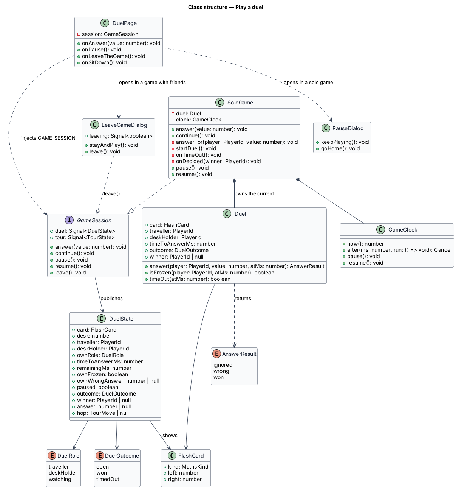
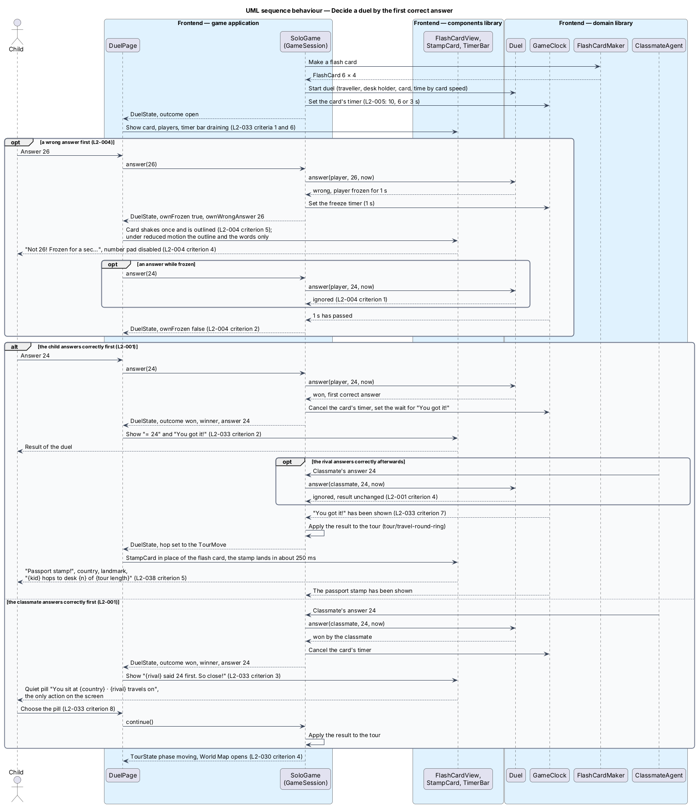
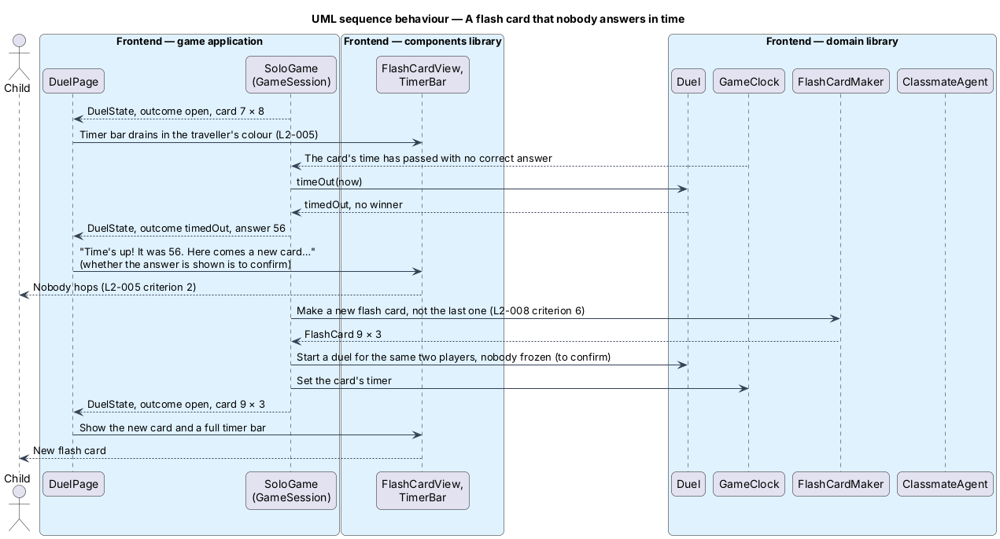
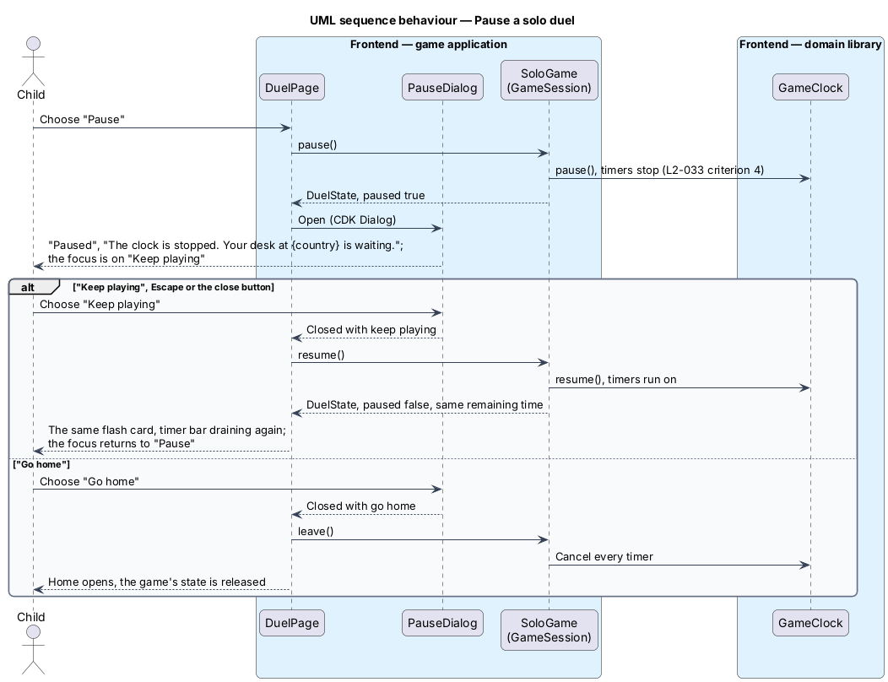

# Play a duel

## Overview

Around the World is the classroom flash-card game as a web game for children aged 10 to 12. The
classroom is a ring of desks, and a tour is one trip round that ring. This feature covers the
single contest the whole game is built from: the duel.

**duel** — contest between the traveller and the desk holder over one flash card

**traveller** — player who moves round the ring and stands beside a desk

**desk holder** — player seated at the desk the traveller stands beside

**flash card** — one sum shown to both players, with one whole-number answer

**freeze** — one second during which a player who answered wrongly cannot answer

**card speed** — setting that fixes the time to answer a flash card: Chill, Normal or Lightning

**duel strip** — top band of the Duel screen that names the traveller and the desk holder over the
timer bar

**passport stamp** — mark for the country a won duel reaches, shown on the Duel screen before
World Map

The first correct answer wins the duel. A wrong answer freezes the player who gave it for
1 second, so guessing never beats thinking. Each flash card has a time to answer, set by the card
speed, and a card that nobody answers in time is replaced by a new one for the same two players.

The feature also covers the Duel screen, which shows the flash card, the two players, the timer
bar and the place of the duel in the tour, and which shows the result of a decided duel, and
the passport stamp a won duel earns, before World Map opens. The slice sits in the `tour` subsystem, beside `tour/make-flash-card` (the
card), `tour/travel-round-ring` (what a decided duel does to the ring) and `tour/end-tour` (how
the tour ends). The ways of giving an answer are designed in `answering/answer-by-voice` and
`answering/answer-with-number-pad`.

## Description

The slice is not built yet; the parts below are those the design introduces. The design covers a
solo game, which is decided on the device: the slice has no backend part, and its diagrams show
frontend libraries only. In a game with friends the server applies the same rules
(`rooms/decide-game-on-server`).

- **`GameSession`** — contract in the `api` library, bound to the `GAME_SESSION` token at the
  game route. It publishes `duel` (`Signal<DuelState>`) and `tour` (`Signal<TourState>`) and
  accepts `answer(value)`, `continue()`, `pause()`, `resume()` and `leave()`. `DuelPage` depends
  on the token only, so the screen does not know which kind of game is played.
- **`DuelState`** — type in `api`. It holds the `FlashCard`, the desk number, the traveller, the
  desk holder, the device's player's role (`traveller`, `deskHolder` or `watching`), the time to
  answer, the time remaining, whether the device's player is frozen, the wrong answer that froze
  them, whether the game is paused, the outcome (`open`, `won` or `timedOut`) with the winner
  and the answer once decided, and `hop`, the `TourMove` a duel won by the device's player
  earned (`tour/travel-round-ring`). The desk number is the number of the desk the duel is at;
  the first duel of a tour is at desk 2 (`L2-007` criterion 4).
- **`FlashCard`** — type in `api`: a kind of maths and two whole numbers. It does not hold the
  answer.
- **`Duel`** — rule type in `domain`'s `tour/`, and the only place on the device where a duel is
  decided. `answer(player, value, atMs)` returns `ignored`, `wrong` or `won`:
  - an answer from a player who is neither the traveller nor the desk holder is ignored
    (`L2-001` criterion 3);
  - an answer after the duel is won is ignored (`L2-001` criterion 4);
  - an answer from a frozen player is ignored (`L2-004` criterion 1);
  - a wrong answer freezes that player, and only that player, until 1 second later on the clock
    (`L2-004` criteria 1 to 3);
  - the first correct answer wins (`L2-001` criteria 1 and 2).

  `timeOut(atMs)` closes an undecided duel with no winner. `Duel` takes the time as an argument
  and reads no clock, so its unit tests need no waiting.
- **`GameClock`** — clock in `domain`'s `tour/`. It gives the time played, runs a callback after
  a number of milliseconds and stops while paused. A fake clock replaces it in unit tests.
- **`SoloGame`** — game service in the `game` application, provided at the game route and bound
  to `GAME_SESSION` for a solo game. For each duel the device's player is in, it asks
  `FlashCardMaker` for a card, creates the `Duel`, sets the card's timer on `GameClock` and
  publishes a new `DuelState`. It passes the device's player's answers and the classmate's
  answers to the same `Duel.answer` method. The classmates and their agents are designed in the
  `classmates` subsystem.
- **`DuelPage`** — page in `game`. It binds `DuelState` and `TourState` to the presentation
  components and forwards an answer to `GameSession.answer`. A live region tells a screen reader
  when a flash card appears, a duel is decided and the player is frozen. The page fills the
  screen, does not scroll, and gives the flash card the largest area (`L2-033` criterion 5).
- **`FlashCardView`**, **`StampCard`**, **`TimerBar`**, **`WorldRing`**, **`KidTag`** —
  presentation components in `components`. `FlashCardView` draws the card in one of the states
  listed below. `StampCard` draws the passport stamp that stands in place of the flash card
  after a won duel. `TimerBar` drains over the time to answer in the traveller's colour; it is a
  progress bar named "Time to answer" whose value is read as "{n} seconds left". `KidTag` shows
  each player's kid, name and role ("Travelling", "Holds {country}"). `WorldRing` and the text
  "Desk {n} of {tour length}" place the duel in the tour (`L2-033` criterion 1).
- **`PauseDialog`** — CDK Dialog in `game`, opened by "Pause" in a solo game (`L2-033`
  criterion 4). Its title is "Paused" and it reads "The clock is stopped. Your desk at {country}
  is waiting." It offers "Keep playing", which is first and holds the focus when the dialog
  opens, and "Go home". Escape and the dialog's close button, which is named "Keep playing", do
  what "Keep playing" does. The focus returns to "Pause" when the dialog closes.
- **`LeaveGameDialog`** — CDK Dialog in `game`, opened by "Leave the game", which replaces
  "Pause" in a game with friends (`L2-033` criterion 4). Its title is "Leave the game?" and it
  reads "The race carries on without you, and you can't come back to this one." It offers "Stay
  and play", which holds the focus when the dialog opens, and "Leave". "Leave" calls
  `GameSession.leave()`; while the room is being told, "Leave" is busy and reads "Leaving…",
  "Stay and play" is disabled and the close button is not shown. Home then opens. What the room
  does when a player leaves is designed in the `rooms` subsystem.

Both dialogs are a sheet from the bottom of the screen below 576 px wide and a centred card
from 576 px up.

The Duel screen has three bands:

- **Top** — the duel strip (the mocks' `duel-hud` block): the traveller on the left with
  "Travelling", "vs", the desk holder on the right with "Holds {country}", and the timer bar
  under both. From 768 px up the world ring shows beside the strip with "Desk {n} of {tour
  length}". Below 768 px a pill under the strip, "{country} · desk {n} of {tour length}",
  replaces the world ring (`L2-050` criterion 3). One corner button is in this band: "Pause" in
  a solo game, "Leave the game" in a game with friends.
- **Middle** — the flash card. Below 768 px the number pad sits under the card; from 768 px up
  it sits beside the card (`L2-050` criterion 2).
- **Bottom** — the switch between voice and the number pad (`answering/answer-by-voice`) or,
  for a watching player in a game with friends, the stickers
  (`rooms/watch-duel-and-send-sticker`).

The classroom shows behind the three bands, under a scrim (`L2-036` criterion 6). The screen is
exactly the height of the window and has no minimum height. Where the window is under 672 px
tall the flash card and the pad's keys shrink. Where it is under 544 px tall, as on a phone
turned on its side, the world ring and the pill give way to "Desk {n} of {tour length}" beside
the names on the duel strip, and the flash card and the pad are both whole (`L2-050`
criterion 5).

`DuelPage` names the two players on the duel strip: the device's own player is "You", another
player is named by their nickname, and a classmate who is one of the five kids is named by the
kid's name (`L2-033` criterion 6). `WorldRing` draws one dot for each desk with the first desk
marked, and a dot in the kid's colour for each player with the device's own player's dot
larger; its accessible name is "The ring of {tour length} desks: you are at desk {n}".

`DuelPage` draws these states in a duel the device's player is in:

- **loading** — while the first flash card is being made ready the card reads "Get ready…", the
  duel strip shows placeholders in the shape of its content, and a status says "Getting the
  first card ready…" (`L2-031` criterion 4).
- **listening** — the sum, with "Shout it!" and a meter when voice is the way of answering, or
  the digits entered when the number pad is; "?" stands in while no digit is entered. A new
  card flips in within 300 ms (`L2-038` criterion 2).
- **wrong** — "Not {answer}! Frozen for a sec…", where the answer is the one the player gave.
  The card shakes once and is outlined (`L2-004` criterion 5); under reduced motion it does not
  shake, and the outline and the words remain. The number pad is disabled with its digits still
  in the answer box, and the rival is not frozen (`L2-004` criterion 4). The pad does not shake.
- **right** — "= {answer}" and "You got it!" (`L2-033` criterion 2).
- **hop** — `StampCard` in place of the flash card: "Passport stamp!", the country reached, its
  landmark and "{kid} hops to desk {n} of {tour length}" (`L2-038` criterion 5). The stamp lands
  in about 250 ms.
- **lost** — "{rival} said {answer} first. So close!" and, under it, the quiet pill "You sit at
  {country} · {rival} travels on" (`L2-033` criteria 3 and 8). The pill is the only action on
  the screen, and it is drawn so that it does not look like a second answer. No red screen shows
  and no buzzer plays.
- **timed out** — "Time's up! It was {answer}. Here comes a new card…" (`L2-005` criterion 2;
  whether the answer is shown is to confirm).

The live region says each event in words: "New card: 6 × 4. Shout it!" (without "Shout it!" when
the number pad is the way of answering), "6 × 4 is 24. You got it!", "Not 42. Frozen for one
second.", "Nia said 24 first. You sit at Italy." and "Time is up. It was 24. A new card is
coming." The sums, answers and names in these lines are the mocks' cast.

The watching state ("Watching… your turn is next"), the stickers, the reconnecting overlay and
the connection banners belong to a game with friends and are designed in the `rooms` subsystem.

A decided duel leaves the Duel screen in one of two ways:

- When the device's player wins, the right state shows first. `SoloGame` then applies the result
  to the tour and publishes the `TourMove` in `DuelState.hop`, and the hop state shows the
  passport stamp. World Map then opens (`L2-033` criterion 7). `SoloGame` sets both waits on
  `GameClock`; how long "You got it!" and the passport stamp each stay is `<TO SUPPLY>`.
- When the device's player loses, the lost state stays until the child chooses the pill "You
  sit at {country} · {rival} travels on". `DuelPage` then calls `GameSession.continue()`,
  `SoloGame` applies the result to the tour, and World Map opens (`L2-033` criterion 8).

World Map then shows what follows, and Duel returns with the next flash card (`L2-030`
criterion 4; `tour/travel-round-ring`). The change of route follows the state `GameSession`
publishes and is designed in `player/find-way-through-screens`.

A solo duel between two classmates is not shown on the Duel screen. The seated player stays on
World Map, and Duel returns when a traveller reaches the player's desk (`L2-034` criterion 7;
`tour/travel-round-ring`). The `watching` role of `DuelState` is therefore used only in a game
with friends (`L2-028`).

The time to answer is 10 seconds for Chill, 6 seconds for Normal and 3 seconds for Lightning
(`L2-005`). When that time passes with no correct answer, `SoloGame` calls `Duel.timeOut`, the
timed out state shows, nobody hops, and a new duel starts for the same two players over a new
flash card with nobody frozen (`L2-005` criterion 2, to confirm). How long the timed out state
stays before the new card is `<TO SUPPLY>`. The Duel screen shows no clock for the tour's own
time limit (`L2-006` criterion 2, to confirm; `tour/end-tour`).

"Pause" stops `GameClock`, so the card's timer, a freeze and the classmate's answer all wait. On
"Keep playing" the same flash card resumes with the same time remaining. "Go home" calls
`GameSession.leave()` and opens Home.

`SoloGame` cancels every timer when the game route is destroyed. It holds one `Duel` at a time
and keeps no list of the duels played (`L2-048` criterion 5).

Open points:

- What follows a card whose time runs out, and whether the answer is shown: `L2-005`
  criterion 2 marks both to confirm.
- Which of two correct answers given at the same reading of the clock wins on the device:
  `<TO SUPPLY>`.
- What the Duel screen shows when the device's player is the desk holder, including the words
  of a duel lost or won by a player who holds a desk: `<TO SUPPLY>`. Every mock draws the
  device's player as the traveller.
- How long "You got it!" and the passport stamp each stay before World Map opens:
  `<TO SUPPLY>`.
- How a classmate who is not one of the five kids is named on the duel strip: `<TO SUPPLY>`.
  `L2-033` criterion 6 names only the device's player, another player and the five kids.
- Whether a lost duel waits for the child to choose the pill in a game with friends:
  `<TO SUPPLY>`.

The screen follows the mocks `docs/mocks/pages/duel/` (states `default`, `pad`, `pad-typed`,
`right`, `wrong`, `wrong-pad`, `lost`, `timeout`, `hop`, `long` and `loading`),
`docs/mocks/dialogs/pause/` (state `default`) and `docs/mocks/dialogs/leave-game/` (states
`default` and `busy`).

## Requirements

The feature realizes the following level-2 (L2) requirements. Each L2 requirement refines a
level-1 (L1) requirement, cited by identifier.

| L2 ID | Refines (L1) | Requirement |
|-------|--------------|-------------|
| `L2-001` | `L1-001` | A duel shall be between the traveller and the desk holder of the desk the traveller stands beside, over one flash card, and the first correct answer shall win the duel; an answer from a player who is neither shall be ignored, and a correct answer given after the duel is won shall leave the result unchanged. |
| `L2-004` | `L1-001` | A wrong answer shall freeze the player who gave it for 1 second, during which every answer that player gives shall be ignored and the rival shall not be frozen; the Duel screen shall say so in words ("Frozen for a sec…") and disable the number pad, and the flash card shall shake once, be outlined and name the answer given ("Not {answer}! Frozen for a sec…"). |
| `L2-005` | `L1-001` | Each flash card shall have a time to answer set by the card speed (Chill 10 seconds, Normal 6 seconds, Lightning 3 seconds), the timer bar shall drain over that time in the traveller's colour, and when the time runs out with no correct answer nobody shall hop and the same two players shall duel over a new flash card with nobody frozen (to confirm); the mocks draw the flash card saying "Time's up! It was {answer}. Here comes a new card…", and whether the answer is shown is to confirm. |
| `L2-033` | `L1-009` | The Duel screen shall show the flash card, the traveller and the desk holder each with their kid, name and role ("Travelling", "Holds {country}"), the timer bar, the world ring and "Desk {n} of {tour length}"; it shall name the device's own player "You", another player by their nickname and a classmate who is one of the five kids by the kid's name; when the player wins, the flash card shall show the answer and "You got it!", the passport stamp shall then stand in place of the flash card and World Map shall then open; when the player loses, the flash card shall say who answered first ("{rival} said {answer} first. So close!") and that the player sits at that country, with no red screen and no buzzer, and shall offer "You sit at {country} · {rival} travels on" as a quiet pill, the only action on the screen, which opens World Map; in a solo game Pause shall stop the clock and open a dialog ("Paused", "The clock is stopped. Your desk at {country} is waiting.") that offers "Keep playing", which Escape and the close button also do, and "Go home"; in a game with friends Pause shall be replaced by Leave, which shall ask first ("Leave the game?", "The race carries on without you, and you can't come back to this one.") and offer "Stay and play" and "Leave", which tells the room and opens Home; the Duel screen shall fill the screen without scrolling at any width, and the flash card shall be the largest thing on it. |

## Diagrams

### System context

A child plays a duel in Around the World. A solo game involves no other system.

### Containers

The `game` application holds the Duel screen and decides a solo duel on the device. The diagram
shows no backend container, because a solo game sends no request to the backend.

### Components

`DuelPage` reads state from, and sends answers to, the `GameSession` contract. `SoloGame`
implements the contract and gives every answer, the child's and the classmate's, to `Duel`.
`GameClock` supplies the time and the timers, and `FlashCardMaker` supplies the card. `DuelPage`
opens `PauseDialog` in a solo game and `LeaveGameDialog` in a game with friends.

### Class structure

`SoloGame` realizes `GameSession` and owns the current `Duel` and the `GameClock`. `Duel` returns
an `AnswerResult` for each answer. `DuelState` is the published view of a duel; it carries the
`FlashCard` without its answer until the duel is decided, the wrong answer that froze the
device's player, and the `TourMove` whose passport stamp a won duel shows.

### Behaviour — decide a duel by the first correct answer

`SoloGame` starts a duel and sets the card's timer. A wrong answer freezes the player for
1 second, the flash card names that answer, and an answer given while frozen is ignored
(`L2-004`). The first correct answer wins (`L2-001`), and a correct answer from the rival
afterwards changes nothing. A won duel shows "You got it!" and then the passport stamp; a lost
duel stays until the child chooses the pill under the card. World Map opens after either
(`L2-033` criteria 7 and 8).

### Behaviour — a flash card that nobody answers in time

When the card's time passes with no correct answer, `Duel` closes with no winner. The flash card
says that the time is up, nobody hops, and the same two players duel over a new flash card
(`L2-005` criterion 2, to confirm).

### Behaviour — pause a solo duel

"Pause" stops `GameClock` and opens `PauseDialog`. "Keep playing", Escape and the close button
resume the same flash card with the same time remaining; "Go home" leaves the game and releases
its state (`L2-033` criterion 4).

