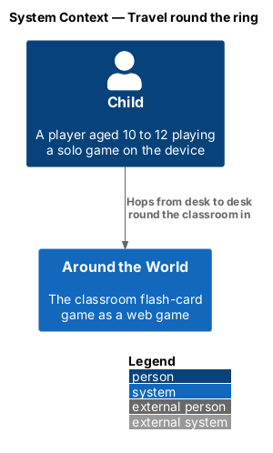
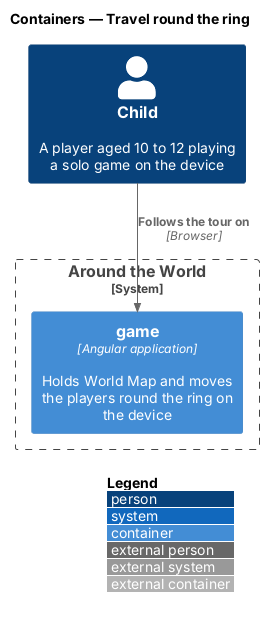
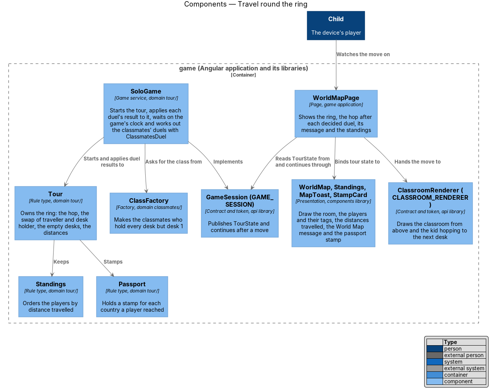
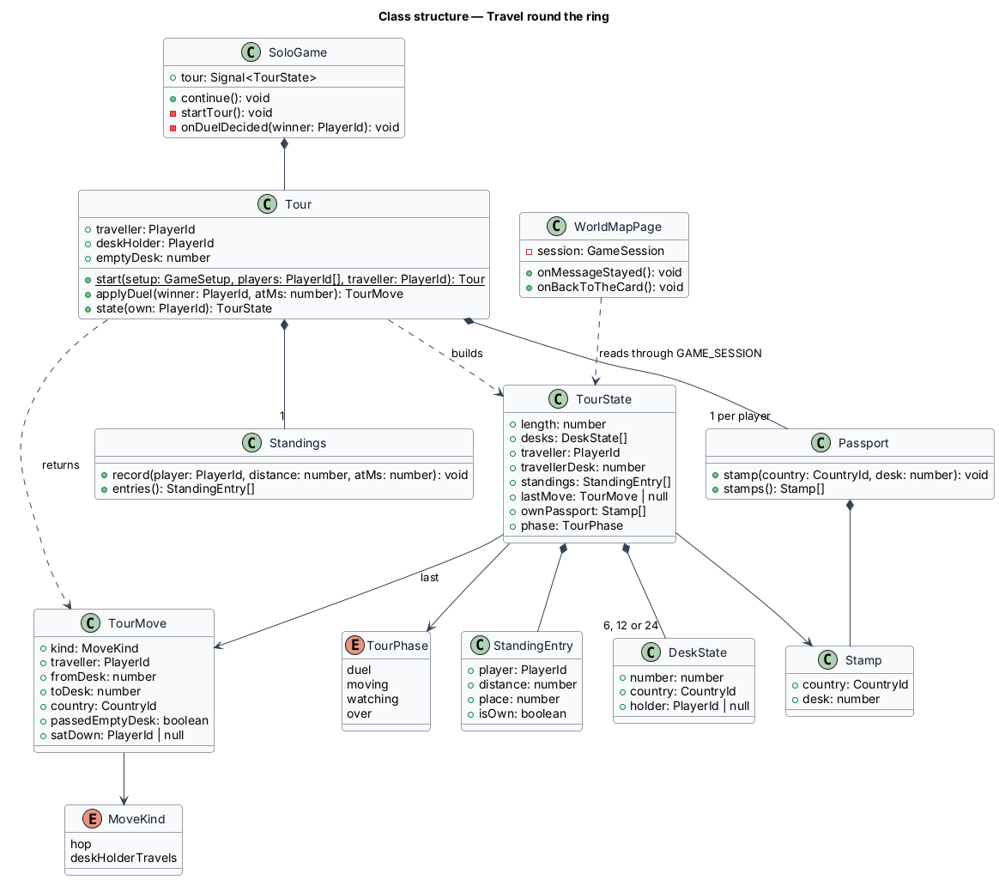
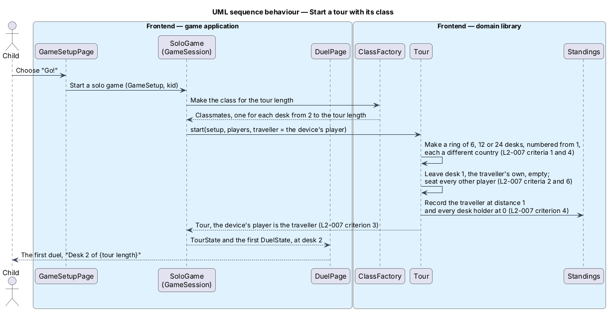
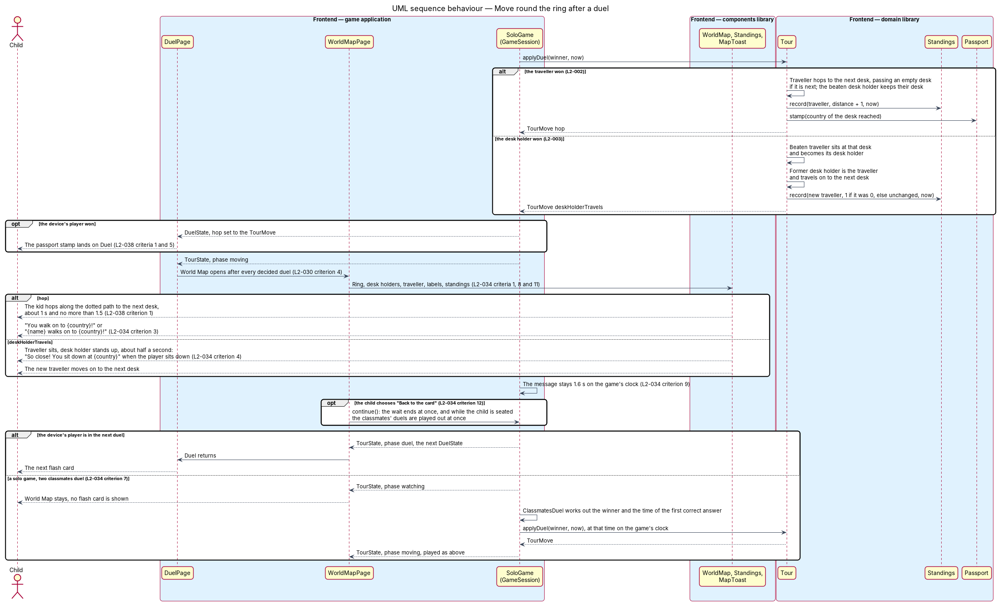

# Travel round the ring

## Overview

Around the World is the classroom flash-card game as a web game for children aged 10 to 12. The
classroom is a ring of desks, each desk is a country, and a tour is one trip round the ring. This
feature covers how the players are placed when a tour starts and how each duel's result moves
them.

**tour** — one game: a trip round a ring of 6, 12 or 24 desks

**desk** — one place on the ring, belonging to one country

**traveller** — player who moves round the ring and duels the holder of each desk in turn

**desk holder** — player seated at a desk

**empty desk** — desk of the ring that no player holds; at the start of a tour desk 1, the first
traveller's own, is the one empty desk

**hop** — move of the traveller to the next desk, earned by winning a duel

**passport** — record of the countries a player reached

**stamp** — one mark in a passport, for one country

**distance travelled** — count of the hops a player has made, which orders the standings

**World Map message** — one line shown on World Map that says in words what a decided duel did

The desks are numbered from 1 to the tour length. Desk 1 is the first traveller's own desk and
stays empty; every other desk has a desk holder. A tour of 12 desks therefore has 1 traveller
and 11 desk holders, and the first duel is at desk 2. At every moment of a tour exactly one
player is the traveller and exactly one desk is empty; the desk of a player removed from a game
with friends also stays empty.

A traveller who wins a duel hops to the next desk and receives a stamp for its country. A desk
holder who wins becomes the traveller and travels on, and the beaten traveller sits down at that
desk. On World Map the hop is the kid moving along a dotted path from one desk to the next, in
about a second.

The feature also covers World Map, the screen that shows the ring, each player's place and the
standings after every decided duel. The slice sits in the `tour` subsystem: `tour/play-duel`
decides each duel, and `tour/end-tour` decides when the tour is over.

## Description

The slice is built for a solo game by journey 05 (`docs/adr/0022-moving-round-the-ring.md`,
`docs/adr/0023-game-screens-follow-the-session.md`); the hop's motion comes with journey 10, the
3D room with journey 09 and the end of the tour with journey 06. The parts below are those the
design introduces. The design covers a
solo game, which is decided on the device: the slice has no backend part, and its diagrams show
frontend libraries only. In a game with friends the server applies the same rules
(`rooms/decide-game-on-server`), and classmates hold the desks no player holds, so that exactly
one desk is empty (`L2-007` criterion 5).

- **`Tour`** — rule type in `domain`'s `tour/`, and the only place on the device where the ring
  is changed. `Tour.start(setup, players, traveller)` makes a ring with the tour length of the
  `GameSetup` and gives each desk a different country with its landmark (`L2-007` criterion 1).
  It numbers the desks from 1 to the tour length, leaves desk 1 empty as the traveller's own
  desk, and seats one other player at each desk from 2 up (`L2-007` criteria 2 and 4). The
  traveller starts beside desk 2 with a distance travelled of 1, and every desk holder starts
  with 0. `applyDuel(winner, atMs)` applies one decided duel and returns a `TourMove`.
  - When the traveller won, the traveller hops to the next desk and the beaten desk holder
    keeps their desk (`L2-002` criterion 1). The traveller's distance travelled goes up by 1, so
    the first traveller of a tour has a distance of 5 at desk 6 (`L2-002` criterion 3). Their
    passport receives a stamp for the country of the desk reached (`L2-002` criterion 2).
  - When the desk holder won, the beaten traveller sits down at that desk and becomes its desk
    holder (`L2-003` criterion 1). The former desk holder is the traveller, travels on to the
    next desk and duels its holder (`L2-003` criterion 2). Their distance travelled becomes 1
    when it was 0 and is otherwise unchanged (`L2-003` criterion 3).
  - When the next desk is an empty desk, the traveller passes it and stops at the desk after
    it. The distance travelled still goes up by 1 for a hop (`L2-002` criterion 4).
  - A distance travelled never goes down, never starts again and never exceeds the tour length.
    A player who becomes the traveller a second time carries on from the distance they had
    (`L2-003` criterion 3).
- **`TourMove`** — value returned by `applyDuel`: its kind (`hop` or `deskHolderTravels`), the
  traveller, the desk left, the desk reached, its country, whether an empty desk was passed
  and, for `deskHolderTravels`, the player who sat down.
- **`Standings`** — rule type in `domain`'s `tour/`. It records each player's distance travelled
  and the time that distance was reached, and gives the players in order of distance.
- **`Passport`** — rule type in `domain`'s `tour/`, one for each player. It holds at most one
  stamp for each desk of the tour, so it is bounded by the tour length (`L2-048` criterion 5).
- **`TourState`** — type in `api`, published by `GameSession.tour`. It holds the tour length, the
  desks with their countries and holders, the traveller and the desk they stand beside, the
  standings, the last `TourMove`, the device's player's stamps and the phase (`duel`, `moving`,
  `watching` or `over`).
- **`ClassmatesDuel`** — rule helper in `domain`'s `tour/`. In a solo game it works out a duel
  between two classmates at its start, under the rules of every duel (`Duel`), from the two
  agents' decisions: the winner and the time of the first correct answer, over at most five
  cards (ADR 0022).
- **`SoloGame`** — game service in `domain`'s `tour/`, provided by the solo group behind
  `GAME_SESSION` (ADR 0016). It asks
  `ClassFactory` for the class, starts the `Tour` with the device's player as the traveller
  (`L2-007` criterion 3), and calls `applyDuel` for every decided duel. For a duel the device's
  player won, the Duel screen first shows the passport stamp of the `TourMove`
  (`tour/play-duel`). `SoloGame` then publishes a `TourState` in phase `moving` with the move,
  sets the World Map message's wait of 1.6 seconds on the game's clock, and starts the next
  duel when the wait is over or `continue()` is called. It tells `watchScreen` listeners when
  the game moves between Duel and World Map (ADR 0023). `ClassFactory` and the choice of classmates are designed in
  the `classmates` subsystem.
- **`WorldMapPage`** — page in `game`. It shows the ring with each desk holder at their desk, the
  traveller standing beside a desk, the desks' countries and the standings (`L2-034`
  criterion 1). It shows the last move with its World Map message (`L2-034` criteria 3 and 4).
  When the message has stayed for 1.6 seconds on the game's clock `SoloGame` moves on, and Duel
  returns with the next flash card (`L2-034` criterion 9, `L2-030` criterion 4). "Back to the
  card" calls `continue()` at once, and Duel returns (`L2-034` criterion 12). The room is drawn
  with the page; the loading state shows until the tour is published, and the error state comes
  with the 3D classroom in journey 09 (ADR 0023).
- **`WorldMap`** (`atw-world-map`), **`Standings`** (component), **`MapToast`** — presentation
  components in `components`. `WorldMap` draws the room from above: the desks on the ring with
  their plaques, the players on them and each kid's name tag (the kid tag's colours, drawn in
  the picture), and the view zoomed to the child's kid; a helper, `RoomLayout`, places each
  desk, kid, plaque and tag. The
  `Standings` component lists the entries by distance travelled. Each entry gives the place, the
  kid as a small bean icon, the name and "{distance}/{tour length}" (`L2-034` criterion 11). The
  device's player's entry is named "You", carries `aria-current` and is outlined, so it is
  marked by more than colour (`L2-034` criterion 6). The list is named "Standings, by desks
  travelled", a place is read as "Place {n}" and a distance as "{distance} of {tour length}
  desks". `MapToast` draws the World Map message in a polite live region, centred under the top
  of the screen, one message at a time.

No rule moves a seated player except the swap of a beaten traveller with the desk holder who
beat them, and that swap leaves the same desks held. The empty desk is therefore desk 1 for the
whole of a solo tour.

World Map opens after every decided duel, whichever player won (`L2-030` criterion 4): after
the passport stamp when the device's player won, and from the pill on Duel when they lost
(`tour/play-duel`). The change of route follows the phase of `TourState` and is designed in
`player/find-way-through-screens`. The two moves play as follows.

- **`hop`** — the traveller's kid hops along the dotted path to the next desk. The hop lasts
  about 1 second and no more than 1.5 (`L2-038` criterion 1). A hop that passes an empty desk is
  one hop and keeps to the same time. The message "You walk on to {country}!" or "{name} walks
  on to {country}!" names the country reached (`L2-034` criterion 3).
- **`deskHolderTravels`** — the beaten traveller sits down at the desk and the desk holder
  stands up, which takes about half a second. When the device's player is the one who sits
  down, the message reads "So close! You sit down at {country}" (`L2-034` criterion 4). The new
  traveller then moves on to the next desk as in a hop.

A message appears within 200 ms and stays for about 1.6 seconds. The word for the move is "hop"
in the code, on Home and on Duel; the World Map messages keep the mocks' words, "walk on to" and
"walks on to". Under reduced motion the kid fades from one desk to the next in no more than
200 ms and nothing moves across the screen (`L2-038` criterion 4).

The 3D classroom, the kids' pieces and the hop drawn in it are designed in the `classroom`
subsystem; `WorldMapPage` hands the `TourMove` to the `CLASSROOM_RENDERER` token and does not
draw the classroom itself. On World Map each kid is a small bean-bodied character in the kid's
colour with the kid's one accessory, under a name tag that gives the kid's name, or "You" for
the device's player (`L2-037` criterion 5). A tag never gives a nickname. A classmate who is
not one of the five kids is a plain bean-bodied character in a calmer colour, with no accessory
and no name tag, and has no entry in the standings (`L2-037` criterion 6, `L2-034`
criterion 10).

In a solo game a player who has sat down, and who is not the desk holder in the next duel, stays
on World Map. `continue()` then starts a duel between two classmates, `SoloGame` publishes phase
`watching`, and no flash card is shown. When that duel is decided `SoloGame` applies it and
publishes phase `moving` with the new `TourMove`, which World Map plays with its message, such
as "{name} walks on to {country}!". Duel returns when a traveller reaches the player's desk
(`L2-034` criterion 7).

World Map is laid out as follows:

- It is exactly the height of the window and does not scroll.
- The top holds a button "Back to the card", the title "World map" and one line. For the
  traveller the line reads "You're travelling · desk {n} of {tour length} · next stop
  {country}". For a desk holder it reads "You're sitting at {country} · {name} is travelling"
  (`L2-034` criterion 2).
- The room is seen from above: a floor, a round world-map rug, the ring of desks and a dotted
  path in front of the desks. Seated kids sit behind their desks; the traveller stands on the
  path in front of a desk. The picture's accessible name says the same as the line at the top:
  "The classroom from above: a ring of {tour length} desks. You're travelling, desk {n} of
  {tour length}, next stop {country}."
- Below 768 px World Map zooms to the device's player's own kid and fills the screen; from
  768 px up it shows the whole room (`L2-034` criterion 5).
- A tour of 6 desks labels every desk with its country. A longer tour labels only the first
  desk, the desk the traveller is at, the next stop and the player's own desk (`L2-034`
  criterion 8). The label of the first desk and the label of the next stop are each drawn in
  their own way, so the two are told apart from the others.
- The standings are at the bottom: five entries across below 576 px, and one row from 576 px
  up.

World Map has two further states. While the classroom is still arriving, the line at the top
and a status read "Drawing the classroom…" and the standings are placeholders (`L2-031`
criterion 4). Where the classroom cannot be drawn, a still picture stands in and an alert reads
"The map is having a rest" and "The standings below still show where everyone is, and the game
carries on." (`L2-036` criterion 3; `classroom/draw-classroom`).

`Tour` keeps the current positions and the last move only. It keeps no list of the duels played
(`L2-048` criterion 5). `SoloGame` cancels its timers when the game route is destroyed.

Decisions (ADR 0022):

- The desks hold the mocks' 24 countries in order from France at desk 1, each with its landmark
  (ADR 0022 lists them); a tour takes the first 6, 12 or 24. They are the cast, not rules.
- A passport holds a stamp only for a desk reached by a hop. A desk holder who becomes the
  traveller walks on to the next desk with no stamp, and a player's own desk is not a stamp
  (`L2-003` criterion 4).
- When another player sits down the message reads "{name} sits down at {country} · {name}
  travels on", with "You travel on" when the child travels on (`L2-034` criterion 4).
- A classmate who is not one of the five kids is "A classmate" at the start of a message and "a
  classmate" within the line at the top (`L2-034` criterion 14).
- Of two players with the same distance travelled, the one who reached it first is placed
  higher, during a tour as at its end; players still level since the start keep the order of
  their desks (`L2-034` criterion 13). The mock `hop` was redrawn to match.
- A duel between two classmates takes as long as its first correct answer takes, under the rules
  of every duel, with a card nobody answers replaced by a new one (`L2-034` criterion 7).
- While the child is seated and classmates duel, "Back to the card" plays out the classmates'
  duels at once until a traveller reaches the child's desk, and Duel returns (`L2-034`
  criterion 12).
- When a hop brings a traveller's distance to the tour length the tour is over: `SoloGame`
  publishes phase `over` and starts no further duel, and journey 06 opens the Podium from there.
- In a game with friends the host is the first traveller (journey 14).

The screen follows the mocks `docs/mocks/pages/world-map/` (states `default`, `hop`, `sit`,
`desk-holder`, `short`, `long`, `loading` and `error`) and `docs/mocks/notifications/map-toast/`
(states `info`, `success` and `warning`).

## Requirements

The feature realizes the following level-2 (L2) requirements. Each L2 requirement refines a
level-1 (L1) requirement, cited by identifier.

| L2 ID | Refines (L1) | Requirement |
|-------|--------------|-------------|
| `L2-002` | `L1-001` | The traveller who wins a duel shall hop to the next desk and duel its desk holder, the beaten desk holder shall keep their desk, the traveller's passport shall hold a stamp for the country of the desk reached, and each hop shall add 1 to their distance travelled; when the next desk is an empty desk the traveller shall pass it and stop at the desk after it. |
| `L2-003` | `L1-001` | The desk holder who wins a duel shall become the traveller and next duel the holder of the next desk, the beaten traveller shall sit down at that desk and become its desk holder, and the new traveller's distance travelled shall be 1 if it was 0 and otherwise what it already was; a distance travelled shall never go down or start again. |
| `L2-007` | `L1-001` | At the start of a tour of 6, 12 or 24 desks the ring shall have that many desks, each a different country with its landmark, numbered from 1 to the tour length; one player shall be the traveller, desk 1 shall be their own desk and the one empty desk, every other player shall be a desk holder, the traveller's distance travelled shall be 1 and the first duel shall be at desk 2; in a solo game the device's player shall be the traveller; in a game with friends classmates shall hold the desks no player holds; at any moment exactly one player shall be the traveller and exactly one desk shall be empty, apart from the desk of each player removed from a game with friends, which stays empty. |
| `L2-034` | `L1-009` | World Map shall show the ring of desks with each desk holder at their desk, the traveller standing beside a desk, the desks' countries and the standings by distance travelled; it shall say where the player is ("You're travelling · desk {n} of {tour length} · next stop {country}", or "You're sitting at {country} · {name} is travelling"); when the traveller wins a duel it shall show the traveller moving along the path to the next desk with a message that names the country reached ("You walk on to {country}!", "{name} walks on to {country}!"); when the desk holder wins it shall show the traveller sitting down and the desk holder travelling on with a message ("So close! You sit down at {country}" when it is the player who sits down; "{name} sits down at {country} · {name} travels on" when another player sits down); Duel shall return when the message has stayed for about 1.6 seconds, and when the child chooses "Back to the card"; in a solo game World Map shall stay shown while classmates duel and the player is seated; it shall zoom to the player's own kid below 768px and show the whole room from 768px up, label only the first desk, the desk the traveller is at, the next stop and the player's own desk in a tour of more than 6 desks, give a classmate who is not one of the five kids no name tag and no entry in the standings, give each entry of the standings its place, kid, name and "{distance}/{tour length}", and mark the player's own entry "You" by more than colour. |

## Diagrams

### System context

A child follows the tour round the classroom in Around the World. A solo game involves no other
system.

### Containers

The `game` application holds World Map and moves the players round the ring on the device. The
diagram shows no backend container, because a solo game sends no request to the backend.

### Components

`SoloGame` asks `ClassFactory` for the class, starts the `Tour` and applies each duel's result to
it. `Tour` keeps the `Standings` and stamps a `Passport`. `WorldMapPage` reads `TourState` through
`GameSession`, binds the World Map message to `MapToast` and hands the move to the classroom's
renderer.

### Class structure

`Tour` owns one `Standings` and one `Passport` for each player, returns a `TourMove` for each
decided duel and builds the `TourState` that `WorldMapPage` reads. A `TourState` holds 6, 12 or
24 `DeskState` entries, of which the first has no holder.

### Behaviour — start a tour with its class

`SoloGame` starts the `Tour` with the device's player as the traveller. `Tour` numbers the desks,
leaves desk 1 empty, seats a classmate at every other desk and places the traveller beside desk 2
with a distance travelled of 1 (`L2-007`).

### Behaviour — move round the ring after a duel

`Tour.applyDuel` moves the traveller on and stamps their passport when the traveller won
(`L2-002`), or swaps the traveller and the desk holder when the desk holder won (`L2-003`). World
Map plays the hop and its message and, when the message has stayed for about 1.6 seconds or the
child chooses "Back to the card", calls `continue()`. Duel returns when the device's player is in the next duel; otherwise World Map
stays while two classmates duel (`L2-034` criterion 7).

