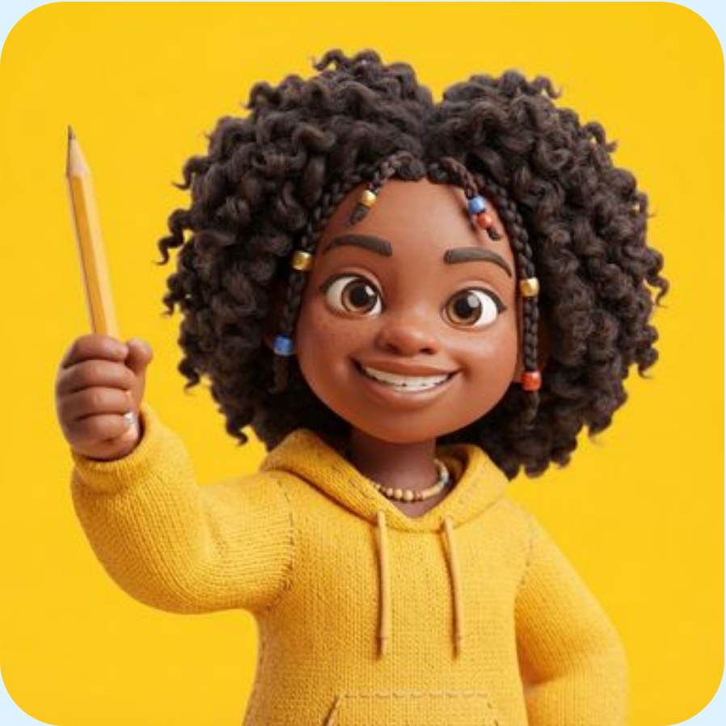
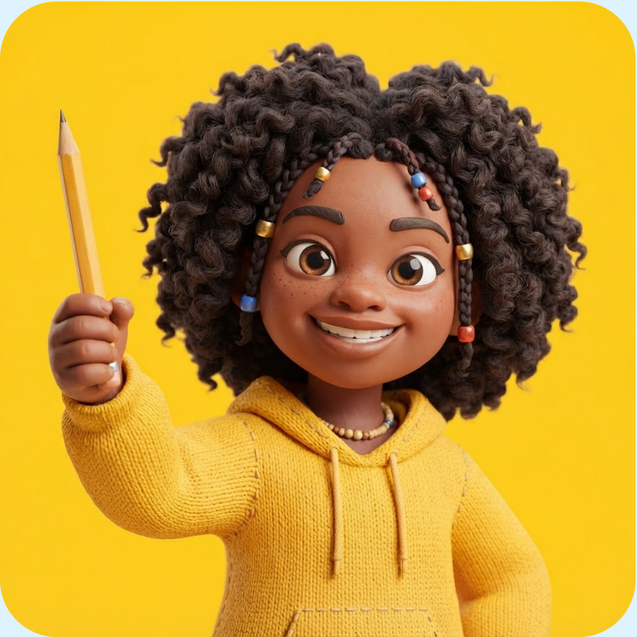
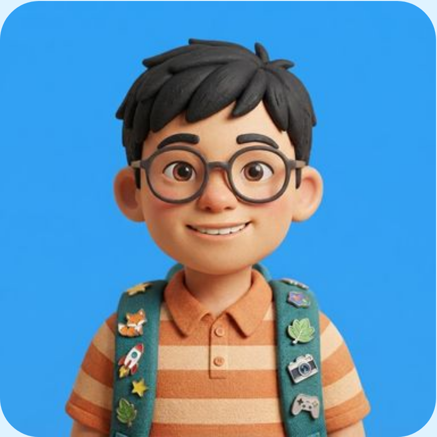
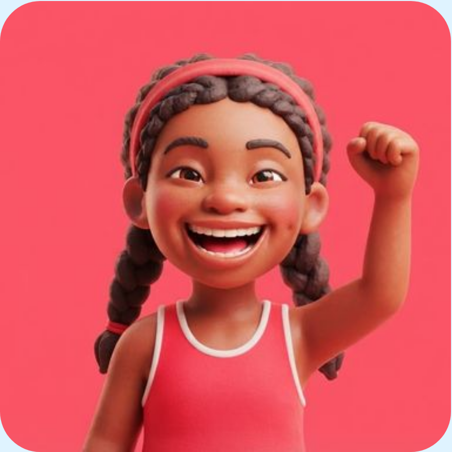
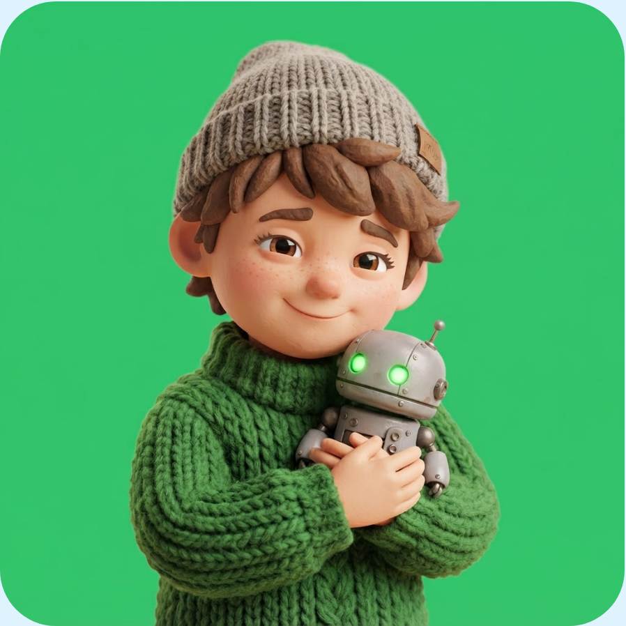
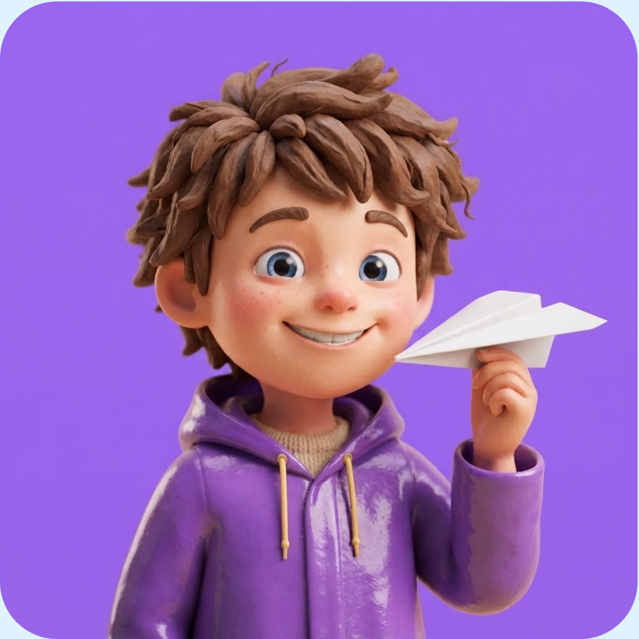

# 001 · Pick Your Kid stage portraits

The stage previously enlarged the 384 × 384 roster thumbnails. It now offers the original 1024 × 1024 Character Sheet JPEG for the selected kid. The browser chooses a source based on stage width and screen density. Small roster and nickname portraits still use the thumbnail.

Each pair shows the production Pick Your Kid stage in Chromium at a 1440 × 960 viewport and 2× pixel density. Open either image at full size to compare the edges and surface detail. The five larger JPEGs match the files referenced by the [Character Sheet](https://www.magicpatterns.com/os/nd2mtiXD3P5QJSqkJZwjJf?file=9ZtjxUsaAF7nTREppoivxt) byte for byte.

| Kid | Before | After |
| --- | --- | --- |
| Zuri |  |  |
| Kenji |  |  |
| Nia |  |  |
| Milo |  |  |
| Pip |  |  |
