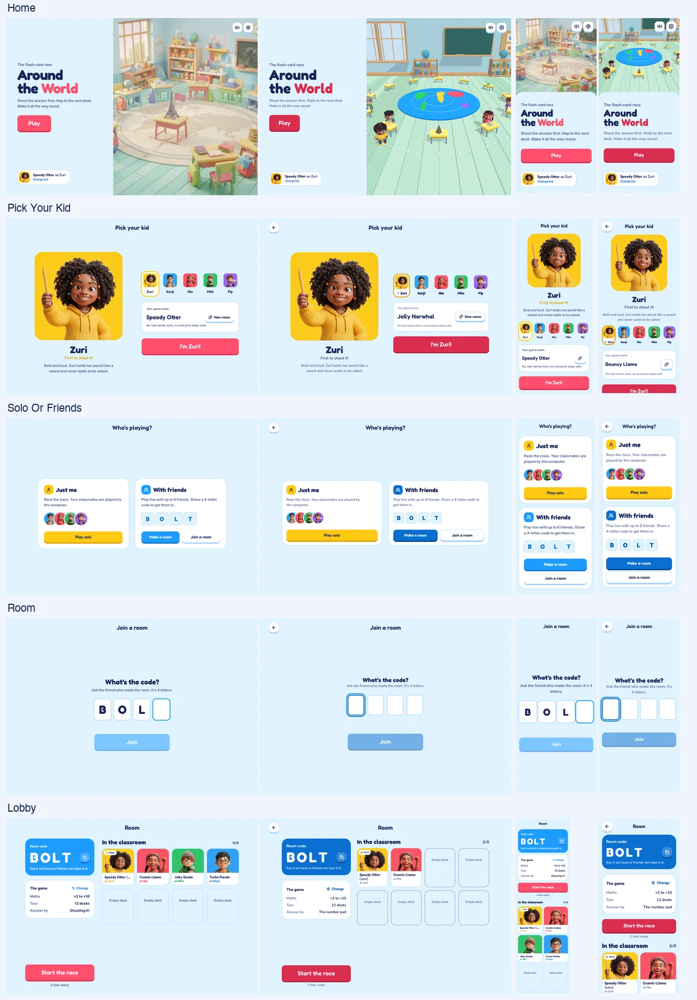
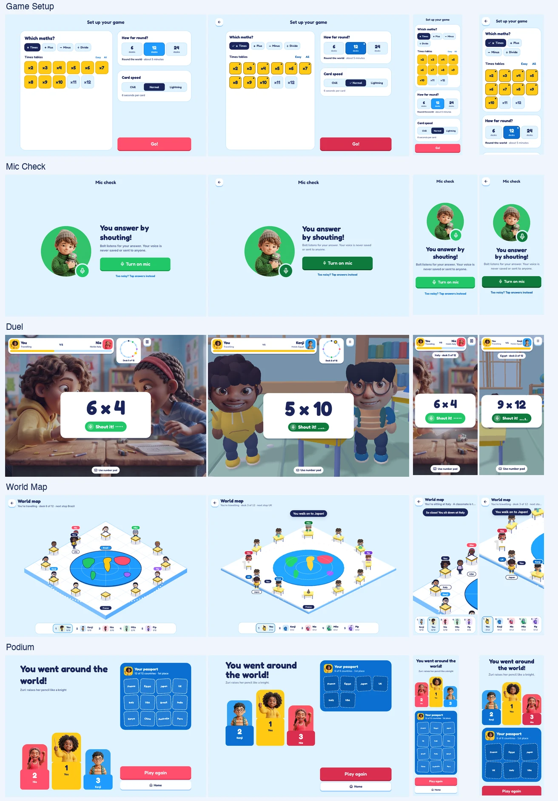

# Classroom tour visual review

Each row shows Magic Patterns beside the running game, first on desktop (1280 × 900), then on phone (390 × 844). Both images in each pair use the same viewport. [Around the World prototype](https://www.magicpatterns.com/os/nd2mtiXD3P5QJSqkJZwjJf)





## What the comparisons show

- Home, Duel and World Map draw the Blender classroom with the players, desk positions and camera for the current tour. The prototype uses a painted classroom still or an illustrated map. Lighting, geometry, camera framing and characters differ visibly.
- Pick Your Kid retains the Character Sheet portraits, kid colours and nickname control. Lobby, Duel and Podium use the current players, maths and passport. The prototype shows a prefilled room code and demonstration players. The fixture opens Room with an empty code and two players in Lobby.
- The game uses higher-contrast button fills, larger touch targets and accessible Back controls. On a narrow phone, Game Setup extends vertically to fit those controls. On Podium, the standings and passport reflect the finished tour.
- On World Map the traveller follows the dotted ring in six alternating steps over 1.4 seconds. The name tag follows the same curve while the classroom loads. Reduced motion uses a short fade. The film shows the movement from above and from the side. [Watch the game plan](../../videos/01-game-plan/01-game-plan.mp4)

## Verification

Twenty Chromium capture rounds exercised each of the ten screens at both sizes. All 400 captures succeeded with zero retries or skips. These checks establish repeatable coverage. The side-by-side images above are the visual comparison. The separate responsive, accessibility and visual sweeps passed all 87 cases. A Blender check sampled each of the six exported walk clips at 20 points and found a supporting sole within 0.22 mm of the floor at every sample.

From frontend, use a production build and run the requested sweep with the following command.

```sh
npx playwright test --config playwright.sweeps.config.ts --project magic-patterns --repeat-each=20
```
